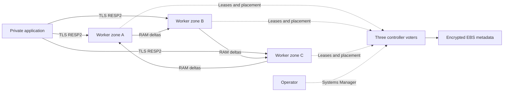

# Deploy a private Cache cluster on EC2

The reference stack has three controller voters and three Cache workers in separate availability zones. Each worker owns part of the primary keyspace and holds a RAM replica for slots owned in another zone. Controllers use dedicated encrypted EBS volumes for metadata. Run the same stack with six or twelve workers when a tested workload can use the additional primary groups.

The deployment starts instances without public IPs or SSH rules. It generates private DNS records for seed discovery and direct client routing. Workers verify controller and replica TLS identities, and clients authenticate to their permitted key prefixes.



## Prepare the release and credentials

Use Python 3.11+, OpenSSL, AWS CLI v2, and a versioned S3 bucket in the deployment region. The reference profile uses an AL2023 Graviton AMI with the AWS CLI, SSM Agent, chrony, ext4 tools, and VMClock device support. Verify that `/dev/vmclock0` works on the selected instance shape and AMI during acceptance. Both node kinds require a synchronized ClockBound interval, including after suspend and resume. [ClockBound 2.0.3 requirements](https://docs.rs/crate/clock-bound-d/2.0.3) · [AL2023 SSM Agent](https://docs.aws.amazon.com/systems-manager/latest/userguide/ami-preinstalled-agent.html)

Build the native Cache Linux release and the pinned ClockBound daemon for the same architecture, then pack an immutable S3 object.

```sh
scripts/cache-release/build-linux.sh ./releases
scripts/cache-ec2/build-clockbound.sh arm64 ./releases
mkdir -p ./releases/linux-arm64
tar -xzf ./releases/nabedra-cache-linux-arm64.tar.gz -C ./releases/linux-arm64 nabedra-db
sha256=$(python3 scripts/cache-ec2/prepare.py artifact \
  --binary ./releases/linux-arm64/nabedra-db \
  --clockbound-daemon ./releases/clockbound-linux-arm64/bin/clockbound \
  --output ./releases/cache-ec2-v1.tar.gz)
object_version=$(aws --region "$region" s3api put-object \
  --bucket "$bucket" --key nabedra-cache/cache-ec2-v1.tar.gz \
  --body ./releases/cache-ec2-v1.tar.gz --query VersionId --output text)
cat > artifact.json <<JSON
{"bucket":"$bucket","key":"nabedra-cache/cache-ec2-v1.tar.gz","version":"$object_version","sha256":"$sha256"}
JSON
```

For a new VPC, save a network document with the three availability zones in order. Instances and interface endpoints use these private subnets. Set the `applications` entries to private CIDRs used by the clients.

```json
{
  "cidr": "10.72.0.0/16",
  "zones": ["eu-west-1a", "eu-west-1b", "eu-west-1c"],
  "subnetCidrs": ["10.72.1.0/24", "10.72.2.0/24", "10.72.3.0/24"],
  "applications": ["10.72.4.0/24"]
}
```

For an existing VPC, supply three private subnet IDs in the same zone order. An application source can be a security group in that VPC.

```json
{
  "vpc": "vpc-0123456789abcdef0",
  "zones": ["eu-west-1a", "eu-west-1b", "eu-west-1c"],
  "subnets": ["subnet-0123456789abcdef0", "subnet-0123456789abcdef1", "subnet-0123456789abcdef2"],
  "applications": ["sg-0123456789abcdef0"]
}
```

An existing network needs working private DNS and access to S3, Secrets Manager, Systems Manager, and Session Manager messaging. The fresh network creates the corresponding interface endpoints and S3 gateway endpoint. To connect workloads to a fresh VPC, route the authorized client CIDRs to its private network and associate the private zone with the client VPC, or place the applications in the Cache VPC. [Systems Manager VPC endpoints](https://docs.aws.amazon.com/systems-manager/latest/userguide/setup-create-vpc.html)

Prepare bootstrap material once per cluster. The generator uses distinct certificates for each controller, worker and operator. The `catalog` profile is suitable for the provider fixture. For an application profile choose the actual namespace. Keep the signing key and the client credential file on a restricted machine.

```sh
domain=cache.example.internal
bootstrap_prefix=nabedra/cache/example
python3 scripts/cache-ec2/prepare.py credentials \
  --output ./bootstrap --domain "$domain" --network network.json \
  --bootstrap-prefix "$bootstrap_prefix"

jq -r '.[] | [.name, .file] | @tsv' bootstrap/secret-index.json |
  while IFS="$(printf '\t')" read -r secret file; do
    aws --region "$region" secretsmanager create-secret --name "$secret" \
      --secret-string "file://$PWD/bootstrap/$file" --query ARN --output text
  done
```

Instance roles can read only their own named bootstrap secret and the pinned artifact object. Controller 1 can also read the operator secret for SSM reconciliation. Use the regional AWS-managed Secrets Manager key for this reference deployment. The artifact bucket contains the binaries and scripts. Secrets Manager holds the credentials, and the CA signing key stays with its owner.

## Deploy and verify readiness

Run this single command after the release and bootstrap references exist. The instance and subnet preflight checks run before the stack change. `--render` prints the versioned CloudFormation template locally.

```sh
python3 scripts/cache-ec2/deploy.py \
  --region "$region" --stack example-cache --domain "$domain" --ami "$ami" \
  --network network.json --bootstrap-prefix "$bootstrap_prefix" \
  --artifact artifact.json --worker-type r7g.large --workers 3
```

The command waits for the controller quorum, enrolls workers, initializes the slot map, and returns the private `rediss://` seed list as JSON with readiness evidence. Readiness requires 16,384 live primaries and 16,384 verified cross-zone replicas. It also checks the advertised workers' certificate names and RESP service. The first host reconciles through SSM after the stack update. Repeat the same command to resume an interrupted deployment. The stock `catalog` client profile in `bootstrap/client.json` has the CA and the explicit allowlist for discovered clients. Read and import the installed `nabedra.cache` or `nabedra/cache` package when running application smoke tests. [Cache ORM contract](../../orm/cache-contract/README.md)

`--worker-memory-mib` sets the systemd cap. `prepare.py credentials --worker-cache-memory-mib` sets the worker's internal budget and allocates half to data. Leave RSS headroom between them. The defaults are 1,536 MiB and 1,024 MiB, respectively. Compare `r7g` and `c7g` shapes with your real key and value distribution and with an AZ absent. Use the paired benchmark's goodput at a matched p99 budget to compute instance, EBS and network cost per million correct operations. [Cache benchmark methodology](../testing/cache-benchmark.md)

## Growth, drain and instance faults

Re-run the deployment command with `--workers 6`, then `--workers 12` to grow. It enrolls workers, orders range moves, and waits until the requested group layout has verified replicas. To reduce the size, use a lower worker count. The controller must attest completion for every worker selected for removal before the command submits the CloudFormation shrinking change. Keep instance type, network, artifact, and TLS bootstrap references fixed during resize. Tail counts are 3, 6, and 12. Provider quotas still apply.

After a confirmed instance termination, re-run the command at the existing size with `--replace-failed-worker N`. The command checks the exact old instance is terminated before replacing its versioned launch template. The worker keeps its DNS name and starts with a fresh incarnation and empty RAM. Allow the controller to rebuild coverage before starting another operation.

A writable hot key has one primary. Growth distributes slots with independent keys. The optional planner evaluates recent memory, queue age, slot spread, CPU and network headroom observations along with cooldown, retries, zone reserve and declared price bounds. It refuses automatic additions until the operator has recorded K04b at 3, 6 and 12 groups, K05 and A01/A02 evidence. A fixed deployment without a configured provider gets an explicit unsupported result. [Growth planner](../../scripts/cache-ec2/growth.py)

Use `observations.py collect` on the operator host to update the latest three observations for a stable topology. It reads the controller before and after parallel worker samples and requires a match on the EC2 instance IDs, worker incarnations, and every primary's slot and epoch. It counts processed write commands and completion rates per slot. The memory ratio uses charged primary and replica data against the configured data cap. CPU uses the measured service cgroup usage against the smaller of the cgroup capacity and the declared qualified cores. Network includes all traffic on the configured interface. Collection requires readable cgroup v2 and interface counters.

Set the policy's `observation` object to the qualified worker profile. Supply `interface`, `sample_seconds` from 2 to 10, `slot_ops_per_second` for the slot pressure threshold, `cpu_cores`, and separate `network_rx_bytes_per_second` and `network_tx_bytes_per_second`. The policy also needs `fixed_monthly_cost_units` for the estimated nonworker charges, plus `zone_cpu_ratio_limit`, `zone_rx_ratio_limit`, `zone_tx_ratio_limit`, and `zone_rss_limit` between zero and one. The zone check allows for each survivor's measured utilization plus the traffic of one lost zone. The provider acceptance still measures failover and replica restoration. Schedule collection often enough to cover the planner's sustained window within its maximum observation age. A topology or provider stack change begins a new observation window. The collector uses read-only commands on the stack's current instances through SSM.

```sh
python3 scripts/cache-ec2/observations.py collect --policy growth-policy.json \
  --output recent-observations.json
```

Schedule the qualified planner on one operator host and keep its state file on persistent local storage. Create the state directory first. Pass the same deployment arguments in a JSON array without `--workers`. The policy names the exact `region/stack`. Use recent observations and prices expressed in a common unit. A local lock admits one automatic operation. After a lost response, the next run reads the live CloudFormation stack before retrying. The planner never launches a second addition while an update is in progress. Removal still requires an explicit deployment command and a committed drain.

```sh
python3 scripts/cache-ec2/growth.py --policy growth-policy.json --observations recent-observations.json \
  --apply --deploy-args auto-deploy-args.json --state-file ./private-state/cache-growth.json
```


For an existing EC2 fleet, install the same pinned binaries, ClockBound unit, and node config with the bootstrap script extracted from the verified artifact. Attach the encrypted metadata device to each controller and pass its volume ID. Workers pass `-` instead of a volume.

```sh
tar -xOzf ./releases/cache-ec2-v1.tar.gz bootstrap.sh > bootstrap.sh
sudo bash bootstrap.sh "$region" controller 1 "$bootstrap_prefix/controller/1" \
  "$bootstrap_prefix" "$bucket" nabedra-cache/cache-ec2-v1.tar.gz \
  "$object_version" "$sha256" "$controller_volume" 1024 ./releases/cache-ec2-v1.tar.gz
```

Install other nodes with their own role, ID and secret. Set private DNS to their IPv4 endpoints. Use the controller 1 operator configuration and run `python3 /usr/local/lib/nabedra-cache/reconcile.py apply --workers 3` on that host. The manual bootstrap needs the same AWS role access to download per-node secrets. Check `journalctl -u nabedra-cache` and `journalctl -u clockbound` through Systems Manager. The worker atomically updates `/run/nabedra-cache/metrics.json` with actor and replica progress observations. When rolling credentials, issue the new certificate with the same advertised name. Stage old and new fingerprints in the replacement worker ticket and worker config, restart the worker and confirm coverage, then repeat with only the new fingerprint. Keep the client and peer CA trust bundles compatible through those restarts.

## Provider acceptance

Run from a client host with private access to the endpoints and stable access to the two built ORM packages. Supply an array of CLI arguments for the deployment as `deploy-args.json`. For a clean deployment use a fresh stack name. The provider runner can stop, restart, terminate and resize instances in the named fixture.

```sh
python3 scripts/cache-ec2/provider_acceptance.py \
  --disposable-stack --deploy-args deploy-args.json --client bootstrap/client.json \
  --packages ./orm-release-artifacts --output ./provider-results.json \
  --scenarios deploy,idempotent,rolling,grow-drain,az-loss,cold,forced-termination
```

The runner installs both package artifacts and executes K05 write/read/expiry with its shared oracle. It records controller coverage timing and scheduled operation outcomes through both ORMs during rolling operations, growth, AZ loss, and forced termination. The raw JSONL includes origin refill misses and unknown write outcomes. K04b requires the separate matched Valkey multi-instance load and readings at each group count. Pass `--failure-args` for the provision-failure history using a fixture principal denied permission to launch additional workers. It requires new CloudFormation failure events for those workers and verifies the previous cluster still serves. Pass `--rotation-fixture` with the worker node, its previous and replacement SHA-256 fingerprints, and `stage` and `finish` SSM shell-command arrays to exercise both trust phases. Unselected scenarios appear as unexecuted. [Cache release cases](../../plans/cache.md) · [Scheduler contract](../testing/scheduler-contract.md)

Run the template, secret-format and drain preflight assertions locally in Docker.

```sh
docker run --rm --network none \
  --mount "type=bind,source=$PWD/scripts/cache-ec2,target=/work,readonly" \
  -w /work nabedra-oltp-perf-builder:1.94.1 \
  sh -ec 'python3 -B -m unittest test_deployment; bash -n bootstrap.sh'
```
