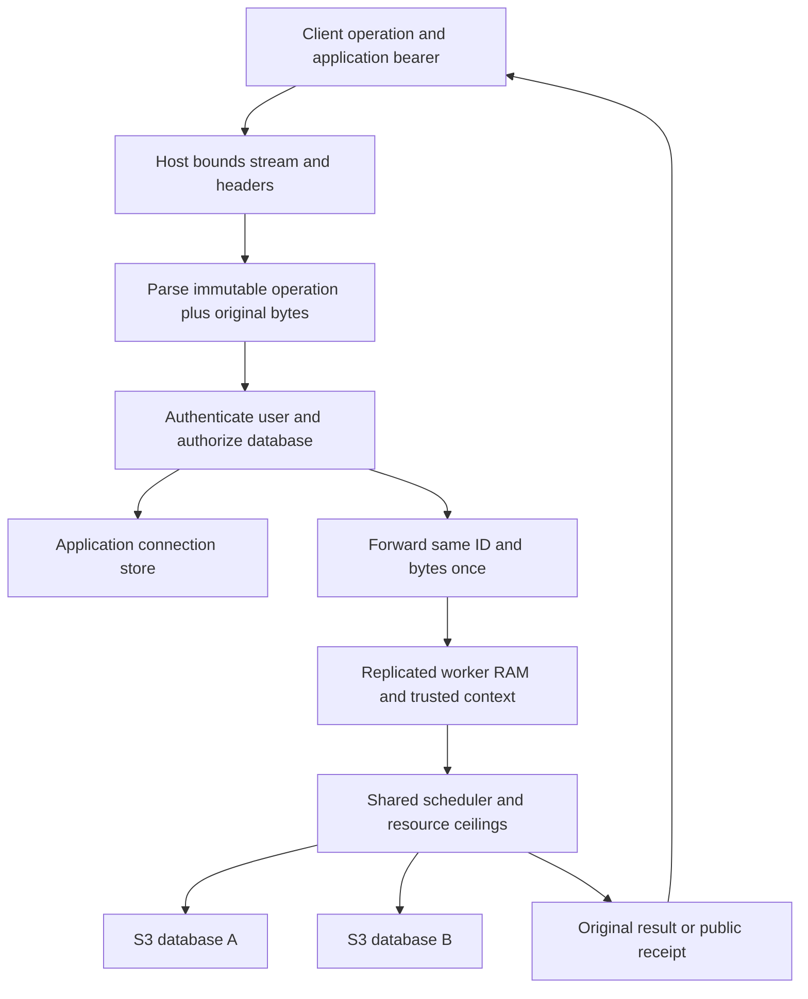

# CLI and server gateway

Install from this checkout on Linux or macOS with Python 3.11+ and the repository's Rust toolchain:

```sh
python3.11 scripts/install_meshdb.py --prefix .meshdb
.meshdb/bin/meshdb --version --json
.meshdb/bin/meshdb --help
```

The installer runs a locked release build and copies the executable into the isolated environment. It honors `CARGO_TARGET_DIR`. Startup resolves `MESHDB_SERVER_BINARY`, the environment-local executable, then `PATH`; it never invokes Cargo. An invalid explicit override is an error. No package or image upload is required.

Activate `.meshdb/bin/activate` for the commands below. Install the server integration into an application environment with `python -m pip install '/path/to/meshdb/orm[gateway]'`. Add `[aws]` when using Boto3 discovery. Core ORM imports and CLI help require neither dependency and resolve no credentials.

## Configure and run

```sh
meshdb init --mode serverless \
  --control-storage s3://meshdb-ops/production/ --region eu-west-1 \
  --data-token-file /run/secrets/meshdb-data --output meshdb.json \
  --non-interactive
meshdb doctor --config meshdb.json --json
meshdb serve --config meshdb.json --local-workers 2 --threads-per-worker 4
```

`init` provisions nothing and refuses overwrites. It writes version 2 JSON and protected auth material, printing paths only. Preserve those secrets on protected storage. Version 1 remains supported. In serverless mode the configured storage is operator control storage; customer credentials belong only in trusted request context. Use distinct admin, enrollment and gateway data tokens.

`serve` owns its API and local worker processes in the foreground. `meshdb.serve.launched` means the API is ready and worker processes have launched; check cluster status for worker enrollment. `--local-workers` counts processes and `--threads-per-worker` bounds each process. The Rust `serve --workers` flag retains its thread meaning. Local replicas on one host do not provide separate failure domains. Signals drain and reap owned children; a failed child produces a failing status. Explicit `--cold-start` retains its fencing meaning; do not use heartbeat expiry as proof that old writers stopped.

Fixed mode uses configured operator credentials and existing token behavior:

```sh
meshdb serve --mode fixed --storage s3://app-a/meshdb/ --region eu-west-1
meshdb worker --bootstrap /run/secrets/worker.json
meshdb cluster status --url https://compute.example.com \
  --admin-token-file /run/secrets/admin --json
meshdb cluster scale 2 --url https://compute.example.com \
  --admin-token-file /run/secrets/admin --json
```

Scaling provisions only through a configured provider. `doctor` checks configuration, versions, secret permissions and storage reads. It never tests writes; a passing diagnosis does not establish write permissions. Exit codes are 0 for success, 2 for argument/configuration errors and 1 for runtime failures, with signal termination preserved.

Before migrating an existing catalog, stop every old writer and choose the intended owning cluster UUID from the cluster configuration. Owner identity cannot be inferred safely:

```sh
meshdb database migrate --storage s3://app-a/meshdb/ --region eu-west-1 \
  --cluster-id 11111111-1111-4111-8111-111111111111 --confirm-writers-stopped
```

Do not perform live cross-cluster transfers. Complete worker shutdown abandons outstanding requests; committed mutations remain durable. Pending requests are replicated in worker RAM and are never replayed from object listings or Redis.

## Host an application endpoint

The client uses its existing ORM against the application's endpoint:

```python
from meshdb import DB

db = DB('https://app.example.com/meshdb', application_token, database='authorized-selector')
```

`database` is optional untrusted input. The application authenticates the user and authorizes that selector. The client receives no AWS credentials. The server integration accepts plain HTTP values:

```python
from meshdb.gateway import Gateway, GatewayContext, S3

gateway = Gateway(cluster_url='https://compute.internal',
                  token=private_compute_token, mount_path='/meshdb')

@gateway.middleware
async def authorize(ctx: GatewayContext):
    user = await authenticate(ctx.headers.get('authorization'))
    if user is None:
        ctx.reject('unauthorized', 'Authentication required')
    connection = await authorized_connection(user.id, ctx.database)
    ctx.principal = user.id
    ctx.storage = S3(connection.bucket, region=connection.region,
                     prefix=connection.prefix, credentials=connection.credentials)

async def endpoint(method, target, header_pairs, raw_body):
    return await gateway.handle_async(method=method, path=target,
        headers=tuple(header_pairs), body=raw_body)
```

`authenticate` and `authorized_connection` are application-owned functions. The server routing code maps the returned `HTTPResponse.status`, `.headers` and `.body` directly to its response. It does not inspect operation fields or reconstruct the operation with ORM methods. `target` includes any query string and is never a full URL. Supply original duplicate header pairs.

The host must stop collecting its input stream at 8 MiB, regardless of declared length. It must also bound headers, concurrent connections and read deadlines before allocating bodies. Gateway's post-read check cannot recover host memory already allocated. The finite loopback fixture in `scripts/gateway_host_fixture.py` demonstrates incremental collection and rejects oversized chunk lengths before reading their data; it is test infrastructure, not a production HTTP server.

Gateway bounds operation/response bodies at 8 MiB, decoded storage context at 16 KiB, its encoded header at 24 KiB and total headers at 32 KiB. Configure reverse proxies with matching caps. Only the approved operation/receipt paths pass. Each receipt access runs middleware again. The helper removes the mount prefix, preserves the exact original operation bytes/ID and submits once. It consumes the application bearer and database selector, adds trusted storage context and compute authentication, and drops arbitrary client headers/cookies. Never pass external identity or storage headers through.

Use `async with gateway` for its application worker lifetime, or `with gateway` for synchronous hosts; explicit `aclose()`/`close()` are available. `handle()` accepts synchronous middleware. `handle_async()` accepts async middleware and runs synchronous callbacks in bounded threads. Python cannot kill a running synchronous callback: timeouts stop waiting but keep its capacity charged until it returns. Give middleware and credential providers their own finite I/O deadlines. Shutdown cannot guarantee interpreter exit if application callbacks never return.

`AwsCredentials` accepts a UTC `expires_at`; the wire timestamp floors fractional seconds. `S3` accepts these credentials or a zero-argument provider. Prefixes are nonempty safe paths, normalized with one trailing slash; root prefixes are unsupported. Supported regions belong to the standard, China or US Gov partitions. `meshdb.aws.default_credentials(profile=None)` lazily creates a persistent Boto3 session. Prefer scoped temporary credentials and role references. Never use a request UUID as authentication.

A lost or invalid response after possible mutation forwarding yields `503 outcome_unknown` for the original ID. Never resubmit automatically. Accepted work retains its credential snapshot on workers; fresh credentials on a receipt request do not renew a pending snapshot. Responses retain original JSON bytes/status and use `Cache-Control: no-store`. Receipt locations use the public mount.



## Local image and deployment

```sh
docker build -t meshdb:local .
docker run --rm -p 8000:8000 \
  --mount type=bind,src="$PWD/deploy",dst=/etc/meshdb,readonly \
  meshdb:local serve --config /etc/meshdb/meshdb.json
```

Put the config and protected secret files under the mounted directory with container-readable paths. Configure a workload role for control storage, verified TLS for external API/worker links, and an explicit reachable bind/advertise address. Listeners default to loopback. Separate workers use `worker --bootstrap /run/secrets/worker.json`. No daemonization, cloud provisioning or registry upload occurs automatically.

The final release passed fresh-prefix installation and all 13 installed S3 assertions, including two enrolled workers, database isolation, replay/conflict handling, receipt authorization, signal drain and catalog migration. See the [execution ledger](testing/cli-serverless-evidence.md) for commands, failure regressions and scope. Live STS rotation, IAM revocation, worker crash recovery and full scheduler/load acceptance remain separate. The local Docker image was not built because the Docker daemon was unavailable.
