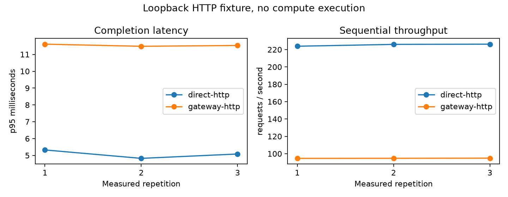

# CLI and serverless execution evidence

The results below predate the Nabedra Database rename. Recorded measurements,
commit hashes, source hashes and raw artifacts retain their original provenance.
Reproduction commands use the current names; these historical assertions were
not rerun for the rename. See [the archive policy](evidence/README.md).

The final release passed fresh-prefix installation and the installed real-S3 acceptance subset on 2026-11-16. The final review then fixed two Python issues and passed the 20 core variations below. The [implementation plan](../../plans/cli-and-serverless.md) and [scheduler contract](scheduler-contract.md) retain the complete requirements. Scenario IDs identify exercised assertions, not a claim that every assertion in each scenario passed.

## Final core review

Following the user's request for at most five essential categories, final QA selected four categories and 20 variations. It reused completed installation/S3 evidence and existing compiled tests. No new load benchmark or live AWS run was needed for the final Python corrections.

| Category | Variations | Executed assertions and boundaries |
| --- | ---: | --- |
| Exact forwarding and rejection, GW01-GW03, SL06, U02 | 5 | Preserve original body/UUID and middleware order; reject malformed/forged/oversized input without forwarding; return uncertain mutation outcomes after exactly one forward; preserve receipt/error bytes and reauthorize receipts; reject overloaded sync/async calls without parsing their bodies or blocking the event loop. |
| CLI lifecycle, CLI01/CLI02 and F03 subset | 3 | Reuse the compatible binary selected from PATH for both API and worker despite an incompatible environment-local binary; preserve worker failure status; signal, drain and reap children. Real subprocesses implement the startup protocol. |
| Database isolation and grants, SL01/SL02, Q05, U02, M02 subset | 5 | Actual one/two-worker first-use and same-ID/table/row isolation; reauthorize warmed data and receipts; preserve accepted credential snapshots during rotation; reject forged replica context; use explicit SDK credentials and retain memory charges through storage clones. Trusted loopback object stores exercise workers; IAM evidence is separate below. |
| Receipt recovery, Q04-Q06, T04 and SL03 subset | 7 | Five virtual-clock API cases cover single submission, exact retry/backoff bounds, deadline cancellation, long healthy waits, nontransient/foreign/malformed replies and terminal errors. Two queue cases cover immutable terminal replication/reconciliation and expired accepted credentials retaining an unknown mutation outcome. |

[Python core output](evidence/cli-serverless/final-python-core.txt): 8 passed in 3.708 seconds. [Rust core output](evidence/cli-serverless/final-rust-core.txt): 12 passed in 4.71 seconds with default S3 features. These are the final core results, rather than an aggregate of earlier overlapping suites. The selected fully qualified test names are in those logs and [the core manifest](evidence/cli-serverless/final-core.json).

Both final Python regressions failed before their fixes. Overload rejection called the complete JSON parser after admission had already failed; it now uses only the request ID captured by admitted parsing. Before parsing, errors have a null request ID. An admitted invalid payload still returns its validated ID after exactly one parse. The CLI selected a compatible PATH executable but resolved again when launching its API; it now passes the selected binary through to the owner. Existing public `serve()` callers keep their default resolution. The focused regression verifies actual API/worker startup and reaping in that fallback configuration.

The review initially started broader checks before the user's narrowing instruction. Existing Python checks completed, including 141 non-gateway/AWS tests and 21 gateway/AWS/host tests, before these final fixes. Rust compilation passed in 1 minute 41 seconds; the broad library run was stopped after 155 assertions and is not reported as a full-suite pass. The final 12 Rust selections reused that executable without recompilation. No further blanket reruns were made. The [final staged-file scan](evidence/cli-serverless/final-secret-scan.json) found no supplied credentials or newly introduced private fixture bucket text.

## Installed real-S3 acceptance

The [final installed run](evidence/cli-serverless/native-s3-final.json) passed all 13 listed assertions in 118.336 seconds through one API, two enrolled native worker processes and a real HTTP gateway host. It used fresh prefixes in the supplied private S3 fixture and the final Rust release SHA-256 `91b239b1c417da288c68abf295dc375b69cf58704b11192492977fd297a75a49`.

The run verified conditional create/update and stale-ETag rejection; isolated create/list/row operations with the same request IDs and bytes across database prefixes; same-database replay and changed-body conflict; warmed-data and receipt rejection with synthetic invalid AWS credentials and no operator-role fallback; known-expired snapshot rejection; once-only durable decisions; no customer secrets or pending request IDs in control objects; status-only host diagnostics; signal drain/reaping without Cargo startup; read-only doctor with unchanged objects; and explicit legacy migration with foreign-owner rejection. Installed core imports ran with optional dependencies absent and network calls blocked. All owned children were reaped, and the [process check](evidence/cli-serverless/final-process-cleanup.json) found no remaining native services or build processes.

This live run preceded the final Python overload/binary-selection corrections. Rust production source is unchanged since that run. Final core tests and fresh packaging checks validate the Python corrections separately; the live report is retained for its exact tested version.

The [fresh-prefix installer](evidence/cli-serverless/install-final.json) passed in 23.588 seconds using the warm locked release cache. [Installed version/help/hash checks](evidence/cli-serverless/installed-final-commands.json) passed with Cargo absent from PATH. The first completed release install took 2097.553 seconds, including dependency compilation; [its report](evidence/cli-serverless/install-release-fixed.json) and [sanitized build log](evidence/cli-serverless/install-release-fixed.txt) remain available. After the final Python fixes, [fresh packaging](evidence/cli-serverless/final-packaging.json) passed in 21.107 seconds without recompiling Rust. Installed help/version, isolated imports with optional dependencies and network blocked, binary integrity and all three changed Python module hashes matched the source. The [sanitized install log](evidence/cli-serverless/final-install.txt) records that run.

Real-S3 limits remain explicit: no live STS rotation, IAM revocation, expiry during accepted execution, cross-bucket isolation, equal table UUIDs in this AWS fixture, worker-crash failover, full scheduler contract, RSS ceiling certification, autoscaling or load acceptance. Known-expired metadata is a local rejection test. Overlapping clients do not prove simultaneous compute-slot occupancy. Doctor's before/after object snapshot is not an S3 audit log. The Docker client exists but its daemon was unavailable, so no image build or upload is claimed.

## Publication and receipt regressions

The [terminal reconciliation record](evidence/cli-serverless/worker-terminal-reconciliation.json) captures a failing deterministic one/two-worker barrier before the fix and passing runs afterward. A lookup after local terminal settlement but before replication acknowledgments must reuse the immutable terminal record, finish replication and preserve the accepted credential snapshot. Mismatched decisions still conflict. The final core selections execute these assertions again.

The [receipt observation record](evidence/cli-serverless/receipt-observation-recovery.json) captures a before-fix `503` versus expected `200` failure. The synchronous route now submits once and only retries transient receipt observations. Each retry reloads authority and signs a fresh lookup. Three consecutive transient failures exhaust recovery after 50/100 ms backoffs, with a five-second recovery window. Healthy pending receipts reset that window, preserving long queue waits. Authorization, validation, identity and terminal-operation errors retain their separate behavior. Deadline cancellation releases observer ownership and never resubmits work.

Earlier integration checks passed 46 tests across API, CLI, queued API, fenced requests, history, publication and runtime. After receipt observation changed, the affected API/queued/fenced targets passed 17 tests, queue runtime six and actual worker configurations two. Storage/queue and no-S3 node checks also passed as recorded in earlier reports. These overlapping counts are historical evidence, not another final suite total. Catalog ownership/migration and same-root conditional fencing were reviewed against those assertions; the final live run also exercised migration and foreign-owner rejection.

The historical [40.492-second installed failure](evidence/cli-serverless/native-s3-installed.json) returned `503 outcome_unknown` despite a later succeeded receipt. Its failing operation was not recorded, so its exact cause remains unexplained. A [fresh run of the unchanged binary](evidence/cli-serverless/native-s3-installed-diagnostic.json) then passed 13 assertions in 124.395 seconds. Bounded observation recovery has its own deterministic proof; it is not presented as a diagnosis of that historical event. The final installed run above passed after that correction. The [earlier first-mutation diagnostic](evidence/cli-serverless/native-diagnostic.json), [patched debug pass](evidence/cli-serverless/native-s3-fixed.json), interrupted installer and sanitized logs remain available without replacing failures with later passes.

## Gateway overhead

The [raw benchmark](evidence/cli-serverless/gateway-http.json) ran in a quiet window with warm-up and three repetitions of 100 sequential requests per path. All 600 measured IDs/body digests matched the serial oracle, with zero missing or duplicate operations. It compares direct loopback HTTP with gateway HTTP, which adds middleware and a second hop. Tracemalloc was enabled for both paths; middleware authorization was in memory. Combined-process RSS is a cumulative high-water observation.



The [SVG](evidence/cli-serverless/gateway-http.svg) and [source hashes](evidence/cli-serverless/gateway-sources.json) identify that measurement. It predates the final overload-correlation correction; no final-code speedup claim is made. It establishes no shared-worker throughput, queue latency, tenant-load capacity, S3/network cost or autoscaling result. The final overload regression checks absence of parsing directly instead of using timing thresholds.

## Reproduce

The core manifest lists the selected test names. With Python 3.11+, HTTPX and the local ORM available, invoke its eight names through `python -m unittest -v`, with `PYTHONPATH=orm/src:orm/tests`. Build the locked default-feature Rust lib test binary once with `cargo test --locked --lib --no-run`, then pass the manifest's 12 names to that executable with `--exact --test-threads=1`. Use one build job and a shared Cargo target on resource-constrained hosts.

```sh
CARGO_BUILD_JOBS=1 python3.11 scripts/install_nabedra.py --prefix /tmp/nabedra-clean-install
/tmp/nabedra-clean-install/bin/nabedra --version --json
/tmp/nabedra-clean-install/bin/nabedra --help
python3.11 scripts/acceptance_serverless_s3.py \
  --env-file /path/to/private/acceptance.env \
  --binary /tmp/nabedra-clean-install/bin/nabedra-database-server \
  --cli /tmp/nabedra-clean-install/bin/nabedra \
  --output artifacts/cli-serverless/native-s3.json
```

Use only a supplied safe fixture. The harness allocates fresh prefixes, keeps credentials/identifiers private, and never deletes existing objects. Conditional PUT probes use Boto3 with explicit credentials, verified TLS, no proxies, finite deadlines and one attempt. HTTP fixtures are separate from actual S3 evidence. No full Q/C/M/R/T/F/U/A/B scheduler scenario is declared passed by these subsets. The implementation keeps requests in replicated worker RAM; full worker shutdown abandons unfinished work while committed mutations remain durable.
