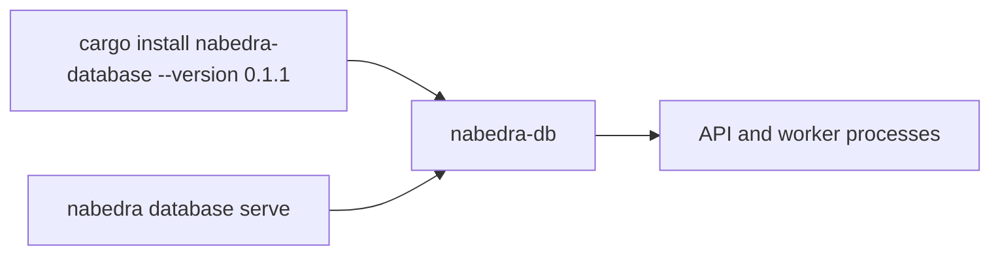

# Native command 0.1.1 release

The Rust crate remains `nabedra-database`; version 0.1.1 installs `nabedra-db`.
Its library remains `nabedra_database_server`. The product CLI remains
`nabedra database <command>` and now resolves the shorter executable in this
checkout. Python 0.1.0 on PyPI still expects the former executable; this release
does not republish Python. The ORM HTTP interface is unchanged.



The binary target, Clap help/version identity, diagnostic prefixes, installer,
Dockerfile, Python binary resolver, Kubernetes worker bootstrap and script
defaults use the new command. Old release evidence retains its original names.
The lockfile changes only the root package version; dependencies are unchanged.

## Executed checks

Validation ran on 2026-11-16 with Cargo/rustc 1.99.1 and Python 3.11.10 on macOS
x86_64. Cargo reused the shared target directory with two jobs, dev/test debug
information disabled and incremental compilation disabled.

```sh
cargo fmt --manifest-path server/Cargo.toml --all -- --check
cargo test --manifest-path server/Cargo.toml --locked \
  --test cli --test startup --test rename_compatibility
PYTHONDONTWRITEBYTECODE=1 PYTHONPATH=orm/python/src \
  python3.11 -m unittest discover -s orm/python/tests -v
PYTHONDONTWRITEBYTECODE=1 PYTHONPATH=orm/python/src \
  python3.11 -m unittest discover -s scripts -p test_server_process.py -v
cargo publish --manifest-path server/Cargo.toml --registry crates-io \
  --locked --dry-run --allow-dirty
```

- All seven targeted Rust tests passed. The new regression asserts the exact
  `nabedra-db 0.1.1` root version banner and the renamed help usage. Existing
  startup, TLS failure, storage identity and template fingerprint checks passed.
  The final incremental build took 1.81 seconds; test execution took 3.09 seconds.
- All 177 Python tests passed in 72.281 seconds. These include executable
  resolution, incompatible-version rejection, literal argument forwarding,
  subprocess supervision, installer paths and provider command generation.
  The resolver regression verifies that the product CLI reports its own 0.1.0
  version separately from native binary version 0.1.1.
- All three process-helper tests passed in 3.006 seconds. Their R04-related
  guard rejects replacement before child exit is confirmed; this is not the
  full R04 scheduler scenario.
- All 27 Python scripts parsed successfully. `git diff --check` passed.
- Cargo's publication dry run packaged 199 files and rebuilt the extracted
  crate with default S3 support in 48.49 seconds. Archive inspection confirmed
  only the `nabedra-db` binary target, the lockfile and MIT license. It found
  no dotenv files, private keys, Cargo credentials, Git metadata or build output.

## Real process smoke test

```sh
PYTHONDONTWRITEBYTECODE=1 python3.11 scripts/acceptance_nabedra.py \
  --binary "$SHARED_CARGO_TARGET/debug/nabedra-db" \
  --output artifacts/db-command-0.1.1/integration-source.json
```

All eight assertions passed in 38.702 seconds using the real native binary and
the source Python CLI against a loopback conditional SQLite object service.
The [report](db-command-0.1.1/integration-source.json) records the executable and
Python source hashes. The CLI and binary reported versions 0.1.0 and 0.1.1.

The C01/U01 subset enrolled one actual two-thread worker and verified exact
insert/get/filter results for 10, 100 and 1,000 rows. Both client modes read the
same 1,110 rows. The R04 subset verified committed rows after an explicit cold
restart. The F03 subset checked SIGTERM cleanup and reaping for both starts.
These are the named subsets only, not full C01/U01/R04/F03 acceptance. AWS,
Kubernetes, full scheduler/load scenarios, Docker image builds and the release
optimization profile were not exercised by these checks.

## Publication

Published [nabedra-database 0.1.1](https://crates.io/crates/nabedra-database/0.1.1)
on 2026-11-16 with the existing Cargo credential. The authenticated upload
rebuilt the extracted crate in 50.37 seconds, and Cargo confirmed registry
availability. The archive records clean commit
`1b6caa34eded82ea22559dad276d51ee95646b3f`, tagged
`nabedra-database-v0.1.1`.

The 700,629-byte upload and subsequent registry download have the same SHA-256:

```text
02ad18b87ad3535b56daf1342cd7b507c57a50a91480ecfd83cd166ef3a9ce8b
```

The [publication record](db-command-0.1.1/publication.json) captures the archive
identity. A fresh installation ran from a temporary directory outside the
checkout, used crates.io as its source, and reused the shared dev-profile
build cache to limit disk usage:

```sh
cargo install nabedra-database --version 0.1.1 --registry crates-io \
  --locked --debug --root "$FRESH_PREFIX"
"$FRESH_PREFIX/bin/nabedra-db" --version
# nabedra-db 0.1.1
```

The [installation report](db-command-0.1.1/registry-install.json) confirms that
`bin/` contains only `nabedra-db`. Root, serve and worker help succeeded with
the new name. The source Python CLI discovered the installed binary and
reported native version 0.1.1 while retaining product CLI version 0.1.0.
No globally installed executable was replaced.
