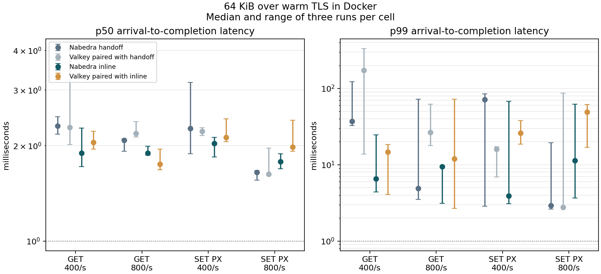

# Native cache test evidence

All cache performance measurements here ran in Docker Desktop's Linux amd64 VM with eight logical CPUs. Release qualification in EC2 was outside the test environment for this change. The samples measure client arrival to completion and retain separate service timing, the tested binary checksums and sanitized configuration.

- [Paired stock RESP2 and installed ORM diagnostics](docker-paired-raw.tar.gz) contain 20 TLS pairs and 10,000 correct operations. The reference was Valkey 8.1.11. The native binary SHA256 starts with `9c4547a9db22`. The stock driver covered 64 B, 1 KiB and 64 KiB. Both installed 0.2.0 ORM paths covered 64 B. Each cell contains one 250-sample pair.
- [64 KiB actor experiment](docker-inline-raw.tar.gz) contains 72,000 correct operations across the queued handoff and inline actor variants, each measured in three pairs of 1,500 samples per cell. The inline binary SHA256 starts with `fddcb2f6fe35`. Valkey ran sequentially on the same server CPU with the same data and memory profile for every pair.

Times below are medians of the three per-run p50 and p99 values, in milliseconds. The two Valkey columns show the independently measured reference for each comparison.

| TLS operation and offered rate | Handoff p50 / p99 | Paired Valkey p50 / p99 | Inline p50 / p99 | Paired Valkey p50 / p99 |
| --- | ---: | ---: | ---: | ---: |
| GET, 400/s | 2.311 / 37.172 | 2.284 / 172.893 | 1.895 / 6.554 | 2.048 / 14.687 |
| GET, 800/s | 2.083 / 4.924 | 2.184 / 26.703 | 1.894 / 9.433 | 1.750 / 11.984 |
| SET PX, 400/s | 2.268 / 71.315 | 2.222 / 16.036 | 2.035 / 3.898 | 2.124 / 26.110 |
| SET PX, 800/s | 1.649 / 2.909 | 1.629 / 2.773 | 1.784 / 11.366 | 1.982 / 49.146 |

The inline runtime removed two async task handoffs per idle turn. Docker tail variation affected both engines, and the largest cells in the initial run lagged Valkey. The follow-up retained 1,500 samples per run and did not qualify a sustainable 1 ms lane. K04a requires at least 10,000 samples per run and the specified same-host EC2 environment. K04b and K05 also require provider evidence. [Reproduction and scoring](../../cache-benchmark.md)

## Direct ingress and cluster diagnostics

The release after bounded direct reads into the RESP input buffer ran three
pairs of 10,000 samples at 650 offered operations per second for 64 KiB GET
hits and SET PX. All 120,000 operations were correct. Median per-run
p50/p99 was 1.842/64.343 ms for Nabedra GET and 1.890/66.750 ms for Valkey.
SET PX measured 1.731/38.604 ms for Nabedra and 1.829/93.760 ms for Valkey.
Both engines delivered a median above 649 correct operations/s in each cell.
Neither reached the 1 ms p99 budget at this offered rate. This fixed-rate
Docker run cannot certify either the latency or sustainable goodput gates.
[Raw schedules, configurations and results](docker-direct-ingress.tar.gz)

[Standalone Docker assertions](docker-standalone.json) cover both pinned
stock RESP2 clients and both installed Cache APIs against native Nabedra and
Valkey. They include limits, ACLs, expiry, eviction and independent session
progress. [Cluster Docker assertions](docker-cluster.json) cover direct
routing and same-slot batches, a verified replica prefix followed by primary
pause and promotion, minority lease expiry, controller WAL recovery, online
move and full-fleet cold reset.

The actual distributed benchmark runner executed its three-group TLS
profile in Docker through all three driver paths. It returned 432 correct
operations across 18 runs, including 90 verified SET PX values and deadlines.
The driver saw all slots and one replica per primary on both engines. The
small sample and single-host network establish runner interoperability.
[Raw three-group diagnostic](docker-three-group-pair.tar.gz)

## Other verification

- Cache-only Rust matrix passed 39 tests. The suite includes the OpenRaft log
  contract, clock bounds, stale authority and replication gaps, bounded
  promotion and snapshot allocation, and readiness based on locally
  installed leases. All five feature dependency-graph checks passed.
- The default OLAP and OLAP-only Rust matrices passed in Docker. Each OLTP
  variant, with and without backup-S3, reported 245 unit passes, 13 ignores
  and two failures in unchanged fixtures. C07/M02 exhausted its configured
  memory before reaching the authority-read assertion. C02 expected rejection
  where the CLI accepts the configured thread count. All seven integration
  suites ran for each variant and returned 31 passes and two ignores per
  variant. Both resolved OLTP dependency and feature graphs match `8f5f6ae`.
- The Python regression suite ran 190 tests with one skip. TypeScript passed
  41 checks with three live skips. Both rebuilt packages are version 0.2.0,
  and installed tests exercised TLS and authentication closure on an opening
  connection.
- Deployment and growth ran 18 Docker assertions, including private
  CloudFormation generation, nonfinite spend rejection, stack scoping and
  lost-response recovery. The 12-worker template passed static lint. No AWS
  actions ran. AZ-loss performance, actual surviving resource headroom and
  repeated provider growth and drain remain unqualified.

## Release builds

Docker produced and checksummed Linux amd64 and arm64 release archives.
Both binaries require glibc 2.34 or compatible. The amd64 binary passed the
standalone and clustered process tests. The arm64 binary passed the standalone
TLS and RESP smoke under QEMU in Docker. BuildKit accepted the cache Dockerfile.
The runtime stage, loaded with the compiled amd64 binary, returned RESP2 PONG
as the unprivileged service user. [Release archive build command](../../../../scripts/cache-release/build-linux.sh)
