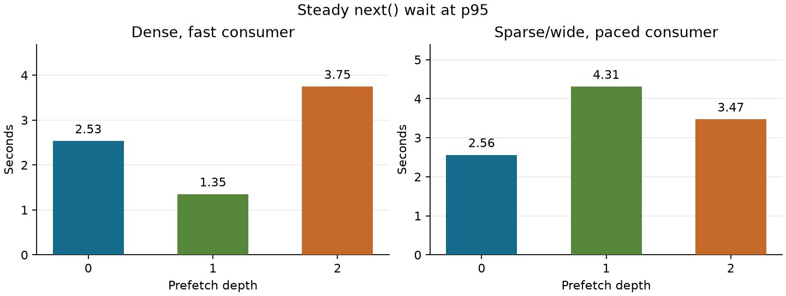

# OLAP stream depth benchmark

ST06 compared depths 0, 1, and 2 for two ranks reading the same pinned snapshot within each profile. Every depth ran one warm-up and three measured repetitions. Each trial checked both ordered shards and their union against the rows accepted at setup. The dense profile also matched the ordinary collect result. GPU idle time, GPU copy time, multi-GPU jitter, and exact cache hits remain unmeasured.

Both profiles used OLAP build `b30fc1ff4527b5c83a13b80e9b1e228c89d7d397` with SHA-256 `6ed815f988132840877f55bc9a31f9c2c6fd99d3bb81d8139c1065fed369e4d8` and seed 92106. The fixture archives were `cc39ef9240b2e1a9da8b33ecc3d019e638c762af` for dense and `ef187b082e34411616c7af1b1f43af05f523779b` for sparse/wide. Each container used 1.5 CPUs and 1,536 MiB of memory with swap disabled. Three workers advertised 1, 2, and 1 compute threads. The API and workers used loopback TCP and a local conditional object store. Other workloads shared the 8-CPU Docker VM, and the one-minute host load before launch was 56.29 for dense and 9.84 for sparse.

| Profile | Depth | First batch p50/p95/p99, ms | Steady next p50/p95/p99, ms | Rows/s, median trial | Encoded bytes read/row, median trial | Ordinary completions during stream |
| --- | ---: | ---: | ---: | ---: | ---: | ---: |
| Dense | 0 | 2,547/3,049/3,049 | 807/2,533/2,533 | 74.9 | 90.0 | n/a |
| Dense | 1 | 2,259/3,446/3,446 | 897/1,352/1,352 | 77.8 | 121.1 | n/a |
| Dense | 2 | 3,653/4,113/4,113 | 1,186/3,746/3,746 | 62.5 | 132.9 | n/a |
| Sparse/wide | 0 | 3,627/3,987/3,987 | 2,234/2,561/2,561 | 14.4 | 1,583.7 | 1 |
| Sparse/wide | 1 | 2,973/3,524/3,524 | 2,723/4,312/4,312 | 13.1 | 1,728.8 | 2 |
| Sparse/wide | 2 | 3,482/5,356/5,356 | 2,585/3,474/3,474 | 12.8 | 1,920.0 | 3 |



Dense read 512 rows with 32–80 character payloads in 64-row batches. Sparse/wide selected 160 of 640 rows, used 128–480 character payloads, and read 32-row batches. It paced each rank by 35 ms per batch and assigned partition delays of 0, 5, 13, or 25 ms. The fixture scheduled at most eight ordinary get or count requests per second with one such request in flight. The mixed trials retired all 15 accepted ordinary requests with exact results, zero missing or duplicate terminals, and zero rejected requests. The measured records include two repeated worker batch requests (B02).

Container memory peaked at 214.4 MiB through the last dense sample and 366.8 MiB in the completed sparse run, with zero OOM events at both observations. The highest sampled worker RSS was 45.4 and 48.9 MiB. The highest sampled charged working memory was 132.9 and 640.1 MiB. The trial records keep these measurements separate from rank skew, fixture CPU time, Parquet GET bytes, proxy timing, and sampled slot occupancy. The B01 observations cover sampled utilization. An exact idle-slot bound remains unmeasured here. [Trial records](benchmark-results.json)

Quantiles use the lower order statistic over pooled rank samples. First-batch quantiles have six measured samples per depth. Steady-next quantiles have 18 dense and 12 sparse samples per depth, which can produce identical p95 and p99 values. Depth one had the lowest observed dense p95 wait and depth zero had the lowest sparse p95 wait. Encoded bytes per row come from the manifest lengths of successful Parquet GETs.

## Run boundaries

- The first attempt hit a 15-second SDK deadline during a 1,024-row setup mutation. It recorded zero trials and finished in 33.43 seconds.
- Chunked setup allowed the 1,024-row retry to finish one dense warm-up and one measured trial per depth. The run stopped after those six verified trials. The partial results retain their original fixture pin and are outside the 512-row summary.
- The smaller combined run hit its 300-second watchdog after completing all 12 dense trials. The sparse profile recorded zero trials.
- The separate sparse-only attempt seeded all 640 rows. Its serial collect setup check hit the 40-second SDK deadline. The process exited after 156.95 seconds, with a 217.4 MiB memory peak and zero OOM events. With the setup-row oracle in place, the retry completed all 12 sparse trials in 321.48 seconds under a 420-second watchdog.

## Reproduce in Docker

Use a Linux x86-64 container with Python 3.11, procps, the pinned binary, and the matching fixture archive. Set the CPU quota to 1.5 and both memory and memory-plus-swap limits to 1,536 MiB. Run the profiles separately on a host with room under those limits.

```sh
export PYTHONPATH=orm/python/src OMP_NUM_THREADS=1 OPENBLAS_NUM_THREADS=1 MKL_NUM_THREADS=1
timeout -k 8s 300s python3.11 scripts/benchmark_olap_streaming.py \
  --binary "$OLAP_BINARY" --commit b30fc1ff4527b5c83a13b80e9b1e228c89d7d397 \
  --fixture-commit cc39ef9240b2e1a9da8b33ecc3d019e638c762af \
  --profile dense_fast --evidence dense.json
timeout -k 8s 420s python3.11 scripts/benchmark_olap_streaming.py \
  --binary "$OLAP_BINARY" --commit b30fc1ff4527b5c83a13b80e9b1e228c89d7d397 \
  --fixture-commit ef187b082e34411616c7af1b1f43af05f523779b \
  --profile sparse_wide --evidence sparse.json
```

[Benchmark fixture](../../../../scripts/benchmark_olap_streaming.py) · [Scheduler contract](../../scheduler-contract.md) · [Streaming plan](../../../../plans/olap-streaming.md)
