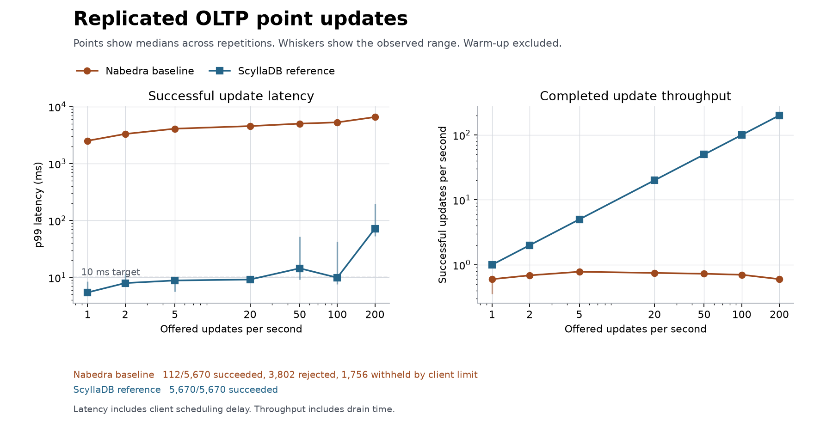

# Replicated OLTP point-update benchmark

Three independent Linux Docker containers hosted the Nabedra workers. Each worker had a separate named volume on the same Docker Desktop VM storage device. A fourth container ran the production remote HTTPS API, and a fifth ran the load driver. Docker inspection verified an aggregate limit of 4 CPUs and 7.9 GB, with swap disabled and no OOM kills. The default allocation gave each worker 1 CPU and 2.15 GB. The API had 0.35 CPU and 550 MB, and the driver had 0.65 CPU and 900 MB.

The fixture seeded 2,000 rows with an integer primary key and integer value. It verified three voters for the table's initial Data group. Each phase chose distinct existing keys uniformly without replacement, with the same seeded arrival schedule across systems. Each rate had a three-second warm-up and three five-second measured repetitions. Clients used persistent connections and made at most 32 updates concurrently. The fixture measured from scheduled arrival through the response and checked every final key and value, including the expected results of late receipts. Goodput counts acknowledged writes and includes drain time. Percentiles describe successful responses. Rejections, client capacity limits, terminal failures, and unresolved identities have separate counts.

The 2021 reference chart used three AWS i3.4xlarge database instances totaling 48 vCPUs, additional load generators, a disk-intensive 1 TB dataset per node, and 30 minutes per offered rate. The local test uses a small warm dataset and the application's HTTPS gateway. The ScyllaDB reference uses prepared native CQL. It measures the overhead of both products' normal request paths. [Published ScyllaDB benchmark](https://www.scylladb.com/2021/08/24/scylladb-vs-cassandra-performance-results/)

## Nabedra baseline

Commit `2e26418` built with Rust 1.94.1, the release profile, the `oltp` feature alone, and the verified RocksDB 11.8.1 archive previously used for the engine integration build. The Rust server binary SHA-256 was `af7752e3c8f54f4560ae93895d5f7e5cf72ef6a153e2842ee4e9f5550c243104`. The archive SHA-256 was `8723f6ffe373a3646de577a711c42ff0dcea433a83837db2d03b7b20c506a8f8`. [RocksDB archive provenance](../olap-streaming/README.md)

| Offered updates/s | Median successful updates/s | Writes acknowledged across 3 repeats | Median successful p99 |
| ---: | ---: | ---: | ---: |
| 1 | 0.600 | 9 / 15 | 2,513 ms |
| 2 | 0.687 | 15 / 30 | 3,307 ms |
| 5 | 0.781 | 18 / 75 | 4,089 ms |
| 20 | 0.749 | 18 / 300 | 4,549 ms |
| 50 | 0.727 | 17 / 750 | 5,018 ms |
| 100 | 0.701 | 18 / 1,500 | 5,283 ms |
| 200 | 0.601 | 17 / 3,000 | 6,551 ms |

Across the 21 measured phases, 112 updates succeeded, 3,802 received explicit rejection and 1,756 hit the driver's concurrency cap. The snapshot oracle found zero mismatches and the driver observed zero unresolved writes. The worker's first-dispatch count matched all 112 acknowledged writes. The gateway reported that most rejected requests had exhausted parsing memory. The API container's measured cgroup memory peak was 46.6 MB. Its logical scheduler charges an 88 MiB staging reservation while each HTTP request waits for remote submission. This accounts for the parsing-memory rejections even at low process memory use.

This is a local O23/O24 and B02 workload subset. The fixture checks ordinary replicated writes, replies, snapshot contents, and bounded resource use. Recovery barriers, wider workloads, physical availability zones, and the full compatibility suite have separate assertions. [OLTP contract](../../oltp-contract.md) · [Scheduler contract](../../scheduler-contract.md)

## Iteration 1 · TCP_NODELAY

This build enabled TCP_NODELAY on both ends of the worker mTLS connection. Under the same workload and limits, 110 of 5,670 measured writes succeeded. Peak median goodput was 0.706 successful updates/s. At 5 offered updates/s, median successful p99 rose from 4,089 to 4,740 ms. Every expected snapshot matched and the driver observed zero unresolved writes. This change was removed.

A separate serialized diagnostic with RPC trace logging isolated two successful writes on the same binary. Their client service times were 1,724 ms and 1,743 ms. Each produced 42 paired service calls, including nested calls. The union of their logged route, transport and decode intervals covered 1,363 ms and 1,379 ms. Peer transport covered 1,107 ms and 1,132 ms, including work at the remote endpoint. Route lookups covered 315 ms and 306 ms. The trace measures grouped call durations. It leaves TLS, quorum, disk flush and native application time combined within those calls.

## Iteration 2 · HTTP parsing reservation

The ingress build reduced the parser staging charge to the owned request buffer size after validation. At 1 offered update/s it acknowledged 15 of 15 measured writes, with median goodput 0.68/s and median successful p99 4,902 ms. The baseline acknowledged 9 of 15 at this rate. The higher admitted concurrency exposed local outgoing RPC lane exhaustion during accepted work. The 2/s phases reported uncertain outcomes in the manifest, timestamp and commit paths. The candidate remains unqualified for general use pending a bounded progress fix.

A write reported as unknown in one phase took effect after that phase's snapshot. The next snapshot saw its value and the initial oracle treated it as a mismatch. The driver must account for uncertain outcomes across phase boundaries. The late value alone does not establish an incorrect database write. The Ed25519 probe on this same binary reached normal HTTPS and worker mTLS readiness, then hit the same fixture issue before it provided enough complete repetitions for a crypto comparison.

## Iteration 3 · TLS certificate algorithm

The unchanged baseline binary ran against an Ed25519 CA and Ed25519 worker and API certificates. Both runs verified RF3, the same workload and resource limits, and every final row. Each rate used three measured repetitions.

| Offered updates/s | RSA median p99 | Ed25519 median p99 | RSA median successful updates/s | Ed25519 median successful updates/s |
| ---: | ---: | ---: | ---: | ---: |
| 1 | 2,513 ms | 2,596 ms | 0.600 | 0.528 |
| 5 | 4,089 ms | 4,212 ms | 0.781 | 0.736 |
| 20 | 4,549 ms | 4,637 ms | 0.749 | 0.764 |

Changing the certificate algorithm gave no consistent performance gain. One Ed25519 write returned an ambiguous response during the timed window. A subsequent receipt confirmed that it succeeded. The successful-throughput counts retain the original synchronous outcome.

## Iteration 4 · In-process sockets

The worker transport used bounded Tokio duplex streams for small, section-free RPCs addressed to the same worker identity. It retained mutual TLS and the existing endpoint checks, so the experiment changed the I/O path. The trace identified six eligible same-process calls among 84 service calls across two writes. It did not enumerate every nested Control exchange.

At 1, 5 and 20 offered updates/s, the candidate acknowledged 9 of 15, 18 of 75 and 18 of 300 writes. Those counts match the baseline. Median p99 was 2,519 ms, 3,943 ms and 4,766 ms. Every exact snapshot matched and all outcomes resolved. The latency shifted in both directions across rates. This change was removed.

## Iteration 5 · Waiting for a service lane

This build combined the smaller ingress lease with a bounded retry for a local outgoing-lane refusal known to occur before send. It acknowledged 14 of 15 measured writes at 1 offered update/s and 19 of 30 at 2/s. Median goodput at 2/s was 0.67/s and median successful p99 was 6,173 ms. The 5/s run stopped during snapshot verification when the read reached its timeout. This build did not establish stable progress under concurrent load.

The workload driver now carries a bounded set of possible late writes across phase boundaries. An unresolved request keeps its original timed disposition, even if a later receipt proves success. The fixture records unresolved evidence and fails verification if a required outcome is still uncertain. Three driver regressions passed in a capped Docker container.

## Iteration 6 · Persistent Control connections

The Authority-only transport trial negotiated persistent mTLS connections while retaining fresh authorization on each frame and unary v1 compatibility. At 1 offered update/s it acknowledged 5 of 15 writes, with median goodput 0.18/s and median successful p99 7,549 ms. At 5/s it acknowledged 12 of 75, with median goodput 0.35/s and median p99 7,096 ms. The run ended with a read timeout at 20/s.

The follow-up enables TCP_NODELAY only on negotiated persistent connections. The request format sends a prologue, header and three lengths as separate TLS writes. TCP_NODELAY sends small writes as soon as possible. The tuned run completed every snapshot with zero unresolved writes. At 1 offered update/s, successful p99 fell to 2,605 ms. [Linux TCP socket options](https://man7.org/linux/man-pages/man7/tcp.7.html)

| Offered updates/s | Repeat baseline successful updates/s | Tuned pool successful updates/s | Repeat baseline p99 | Tuned pool p99 |
| ---: | ---: | ---: | ---: | ---: |
| 1 | 0.57 | 0.40 | 2,871 ms | 2,605 ms |
| 5 | 0.74 | 0.81 | 4,562 ms | 4,275 ms |
| 20 | 0.75 | 0.80 | 4,779 ms | 4,477 ms |

The repeat baseline sent 91,168 active TCP opens across the workers and API. The tuned pool sent 80,119, a reduction of 12.1%. These kernel counters include setup and the full set of workload phases. The repeat baseline acknowledged 44 measured writes and had one unresolved outcome. The tuned run acknowledged 43. Both final snapshot oracles found zero mismatches. The tuned pool reduced connection setup work, while the observed latency and goodput remained in the range of baseline variation.

## Iteration 7 · Fewer metadata round trips

One build combined two changes. Owner service calls could reuse a cached destination while the receiver checked the caller's authority and the exact replica's published membership in one fresh Control read. Qualifying single-write manifests used one Status RPC for `BeginManifest`, `ManifestPage`, and `SealManifest`, each of which kept its original Raft command. The experiment measures their combined effect.

The release binary SHA-256 was `b1f8bd148a5c82a39152134fb4837334f913c270cb13affd762dd48c5d2dd211`. It ran in the same container image as the baseline, `sha256:1547483c44543b51e35b72fce17d9bf49d6b6f56c027dd5b634392006f83f7dc`. The run verified RF3, 4 CPUs, and 7.9 GB of aggregate memory. The comparison uses the original verified RSA baseline and the same arrival seed, warm-up, and repetition lengths. The driver revision included the phase-boundary reconciliation fix described in iteration 5.

| Offered updates/s | Baseline goodput | Metadata build goodput | Baseline median successful p99 | Metadata build median successful p99 | Metadata build acknowledgments |
| ---: | ---: | ---: | ---: | ---: | ---: |
| 1 | 0.600/s | 0.600/s | 2,513 ms | 1,935 ms | 10 / 15 |
| 5 | 0.781/s | 0.902/s | 4,089 ms | 3,656 ms | 18 / 75 |
| 20 | 0.749/s | 0.995/s | 4,549 ms | 3,662 ms | 21 / 300 |

Of 390 timed writes, 49 succeeded and 341 received explicit rejections. There were zero unresolved outcomes, and every snapshot matched the expected rows. Median successful p99 fell by 23%, 11%, and 19% across the three rates. The repeat baseline in iteration 6 also had higher p99 at each rate, with one unresolved outcome. At 20 updates/s the metadata build still rejected 279 of 300 writes. The 1,935 ms median successful p99 at the lightest tested rate remains above the 10 ms target.

The follow-up in iteration 9 refreshes a stale Status leader hint and combines prepared observation with the permit reply for one Data participant. Atomic Status or Data apply commands would require log compatibility across voters and learners. [OLTP latency plan](../../../../plans/oltp-latency.md)

## Iteration 8 · CPU allocation to the queue owner

The CPU-only trial used the original RSA baseline binary. The combined trial used the measured metadata binary from iteration 7. Both gave `w1` 1.6 CPUs and `w2` and `w3` 0.7 CPU each. The API and load driver retained 0.35 and 0.65 CPU, and all five memory limits stayed fixed. Docker inspection verified the 4 CPU and 7.9 GB aggregate cap, and the workers' Linux `cpu.max` confirmed the requested quotas. Runtime statistics identified `w1` as the queue owner in all 12 phases of each trial.

| Offered updates/s | CPU split goodput | CPU split median successful p99 | CPU split acknowledgments | Metadata + CPU split goodput | Metadata + CPU split median successful p99 | Metadata + CPU split acknowledgments |
| ---: | ---: | ---: | ---: | ---: | ---: | ---: |
| 1 | 0.600/s | 2,510 ms | 9 / 15 | 0.585/s | 2,297 ms | 9 / 15 |
| 5 | 0.897/s | 3,468 ms | 20 / 75 | 0.929/s | 3,494 ms | 20 / 75 |
| 20 | 0.996/s | 3,879 ms | 22 / 300 | 1.036/s | 3,568 ms | 22 / 300 |

Each trial acknowledged 51 of 390 timed writes. The CPU-only trial returned 338 parsing-capacity rejections and one explicit outgoing-lane refusal. All 339 rejections in the combined trial reported parsing-capacity exhaustion. Both runs accounted for every scheduled identity, found zero snapshot mismatches, and recorded zero unresolved outcomes or client-capacity drops.

The following kernel totals cover each entire run, including startup, seeding, warm-up, measured phases, and snapshot checks. The repeat baseline used the same three rates and matched setup. Its measured phases had 44 acknowledgments and one unresolved outcome. CPU and TCP totals add the counters from the three workers and the API. Bridge traffic adds `eth0` receive and transmit counters for each of those containers.

| Kernel counter | RSA repeat | Metadata only | CPU split only | Metadata + CPU split |
| --- | ---: | ---: | ---: | ---: |
| Server CPU time (s) | 372.28 | 328.88 | 403.15 | 390.14 |
| `w1` CPU time (s) | 205.90 | 176.32 | 222.10 | 210.32 |
| `w1` throttled periods / quota periods | 1,236 / 2,378 | 1,044 / 2,099 | 99 / 2,325 | 30 / 2,300 |
| `w2` throttled periods / quota periods | 2 / 2,354 | 1 / 2,076 | 147 / 2,302 | 146 / 2,277 |
| `w3` throttled periods / quota periods | 2 / 2,328 | 3 / 2,047 | 382 / 2,273 | 432 / 2,248 |
| API throttled periods / quota periods | 13 / 1,859 | 18 / 1,655 | 16 / 1,836 | 17 / 1,847 |
| Largest server cgroup memory peak (bytes) | 95,064,064 | 98,455,552 | 107,282,432 | 106,692,608 |
| Block I/O read bytes | 0 | 4,161,536 | 0 | 0 |
| Block I/O write bytes | 68,964,352 | 72,773,632 | 75,329,536 | 74,309,632 |
| Bridge traffic (bytes) | 472,449,567 | 448,673,576 | 491,805,322 | 462,784,948 |
| Bridge traffic (packets) | 2,508,617 | 2,372,200 | 2,606,501 | 2,448,064 |
| TCP active opens | 91,168 | 84,334 | 95,199 | 87,041 |
| TCP retransmitted segments | 579 | 519 | 323 | 411 |
| TCP connection attempts that failed | 49 | 57 | 67 | 68 |
| TCP established resets | 2 | 2 | 5 | 4 |

Server cgroups recorded zero memory-limit or OOM events and zero `eth0` errors or drops in all four runs. With the CPU split alone, `w1` throttled in 4.3% of quota periods, down from 52.0% in the repeat baseline. `w3` throttled in 16.8% of periods with the CPU split and 19.2% with both changes. Comparing the two asymmetric runs with the same number of acknowledgments, the metadata build used 8.6% fewer TCP active opens and 3.2% less CPU time across the run.

The combined configuration had the highest Nabedra median goodput at 5 and 20 offered updates/s. The metadata-only build had the lowest median successful p99 at 1/s. At 20/s the combined run still rejected 278 of 300 writes. Both CPU-split trials exceeded the 10 ms p99 target and returned explicit rejections at every tested rate. The CPU split is measured for this observed queue placement and this three-rate workload.

## Iteration 9 · Prepared observation and commit permit

This build added `ObservePreparedAndGetPermit` and refreshed stale Status leader hints on top of iteration 7. For one Data participant, Status verifies the durable participant seal, applies the existing prepared observation, and returns a strong commit permit in the same RPC. Timestamp allocation still reads and verifies the permit independently. The release binary SHA-256 was `1e12ba084c0cd15b3c4b4d01cdb090d6cda3e9b0dd9f8d553ecca1e2d71ace87`.

The symmetric sweep used RSA certificates, the same Linux image, RF3, and the same seeded workload as iteration 7. Docker inspection verified the 4 CPU and 7.9 GB aggregate caps, including the API and load driver. RPC tracing was off during the warm-up and three measured repetitions at each rate.

| Offered updates/s | Iteration 7 goodput | Prepared build goodput | Iteration 7 median successful p99 | Prepared build median successful p99 | Prepared build acknowledgments |
| ---: | ---: | ---: | ---: | ---: | ---: |
| 1 | 0.600/s | 0.600/s | 1,935 ms | 2,208 ms | 9 / 15 |
| 5 | 0.902/s | 0.849/s | 3,656 ms | 3,427 ms | 19 / 75 |
| 20 | 0.995/s | 0.901/s | 3,662 ms | 3,670 ms | 20 / 300 |

Of 390 timed writes, 48 were acknowledged and 342 received explicit API parsing-capacity rejections. The queue owner, `w1`, recorded 48 first dispatches during the measured phases. All 12 phase snapshots matched, with zero unresolved outcomes or client-capacity drops. Successful p99 improved at 5/s as goodput fell. At 1/s p99 rose, and at 20/s p99 was nearly unchanged as goodput fell. The sweep showed mixed results for the combined follow-up.

Whole-run kernel counters include startup, seeding, warm-up, measured phases, and snapshot checks. The three workers and API used 347.64 CPU seconds, versus 328.88 in iteration 7. The queue owner was throttled in 1,074 of 2,241 periods (47.9%). Workers `w2` and `w3` were throttled in 6 of 2,220 and 4 of 2,192 periods. Server cgroups recorded zero memory-limit or OOM events.

A separate RPC trace used one client, 16 rows, and one eight-second measured repetition at 1 offered update/s. Two writes succeeded and six scheduled arrivals hit the single-client limit. Each success had 38 paired service RPCs, including nested service calls, with 27 route hints and nine fresh route checks. Each trace included one successful `InstallPointManifest` and one successful `ObservePreparedAndGetPermit`, plus the independent Status permit read from Timestamp. Client service times were 1,717 and 1,711 ms. The iteration 1 diagnostic recorded 42 service RPCs per write and used the original metadata path with TCP_NODELAY. The two-write trace shows which calls the combined metadata path exercised. The sweep above measures load performance.

## Iteration 10 · Atomic Status point manifest

This experiment used the `oltp-experiment-atomic-manifest` build feature to apply a qualifying point manifest in one Status Raft command. Iteration 7 used one RPC and three Status commands for the same work. The experimental build also included the stale-leader hint repair. It ran the same seeded RF3 workload and Linux image as iteration 7, with RSA, fresh volumes, and one binary across all workers. Docker inspection verified 4 CPUs and 7.9 GB across the cluster, API, and driver, with swap disabled and zero OOM kills.

| Offered updates/s | Iteration 7 goodput | Atomic build goodput | Iteration 7 median successful p99 | Atomic build median successful p99 | Atomic build acknowledgments |
| ---: | ---: | ---: | ---: | ---: | ---: |
| 1 | 0.600/s | 0.600/s | 1,935 ms | 1,947 ms | 9 / 15 |
| 5 | 0.902/s | 0.903/s | 3,656 ms | 3,518 ms | 18 / 75 |
| 20 | 0.995/s | 0.891/s | 3,662 ms | 4,223 ms | 21 / 300 |

The run acknowledged 48 of 390 timed writes. The remaining 342 received explicit parsing-capacity rejections. There were zero terminal failures, client-capacity drops, or unresolved outcomes. The queue owner recorded 48 first dispatches. The initial snapshot and all 12 phase snapshots matched all 2,000 expected rows. At 20/s, median successful p99 increased by 15.3% and goodput fell by 10.4%. The atomic candidate was set aside. This run covered the single-build point-update path.

The release binary SHA-256 was `e0b85c6017699d31277b16dd1ea5e1e089ad9f25917f6486ac8fa69500d26d75`. The raw `benchmark-metadata-atomic-point/results.json` SHA-256 was `1bc17ba0501628911988c4879a004bebbf0c8fbfa12e5a2409cfd3b69b59dbd1`.

## Iteration 11 · Smaller parser reservation with bounded lane wait

This build combined the iteration 7 metadata path and the stale Status leader hint repair with a smaller parser staging reservation and a bounded wait for the selected outgoing service lane. Docker inspection verified the 4 CPU and 7.9 GB caps. At 1 offered update/s, all 15 measured writes received success responses. Median successful goodput was 0.74 updates/s and median p99 was 4,441 ms. The iteration 7 build acknowledged 10 of 15 writes at that rate with a median p99 of 1,935 ms.

The initial snapshot, warm-up snapshot, and first two measured snapshots each matched all 2,000 expected rows. The snapshot read after the third measured repetition timed out, so the driver marked the run unverified and stopped before the 2/s phase. The trial exercised part of the O23/O24 and B02 point-update workload. The C07, O13, O22, and Q01–Q06 assertions require separate tests. The production candidate excludes this change.

The release binary SHA-256 was `b9928397451cad17d4e41497c33ee38cd4efd720c4604fa4096548e007c8ab03`. The raw `benchmark-metadata-slots-point/results.json` SHA-256 was `2430722d928c5fc728e0daaad59de8035ed82d9c17da33eb8b6209613dc26d70`.

## Iteration 12 · Status placement on the queue owner

Both runs used the iteration 7 binary, worker quotas of 1.6, 0.7, and 0.7 CPUs, and identical RF3 voters. The test changed the Status seed from `w3` to `w1`, the queue owner. This reassigned their Status node IDs. Fresh Docker volumes and the same 4 CPU and 7.9 GB caps applied in each run. Followers reported ReadIndex forwarding hints to `w1` during startup. The fixture did not observe Status leadership throughout the timed phases.

| Offered updates/s | Control goodput | `w1` seed goodput | Control median successful p99 | `w1` seed median successful p99 | `w1` seed acknowledgments |
| ---: | ---: | ---: | ---: | ---: | ---: |
| 1 | 0.585/s | 0.593/s | 2,297 ms | 3,030 ms | 10 / 15 |
| 5 | 0.929/s | 0.487/s | 3,494 ms | 7,172 ms | 16 / 75 |
| 20 | 1.036/s | 0.687/s | 3,568 ms | 5,106 ms | 16 / 300 |

The placement trial acknowledged 42 of 390 measured writes, compared with 51 in the CPU-split control. It recorded 344 explicit parsing-capacity rejections and four responses with an unknown outcome. The driver confirmed three of the four outcomes by receipt. The fourth write's value appeared in the snapshot while its receipt still reported `running`. The driver marked the sweep unverified. All 13 snapshots matched the expected 2,000 rows and there were zero client-capacity drops.

The aggregate server CPU time rose from 390.14 s to 420.32 s and the queue owner throttled in 87 of 2,740 quota periods, up from 30 of 2,300. TCP active opens fell from 87,041 to 85,617. These counters include startup, seeding, and snapshots. The O23/O24 and B02 workload subset showed worse tail latency at all three rates and left a terminal receipt unverified, so the placement change was set aside. The raw `benchmark-metadata-status-owner-resume/results.json` SHA-256 was `2d97d371e102189f8f3687a487babe8c3963b81a3b1f06668f1b61c91b2a6ac7`.

## Iteration 13 · Metadata build with stale-hint recovery

Commit `c7f2a90` retained iteration 7's route authorization and manifest batching. It also cleared the Status leader hint when a compound write failed with uncertain routing, and restored the normal replica routing pass for read-only requests when a hinted receiver failed. The release binary SHA-256 was `1a050263a4ee21d51d7cf023baaf06e21f04f5d2433714693fbe7474dd9c8842`. The 4 CPU and 7.9 GB sweep used fresh RF3 clusters, symmetric worker quotas, and the same RSA certificates, seed, and workload parameters as iteration 7.

| Offered updates/s | Original baseline goodput / p99 | Iteration 7 goodput / p99 | `c7f2a90` goodput / p99 | `c7f2a90` acknowledgments |
| ---: | ---: | ---: | ---: | ---: |
| 1 | 0.600/s / 2,513 ms | 0.600/s / 1,935 ms | 0.573/s / 2,144 ms | 9 / 15 |
| 5 | 0.781/s / 4,089 ms | 0.902/s / 3,656 ms | 0.826/s / 3,557 ms | 18 / 75 |
| 20 | 0.749/s / 4,549 ms | 0.995/s / 3,662 ms | 0.879/s / 4,175 ms | 20 / 300 |

All 13 snapshots matched all 2,000 rows. The driver reported 47 acknowledgments and 343 explicit parsing-capacity rejections, with zero terminal errors, unresolved outcomes, or client-capacity drops. Median successful p99 fell 14.7%, 13.0%, and 8.2% from the original baseline. Iteration 7 had higher goodput at all three rates and lower p99 at 1 and 20/s. The comparison uses one sweep per binary. It does not isolate the effect of either routing repair. Each timed repetition acknowledged two to seven writes, so its p99 equaled its slowest successful write.

The fixed-membership O23/O24 and B02 subset checked ready membership, published Data replica placement, first-dispatch count, HTTPS disposition, row values, and resource caps. The worker and API cgroups used 353.25 CPU seconds, with a largest memory peak of 103,784,448 bytes and zero memory-limit or OOM events. Whole-run TCP active opens were 84,173. The original baseline included an extra 2/s phase, which shifted later payload values but kept the same keys and relative arrival times. Iteration 7 and the exact-settings baseline repeat also matched payload values. The exact-settings repeat had one unresolved receipt.

The raw `benchmark-metadata-qualified-resume/results.json` SHA-256 was `d9c8a92a33f9749e5a6ec170541c4782b83a50c01aedb97111a788bb4ae88ddd`.

## Iteration 14 · Completion notification

This isolated build added bounded gateway observation to `c7f2a90`. The server waited for the exact terminal version under the current ready membership. The gateway deferred on overload or an authority change and retried against fresh authority.

| Offered updates/s | Control goodput / p99 | Notification goodput / p99 | Notification acknowledgments |
| ---: | ---: | ---: | ---: |
| 1 | 0.573/s / 2,144 ms | 0.600/s / 1,927 ms | 10 / 15 |
| 5 | 0.826/s / 3,557 ms | 0.891/s / 3,554 ms | 18 / 75 |
| 20 | 0.879/s / 4,175 ms | 0.830/s / 4,203 ms | 19 / 300 |

The load sweep acknowledged 47 of 390 measured writes, the same total as the control. The other 343 offers received explicit parsing-capacity rejections. All 13 snapshots matched, and the driver recorded zero unresolved outcomes. In the serial workload at 0.2/s, all ten measured writes succeeded and all 12 snapshots matched. Median client latency rose from 1,193.70 to 1,489.58 ms, an increase of 24.8%. The notification build's serial latencies ranged from 1,203.07 to 1,772.88 ms. Goodput stayed at 0.2/s. The mixed load results and higher serial median were grounds to set the candidate aside.

The 4 CPU and 7.90 GB RF3 runs exercised the fixed-membership O23/O24 and B02 subsets. The serial run verified equal terminal and accepted counters on all three workers at the sampled boundaries. Fault injection and authority changes during observation remain unverified. The host rebooted after compilation. The recovered binary matched the build log's SHA-256 `66bd52910a308d55ee38bb6ac58c917bfd0bebda992ad9cf2272c8ceb0fbdb32`. The comparison uses the recorded control aggregates because the reboot cleared their intermediate artifacts. The notification load and serial result SHA-256 hashes were `6610dbccf8cfb2e5f01fbda062c4faf15ef3640b84651c7825ede040b8c18d6d` and `5f395b8cd7a49455145ea7754c06e5d130e38b4dbed491e6d7a6e4b787383b7d`.

## Iteration 15 — Atomic Data prepare and seal

This feature-gated build used one Data log entry for a bounded prepare page and seal, on top of iteration 7. One exact native test exercised legacy page and seal prefixes, exact replay after reopen, mismatched writes and result digests, private visibility, atomic rejection of an invalid root, and an old-run proposal after a fence (O07/O09/O10/O11/O15 subsets). The ordinary feature-off binary target passed compilation. A separate homogeneous RF3 diagnostic traced the compound apply for each of three measured successful writes and matched all five snapshots, including setup and warm-up.

The first untraced sweep stopped when a snapshot read timed out at 1 offered update/s. The identical retry used fresh volumes, the same 2,000-row RSA workload, and the same 4 CPU and 7.90 GB caps as the iteration 7 run. The table compares the retry with the historical iteration 7 aggregates. A host reboot cleared the raw control artifacts. The experiment did not build a same-source feature-off release control.

| Offered updates/s | Iteration 7 goodput / successful p99 | Atomic Data goodput / successful p99 | Atomic Data acknowledgments |
| ---: | ---: | ---: | ---: |
| 1 | 0.600/s / 1,935 ms | 0.600/s / 1,934 ms | 9 / 15 |
| 5 | 0.902/s / 3,656 ms | 0.831/s / 3,391 ms | 18 / 75 |
| 20 | 0.995/s / 3,662 ms | 0.873/s / 4,252 ms | 18 / 300 |

All 13 retry snapshots matched. Of the 390 measured offers, 45 succeeded and 345 received explicit `not_applied` parsing-capacity rejections. The driver recorded zero unresolved outcomes. Accepted-record deltas and the owner's first-dispatch count matched successes. Eight follower terminal deltas across five phases differed by one and matched changes in the sampled running counts. At the final sample all three workers showed 95 accepted and 95 terminal records, including setup and snapshot requests. These O23/O24 and B02 subsets leave all-ready acknowledgment timing and membership churn unverified. The highest tested rate showed 12.3% lower goodput and 16.1% higher successful p99. The branch excludes the experiment.

The optimized binary SHA-256 was `a253c0562e9cf3860fd2ea87255c251bec5e5b09bdb071081ae920a2b32aba69`. The untraced retry result SHA-256 was `151044117551cc9fc265cd6467006cd0a96054ffbffc7864a0d7b1085154806d`.

## ScyllaDB reference

The ScyllaDB 6.2.3 reference ran three nodes and the driver with a combined cap of 3.65 CPUs and 7.35 GB. Each node and the driver had the same limits as in the symmetric Nabedra runs. This topology serves prepared CQL directly. It used RF3, QUORUM and batch commit-log sync. The fixture verified the effective sync mode on every node. On Docker Desktop the Linux AIO limit prevented the third node from starting, so the run used the epoll backend. [ScyllaDB Docker Desktop workaround](https://github.com/scylladb/scylladb/issues/16806)

| Offered updates/s | Median successful updates/s | Writes acknowledged across 3 repeats | Median successful p99 |
| ---: | ---: | ---: | ---: |
| 1 | 1.00 | 15 / 15 | 5.45 ms |
| 2 | 2.00 | 30 / 30 | 7.97 ms |
| 5 | 5.00 | 75 / 75 | 8.85 ms |
| 20 | 20.00 | 300 / 300 | 9.20 ms |
| 50 | 50.00 | 750 / 750 | 14.47 ms |
| 100 | 99.96 | 1,500 / 1,500 | 9.91 ms |
| 200 | 200.00 | 3,000 / 3,000 | 71.98 ms |

Every measured write returned successfully and every snapshot matched. At 200 offered updates/s, p99 across the three repetitions ranged from 52.67 to 197.76 ms. This sweep stops at 200 updates/s.

The highest tested rate with successful p99 below 10 ms in all three repetitions was 20 updates/s. Its three p99s were 8.35, 9.50, and 9.20 ms. At 100/s the median p99 was 9.91 ms, with one repetition reaching 42.25 ms.



## Serial point updates at 0.2/s

The 1/s sweep already produced Nabedra rejections. A separate paired run set one client and scheduled one seeded update per five-second phase at 0.2 offered updates/s. Each phase drained the update and verified the snapshot before the next phase began. Both engines started with the same 2,000 rows and used matching update keys, values, and arrival offsets across one warm-up and ten measured repetitions. Nabedra used `c7f2a90` and the usual remote HTTPS gateway. ScyllaDB 6.2.3 used prepared CQL with RF3, QUORUM, and batch commit-log sync. Per-worker and driver quotas matched. Docker verified aggregate limits of 4 CPUs and 7.90 GB for Nabedra, and 3.65 CPUs and 7.35 GB for ScyllaDB.

| Engine | Timed acknowledgments | Median scheduled-client latency | Observed range |
| --- | ---: | ---: | ---: |
| Nabedra | 10 / 10 | 1,193.70 ms | 1,127.33–2,567.06 ms |
| ScyllaDB | 10 / 10 | 7.43 ms | 4.67–9.72 ms |

Both runs matched all 12 snapshots. The driver reported zero overlapping measured writes, rejections, retries, or unresolved outcomes. Both had median drain-inclusive goodput of 0.2 updates/s. Seven Nabedra writes and all ten ScyllaDB writes completed inside their offer window. The observed median latency gap was 161× with no concurrent client writes. Background cluster traffic and inter-phase snapshots still ran. This O24/B02 subset compares serial request latency. Ten samples per engine give limited tail resolution.

The raw `benchmark-metadata-qualified-low-load/results.json` SHA-256 was `099f773b3d0a245ffcfe7df4bbea6f22d03d8e2c67a6a63e5d169bad766e71c6`. The raw `benchmark-scylla-low-load/results.json` SHA-256 was `c5ca6bbef5fdf3b2451550375822697aa3f9a7826d80c1b6a64c4236e11e81bb`.

## Transport timing diagnostic

An isolated `c7f2a90` build paired client and receiver transport events by nonce. Two traced runs used one client, 16 rows, RF3, and the 4 CPU and 7.90 GB caps. All eight timed writes succeeded and all 12 snapshots matched. Seven write windows had paired gateway ingress and observation events within the measured HTTP interval. One window had a 24.136 ms clock-alignment error and was excluded from overlap calculations.

| Lane in the repeat capture | Paired replies | Median sender TCP connect | Median sender TLS | Median receiver preflight | Median receiver handler |
| --- | ---: | ---: | ---: | ---: | ---: |
| API ingress | 16 | 0.256 ms | 1.091 ms | 4.574 ms | 336.058 ms |
| Authority, same worker | 331 | 0.226 ms | 0.770 ms | 0.035 ms | 4.068 ms |
| ServiceAuthority, cross worker | 84 | 0.303 ms | 1.036 ms | 5.997 ms | 5.080 ms |
| ControlConsensus | 7,023 | 0.247 ms | 1.198 ms | 0.031 ms | 0.088 ms |

The table includes startup, seeding, snapshots, and background traffic. The repeat captured 11,015 complete sender and receiver pairs, with 12 unmatched sender replies. Within its three aligned write windows, 36 cross-worker ServiceAuthority preflights had a median duration of 5.737 ms. Directly awaited child RPCs overlapped a median 5.537 ms per preflight. The intervals overlap and do not add up to end-to-end latency. The data prioritizes reducing repeated authorization and consensus work on the request path. It leaves the savings from transport reuse unmeasured.

These are traced O24 and B02 serial-workload subsets. O22 progress under mixed saturation remains unverified. The diagnostic binary SHA-256 was `076642f751de41978ad208a53561d31bad4fed1ea76ee5a40c4ef2e249338839`. The initial and repeat result SHA-256 hashes were `8b831418727ec70b04f8112a1a901cacfbad16d381d0f47ca4e9d382526a4348` and `7646b06fdda457d42606baaa5be32f10d8e02611e4ce31632e6d8bd35b565b74`.

## Quorum confirmation and local apply timing

An isolated optimized diagnostic extended the previous transport trace with OpenRaft client roles and separate ReadIndex stages. Two fresh RF3 runs used the same serial workload, 16 rows, and the 4 CPU and 7.90 GB caps. All eight measured writes succeeded, all 12 snapshots matched, and all eight gateway windows passed clock alignment. Sixty-seven completed Control ReadIndex calls linked through exact endpoint nonces to those timed requests.

| Capture | Gateway-linked reads | Median quorum confirmation | Median local Raft apply wait | Median durable marker check |
| --- | ---: | ---: | ---: | ---: |
| Initial | 40 | 3.856 ms | 0.001 ms | 0.497 ms |
| Repeat | 27 | 4.783 ms | 0.001 ms | 0.748 ms |

Quorum confirmation includes time in the local Raft API queue. These intervals cover directly linked reads and can overlap other work. They cannot establish a total latency saving from reducing quorum checks. Across the full captures, 9,900 of 10,838 and 7,632 of 8,385 matched successful Raft replies came from the dedicated heartbeat client. That client combines periodic and ReadIndex-triggered work. No outgoing Raft trace carried a direct endpoint parent, so individual heartbeats remain unattributed.

The measured O24/B02 subset covers serial point writes. Mixed-load saturation and the O22 progress assertions remain open. The optimized diagnostic binary SHA-256 was `d2f5952e09f2a9b1cc4752e56efa2b6cb7da13dbc1a9d41baebb1ddb4c13e100`. The shell wrapper missed its exit record after compilation. Cargo completion, the copied executable's matching digest, and cgroup measurements verified the build.

## Focused metadata regression checks

Five exact Rust tests passed on the metadata source in `c7f2a90`. The Linux Docker test container used a four-CPU quota, a 7,235,174,400-byte memory limit, and no swap. Its cgroup memory peak was 5,131,698,176 bytes, with zero memory-limit or OOM events. The checks used the pinned Rust 1.94.1 builder and RocksDB archive listed above, with `--no-default-features --features oltp --lib` and one test thread.

| Test name | Executed assertions |
| --- | --- |
| `o07_o10_o11_point_manifest_replays_legacy_prefixes_and_rejects_changed_plan` | Replay the exact manifest from four old draft prefixes, reject a changed write root, and preserve the sealed page. Also inject an unavailable hinted receiver and verify a direct read reroutes within the same call (O06/O14). |
| `o10_o15_status_service_uses_actual_control_routes_and_rejects_forged_outcome` | Read an exact durable decision over mTLS, reject an altered outcome, and settle a permanent planning failure without a manifest. |
| `o14_c07_m02_replica_routes_require_fresh_control_record_after_replacement` | Refresh the generation after Raft replacement, use cached routes within the memory budget, and release route and decode charges. |
| `o06_o14_timestamp_service_retries_same_snapshot_after_leader_convergence` | An old peer rejects the read-only placement probe. Retry snapshot creation with the original payload and identity across new transport sessions. Verify overload and authorization responses. |
| `o14_o16_owner_service_checks_exact_receiver_in_published_membership` | Reject unpublished membership, an old generation, an incorrect node or worker, and a stale incarnation. Accept the exact published replacement. |

The output log SHA-256 was `bba718e6bcc75c7525d1541ee97b15d66d9868058785921d8a8552d78373f5a4`. These assertions cover local consensus and transport, including a modeled old decoder. The full multi-worker recovery, disk-fault, mixed-version process, and ORM suites remain pending.

The follow-up bounded the optional receiver probe and repeatable hinted reads, then moved a failed same-generation receiver behind other candidates in the verified route order. All five exact tests passed again. The expanded O06/O14 assertion held each marked request until its unmarked fallback reached the same Status endpoint. The timed-out probe did not confirm a receiver. This exercised the only-replica fallback. Attempt ordering with multiple live voters remains unverified. The same Docker quotas applied, with 5,322,690,560 bytes peak memory and zero memory-limit or OOM events. The output log SHA-256 was `f7aa436e43ccd4cb57584dfa30e2f3065a5db1890df3fdd78b3cbadcc490aa15`. The timing sweeps above used `c7f2a90` before this follow-up.

## Fixed-ready terminal receipt check

Separate RF3 runs used an ordinary HTTPS gateway and three registered workers. A test hook paused the final ready follower before it installed one point update's terminal record. The stock gateway exposed the successful result in GET and completed the synchronous POST while that follower was still paused. The isolated gateway gate returned `committing` without a result and kept POST pending. Both runs then released the follower, matched the original decision, terminal version and accepted context on all three workers, verified release of the original snapshot pin, and read back the exact updated row.

The stock fixture reached the final receipt assertion and failed it. The gated fixture passed. Both used matching unoptimized Linux builds and the same 4 CPU and 7.90 GB runtime allocation including the driver, with swap disabled. This exercises Q06/T04 and the fixed-ready subsets of O10 and O23.

The retained gateway change uses the coordinator's existing Control confirmation of the exact terminal copy. It passed the same RF3 fixture and two native checks for exact ready-view and version matching, recovery selection, and result expiry. A separate capped RF3 run held the follower through the bounded POST deadline. POST returned HTTP 503 with an unknown outcome, GET stayed `committing` while the follower was paused, and GET returned the exact original success after release. The driver submitted once. All three terminal copies, the original pin release, and the final row verified. Live expiry, direct worker HTTP, and membership churn remain open.

### Optimized gateway measurements

The paired release builds used stock `4483521` and the confirmed-copy gateway in `230ec16`. Each run used fresh RF3 workers, the ordinary HTTPS gateway, RSA certificates, and the matched 2,000-row fixture with 4 CPUs and 7.90 GB. Each load sweep verified all 13 snapshots and 468 offers including warm-up. All timed outcomes were synchronous successes or explicit parsing-capacity rejections.

| Offered updates/s | Stock acknowledgments | Confirmed-copy acknowledgments | Stock goodput / successful p99 | Confirmed-copy goodput / successful p99 |
| ---: | ---: | ---: | ---: | ---: |
| 1 | 9 / 15 | 9 / 15 | 0.594/s / 2,617 ms | 0.542/s / 3,807 ms |
| 5 | 17 / 75 | 16 / 75 | 0.747/s / 4,309 ms | 0.641/s / 4,863 ms |
| 20 | 18 / 300 | 18 / 300 | 0.815/s / 3,964 ms | 0.807/s / 4,315 ms |

Each p99 is the median of three phase p99 values and describes the few successful writes in each phase. Goodput includes drain time. In the separate serial pair at 0.2/s, both builds acknowledged all ten timed writes and matched all 12 snapshots. Median latency moved from 1,794.35 to 1,826.72 ms, an increase of 1.8%. The observed ranges were 1,725.12–2,077.66 ms and 1,704.45–2,475.44 ms. The build changes where acknowledgment ends, and the comparison does not isolate time spent in the wait from run variability. These are fixed-ready O23, warm point-write O24, and B02 workload subsets.

The stock and confirmed-copy executable SHA-256 values were `2f2b749b24ff125e2679dcbc8504389f8e5e9d6dddd75d46ca6b38dab4a6a30c` and `cce7c4a11e82b2010f833fb45436583ca716dae961d29d6b5b15fd04846c8a19`. Both optimized builds and all four runtime fixtures completed under their caps with zero OOM events.

## Reproduce

Build or obtain a pinned Nabedra Linux release image. Use an idle Docker host and empty result directories. Run one engine at a time.

```sh
python3.11 scripts/benchmark_oltp_nabedra.py --image nabedra:oltp \
  --output artifacts/oltp-latency/nabedra --rates 1,2,5,20,50,100,200
bash scripts/benchmark_scylla_oltp.sh artifacts/oltp-latency/scylla \
  --rates 1,2,5,20,50,100,200
```

For the CPU trials, use the pinned baseline or metadata binary with `--binary` and pass `--worker-cpus 1.6,0.7,0.7 --tls-key-type rsa --rates 1,5,20`. Use a separate output directory for each run.
For the Status placement trial, add `--status-seed-worker w1` to the metadata CPU trial.
For the serial comparison, pass `--rates 0.2 --seconds 5 --warmup-seconds 5 --repetitions 10 --clients 1 --rows 2000 --seed 20261118 --timeout 10` to both runners.
