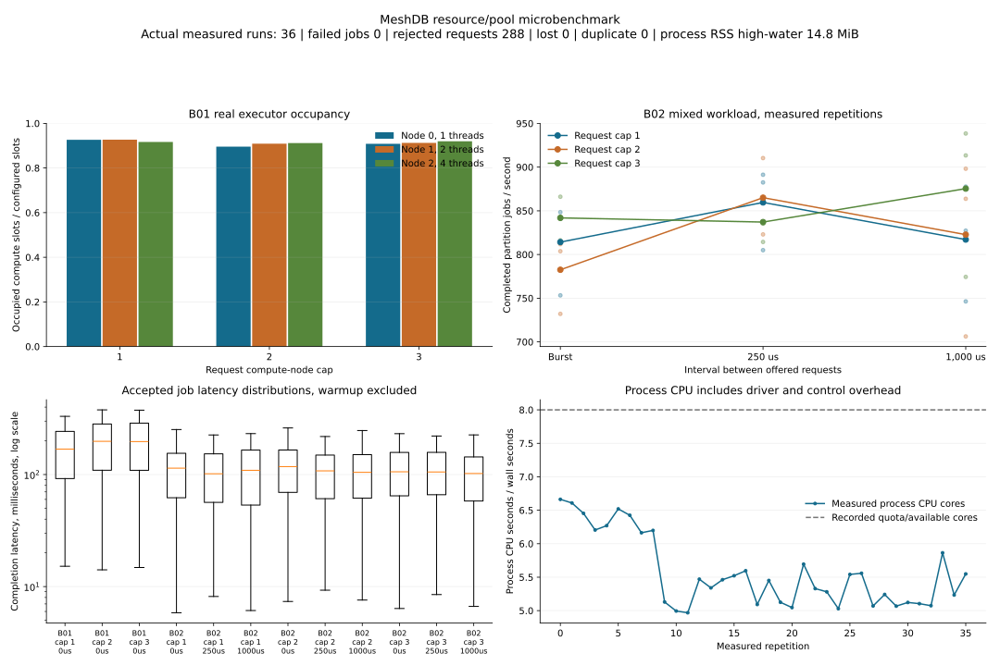
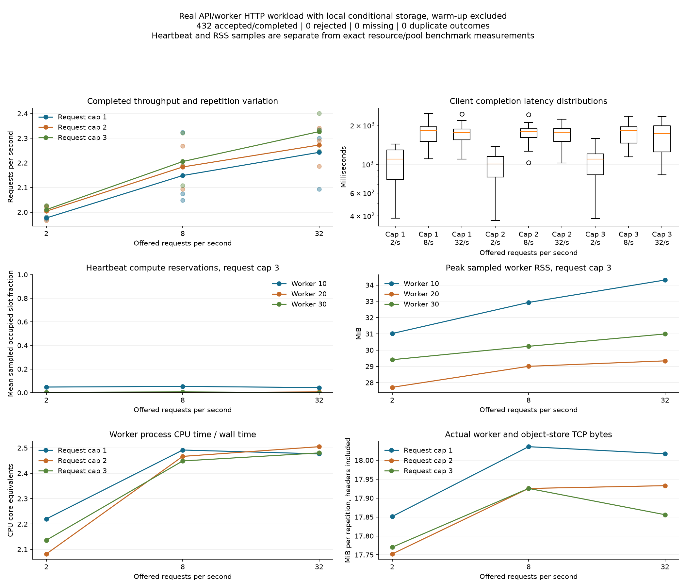

The resource-aware scheduler was validated on implementation commit `59ffcc72907c68c7a378cd3c9f1dddce2cab1b6b`. The measured native server SHA-256 is `5a5ab2598580f76c2f083346619f343f92b9f2deecb186cb3feff514beee5247`.

The final Rust run passed **727 tests across 37 targets**, and the Python suite passed **127 tests**. The S3-enabled build passed. The [functional results](evidence/resource-aware-scheduling/results.json) retain the exact binary hashes and execution boundaries for the separate process fixtures.

## Measured results

The [validated benchmark records](evidence/resource-aware-scheduling/benchmarks.json) include every measured repetition, p50/p95/p99 latency values, per-worker observations, configuration, machine, seeds and raw artifact checksums.

| Workload | Executed result |
| --- | --- |
| B01 CPU pool | One warm-up and three measured repetitions per request cap. A separate 96-job event assertion checked 89 backlogged releases: zero feasible logical slots remained idle after the release event, and all reservations settled. CPU runs averaged 6.26–6.57 CPU core equivalents on eight available logical CPUs; mean worker slot occupancy was 89.6–92.7%. |
| B02 pool CPU/memory/socket mix | One warm-up and three measured repetitions for every cap/arrival configuration. All accepted jobs completed; zero failed, missing or duplicate jobs. Exact arrival-to-compute-start and completion distributions, logical charges and actual socket payload bytes are retained. |
| B02 real HTTP/storage | Caps 1/2/3, offered rates 2/8/32 requests per second, 16 requests per repetition, 64 seeded rows, and a declared 2 ms partition-read delay. All 576 requests succeeded, including 432 in the 27 measured repetitions. Zero client rejections, missing or duplicate outcomes. Twenty internal HTTP 429 responses and eleven dependency-open retries caused no failed logical requests. |
| Q01 real HTTP | 1,000 submitted, acknowledged and terminal identities; every row/metadata result matched its serial oracle. Zero missing or duplicate outcomes, HTTP rejections, uncertain submissions or host transport errors. |
| Q01 actual CPU gates | 1,000 queries were accepted while both compute executors remained occupied, under the default 8 GiB ceiling. Every query returned its exact count or rows after release. Malformed/auth/truncated traffic and finite overflow did not displace accepted work. |
| C04/C05/C07 real HTTP | Each cap read 128 actual partition files. Observed concurrent transport nodes stayed within 1/2/3. A third small read completed while both large requests remained running; all final rows/counts matched the oracle. |
| Q02 independent limits | Count eight admitted eight requests, then rejected the next. A separate 40,000-byte replica limit admitted three large valid predicates with count 100, then rejected the next. All eleven accepted requests completed correctly. |





These are **unoptimized development builds**, with `CARGO_PROFILE_DEV_DEBUG=0`, `CARGO_PROFILE_TEST_DEBUG=0` and `CARGO_INCREMENTAL=0`. They are not release-throughput claims. HTTP throughput includes the local proxy, authentication, polling and conditional SQLite service.

The HTTP workers advertise 1/2/4 compute threads and logical RAM ceilings of 8/12/20 GiB on one shared 16 GiB host. These ceilings are not a certification of physical memory capacity. No OS CPU or memory quota was installed. Actual sampled RSS is reported separately from logical charges. Each worker also has its bounded two-thread control pool.

Heartbeat reservations/charges and RSS are sampled at 250 ms. HTTP queue waits are receipt-state observation bounds with 100 ms polling, including ingress. Pool job waiting is arrival to closure start; mixed socket jobs include their precompute I/O stage. Network figures count protocol bytes once per proxied RPC, including HTTP headers, rather than TCP/IP headers or retransmissions. Queue/result payload observations exclude allocator metadata and unobserved local transitions. The compact records include separate actual queue-install wire bytes.

## Passing commands and reproduction

Commands below run from the repository root, except the explicit `server` subshells. The full Rust and Python commands passed; the S3-enabled check finished in 19.02 seconds and Python in 59.682 seconds.

```sh
export CARGO_PROFILE_DEV_DEBUG=0 CARGO_PROFILE_TEST_DEBUG=0 CARGO_INCREMENTAL=0
(cd server && cargo test --locked --no-default-features --no-fail-fast -j1 -- --test-threads=4)
(cd server && cargo check --locked -j1)
PYTHONPATH=orm/src python3.11 -m unittest discover -s orm/tests
```

Build the supplied native targets before reproducing the process and benchmark runs:

```sh
(cd server && cargo build --locked --no-default-features -j1 --bin meshdb-server --example resource_scheduler_benchmark)
python3.11 scripts/acceptance_scheduler.py --binary server/target/debug/meshdb-server
python3.11 scripts/acceptance_providers.py --binary server/target/debug/meshdb-server
python3.11 scripts/acceptance_scheduler_load.py --binary server/target/debug/meshdb-server --suite caps --output artifacts/scheduler-caps-final.json
python3.11 scripts/acceptance_scheduler_load.py --binary server/target/debug/meshdb-server --suite conservation --output artifacts/scheduler-conservation-final.json
python3.11 scripts/acceptance_scheduler_load.py --binary server/target/debug/meshdb-server --suite overflow --output artifacts/scheduler-overflow-final.json
```

Run measurements sequentially with other CPU/TCP fixtures stopped:

```sh
server/target/debug/examples/resource_scheduler_benchmark --output artifacts/scheduler-pool-benchmark.json
python3.11 scripts/acceptance_scheduler_load.py --binary server/target/debug/meshdb-server --suite benchmark --output artifacts/scheduler-http-benchmark.json
python3.11 scripts/summarize_scheduler_benchmarks.py --pool artifacts/scheduler-pool-benchmark.json --http artifacts/scheduler-http-benchmark.json --output artifacts/scheduler-benchmark-evidence.json
python3.11 scripts/plot_resource_scheduler_benchmark.py artifacts/scheduler-pool-benchmark.json --output docs/testing/evidence/resource-aware-scheduling/pool-benchmark.svg
python3.11 scripts/plot_scheduler_http_load.py artifacts/scheduler-http-benchmark.json --output docs/testing/evidence/resource-aware-scheduling/http-benchmark.png
```

Full raw JSON is retained locally as verified `.json.gz` files under `artifacts/`, with compressed and uncompressed SHA-256 values in the committed summaries. Decompress it to replay the pool plot, or rerun the commands above. The HTTP plot and combined validator also accept gzip input. Only Matplotlib label compatibility was changed after measurement; no measured runtime, input, limit or oracle changed.

The 1,000-request TCP fixture uses four concurrent admission clients, bounded same-identity backpressure, finite count/byte budgets and one-hour result retention. Seven gated remote allocations exercise heterogeneous capacity before release at the 64th acknowledgment. Actual CPU saturation is asserted separately by the literal 1,000-query local-router test. Every acknowledged TCP identity and terminal oracle remains mandatory.

## Case evidence

The identifiers are those in [the reusable contract](scheduler-contract.md). Unit means actual Rust assertions, including in-process routers and injected stores; TCP means native API/worker processes with conditional local storage. The boundary column states what was executed, not a claim that a test count proves every possible fault.

| ID | Executed assertions | Boundary/source |
| --- | --- | --- |
| C01 | Distinct signed 1/2/4 pools and RAM ceilings; advertised availability is bounded. | Unit, TCP recovery/load |
| C02 | Zero/overflow/contradictory limits, forged signed capacity and stale incarnation rejection. | Configuration/auth/membership unit assertions |
| C03 | Same node restarted from four to three threads; exact rows, partition identities and file hashes preserved. | TCP recovery |
| C04 | Caps 1/2/3 over 128 actual files; multiple jobs per used worker. Reducer caps checked explicitly. | TCP load, scheduler reducer assertions |
| C05 | Two large requests overlap; third small result completes while both remain running; fair-round assertions. | TCP load/recovery, scheduler |
| C06 | A gated executor does not block refill of the other executor; heterogeneous capacities and job work. | Actual worker pool, TCP traces, measured pool |
| C07 | Saturated coordinators/control progress; remote waits use memory without CPU grants; ordinary peer overload retries. | Scheduler/pool, TCP, signed control regression |
| M01 | Wide/string/extreme metadata, decoder/encoder growth and update candidate limits fail before unbounded allocation. | Snapshot, mutation and codec assertions |
| M02 | Aggregate queue/result/working charges, simultaneous buffered requests and reservation settlement; separate RSS observations. | Scheduler/pool, benchmark records |
| M03 | Impossible work, temporary pressure, 32-grant aging, retained growth and cycle prevention. | Scheduler and buffered worker pool |
| Q01 | Literal 1,000 CPU-gated queries, 1,000 TCP identities and exact terminal oracles; queue model conservation. | Local router, TCP, replicated queue |
| Q02 | Independent count and replica-byte overflow; existing accepted work retained; malformed traffic rejected. | Local router, queue, TCP |
| Q03 | Complete-copy ACK held with no early acceptance; owner killed; exact-body retry yields one decision. Empty/multipage snapshot flags checked. | TCP recovery, queue |
| Q04 | Accepted work survives socket loss and API replacement with the same run/receipt/result. | Local router, TCP recovery |
| Q05 | Two real APIs race identical mutation; one receipt/decision; changed-body conflict and exact replay. | TCP recovery, queue/router |
| Q06 | Explicit result expiry/cap, immutable terminal identity and durable mutation reconciliation. | Queue and queued API |
| F01 | Typed validation/storage/internal codec/resource errors preserve unrelated gated work and subsequent executor use. | Actual worker pool and engine fault assertions |
| F02 | Unwinding task panic settles buffers/permits; executor and unrelated work remain usable. | Actual worker pool |
| F03 | Cancelled waits, dropped receivers, pool stop, buffered reservations and payload cleanup settle ownership once. | Scheduler/pool/payload ownership and event tests |
| R01 | Coordinator OS kill recovers from a surviving queue copy with the exact result. | TCP recovery |
| R02 | Successive worker kills preserve accepted identity and captured result through one holder. | TCP recovery |
| R03 | Join copies outstanding state before readiness; capacity failure is atomic; snapshot pagination terminates. | TCP recovery, queue |
| R04 | All holders stop; explicit cold fence abandons old read and retains committed mutation/data. | TCP recovery, queued API, fenced catalog |
| R05 | SIGSTOP owner, higher-term takeover, SIGCONT; no stale root publication and one decision. | TCP recovery, catalog/auth fencing |
| R06 | SIGKILL worker retains cross-node copies and committed data. | TCP recovery; no within-node abort/OOM isolation claim |
| T01 | Failed preparation cancels/drains siblings without publishing a partial partition set. | Engine write and fenced publication |
| T02 | First/second upload failure preserves prior catalog; uploaded final-key orphans stay unreferenced. | Engine/storage fault assertions |
| T03 | Shared-base mutations recompute CAS losers; concurrent tables and same-key outcomes retain serial semantics. | Publication/engine, TCP node regression |
| T04 | Applied PUT/lost reply reconciles exact decision; API restart and cold lookup retain success. | Fenced/publication assertions, TCP |
| T05 | Old PUT before new fence may commit; old PUT after fence fails the same conditional root update. | Deterministically gated conditional store |
| T06 | Existing wire operations, no-ops, empty/conflicting batch, bounds and stale handles retain stable outcomes. | Engine/API/protocol/fenced replay |
| U01 | Shared queue/transaction behavior in local router and separate workers, including saturation and recovery. | Local CPU fixture, queued API, TCP |
| U02 | JSON/duplicates/depth/types/huge limits/auth/truncated bodies during CPU saturation; frame/replay validation. | Literal CPU-gated router, protocol/auth, TCP subset |
| U03 | Seeds 343687/99112/20261115 check queue, resources, joins/drains/loss/retries/cancel, fences and serial rows after events. | Scheduler and queue/catalog event generators |
| A01 | Manual API/ORM rejects unsupported provisioning without inventing a provider. | Validation and real manual API |
| A02 | Configured callbacks drive 1→2→1→0→1 actual workers; inventory failure, 12 exact reads and proof before removal. | Real callback/TCP processes with local provider |
| B01 | CPU repetitions and 96-job/89-release no-feasible-idle assertion; measured CPU/slot usage. | Validated pool records and chart |
| B02 | Repeated mixed pool and real HTTP/storage matrix; all quantiles, memory/network/retry/rejection/identity observations. | Validated per-repetition records and charts |

## Regression notes and limits

Regression cases retain the empty/multipage queue snapshot completion bug, bounded control-message memory, deferred local execution-stage memory with 1,000 CPU-gated requests, scheduler aggregate accounting, and ordinary unsigned peer overload followed by fully authenticated success. Control retries preserve the original permit/operation/admission and owned resources; success and settlement still require signed proof.

The fixtures also retain the host socket-pressure failure separately: bounded clients/backoff/polling and explicit finite retention prevent the observer from generating an unreported retry storm. Accepted terminal failures are never ignored to obtain a pass.

Conditional SQLite and local callback evidence does not certify live AWS S3 or Kubernetes lifecycle behavior. No OS process quota or supervised within-node abort/OOM isolation is claimed. Committed mutations remain durable; the queue is replicated worker RAM and is abandoned after every holder stops.
