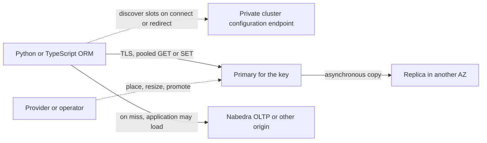

Nabedra Cache should let Python and TypeScript applications read and replace expiring values in RAM with roughly the same client-observed latency as Redis or Memcached.

**Recommendation.** Ship the ORM contract over an existing Valkey data plane first. On AWS, start with a node-based ElastiCache for Valkey cluster. For local and self-hosted deployments, run the same commands against a pinned upstream Valkey release. Give Cache its own Cargo build and deployment lifecycle. Keep OLTP as the source of truth for anything the application cannot reconstruct. A native Rust cache worker is a second implementation option if owning the worker becomes a product requirement or the measurements identify a specific limitation.

## Which engine should own the keys?

| Option | What a successful write means | When to choose it | Principal cost |
| --- | --- | --- | --- |
| Existing OLTP with a key/value table and expiry column | Nabedra reached its durable decision and publication boundary. An expiry predicate can hide old rows. | The data must survive a restart and measured ORM latency fits the application. This is also the comparison to run first. | Add atomic expiry and reclamation to make this a cache API. A warm index does not remove admission, durable logging, or transaction coordination. |
| Valkey workers behind a Nabedra ORM module | The shard primary has applied the command in RAM. The ordinary write returns before asynchronous replication finishes. | Recommended for a rebuildable cache, direct Redis-protocol client access, and a short path to multi-AZ operation. | A separate service, client pools, credentials, and capacity budget. Failover can lose recent changes, including deletes. |
| Native Nabedra RAM workers | One fenced shard owner has applied a single-key operation in RAM. Start with one copy and allow a failed shard to restart empty. | A self-contained Rust worker or Nabedra-specific placement/isolation is worth maintaining. Keep the ORM contract and compare this implementation with Valkey. | Nabedra owns routing, eviction, failover, rebalancing, observability and client compatibility. Replicated HA is a later milestone with its own fault tests. |

**What the OLTP evidence answers.** A historical single-worker loopback run measured 103 point hits on a three-row table at 2.91 ms median and 4.36 ms p99. On the separate OLTP performance branch, an RF3 development run with four aggregate CPUs measured a 1,826.72 ms median across ten serial point updates using confirmed terminal copies. These are different workloads and revisions. Neither run paired Nabedra with a cache server. They justify measuring the actual client path before promising an elapsed time. [RF1 measurements](../docs/testing/evidence/oltp/quiet-rf1/rf1-process.json) · RF3 evidence at local Git revision `d330e60`, `docs/testing/evidence/oltp-latency/README.md`, section containing “1,826.72”.

On the planning base (`76ea16f`), OLTP reserves a durable request identity before executable RAM admission. Mutations can cross Status, Timestamp and Data groups, and the storage engine uses RocksDB. The performance branch prototypes shard-scoped routing and queue-copy quorums. Borrow placement and resource accounting where they fit. Benchmark an integrated optimization at its actual revision before assigning it a speedup. Even an OLTP build that wins a latency comparison still has a durable write path. [Admission](../server/src/oltp_runtime/admission.rs) · [Transaction coordinator](../server/src/oltp_runtime/transaction.rs) · [OLTP storage](../server/src/oltp/mod.rs)

## Production layout



Use a single region per cache and private subnets reachable from the application. An initial HA layout is three shards with one primary and one replica per shard, spread across three AZs with each replica in a different AZ from its primary. This is a topology to test, not a minimum purchase. Use one standalone primary locally. The cluster-aware client discovers the 16,384-slot map and reuses TLS connections to owners. A warm single-key command normally takes one client-to-primary round trip. Read from primaries by default so a subsequent read on a stable owner sees the preceding write, subject to expiry, eviction and intervening writes. [Valkey Cluster](https://valkey.io/topics/cluster-spec/) · [AWS multi-AZ failover](https://docs.aws.amazon.com/AmazonElastiCache/latest/dg/disaster-recovery-resiliency.html)

Set an explicit memory ceiling and an eviction policy, initially `allkeys-lru` (sampled approximation). Deploy the RAM-only profile with provider durability and data tiering disabled. For self-hosting, turn off AOF and scheduled RDB saves, configure diskless replication sync and disable swap on cache hosts. Keep cluster topology metadata separate from values. Check the actual parameter group, available RAM and backup policy during provisioning. Memory limits need headroom for fragmentation, network buffers, replication backlog and full resync. For initial sizing, divide measured live bytes including per-entry overhead by the usable data bytes per primary, round up, then multiply nodes by the replica factor. Check the result against peak per-shard load and AZ-loss headroom. Measure process RSS during a rebalance. [Key eviction](https://valkey.io/topics/lru-cache/) · [Valkey persistence](https://valkey.io/topics/persistence/) · [Replication](https://valkey.io/topics/replication/) · [AWS durability settings](https://docs.aws.amazon.com/AmazonElastiCache/latest/dg/Durability.Options.html)

Scale write throughput and total memory by adding **shards** and moving slots. Another primary can own more independent keys. A single hot writable key still has one owner. Adding replicas helps read throughput only for callers that accept stale reads. Record hottest slots, network bytes, engine CPU, hit rate, evictions, replica lag, and client p99. Size for one AZ down. Throttle moves against foreground p99 and preserve capacity for catch-up. Qualify manual growth and drain first. Enable automatic scaling only with a tested provider adapter and explicit node/spend ceilings. [AWS online resharding](https://docs.aws.amazon.com/AmazonElastiCache/latest/dg/scaling-redis-cluster-mode-enabled.html) · [AWS latency and skew guidance](https://docs.aws.amazon.com/AmazonElastiCache/latest/dg/wwe-troubleshooting.html)

Node-based ElastiCache gives the first comparison a known shard count, node class and replica placement. Test ElastiCache Serverless as a second deployment for unpredictable demand or a small operations team. Measure bursts, throttling and end-to-end tails through its endpoint. For an existing EC2/EKS fleet, self-hosted Valkey buys control over version, memory and host placement at the cost of patching, resharding, promotion and recovery. Compare monthly node-hours or serverless usage, replica RAM and applicable network charges at the **same sustained goodput, p99 and failure policy**. Use the deployment region and actual usage for cost estimates. [AWS deployment options](https://docs.aws.amazon.com/AmazonElastiCache/latest/dg/WhatIs.Components.html) · [Serverless client behavior](https://docs.aws.amazon.com/AmazonElastiCache/latest/dg/wwe-troubleshooting.html)

## ORM and wire contract

Expose `Cache` from the package root and from `nabedra.cache` / `nabedra/cache`. Give it its own endpoint, identity and bounded connection pool so a cache-only application can use it. The examples show the proposed API for a cluster and assume the application has loaded the endpoint and credentials. Use an explicit standalone/cluster option for upstream endpoints and qualify managed endpoint discovery during the driver spike. Python calls are synchronous. TypeScript operations return promises.

```python
from nabedra.cache import Cache

with Cache.connect(endpoint, username=user, password=secret, namespace="catalog", cluster=True) as cache:
    created = cache.set("sku:42", b"in stock", ttl_ms=30_000, when="absent")
    value = cache.get("sku:42")  # bytes | None
```

```ts
import { Cache } from "nabedra/cache"

const cache = await Cache.connect(endpoint, { username, password, namespace: "catalog", cluster: true })
try {
  const created = await cache.set("sku:42", new TextEncoder().encode("in stock"), {
    ttlMs: 30_000, when: "absent",
  })
  const value = await cache.get("sku:42") // Uint8Array | null
} finally {
  await cache.close()
}
```

| Operation (Python / TypeScript) | Result and wire behavior |
| --- | --- |
| `get(key)` | `GET` returns exact bytes or `None` / `null` on a miss. An empty value is a hit. |
| `set(key, value, *, ttl_ms=None, when="always")` / `set(key, value, { ttlMs?, when? }?)` | One `SET` with optional `PX`. Modes `always`, `absent`, `present` map to unconditional, `NX`, `XX`. Return true on application and false on a failed condition. A successful overwrite with omitted TTL clears prior expiry. A failed condition preserves both value and TTL. |
| `delete(key)` | Single-key `DEL`; true if it removed a live key. |
| `expire(key, ttl_ms)` / `expire(key, ttlMs)` | `PEXPIRE`; true if a live key received the new deadline. Zero explicitly deletes an existing key. |
| `ttl_ms(key)` / `ttlMs(key)` | `PTTL`; return remaining whole milliseconds, `-1` for a live key without expiry and `-2` for a miss. |
| `persist(key)` | `PERSIST`; true if a live key had an expiry removed. |
| `close()` | Release the client's pool. Repeated close succeeds. |

Start TTL at the server when the write applies. Reads do not extend it. The server treats an expired key as missing even while physical reclamation is pending. Expiry and eviction are independent reasons for a miss. Validate integer TTLs in both SDKs, up to 9,007,199,254,740,991 ms (the largest exact safe integer in TypeScript), with a minimum of 1 for `set` and 0 for `expire`. As proposed SDK limits, allow 1–250 UTF-8 bytes per logical key and up to 1 MiB per binary value. Reject invalid Unicode, booleans as integers, and overflow before sending. Share boundary fixtures and exact error meanings. [SET](https://valkey.io/commands/set/) · [PEXPIRE](https://valkey.io/commands/pexpire/) · [PTTL](https://valkey.io/commands/pttl/)

Use a validated 1–64 character ASCII namespace matching `[a-z0-9_-]+`. Encode a logical key as `nb:<namespace>:<unpadded-base64url(UTF-8 key)>`. This keeps user braces out of slot selection. Publish byte-exact vectors and the physical-key convention for existing RESP clients. Bind data permissions to that prefix with backend ACLs, use TLS with verified hostnames on every node, allow only required data commands and driver discovery/handshake commands, and keep admin credentials separate. A prefix alone gives no isolation. SDK size limits do not constrain other clients with direct access. Use separate clusters for trust domains needing independent hard memory limits or independent eviction. [Valkey ACLs](https://valkey.io/topics/acl/) · [ElastiCache user groups](https://docs.aws.amazon.com/AmazonElastiCache/latest/dg/Clusters.RBAC.html)

Choose optional, cluster-aware drivers in a compatibility spike. Verify raw binary replies, bounded pools and deadlines, verified TLS, redirects, reconnect behavior, primary reads and explicit shutdown against both targets. Inspect internal retries, offline queues and auto-pipelining. Permit a bounded retry on a definitive pre-execution redirect (`MOVED` or `ASK` with `ASKING` on the target connection). A lost mutation reply returns the ORM's `UnknownOutcomeError`; silently resending `DEL`, conditional `SET`, or a relative TTL changes observable behavior. Surface authentication, overload, validation and transport errors distinctly from misses. Candidate drivers are [redis-py](https://redis.readthedocs.io/en/stable/clustering.html) and [node-redis](https://github.com/redis/node-redis).

**Compatibility.** A real Valkey worker already speaks RESP. Qualify the listed commands, ACL and cluster discovery with a stock Redis client in addition to the ORMs. Existing Redis workloads using scripts, transactions, richer types or raw key names need a command/key inventory. Memcached compatibility in v1 means replacing application `get`/`set`/TTL calls through the ORM. Existing Memcached clients use a separate protocol, item flags and CAS tokens, and interpret TTLs beyond 30 days as Unix timestamps. Only add a Memcached listener if unchanged clients are required. Then specify those semantics and run real clients against it. [Redis cluster protocol](https://redis.io/docs/latest/operate/oss_and_stack/reference/cluster-spec/) · [Memcached text protocol](https://docs.memcached.org/protocols/basic/)

**Failure contract.** Cache values are expendable. A successful cache command completes at the primary. If a replica is promoted before it receives a write, a value may disappear or an older value may return. A full cold start of the volatile deployment begins empty. During rolling replacement, fence an empty restarted primary and rejoin it as a replica after promotion so it cannot overwrite surviving warm copies. Callers needing a durable decision use OLTP. Cache commands expose no asynchronous acceptance receipt and use a separate listener from table operations. The existing worker queue retains accepted database requests while a complete copy survives, abandons outstanding requests after every worker stops and preserves committed mutations. Any future cache job that uses that queue must follow its acceptance, drain and recovery rules. [Scheduler requirements](resource-aware-scheduling.md) · [Valkey replication](https://valkey.io/topics/replication/)

On a miss, the application can read the origin and populate with a TTL. Make fallback on cache outage explicit per application. Cap concurrent refills per origin and coalesce concurrent misses for a hot key. In this cache-aside model a concurrent durable update can race with a stale fill. Applications that need a freshness boundary should key by an authoritative revision or validate against the origin. Cache eviction or failover can invalidate locks or counters that an application treats as authoritative.

## Cargo and implementation order

1. **Baseline and command contract.** Freeze shared binary, TTL and error fixtures. Capture direct Valkey, Redis, Memcached and the current OLTP point path. For the OLTP comparison measure its supported row representation, record encoding overhead, and separate a warm primary-key lookup from an update and an insert. Report missing TTL/eviction behavior. Record the precise branch, binary and settings.
2. **Server packaging.** Add `cache = []` as a third mutually exclusive engine in [Cargo.toml](../server/Cargo.toml), [engine guards](../server/src/lib.rs), [CLI dispatch](../server/src/main.rs) and the [Dockerfile](../Dockerfile). Proposed build: `cargo build --release --manifest-path server/Cargo.toml --no-default-features --features cache`. For the Valkey option, the cache build of `nabedra-db serve` launches a configured local Valkey executable, checks its version/readiness, propagates failure, and owns shutdown. Ship/pin that executable in the cache container and document it as a dependency for a bare binary. In managed mode the ORM connects directly to the pre-provisioned endpoint, with no Nabedra process in the request path. Verify default OLAP+S3, OLAP-only, OLTP-only, OLTP backup, cache-only, and invalid engine combinations including zero engines and cache+S3. Check the cache build graph excludes RocksDB, Arrow, Parquet and AWS SDK dependencies. [Cargo features](https://doc.rust-lang.org/cargo/reference/features.html)
3. **Paired ORM release.** Implement `orm/python/src/nabedra/cache/` and `orm/typescript/src/cache/`, package exports, optional dependencies and examples. Run the same fixtures through installed packages against standalone, clustered, and failover deployments. Ship both clients in one PR at synchronized package versions. [ORM parity requirements](../docs/testing/orm-parity.md)
4. **Cloud and operations.** Qualify the fixed private multi-AZ deployment, auth rotation, loss of a primary/AZ, rolling upgrade, online slot migration and empty cold start. Report recovery time, origin refill load and acknowledged changes lost. Then qualify autoscaling and cost. For adoption, shadow reads or dual-populate only rebuildable keys, canary by namespace, and retain a switch to the old backend. Avoid copying a remaining TTL as a fresh original lifetime.
5. **Decision on native workers.** Stop after step 4 if Valkey meets the gates and separate workers are acceptable. If a Nabedra-owned worker is required, prototype a single-node Rust `cache` engine with binary values, a byte-budgeted hash table, passive expiry on access, a bounded active expiry sweep, and sampled eviction. Charge keys, values, TTL metadata, buffers and allocator headroom. Reject oversized entries before evicting. Show the same RESP subset through both ORMs. Before distributing it, beat the identified limitation on the same traces. For scale-out reuse eligible membership/TLS/resource code, assign many virtual slots to single owners, and keep the authority service outside the per-key path. Fence prior owners before reassignment, using expiring authority grants with a tested clock bound or an acknowledged stop. Where fencing cannot be established, pause that slot. During moves, bound snapshot plus ordered deltas, carry absolute deadlines and deletes, fence and drain the source, verify the target, then publish the new slot map. Initially recover an unexpectedly lost slot empty. Require fault evidence before adding warm replica promotion. A native implementation claiming Redis Cluster compatibility must also pass real-client slot discovery, redirect, hash-tag and migration tests.

## What would establish comparable speed?

Use the following as proposed acceptance targets. Each comparison uses the same caller location, TLS, persistent connections, key/value distribution, memory ceiling, failure policy where supported, and offered arrival schedule. Run a stock driver and the public ORM to isolate wrapper overhead. Compare Redis/Valkey with equivalent asynchronous replication and persistence settings. Compare Memcached in an unreplicated lane and disclose protocol/TTL differences. Show durable OLTP on its actual settings. Separate standalone, same-AZ and cross-AZ results. A server handler timer excludes the network and cannot establish client latency.

| Future case | Assertions or measurements |
| --- | --- |
| K01 · Protocol and isolation | Both ORMs and stock RESP clients agree on bytes, empty/missing values, cross-language reads, condition races and expiry boundaries. Check absent/no-expiry TTL replies, overwrite and persist, long TTLs, Unicode, limits, restricted keys/commands, close and stale credentials. Use a fake clock for native expiry; run real-time deadline windows against upstream. |
| K02 · Memory and time | Overwrite/expire/delete/recreate under pressure; a stale expiry event must never remove the replacement. Exercise many tiny entries, 1 MiB entries, heavy churn, expired-but-unvisited keys and a hot slot. Check bounded RSS, misses, eviction rate and recovery of headroom. |
| K03 · Failures | Cut sockets immediately before and after mutation execution, isolate a primary, promote a lagging replica, kill a shard, wipe the volatile fleet and restart. Distinguish explicit error, unknown outcome, permitted lost write and an ordinary miss. Exercise stale routing during a move and verify unrelated slots remain usable where the configured cluster coverage policy permits. |
| K04 · Latency and scaling | Run single-command clients first, then fixed pipeline depths separately. Sweep offered load through saturation for GET hits, misses, SET with TTL, 95:5 and 50:50 mixes. Test 64 B, 1 KiB and 64 KiB values, uniform and skewed keys, then one hot writer. At 1, 3, 6 and 12 primaries, hold bytes per primary and replica ratio fixed. Track goodput per primary, p50/p95/p99/p99.9 from scheduled client arrival, errors, network bytes and cost per million successful operations. Repeat during rebalance and failover. |
| K05 · Production boundaries | Launch through local Cargo-built/container entry points and the managed endpoint. Verify shutdown cleans up owned children, dependency isolation, TLS/ACL rotation, failover, scale-down, cost ceiling and provider failure. Check OLTP committed rows/receipts and outstanding database work across API, individual worker and full-cluster failures. |

For a proposed definition of “roughly the same,” at matched operating points require client GET-hit and SET-with-TTL p50 and p99 at most **1.2×** the reference and sustainable correct operations/s at least **0.8×** its rate under the same p99 budget. Report Redis and Memcached separately. For uniform independent keys, target at least **80% scale-out efficiency** at 6 and 12 primaries relative to 3 (`goodput(N) / goodput(3) × 3/N`). These are decision thresholds, not forecasts. Predeclare payloads, hit ratios and the production p99 budget; include 1 ms same-AZ as a test point wherever the reference sustains it. Qualifying loads require correct outcomes, zero unexpected rejections/timeouts and steady memory. Record offered requests so dropped work cannot improve latency. Warm up, collect at least three independent paired runs and 10,000 measured samples per cell for p99. Publish confidence intervals and sample counts; collect larger samples before claiming p99.9 equivalence. A confidence interval crossing a threshold is inconclusive.

Run K01–K05 before claiming cache acceptance. When integrating shared workers, replay [scheduler scenarios](../docs/testing/scheduler-contract.md) C01–C07, M01–M03, F01–F03 and U01–U03; cover Q01–Q06, R01–R06 and T01–T06 for database admission/recovery/publication regressions. Use A01–A02 and B01–B02 for adapter and utilization evidence. Add a named regression for each new failure. All cache, scale-out and provider cases above are planned measurements.
