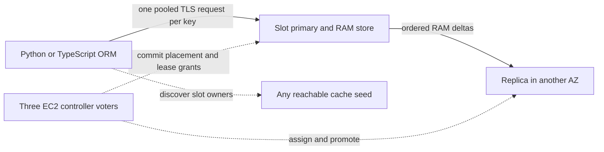

Build a native Rust cache database with in-memory reads and writes, expiring keys, shard replication, and a Python and TypeScript ORM that can connect to a standalone process or a cluster on EC2.

## Architecture and guarantees

The `cache` Cargo feature builds Nabedra's own server. Nabedra implements the command parser, storage, TTL, eviction, routing, replication, and cluster control. The release covers a Redis-compatible subset for binary key/value caching. Valkey, Redis, and Memcached are reference implementations for compatibility and performance tests. The initial scope covers strings and counters, with lists, sets, sorted sets, streams, scripting, and general transactions outside the command contract.

Use a single server process for local development. In a cluster, each slot has one primary and one asynchronous RAM replica, with three separate controller voters for placement and fencing. On a healthy primary, a successful reply means the command took effect in RAM. Subsequent primary reads see that write until another mutation, expiry, or eviction. A failover may lose recent writes or restore an older value if the replica missed the replacement or delete. Expired values remain expired. A cold start after losing all RAM copies starts empty. The application keeps irreplaceable data in OLTP or another authoritative store. This adopts the acknowledgment trade-off of asynchronous cache replication. [Valkey replication semantics](https://valkey.io/topics/replication/)

**Reuse from Nabedra.** Extract applicable TLS framing, worker resource accounting, supervisor and deployment inventory code behind engine-independent interfaces as each use becomes concrete. The cache owns a different execution path from the OLTP transaction coordinator. OLTP's durable identity reservation, transactional publication and storage engine are part of the comparison baseline. Historical loopback OLTP reads reached 2.91 ms median and 4.36 ms p99 on 103 hits against a three-row table. An RF3 development run on the separate performance branch measured 1,826.72 ms median for ten durable point updates at four aggregate CPUs. These measurements provide context. Run a paired benchmark before assigning a speed advantage to the cache. [OLTP read samples](../docs/testing/evidence/oltp/quiet-rf1/rf1-process.json) · [Admission code](../server/src/oltp_runtime/admission.rs) · RF3 evidence at Git revision `d330e60` in `docs/testing/evidence/oltp-latency/README.md`.



## Cargo, process roles and protocol

Build with `cargo build --release --manifest-path server/Cargo.toml --no-default-features --features cache`. Extend the existing exclusive engine guard and binary version output to select exactly one of `olap`, `oltp`, and `cache`. Preserve the default `olap,s3` build. A cache build includes the native server and its metadata consensus code. Its dependency graph excludes the OLTP storage engine, Arrow, Parquet, and the AWS SDK. Provide Linux arm64 and amd64 releases and a `cache` Docker target. [Cargo features](https://doc.rust-lang.org/cargo/reference/features.html) · [Current engine guard](../server/src/lib.rs) · [Current Docker targets](../Dockerfile)

| Entry point | Responsibility |
| --- | --- |
| `nabedra-db serve --config cache-local.toml` | Start the native RESP server in standalone mode. Use the same parser and storage as cluster workers. |
| `nabedra-db cache controller --config controller.toml` | Participate in a three-voter metadata quorum. Expose private mTLS admin and enrollment endpoints. |
| `nabedra-db cache worker --config worker.toml` | Enroll with a new incarnation, open client and peer listeners, and start serving only the slots for which it receives valid authority. |
| `nabedra-db cache admin --config admin.toml <command>` | Provide authenticated `init`, `status`, `rebalance`, `drain`, `replace`, and `cold-reset` operations. Use versioned, resumable operation IDs for topology changes. |

Implement RESP2 request arrays of bulk strings and binary-safe replies. Parse incrementally and bound argument count, frame bytes, declared lengths, pipelines, output buffer, total connections, and TLS handshake concurrency before allocation. Apply per-connection and per-identity admission limits. Preserve response order within a connection. Enforce TLS with hostname verification and ACLs for production, with explicit plaintext loopback mode for local use. Scope credentials to key prefixes and commands. Validate every key in a multicall before changing state. Give administrative operations separate credentials and a private endpoint. [RESP specification](https://valkey.io/topics/protocol/) · [ACL conventions](https://valkey.io/topics/acl/)

| Command contract | Required behavior |
| --- | --- |
| `GET`, `SET [NX or XX] [EX or PX]`, `DEL`, `EXISTS` | Values are bytes. An empty value is a hit. Missing and expired keys have the same reply. Conditional set checks and applies in one operation. Successful overwrite clears prior expiry unless a new TTL is supplied. Failed conditions preserve value and TTL. |
| `TTL`, `PTTL`, `EXPIRE`, `PEXPIRE`, `PERSIST` | Support the base commands. Relative expiry starts at application. Nonpositive `EXPIRE` / `PEXPIRE` deletes a live key. TTL replies use `-2` for missing and `-1` for no deadline. Reads do not extend TTL. |
| `INCRBY` | Atomic checked signed 64-bit addition. A miss starts at zero. Existing bytes must parse as a compatible integer. Preserve the live key's TTL. Invalid values or overflow leave state intact. |
| `MGET`, multi-key `DEL` / `EXISTS` | Execute on one actor. In cluster mode require the keys to share a slot and return `CROSSSLOT` before any mutation. Preserve argument order and duplicate-key semantics per command. |
| Driver handshake and discovery | Implement `AUTH`, `PING`, `ECHO`, `HELLO 2`, `CLIENT SETINFO`, `CLUSTER SLOTS`, `CLUSTER SHARDS`, and command metadata used by the supported driver versions. Test the exact handshake with stock clients configured for RESP2. Return explicit errors for unsupported commands and RESP versions. |

Use Redis Cluster's CRC16 slot function, hash tags, and 16,384 slots. Expose real node endpoints and use `MOVED` for a known different owner. During a handoff, return `TRYAGAIN` before execution while ownership is frozen. Return `CLUSTERDOWN` for an affected slot when no valid current owner can serve it. Resharding transfers whole slots in the background, so the server need not issue `ASK` or expose a partially moved slot. The client refreshes from bounded, allow-listed seeds and reuses direct connections to authenticated nodes. Protocol compatibility is qualified command by command. [Cluster specification](https://valkey.io/topics/cluster-spec/) · [Discovery response](https://valkey.io/commands/cluster-slots/) · [SET and TTL behavior](https://valkey.io/commands/set/) · [EXPIRE behavior](https://valkey.io/commands/expire/)

## The hot path and memory

Use a fixed number of execution actors per worker, initially sized against actual CPU quota. Each actor owns multiple slots and serializes operations in each slot. TLS/RESP tasks route validated commands to bounded actor queues. The actor checks role and authority, expires the addressed key if due, applies the command, then replies. One actor turn establishes the order of a single-slot operation. The primary reads directly from RAM. The write path uses a local replication journal in RAM. The response path has no controller request, disk write, or replica wait. Split client work, peer transfer and control progress into independently bounded queues. Standalone executes with the same engine and no cluster lease or replication work. Profile RESP parsing, TLS, routing, actor handoffs, allocation and TTL maintenance separately. If queue or handoff cost breaks the single-host gate, prototype routing connections and execution onto the same core before adding cluster complexity.

Store owned byte slices for keys and values with a hash table per slot. Maintain one indexed expiry record per expiring key, keyed by deadline and entry identity. Replacing or deleting a key removes its previous record. Compare absolute deadlines on reads and writes. Reclaim inactive expired keys with time- and item-bounded maintenance turns. Before promotion or migration, preserve deadlines and use the same expiry check on the receiver. In a cluster use the upper endpoint of the bounded clock interval to hide a due key conservatively. Test expiry precision and the maximum early-expiry window under admitted clock uncertainty. Reject service on an invalid clock. Use an injectable clock for local tests.

Default to sampled LRU within each slot. Also support a `noeviction` profile that returns explicit OOM. Budget slot bytes under a worker ceiling and let the controller allocate capacity across slots using observed RAM and load. Charge keys, values, expiry/index metadata, hash-table reservations, replies, journals, snapshot buffers, and replication state. Keep protected capacity for control and transfers. Reserve memory before growth, cap candidate eviction work per command and return OOM before mutation if the planned victims cannot free enough space. A replica applies the primary's exact eviction and expiration effects and never independently evicts live data from a promotable copy. Set an OS memory cap and retain RSS headroom for allocator overhead and fragmentation. Report both charged bytes and RSS. Limit a raw key to 512 bytes and a value to 1 MiB in the first release. Derive total frame and pipeline limits separately from those per-item limits.

## Replication, fencing and recovery

**Topology authority.** Use OpenRaft for metadata consensus, with a cache-owned checksummed metadata log and atomic snapshots on the controllers' EBS volumes. Implement and test the library's storage contract, including durable vote/log writes, fsync ordering, snapshot installation and recovery from partial tail writes. The metadata record contains cluster generation, membership and incarnation, each slot's epoch, its primary and replica, and lease/handoff state. Store topology and authority only. Peer RPCs carry cluster generation, slot, authority epoch, source and destination incarnation, and payload bounds. Cache values, command bodies and results live in RAM. [OpenRaft storage implementation guide](https://docs.rs/openraft/latest/openraft/docs/getting_started/index.html)

**Leases.** The controller commits grants for batches of slots with the same owner and a short expiration. Start acceptance testing with a 3 s lease, renewal attempted every 1 s, and an admitted clock interval at most 10 ms wide. Adjust these settings using measured failover time and renewal headroom. Bind each grant to the slot epochs and an exact worker incarnation. Renew outside command execution. Authorize a turn only while the local bounded-time upper endpoint is strictly before grant expiry, and recheck under the actor's exclusive ownership before the result or mutation becomes visible. Stage mutations privately through that check, including capacity for the journal entry and the bounded reply. Treat the successful final check as the operation's linearization point. Log the effects before processing the next command, and let peers reject effects from retired epochs. A successor uses a committed grant only when its lower time bound reaches the previous grant's latest committed expiry, or after the prior actor irrevocably freezes and acknowledges the exact grant. Pause on expired grants, excessive clock uncertainty, or rollback. Deliver grants over authenticated controller channels only after consensus commit. On a controller leadership change, recover the latest committed deadline before issuing grants. On worker restart, require fresh authority for the new incarnation. The EC2 profile uses ClockBound with Amazon Time Sync, and the lease argument assumes the reported interval covers true time. Qualify suspend/resume, clock faults, lost renewals, and minority partitions with deterministic schedules. If the quorum cannot renew, the data plane serves only through already valid grants. [ClockBound on EC2](https://docs.aws.amazon.com/AWSEC2/latest/UserGuide/compare-timestamps-with-clockbound.html)

**Replication.** For each slot, sequence canonical mutation effects within an epoch. Include the complete set of changes to values, absolute deadlines, deletions and evictions for each successful command. Keep a byte-bounded replay journal, and have the replica acknowledge its highest contiguous applied sequence. Ignore exact duplicates and reject gaps, wrong epochs, or stale incarnations. A missing log segment triggers snapshot catch-up. A snapshot carries an epoch and sequence cut. Stream it in bounded chunks using an immutable view with charged copy-on-write overhead, then apply retained deltas in order. If the pin, delta or time budget is exceeded, drop the incomplete transfer and retry with backoff. The primary can continue writing when a replica falls behind. Expose the lost failover coverage and bound retry work. Only a replica with a verified complete baseline, contiguous applied prefix and matching identity/epoch is eligible for promotion.

**Failover and restart.** After fencing the previous authority, promote an eligible replica from its last contiguous prefix, assign a new epoch, and build a replacement copy. Start failed workers with empty RAM and a fresh incarnation. Require catch-up before those workers are eligible for promotion. Continue serving unrelated slots when their authority is valid. A lost connection alone does not prove a slot's copies are gone. If both copies are lost, an explicit scoped cold reset fences the old epoch and starts that slot empty. A complete fleet cold reset increments the cluster generation and clears all slot data and pending cache work. Persist only the new topology. A peer returning late with the old generation cannot republish data.

**Recovery during replica replacement.** For K03, prefer a ready assigned replica. A target still staged by a replica-only transfer can become primary when its incarnation is enrolled, it reports a verified baseline for the current epoch, and its prefix trails the latest committed source progress by at most the 32-mutation cutover limit. Source progress is recorded when staging starts and advanced by committed renewals for that move. A target can have received more mutations than the last source report records. The committed transition identifies both incarnations, the retained epoch and sequence, the source watermark, and the source's retirement or latest expired lease. Retirement prevents renewals. The target's grant still starts at or after the previous grant's expiry because an isolated source can hold a valid grant.

When neither copy qualifies and the source is unavailable, use a scoped cold reset. The deadline is the last committed grant's expiry plus one controller progress-report window (3 s). This gives surviving copies time to report after a leadership change. Recovery changes take priority in batches of up to 256 per 250 ms reconcile turn. With a stable quorum and reachable workers, allow one renewal interval to install the placement and another for a fresh grant. A cold reset advances the epoch, records the loss, and initializes empty storage. Unrelated slots keep their contents and authority.

**Online move.** Enroll a target, stream a verified snapshot and deltas while the source serves, and bring lag below the cutover budget. Freeze the slot on the old primary, settle its bounded work and record the last applied sequence. Catch the target up to that exact sequence. The controller commits the replacement epoch only with fence and target-readiness evidence. Publish the new map and retire the old copy after restoring the configured replica count. If an operator or controller crashes, resume from committed move state. If the source dies before the freeze sequence can be verified, use the normal failover path with its asynchronous loss semantics. Throttle transfers and concurrent moves per worker, preserve expiry across movement and bound customer-visible freeze time.

**Accepted work.** A RESP mutation has one completion reply. Ingress and actor queues contain bounded, pending calls before execution. The cache exposes no queued-success reply or asynchronous receipt. If a connection drops after possible execution, the ORM reports an unknown write outcome. Any feature that later acknowledges queued work must store its complete request in replicated worker RAM and follow the repository's acceptance and cold-start rules. Existing database requests keep their original queue and durable mutation contracts. [Worker scheduling requirements](resource-aware-scheduling.md) · [Scheduler test cases](../docs/testing/scheduler-contract.md)

## Deploy on your EC2 instances

Ship a versioned CloudFormation template and one documented deploy command for a fresh or existing VPC. The deploy command takes an AWS region, network settings, worker instance type and count, and a reference to bootstrap credentials. It returns the private seed endpoints and readiness status. Automate first boot, voter formation, worker enrollment, placement and health checks. Retain a manual install path for an existing fleet. Use one regional cluster with private client and peer endpoints, three AZs, and one controller voter per AZ. Run controllers as separate systemd services on small dedicated instances in the reference deployment, each with a persistent encrypted EBS metadata volume. Use three memory-optimized worker instances to start, one per AZ, with three primary groups and their RAM replicas placed across AZs. A worker can host one primary group and one replica group under separate byte budgets. Keep sufficient spare memory, CPU and network bandwidth to serve after losing an AZ. Compare memory-optimized and compute-optimized shapes against the actual workload before sizing production. [EC2 memory-optimized instances](https://aws.amazon.com/ec2/instance-types/memory-optimized/) · [EC2 compute-optimized instances](https://aws.amazon.com/ec2/instance-types/compute-optimized/)

Use private DNS seed records and per-node DNS names in discovery replies. Keep seed discovery outside the request path. Limit the RESP security group to application callers and the peer/admin group to the authorized workers, controllers and operators. Issue TLS certificates for the advertised names, verify peer identities on enrollment, and exercise rotation with old and new certificates temporarily trusted. Use instance roles for retrieval of bootstrap material and for authorized EC2 actions. Set systemd resource limits, disable swap for workers, and publish per-slot throughput, expiry/eviction, oldest queued time, replication lag, lease headroom, catch-up progress, and unknown outcomes.

Start with manual growth. Join a new worker, validate capacity, move selected slots with replicas in distinct AZs, and verify placement before counting the new capacity. Grow only if demand is spread across enough keys to use new owners. A hot writable key still has a single serialization point. Scale up an overloaded owner or change the application key layout for that case. Replica reads are a later explicit consistency mode. Scale down only after the controller records a completed drain and proves that the surviving placement and resources satisfy the configured readiness policy.

Add automatic growth after the manual and failure paths pass. Feed sustained memory pressure, queue age, per-slot throughput and headroom into the existing deployment-planning approach. Launch through a versioned EC2 launch template, with bounded instance counts, spend, concurrent moves, and provisioning retries. Make the control plane request termination after a verified drain. An AWS lifecycle hook can delay termination, and AWS can proceed when it times out. Model forced termination as an instance fault. Compare hourly instance and EBS charges, network traffic, and cost per million successful requests at matched durability and p99. [Existing deployment planner](../server/src/oltp_deployment/planner.rs) · [EC2 launch templates](https://docs.aws.amazon.com/autoscaling/ec2/userguide/create-launch-template.html) · [AWS lifecycle hook behavior](https://docs.aws.amazon.com/autoscaling/ec2/userguide/lifecycle-hooks.html)

## ORM

Export `Cache` from the Python and TypeScript package roots and `nabedra.cache` / `nabedra/cache`. Accept bootstrap endpoints, credentials, namespace and pool/deadline options. Python uses synchronous methods and a context manager. TypeScript uses promises and explicit `close()`. Implement the same command and error contract in both languages. Reuse existing cluster-aware RESP client libraries if the compatibility spike verifies their timeout and retry behavior. The ORM uses the native Nabedra endpoint in production. [Python driver cluster behavior](https://redis.readthedocs.io/en/stable/clustering.html) · [Node driver](https://github.com/redis/node-redis) · [ORM release parity](../docs/testing/orm-parity.md)

```python
from nabedra.cache import Cache

with Cache.connect(endpoint, username=user, password=secret, namespace="catalog", cluster=True) as cache:
    cache.set("sku:42", b"in stock", ttl_ms=30_000, when="absent")
    value = cache.get("sku:42")  # bytes | None
```

```typescript
import { Cache } from "nabedra/cache"

const cache = await Cache.connect(endpoint, { username, password, namespace: "catalog", cluster: true })
try {
  await cache.set("sku:42", new TextEncoder().encode("in stock"), { ttlMs: 30_000, when: "absent" })
  const value = await cache.get("sku:42") // Uint8Array | null
} finally {
  await cache.close()
}
```

| ORM method | Result |
| --- | --- |
| `get(key)` | Exact bytes or a miss. An empty byte string is a hit. |
| `set(key, value, ttl_ms=None, when="always")` / `set(key, value, { ttlMs?, when? }?)` | Boolean. Modes `always`, `absent`, and `present` map to unconditional, NX, and XX. SDK TTL is 1 through `Number.MAX_SAFE_INTEGER` milliseconds. |
| `delete(key)`, `expire(key, ttl_ms)`, `persist(key)` | Boolean. SDK `expire` accepts zero for explicit deletion and positive integer TTLs through `Number.MAX_SAFE_INTEGER`. |
| `ttl_ms(key)` / `ttlMs(key)` | Remaining whole milliseconds, `-1` for no deadline, `-2` for missing. |
| `increment(key, delta)` | Python `int` and TypeScript `bigint` for signed 64-bit values. Require lossless signed 64-bit replies in the driver spike, including the two extremes beyond JavaScript's safe number range. |
| `close()` | Release connection pools. Repeated close succeeds. |

Limit SDK keys to 1–250 UTF-8 bytes and namespace names to 1–64 ASCII characters in `[a-z0-9_-]`. Encode a key as `nb:<namespace>:<unpadded-base64url(UTF-8 key)>`, with server ACL checks on the full encoded prefix. Publish shared vectors and exact error mappings. Distinguish ordinary misses from authentication, overload, validation, transport and unknown mutation outcome. Retry definitive pre-execution redirects inside one bounded deadline. Disable driver offline queuing and mutation retries after possible transmission. A retry of a conditional set, a delete, an increment or a relative TTL can change the result. Test both installed packages and keep release versions in sync. Memcached applications can use the same ORM operations. An existing Memcached client speaks a different protocol with flags, CAS and distinct TTL conventions. [Memcached protocol](https://docs.memcached.org/protocols/basic/)

## Implementation and acceptance

| Stage | Deliverable and executed evidence required to advance |
| --- | --- |
| 1. Standalone native engine | Feature matrix, real RESP server and CLI, bounded actor/store, TTL and eviction, TLS/ACLs. K01–K02. |
| 2. Both ORMs and single-host speed | Python and TypeScript packages, installed-package parity and stock RESP client interoperability. Pass K04a before promoting the engine to cluster rollout. K01 and K04a. |
| 3. Cluster | Controller metadata quorum, direct slot routing, fencing, RAM replication, promotion, rolling replacement and online moves. Local multi-process fault histories first. K02–K03 and U01–U03. |
| 4. EC2 release | Reference infrastructure, fixed-size deployment, monitoring, runbooks, provider acceptance and traffic replay through both ORMs. Pass K03, K04b and K05 before claiming production cluster readiness. |
| 5. Elastic scaling | Demonstrate 3→6→12 primary-group growth under live traffic, AZ-loss performance, safe drain and provider fault handling. Enable automatic growth after K04b, K05 and A01–A02. |

| Case | Required assertions |
| --- | --- |
| K01 · Semantics and interoperability | Run shared oracle cases through both ORMs and pinned stock RESP2 clients. Verify same-slot batches, signed integer boundaries, eviction and expiry behavior, byte-exact replies, routing, restricted prefixes/commands and malformed or oversized frames. Run A/B interoperability checks against a pinned Valkey server. |
| K02 · Memory and latency under pressure | Assert frame, actor, journal, snapshot and output caps plus RSS headroom during churn and transfer. Inject expiry/overwrite/delete races, oversized values, saturated ingress and burst expiry. Check that stalls or invalid commands leave independent slots responsive. |
| K03 · Replication and authority | Kill or pause owners, replicas and controllers at deterministic boundaries before and after apply, reply, replication ACK, snapshot install, freeze, grant expiry and leadership change. Inject gaps, old incarnations, clock jumps, AZ partitions and concurrent moves. Validate allowed lost acknowledgments, no two authoritative owners, expiry preservation, empty cold reset, and unchanged unaffected slots. Include metadata log truncation and recovery. |
| K04a · Single-host Valkey parity | Run pinned release builds of standalone Nabedra and Valkey sequentially on the same EC2 host, with identical CPU and memory limits, persistence and replication disabled, equivalent eviction settings, and the same load generator pinned away from server cores. Use warm persistent TCP connections, one command at a time per connection, with loopback and TLS as a required lane. Report plaintext, cold connections and controlled pipelining separately. |
| K04b · Distributed parity and scale | Run Nabedra and Valkey on separate, matched sets of EC2 instances with one asynchronous replica per primary. Measure at 3, 6 and 12 primary groups, spread across 3 AZs, holding available CPU and RAM per group, bytes per group, replica ratio and client placement fixed. Include this gate on the smallest supported production cluster and at each larger tested size. Measure slot migration, skew, an AZ loss, and a hot writer separately. |
| K05 · EC2 deploy, replace and drain | Run the documented deployment from a clean environment, connect both installed ORMs to the emitted endpoints, and run a write/read/expiry smoke test. Verify re-running the same deployment converges without SSH or hand-edited membership. Exercise credential rotation, rolling and cold restarts, add/remove a worker, AZ loss, forced termination and provisioning failure. Measure time to readiness, recovery, lost acknowledgments, time to restore replica coverage and origin refill load. Prove the controller resumes interrupted operations and enforces placement and spend limits. |

**Single-host release gate.** On the same host, compare warm `GET` hits and `SET PX` with 64 B, 1 KiB and 64 KiB values under identical schedules. Use a stock RESP2 driver first, then each public ORM. At each required load, the upper bound of the confidence interval for Nabedra/Valkey client p50 and p99 must be **at most 1.20**. Report the 0.80–1.20 parity band and accept faster results. Use common offered rates derived from a separate Valkey calibration, including low load and 50% and 80% of Valkey's sustainable throughput at the declared p99 budget. Nabedra must also sustain at least **80%** of Valkey's correct operations per second under that budget. Test 1 ms p99 as a specific lane wherever Valkey sustains it. A hypothetical 0.50 ms Valkey p99 gives a Nabedra ceiling of 0.60 ms at the same load. No absolute millisecond number is assumed ahead of the run.

**Cluster release gate.** For uniform independent keys, use the same p50/p99 limit against the equivalent Valkey Cluster profile and at least **80% scale-out efficiency** at 6 and 12 primary groups relative to 3, using `goodput(N) / goodput(3) × 3/N` under the same p99 budget. Against the three-group baseline, that is at least 1.6× goodput at six groups and 3.2× at twelve. Verify healthy single-key operations reach one primary with no controller RPC, and that replication fans out to the fixed replica set as the fleet grows. Track controller CPU, routing refreshes, connection counts, per-group CPU and RAM, network saturation and latency during online scale-out. Run skew and hot-key stress separately. Before claiming a larger supported envelope, repeat at that size.

Across both gates, sweep offered load through saturation and include misses and mixed workloads. Start timers at scheduled client arrival and count every outcome. Qualifying loads have no unexpected rejects, timeouts or unknown outcomes. Warm up, use at least three independent paired repetitions and collect at least 10,000 measured samples per p99 cell. Publish raw results, confidence intervals, per-run percentiles, RSS and matching configurations. An interval spanning the gate calls for more evidence. Redis, Memcached and durable OLTP remain secondary comparisons with their configuration and semantics recorded. Compare Memcached with unreplicated memory only. [Valkey latency measurement guidance](https://valkey.io/topics/latency/)

For changes to shared worker code, retain the [scheduler contract](../docs/testing/scheduler-contract.md) cases C01–C07, M01–M03, F01–F03 and U01–U03. Run Q01–Q06, R01–R06 and T01–T06 for shared database admission, recovery and publication changes. Use A01–A02 and B01–B02 for provider, resource and load evidence. Add named regressions for new failure histories. Run both unchanged database engine feature matrices and the new cache-only matrix before release. The cache and cloud assertions in this plan remain to be executed.
