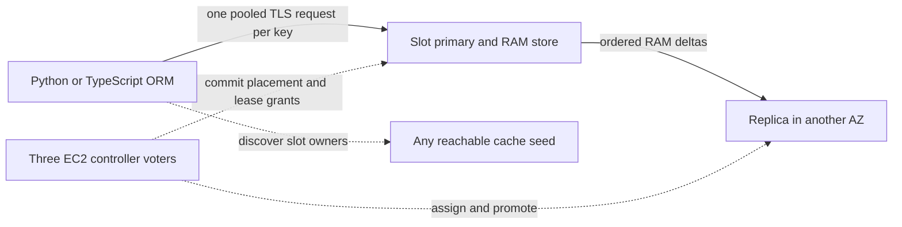

Build a native Rust cache database with in-memory reads and writes, expiring keys, shard replication, and a Python and TypeScript ORM that can connect to a standalone process or a cluster on EC2.

## Architecture and guarantees

The `cache` Cargo feature builds Nabedra's own server. Nabedra implements the command parser, storage, TTL, eviction, routing, replication, and cluster control. The release covers a Redis-compatible subset for binary key/value caching. Valkey, Redis, and Memcached are reference implementations for compatibility and performance tests. The initial scope covers strings and counters, with lists, sets, sorted sets, streams, scripting, and general transactions outside the command contract.

Use a single server process for local development. In a cluster, each slot has one primary and one asynchronous RAM replica, with three separate controller voters for placement and fencing. On a healthy primary, a successful reply means the command took effect in RAM. Subsequent primary reads see that write until another mutation, expiry, or eviction. A failover may lose recent writes or restore an older value if the replica missed the replacement or delete. Expired values remain expired. A cold start after losing all RAM copies starts empty. The application keeps irreplaceable data in OLTP or another authoritative store. This adopts the acknowledgment trade-off of asynchronous cache replication. [Valkey replication semantics](https://valkey.io/topics/replication/)

**Reuse from Nabedra.** Extract applicable TLS framing, worker resource accounting, supervisor and deployment inventory code behind engine-independent interfaces as each use becomes concrete. The cache owns a different execution path from the OLTP transaction coordinator. OLTP's durable identity reservation, transactional publication and storage engine are part of the comparison baseline. Historical loopback OLTP reads reached 2.91 ms median and 4.36 ms p99 on 103 hits against a three-row table. An RF3 development run on the separate performance branch measured 1,826.72 ms median for ten durable point updates at four aggregate CPUs. These measurements provide context. Run a paired benchmark before assigning a speed advantage to the cache. [OLTP read samples](../docs/testing/evidence/oltp/quiet-rf1/rf1-process.json) · [Admission code](../server/src/oltp_runtime/admission.rs) · RF3 evidence at Git revision `d330e60` in `docs/testing/evidence/oltp-latency/README.md`.



## Cargo, process roles and protocol

Build with `cargo build --release --manifest-path server/Cargo.toml --no-default-features --features cache`. Extend the existing exclusive engine guard and binary version output to select exactly one of `olap`, `oltp`, and `cache`. Preserve the default `olap,s3` build. A cache build includes the native server and its metadata consensus code. Its dependency graph excludes the OLTP storage engine, Arrow, Parquet, and the AWS SDK. Provide Linux arm64 and amd64 releases and a `cache` Docker target. [Cargo features](https://doc.rust-lang.org/cargo/reference/features.html) · [Current engine guard](../server/src/lib.rs) · [Current Docker targets](../Dockerfile)

| Entry point | Responsibility |
| --- | --- |
| `nabedra-db serve --config cache-local.toml` | Start the native RESP server in standalone mode. Use the same parser and storage as cluster workers. |
| `nabedra-db cache controller --config controller.toml` | Participate in a three-voter metadata quorum. Expose private mTLS admin and enrollment endpoints. |
| `nabedra-db cache worker --config worker.toml` | Enroll with a new incarnation, open client and peer listeners, and start serving only the slots for which it receives valid authority. |
| `nabedra-db cache admin --config admin.toml <command>` | Provide authenticated `init`, `status`, `rebalance`, `drain`, `replace`, and `cold-reset` operations. Use versioned, resumable operation IDs for topology changes. |

Implement RESP2 request arrays of bulk strings and binary-safe replies. Parse incrementally and bound argument count, frame bytes, declared lengths, pipelines, output buffer, total connections, and TLS handshake concurrency before allocation. Apply per-connection and per-identity admission limits. Preserve response order within a connection. Enforce TLS with hostname verification and ACLs for production, with explicit plaintext loopback mode for local use. Scope credentials to key prefixes and commands. Validate every key in a multicall before changing state. Give administrative operations separate credentials and a private endpoint. [RESP specification](https://valkey.io/topics/protocol/) · [ACL conventions](https://valkey.io/topics/acl/)

| Command contract | Required behavior |
| --- | --- |
| `GET`, `SET [NX or XX] [EX or PX]`, `DEL`, `EXISTS` | Values are bytes. An empty value is a hit. Missing and expired keys have the same reply. Conditional set checks and applies in one operation. Successful overwrite clears prior expiry unless a new TTL is supplied. Failed conditions preserve value and TTL. |
| `TTL`, `PTTL`, `EXPIRE`, `PEXPIRE`, `PERSIST` | Support the base commands. Relative expiry starts at application. Nonpositive `EXPIRE` / `PEXPIRE` deletes a live key. TTL replies use `-2` for missing and `-1` for no deadline. Reads do not extend TTL. |
| `INCRBY` | Atomic checked signed 64-bit addition. A miss starts at zero. Existing bytes must parse as a compatible integer. Preserve the live key's TTL. Invalid values or overflow leave state intact. |
| `MGET`, multi-key `DEL` / `EXISTS` | Execute on one actor. In cluster mode require the keys to share a slot and return `CROSSSLOT` before any mutation. Preserve argument order and duplicate-key semantics per command. |
| Driver handshake and discovery | Implement `AUTH`, `PING`, `ECHO`, `HELLO 2`, `CLIENT SETINFO`, `CLUSTER SLOTS`, `CLUSTER SHARDS`, and command metadata used by the supported driver versions. Test the exact handshake with stock clients configured for RESP2. Return explicit errors for unsupported commands and RESP versions. |

Use Redis Cluster's CRC16 slot function, hash tags, and 16,384 slots. Expose real node endpoints and use `MOVED` for a known different owner. During a handoff, return `TRYAGAIN` before execution while ownership is frozen. Return `CLUSTERDOWN` for an affected slot when no valid current owner can serve it. Resharding transfers whole slots in the background, so the server need not issue `ASK` or expose a partially moved slot. The client refreshes from bounded, allow-listed seeds and reuses direct connections to authenticated nodes. Protocol compatibility is qualified command by command. [Cluster specification](https://valkey.io/topics/cluster-spec/) · [Discovery response](https://valkey.io/commands/cluster-slots/) · [SET and TTL behavior](https://valkey.io/commands/set/) · [EXPIRE behavior](https://valkey.io/commands/expire/)

## The hot path and memory

Use a fixed number of execution actors per worker, initially sized against actual CPU quota. Each actor owns multiple slots and serializes operations in each slot. TLS/RESP tasks route validated commands to bounded actor queues. The actor checks role and authority, expires the addressed key if due, applies the command, then replies. One actor turn establishes the order of a single-slot operation. The primary reads directly from RAM. The write path uses a local replication journal in RAM. The response path has no controller request, disk write, or replica wait. Split client work, peer transfer and control progress into independently bounded queues. Standalone executes with the same engine and no cluster lease or replication work. Profile RESP parsing, TLS, routing, actor handoffs, allocation and TTL maintenance separately. If queue or handoff cost breaks the single-host gate, prototype routing connections and execution onto the same core before adding cluster complexity.

Store owned byte slices for keys and values with a hash table per slot. Maintain one indexed expiry record per expiring key, keyed by deadline and entry identity. Replacing or deleting a key removes its previous record. Compare absolute deadlines on reads and writes. Reclaim inactive expired keys with time- and item-bounded maintenance turns. Before promotion or migration, preserve deadlines and use the same expiry check on the receiver. In a cluster use the upper endpoint of the bounded clock interval to hide a due key conservatively. Test expiry precision and the maximum early-expiry window under admitted clock uncertainty. Reject service on an invalid clock. Use an injectable clock for local tests.

Default to sampled LRU within each slot. Also support a `noeviction` profile that returns explicit OOM. Budget slot bytes under a worker ceiling and let the controller allocate capacity across slots using observed RAM and load. Charge keys, values, expiry/index metadata, hash-table reservations, replies, journals, snapshot buffers, and replication state. Keep protected capacity for control and transfers. Reserve memory before growth, cap candidate eviction work per command and return OOM before mutation if the planned victims cannot free enough space. A replica applies the primary's exact eviction and expiration effects and never independently evicts live data from a promotable copy. Set an OS memory cap and retain RSS headroom for allocator overhead and fragmentation. Report both charged bytes and RSS. Limit a raw key to 512 bytes and a value to 1 MiB in the first release. Derive total frame and pipeline limits separately from those per-item limits.

## Replication, fencing and recovery

**Topology authority.** Use OpenRaft for metadata consensus, with a cache-owned checksummed metadata log and atomic snapshots on the controllers' EBS volumes. Implement and test the library's storage contract, including durable vote/log writes, fsync ordering, snapshot installation and recovery from partial tail writes. The metadata record contains cluster generation, membership and incarnation, each slot's epoch, its primary and replica, and lease/handoff state. Store topology and authority only. Peer RPCs carry cluster generation, slot, authority epoch, source and destination incarnation, and payload bounds. Cache values, command bodies and results live in RAM. [OpenRaft storage implementation guide](https://docs.rs/openraft/latest/openraft/docs/getting_started/index.html)

**Leases.** The controller commits grants for batches of slots with the same owner and a short expiration. Start acceptance testing with a 3 s lease, renewal attempted every 1 s, and an admitted clock interval at most 10 ms wide. Adjust these settings using measured failover time and renewal headroom. Bind each grant to the slot epochs and an exact worker incarnation. Renew outside command execution. Authorize a turn only while the local bounded-time upper endpoint is strictly before grant expiry, and recheck under the actor's exclusive ownership before the result or mutation becomes visible. Stage mutations privately through that check, including capacity for the journal entry and the bounded reply. Treat the successful final check as the operation's linearization point. Log the effects before processing the next command, and let peers reject effects from retired epochs. A successor uses a committed grant only when its lower time bound reaches the previous grant's latest committed expiry, or after the prior actor irrevocably freezes and acknowledges the exact grant. Pause on expired grants, excessive clock uncertainty, or rollback. Deliver grants over authenticated controller channels only after consensus commit. On a controller leadership change, recover the latest committed deadline before issuing grants. On worker restart, require fresh authority for the new incarnation. The EC2 profile uses ClockBound with Amazon Time Sync, and the lease argument assumes the reported interval covers true time. Qualify suspend/resume, clock faults, lost renewals, and minority partitions with deterministic schedules. If the quorum cannot renew, the data plane serves only through already valid grants. [ClockBound on EC2](https://docs.aws.amazon.com/AWSEC2/latest/UserGuide/compare-timestamps-with-clockbound.html)

**Replication.** For each slot, sequence canonical mutation effects within an epoch. Include the complete set of changes to values, absolute deadlines, deletions and evictions for each successful command. Keep a byte-bounded replay journal, and have the replica acknowledge its highest contiguous applied sequence. Ignore exact duplicates and reject gaps, wrong epochs, or stale incarnations. A missing log segment triggers snapshot catch-up. A snapshot carries an epoch and sequence cut. Stream it in bounded chunks using an immutable view with charged copy-on-write overhead, then apply retained deltas in order. If the pin, delta or time budget is exceeded, drop the incomplete transfer and retry with backoff. The primary can continue writing when a replica falls behind. Expose the lost failover coverage and bound retry work. Only a replica with a verified complete baseline, contiguous applied prefix and matching identity/epoch is eligible for promotion.

**Failover and restart.** After fencing the previous authority, promote an eligible replica from its last contiguous prefix, assign a new epoch, and build a replacement copy. At controller startup and after a change of term, start a 3 s observation window. During that window, treat an enrolled incarnation without a current-term report as unknown. Defer failover and replica replacement that would rely on its silence. A current-term report or a committed retirement can establish the incarnation's status earlier. A worker first heard late gets a full report-age interval from receipt before its report can expire. Rebuild a replica's verified baseline as early as possible to reduce the interval without an eligible recovery copy. Start failed workers with empty RAM and a fresh incarnation. Require catch-up before they can take over. Continue serving unrelated slots under their valid grants. Outside staged recovery, when both usable copies are lost, an operator requests a scoped cold reset that fences the old epoch and starts the slot empty. A complete fleet cold reset increments the cluster generation and clears all slot data and pending cache work. If scoped repair issued grants to returning workers, pause their renewals and wait for those grants to expire before requesting the fleet reset. Persist only the new topology. A peer returning late with the old generation cannot republish data.

**Recovery during replica replacement.** For K03, prefer a ready assigned replica. Once the current-term observation rule permits recovery, an enrolled staged target that reports a verified current-epoch baseline can become primary when it holds the last verified copy. Promote it even when the retained prefix trails the latest committed source progress by more than 32 mutations. Ordinary transfers still use the 32-mutation cutover limit. The source watermark is recorded when staging starts and advanced by committed renewals for that move. A target can hold more mutations than the last source report records, so this watermark alone cannot bound lost acknowledgments. The committed transition identifies both incarnations, the retained epoch and sequence, the source watermark, and the source's retirement or latest expired lease. Validate the transition against the expected slot, including its epoch, staged target and latest lease. The choice of the best verified copy uses observations from the current term.

Retirement prevents renewals. A copy follows the source incarnation for its assigned epoch until it installs a newer epoch, including after that source retires. The controller commits staged promotion only once its lower bound reaches the source's latest committed expiry. The new grant starts at or after that expiry. Writes acknowledged on the last grant remain subject to asynchronous replication loss.

When the source and assigned replica are unavailable during a staged replica replacement and the target has no usable verified baseline, the controller can cold-reset that slot automatically. It waits one progress-report window (3 s) after the later of the last committed grant's expiry and the start of observations in the current term. Outside a staged replica replacement, a slot without a usable copy waits for a scoped operator reset. Recovery changes take priority in batches of up to 256 per 250 ms reconcile turn. With a stable quorum and reachable workers, allow one renewal interval to install the placement and another for a fresh grant. A cold reset advances the epoch, records the loss, and initializes empty storage. Unrelated slots keep their contents and authority.

**Online move.** Enroll a target, stream a verified snapshot and deltas while the source serves, and bring lag below the cutover budget. Freeze the slot on the old primary, settle its bounded work and record the last applied sequence. Catch the target up to that exact sequence. The controller commits the replacement epoch only with fence and target-readiness evidence. Publish the new map and retire the old copy after restoring the configured replica count. If an operator or controller crashes, resume from committed move state. If the source dies before the freeze sequence can be verified, use the normal failover path with its asynchronous loss semantics. Throttle transfers and concurrent moves per worker, preserve expiry across movement and bound customer-visible freeze time.

**Accepted work.** A RESP mutation has one completion reply. Ingress and actor queues contain bounded, pending calls before execution. The cache exposes no queued-success reply or asynchronous receipt. If a connection drops after possible execution, the ORM reports an unknown write outcome. Any feature that later acknowledges queued work must store its complete request in replicated worker RAM and follow the repository's acceptance and cold-start rules. Existing database requests keep their original queue and durable mutation contracts. [Worker scheduling requirements](resource-aware-scheduling.md) · [Scheduler test cases](../docs/testing/scheduler-contract.md)

## Deploy on your EC2 instances

Ship a versioned CloudFormation template and one documented deploy command for a fresh or existing VPC. The deploy command takes an AWS region, network settings, worker instance type and count, and a reference to bootstrap credentials. It returns the private seed endpoints and readiness status. Automate first boot, voter formation, worker enrollment, placement and health checks. Retain a manual install path for an existing fleet. Use one regional cluster with private client and peer endpoints, three AZs, and one controller voter per AZ. Run controllers as separate systemd services on small dedicated instances in the reference deployment, each with a persistent encrypted EBS metadata volume. Use three memory-optimized worker instances to start, one per AZ, with three primary groups and their RAM replicas placed across AZs. A worker can host one primary group and one replica group under separate byte budgets. Keep sufficient spare memory, CPU and network bandwidth to serve after losing an AZ. Compare memory-optimized and compute-optimized shapes against the actual workload before sizing production. [EC2 memory-optimized instances](https://aws.amazon.com/ec2/instance-types/memory-optimized/) · [EC2 compute-optimized instances](https://aws.amazon.com/ec2/instance-types/compute-optimized/)

Use private DNS seed records and per-node DNS names in discovery replies. Keep seed discovery outside the request path. Limit the RESP security group to application callers and the peer/admin group to the authorized workers, controllers and operators. Issue TLS certificates for the advertised names, verify peer identities on enrollment, and exercise rotation with old and new certificates temporarily trusted. Use instance roles for retrieval of bootstrap material and for authorized EC2 actions. Set systemd resource limits, disable swap for workers, and publish per-slot throughput, expiry/eviction, oldest queued time, replication lag, lease headroom, catch-up progress, and unknown outcomes.

Start with manual growth. Join a new worker, validate capacity, move selected slots with replicas in distinct AZs, and verify placement before counting the new capacity. Grow only if demand is spread across enough keys to use new owners. A hot writable key still has a single serialization point. Scale up an overloaded owner or change the application key layout for that case. Replica reads are a later explicit consistency mode. Scale down only after the controller records a completed drain and proves that the surviving placement and resources satisfy the configured readiness policy.

Add automatic growth after the manual and failure paths pass. Feed sustained memory pressure, queue age, per-slot throughput and headroom into the existing deployment-planning approach. Launch through a versioned EC2 launch template, with bounded instance counts, spend, concurrent moves, and provisioning retries. Make the control plane request termination after a verified drain. An AWS lifecycle hook can delay termination, and AWS can proceed when it times out. Model forced termination as an instance fault. Compare hourly instance and EBS charges, network traffic, and cost per million successful requests at matched durability and p99. [Existing deployment planner](../server/oltp-replication/src/oltp_deployment/planner.rs) · [EC2 launch templates](https://docs.aws.amazon.com/autoscaling/ec2/userguide/create-launch-template.html) · [AWS lifecycle hook behavior](https://docs.aws.amazon.com/autoscaling/ec2/userguide/lifecycle-hooks.html)

## ORM

Export `Cache` from the Python and TypeScript package roots and `nabedra.cache` / `nabedra/cache`. Accept bootstrap endpoints, credentials, namespace and pool/deadline options. Python uses synchronous methods and a context manager. TypeScript uses promises and explicit `close()`. Implement the same command and error contract in both languages. Reuse existing cluster-aware RESP client libraries if the compatibility spike verifies their timeout and retry behavior. The ORM uses the native Nabedra endpoint in production. [Python driver cluster behavior](https://redis.readthedocs.io/en/stable/clustering.html) · [Node driver](https://github.com/redis/node-redis) · [ORM release parity](../docs/testing/orm-parity.md)

```python
from nabedra.cache import Cache

with Cache.connect(endpoint, username=user, password=secret, namespace="catalog", cluster=True) as cache:
    cache.set("sku:42", b"in stock", ttl_ms=30_000, when="absent")
    value = cache.get("sku:42")  # bytes | None
```

```typescript
import { Cache } from "nabedra/cache"

const cache = await Cache.connect(endpoint, { username, password, namespace: "catalog", cluster: true })
try {
  await cache.set("sku:42", new TextEncoder().encode("in stock"), { ttlMs: 30_000, when: "absent" })
  const value = await cache.get("sku:42") // Uint8Array | null
} finally {
  await cache.close()
}
```

| ORM method | Result |
| --- | --- |
| `get(key)` | Exact bytes or a miss. An empty byte string is a hit. |
| `set(key, value, ttl_ms=None, when="always")` / `set(key, value, { ttlMs?, when? }?)` | Boolean. Modes `always`, `absent`, and `present` map to unconditional, NX, and XX. SDK TTL is 1 through `Number.MAX_SAFE_INTEGER` milliseconds. |
| `delete(key)`, `expire(key, ttl_ms)`, `persist(key)` | Boolean. SDK `expire` accepts zero for explicit deletion and positive integer TTLs through `Number.MAX_SAFE_INTEGER`. |
| `ttl_ms(key)` / `ttlMs(key)` | Remaining whole milliseconds, `-1` for no deadline, `-2` for missing. |
| `increment(key, delta)` | Python `int` and TypeScript `bigint` for signed 64-bit values. Require lossless signed 64-bit replies in the driver spike, including the two extremes beyond JavaScript's safe number range. |
| `close()` | Release connection pools. Repeated close succeeds. |

Limit SDK keys to 1–250 UTF-8 bytes and namespace names to 1–64 ASCII characters in `[a-z0-9_-]`. Encode a key as `nb:<namespace>:<unpadded-base64url(UTF-8 key)>`, with server ACL checks on the full encoded prefix. Publish shared vectors and exact error mappings. Distinguish ordinary misses from authentication, overload, validation, transport and unknown mutation outcome. Retry definitive pre-execution redirects inside one bounded deadline. Disable driver offline queuing and mutation retries after possible transmission. A retry of a conditional set, a delete, an increment or a relative TTL can change the result. Test both installed packages and keep release versions in sync. Memcached applications can use the same ORM operations. An existing Memcached client speaks a different protocol with flags, CAS and distinct TTL conventions. [Memcached protocol](https://docs.memcached.org/protocols/basic/)

## Implementation and acceptance

| Stage | Deliverable and executed evidence required to advance |
| --- | --- |
| 1. Standalone native engine | Feature matrix, real RESP server and CLI, bounded actor/store, TTL and eviction, TLS/ACLs. K01–K02. |
| 2. Both ORMs and single-host speed | Python and TypeScript packages, installed-package parity and stock RESP client interoperability. Pass K04a before promoting the engine to cluster rollout. K01 and K04a. |
| 3. Cluster | Controller metadata quorum, direct slot routing, fencing, RAM replication, promotion, rolling replacement and online moves. Local multi-process fault histories first. K02–K03 and U01–U03. |
| 4. EC2 release | Reference infrastructure, fixed-size deployment, monitoring, runbooks, provider acceptance and traffic replay through both ORMs. Pass K03, K04b and K05 before claiming production cluster readiness. |
| 5. Elastic scaling | Demonstrate 3→6→12 primary-group growth under live traffic, AZ-loss performance, safe drain and provider fault handling. Enable automatic growth after K04b, K05 and A01–A02. |

| Case | Required assertions |
| --- | --- |
| K01 · Semantics and interoperability | Run shared oracle cases through both ORMs and pinned stock RESP2 clients. Verify same-slot batches, signed integer boundaries, eviction and expiry behavior, byte-exact replies, routing, restricted prefixes/commands and malformed or oversized frames. Run A/B interoperability checks against a pinned Valkey server. |
| K02 · Memory and latency under pressure | Assert frame, actor, journal, snapshot and output caps plus RSS headroom during churn and transfer. Inject expiry/overwrite/delete races, oversized values, saturated ingress and burst expiry. Check that stalls or invalid commands leave independent slots responsive. |
| K03 · Replication and authority | Kill or pause owners, replicas and controllers at deterministic boundaries before and after apply, reply, replication ACK, snapshot install, freeze, grant expiry and leadership change. Inject gaps, old incarnations, clock jumps, AZ partitions and concurrent moves. Keep an enrolled worker silent early in a new term, then deliver its first report late and check that its report gets a full age interval. Compare the retained prefix with the source's last acknowledged sequence after assigned failover, staged promotion, planned movement, and cold reset. Exercise ordinary transfer at 32 and 33 mutations of lag, and preserve the last verified copy at 33 or more. Verify scoped automatic and operator reset, lease exclusivity, expiry preservation and other slots continuing to serve. Include metadata log truncation and recovery. |
| K04a · Single-host Valkey parity | Run pinned release builds of standalone Nabedra and Valkey sequentially on the same EC2 host, with identical CPU and memory limits, persistence and replication disabled, equivalent eviction settings, and the same load generator pinned away from server cores. Use warm persistent TCP connections, one command at a time per connection, with loopback and TLS as a required lane. Report plaintext, cold connections and controlled pipelining separately. |
| K04b · Distributed parity and scale | Run Nabedra and Valkey on separate, matched sets of EC2 instances with one asynchronous replica per primary. Measure at 3, 6 and 12 primary groups, spread across 3 AZs, holding available CPU and RAM per group, bytes per group, replica ratio and client placement fixed. Include this gate on the smallest supported production cluster and at each larger tested size. Measure slot migration, skew, an AZ loss, and a hot writer separately. |
| K05 · EC2 deploy, replace and drain | Run the documented deployment from a clean environment, connect both installed ORMs to the emitted endpoints, and run a write/read/expiry smoke test. Verify re-running the same deployment converges without SSH or hand-edited membership. Exercise credential rotation, rolling and cold restarts, add/remove a worker, AZ loss, forced termination and provisioning failure. Measure time to readiness, recovery, lost acknowledgments, time to restore replica coverage and origin refill load. Prove the controller resumes interrupted operations and enforces placement and spend limits. |

**Single-host release gate.** On the same host, compare warm `GET` hits and `SET PX` with 64 B, 1 KiB and 64 KiB values under identical schedules. Use a stock RESP2 driver first, then each public ORM. At each required load, the upper bound of the confidence interval for Nabedra/Valkey client p50 and p99 must be **at most 1.20**. Report the 0.80–1.20 parity band and accept faster results. Use common offered rates derived from a separate Valkey calibration, including low load and 50% and 80% of Valkey's sustainable throughput at the declared p99 budget. Nabedra must also sustain at least **80%** of Valkey's correct operations per second under that budget. Test 1 ms p99 as a specific lane wherever Valkey sustains it. A hypothetical 0.50 ms Valkey p99 gives a Nabedra ceiling of 0.60 ms at the same load. No absolute millisecond number is assumed ahead of the run.

**Cluster release gate.** For uniform independent keys, use the same p50/p99 limit against the equivalent Valkey Cluster profile and at least **80% scale-out efficiency** at 6 and 12 primary groups relative to 3, using `goodput(N) / goodput(3) × 3/N` under the same p99 budget. Against the three-group baseline, that is at least 1.6× goodput at six groups and 3.2× at twelve. Verify healthy single-key operations reach one primary with no controller RPC, and that replication fans out to the fixed replica set as the fleet grows. Track controller CPU, routing refreshes, connection counts, per-group CPU and RAM, network saturation and latency during online scale-out. Run skew and hot-key stress separately. Before claiming a larger supported envelope, repeat at that size.

Across both gates, sweep offered load through saturation and include misses and mixed workloads. Start timers at scheduled client arrival and count every outcome. Qualifying loads have no unexpected rejects, timeouts or unknown outcomes. Warm up, use at least three independent paired repetitions and collect at least 10,000 measured samples per p99 cell. Publish raw results, confidence intervals, per-run percentiles, RSS and matching configurations. An interval spanning the gate calls for more evidence. Redis, Memcached and durable OLTP remain secondary comparisons with their configuration and semantics recorded. Compare Memcached with unreplicated memory only. [Valkey latency measurement guidance](https://valkey.io/topics/latency/)

For changes to shared worker code, retain the [scheduler contract](../docs/testing/scheduler-contract.md) cases C01–C07, M01–M03, F01–F03 and U01–U03. Run Q01–Q06, R01–R06 and T01–T06 for shared database admission, recovery and publication changes. Use A01–A02 and B01–B02 for provider, resource and load evidence. Add named regressions for new failure histories. Run both unchanged database engine feature matrices and the new cache-only matrix before release. The cache and cloud assertions in this plan remain to be executed.

## Design review

Reviewed 2026-11-26 by rv-cache against the shipped code on main `e6b4040b` where this plan is silent. Spec
`specs/cache/CacheCluster.tla`, T check `cache-cachecluster`. Findings and their fixes are in the review wave's
`findings/cache.md`. The ones that change this plan are marked below.

| Part | Content |
| --- | --- |
| Guarantees | CACHE-G05: `G05_ReplicaPrefix`, `G05_PromotedPrefix`, `G05_NoAckAfterHandover`, `G05_NoEarlyStagedCommit`, `G05_LossOnlyFromLag`, `G05_NoRepairOfSteady`, `G05_ObservationWindow`, `D6_LagBound`, `D6_OrdinaryTransferLag`, `D6_LastVerifiedCopyPreserved` and `D6_StagedRepair` (liveness). CACHE-G06: `G06_LeaseExclusive`, `G06_ServedEpochOrder`, with `ClockAssumption` as the lease argument's precondition. CACHE-G07: `G07_SlotOwnership`. CACHE-G02: `G02_ExpiredNeverReturns`, `G02_NoResurrection`. CACHE-G09: `G09_ColdStartEmpty`. Not modelled: G01 and G12 (byte-level replies and client encoding), G03, G04 and G10 (memory and timing), G08 (redirect encoding; the routing state it reads is the committed slot record), G11 (deployment lifecycle; the replace and drain steps it threatens are the `Replace` fault and the move actions). |
| Topology | Controllers: one linearizable log with a leader. A leadership change loses the leader's observations and may change its clock. Workers: RAM shards, an installed view and a grant per slot. Channels: worker to leader heartbeat (report, renewal, reply with topology and grants; a lost reply is modelled), copy to source pull replication (a reply delivered after an epoch, role, membership or generation change is modelled; loss is a retry), client to primary (a write is one actor turn). Faults, each with a budget and only before `GST`: crash with RAM loss, restart with a new incarnation, re-enrollment of a running process (`Replace`), controller partition, peer partition, lost heartbeat reply, delayed replication reply, leadership change, and clock drift within `MaxDrift` (past it in the E1 mutant). Operator-scoped and fleet cold resets and operator move orders have separate budgets and can start after `GST`. Out of scope: Raft internals, torn writes and controller disk loss (decision 4; the OpenRaft storage contract is tested separately), duplication on the pull channel (idempotent by sequence), memory limits on copies (R-cache-20), more than one slot (each slot's protocol is independent; batching limits are counted under Cost). |
| Spec | [CacheCluster.tla](../specs/cache/CacheCluster.tla) and [MCCacheCluster.tla](../specs/cache/MCCacheCluster.tla). The `cache-cachecluster` check uses the baseline configurations below. The separate `cache-recovery-policy` check exercises the approved recovery boundaries using the same actions. Liveness uses weak fairness for ticks, heartbeats (1 s renewal), reconciliation (250 ms turns), replication (25 ms polls), partitions healing, and report expiry (3 s report age). `Tick` assumes a worker that has stayed connected since the term began reports within the controller's window. The model abstracts wall-clock report ageing to an action after disconnection. The K03 runtime check must verify elapsed time from a late first report. |
| Results | [Run 45803189065](https://github.com/zPy52/nabedra-database/actions/runs/45803189065) at `be02eefb` failed overall. The automatic staged reset baseline passed (1,652,011 distinct states, depth 39), as did liveness (41,493 distinct states, depth 31). Seven baselines hit the 900 s budget with 1,314,143 to 4,540,209 states queued. The unfinished baselines left action coverage incomplete and prevented their mutants from counting. Three generated mutant configs named values absent from the model. `90220509` corrected those values, split controller and peer partition budgets, and divided the fault combinations among 16 baselines. [Run 45821916881](https://github.com/zPy52/nabedra-database/actions/runs/45821916881) finished with 12 passing baselines and 8 of 21 mutants caught. Data, lead, reset and skew timed out at 900 s with 430,724, 1,143,448, 387,255 and 1,548,221 states still queued respectively. Their timeouts left five actions without coverage. Nine mutants lost their controls. The freeze mutant broke replica-prefix safety before its expected exclusivity violation. The two clock-uncertainty mutants and the early staged-commit mutant found no violation under their bounds. [Run 45842383770](https://github.com/zPy52/nabedra-database/actions/runs/45842383770) passed the bug-record check on `90220509` (126 records validated, 31 open). |
| Mutants | P1 `no_uncertainty` (`G06_LeaseExclusive`), `no_uncertainty_served` (`G06_ServedEpochOrder`), `no_uncertainty_resurrect` (`G02_NoResurrection`). P2 `replica_keeps_deleted` (`G05_ReplicaPrefix`), `replica_keeps_deleted_promoted` (`G05_PromotedPrefix`), `replica_set_after_expiry_del` (`G05_ReplicaPrefix`). P3 `owner_change_keeps_epoch` (`G07_SlotOwnership`). P4 `cold_reset_ignores_live_lease` (`G06_LeaseExclusive`). E1 `drift_beyond_bound` (`ClockAssumption`), `drift_beyond_bound_lease` (`G06_LeaseExclusive`). P5 `staged_ignores_fence` and P7 `retire_is_fence` (`G06_LeaseExclusive`). P6 `staged_ignores_lag` (`D6_LagBound`). `expiry_lower_endpoint` (`G02_ExpiredNeverReturns`), `accept_retired_epoch` (`G05_ReplicaPrefix`), `cold_reset_retains_data` (`G09_ColdStartEmpty`), `freeze_keeps_serving` (`G06_LeaseExclusive`), `prefix_no_staged_recovery` (`D6_StagedRepair`), `prefix_retired_gate` (`G05_LossOnlyFromLag`), `prefix_early_staged_commit` (`G05_NoAckAfterHandover`), `prefix_no_observe_window` (`G05_NoRepairOfSteady`). Run 45803189065 caught `prefix_no_staged_recovery` with an 18-state lasso. Run 45821916881 caught the retirement replication mutant in 7 states and the original observation mutant in 5 states. The separate recovery policy schedule and mutant results are below. |
| Counterexamples | CACHE-1 (records `CACHE-retired-live-source-lost-writes` and `DESIGN-cache-retired-source-handover`): the shipped design, which the two `prefix_*` mutants of `follow_retired` restore, acknowledges writes on a retired source after its successor took over (staged path) or after its copy stopped pulling (assigned path). Plan changed: "Recovery during replica replacement" now says a copy keeps applying a retired source's effects and the promotion commits only at the source's latest expiry. Code pending. CACHE-2 (records `CACHE-K03-DOCKER-PLACEMENT` and `DESIGN-cache-silent-worker-repair`): failover and replica replacement act on a connected worker's silence at the start of a term (`prefix_no_observe_window` restores it). The approved plan applies the observation window to failover and replica replacement. CACHE-3: the approved repair policy is automatic during staged recovery and operator-scoped elsewhere. `D6_StagedRepair` checks liveness under that scope. CACHE-4: the approved plan preserves the last verified copy past the ordinary cutover threshold. `D6_LastVerifiedCopyPreserved` checks the staged reset fallback and `D6_OrdinaryTransferLag` protects the ordinary transfer threshold. |
| Cost | Per operation, from the spec's actions. GET hit: no log entry and no controller or replica round trip. GET of a due key, SET and DEL: one RAM journal entry, no fsync, no controller or replica wait (the plan's target). Each copy pulls one delta, so fan-out is the fixed replica plus at most one transfer target. Renewal: one heartbeat per worker per second, one Raft entry with a quorum fsync, a reply with the grants and, when the revision changed, the whole topology (about 4.5 MB for 16,384 slots, finding CACHE-7). Failover: lease expiry (3 s), up to one extra report window (3 s) after a controller change when an incarnation is unobserved, one reconcile entry per 256 slots per 250 ms turn, one heartbeat to install and one for the grant (the plan's two renewal intervals). Staged promotion: the same; with the fix it commits at the source's expiry, which the target's grant needed anyway. Online move: order, freeze, frozen and cutover entries (four) and about two heartbeats of `TRYAGAIN` per slot. Cold reset: one admin entry after the scoped leases expire. Gaps found by code reading: an assigned replica lane of 5,461 slots sustains about 15 writes/s per slot (CACHE-6), and 64 concurrent moves per worker make replica coverage after an AZ loss take minutes (CACHE-9). |
| Independent read | `wave-dr/reads/cache.md` (2026-11-24) assessed the original plan. Review of the approved changes is pending. R-cache-01: check and append are one `Write` step. 02: base fixed at install, `G05_PromotedPrefix`. 03 and 04: `ClockAssumption` and the E1 mutants (a suspend-unaware clock is drift past the bound). 05: not applicable, grants carry the absolute committed expiry (`state.rs:233`). 06: abstraction, apply re-validates each change against the latest slot record. 07: a renewal applies to the slot's current primary in the same step. 08: move actions; no unfreeze path exists; `freeze_keeps_serving`. 09: `G02_NoResurrection`; hides are journaled. 10: `HoldReply`, `accept_retired_epoch`. 11: a snapshot applies atomically (`copies.rs` assembles chunks in a separate store). 12: reports keyed by incarnation (`Live`). 13: `Replace`. 14: `.staged`, `.skew`, `retire_is_fence`. 15 and 16: `D6_LagBound` and CACHE-4. 17 and 19: `AdminColdReset` and P4. 18: `StagedReset` with a controller partition; epoch and generation checks in `Recv`. 20: not modelled (memory). 21: replicas never expire locally. 22: absolute deadlines in effects, `HoldReply`. 23: `Expire` requires authority. 24: abstraction, compare-and-set at apply (`placement.rs:326`). 25: out of scope (decision 4). 26: `LeaderChange` with `StagedReset`, and CACHE-2. 27: not modelled (one slot), CACHE-9. 28: out of scope (client retries, K01 and G12). |

### Baseline configurations

All 16 broad configurations use three workers, two client IDs, one slot and one key. Time is in model ticks.
`D = MaxDrift = TTL = 1`, `L = RA = G = 3` and `MaxLag = 0`. The model requires staged promotion to retain at least the
reported prefix. The production threshold of 32 mutations is outside these bounds. All safety configurations
use worker and client symmetry and start from any distinct primary and replica. Clocks start at zero skew
except in `.skew` and `.skewstaged`, which start each clock at either extreme of the drift bound.
The liveness configuration uses a fixed initial primary and replica and no symmetry.

The configurations below are in `specs/cache/`. Mutations count actor turns and do not include synthetic
expiry deletes. Each listed fault has a budget of one and unlisted faults have a budget of zero. Faults
stop at `MaxTime`, except in `.live` where they stop at tick 2. Every configuration uses two epochs,
except `.live` which uses three.

| Configuration | MaxTime | MaxWrites | Enabled faults and operations |
| --- | ---: | ---: | --- |
| `CacheCluster.cfg` | 4 | 1 | Crash and controller partition. |
| `CacheCluster.autoreset.cfg` | 7 | 0 | Crash and leadership change during automatic staged reset. |
| `CacheCluster.data.cfg` | 4 | 2 | Delayed replication reply with SET, TTL and DEL interleavings. |
| `CacheCluster.failover2.cfg` | 4 | 2 | Controller partition with SET and DEL across failover. |
| `CacheCluster.fixed.cfg` | 4 | 1 | Live source re-enrollment with the `follow_retired` and `observe_window` variants enabled. |
| `CacheCluster.lead.cfg` | 4 | 1 | Leadership change and one worker or controller clock drift step. |
| `CacheCluster.live.cfg` | 8 | 0 | Crash before tick 2 and the `D6_StagedRepair` liveness property. |
| `CacheCluster.move.cfg` | 5 | 1 | Crash and an operator-ordered online move. |
| `CacheCluster.peer.cfg` | 4 | 1 | Peer partition and crash while the replica lags. |
| `CacheCluster.reset.cfg` | 4 | 1 | Operator cold reset (scoped or fleet) and delayed replication reply. |
| `CacheCluster.restart.cfg` | 4 | 0 | Crash, restart with a new incarnation, and lost heartbeat reply. |
| `CacheCluster.skew.cfg` | 4 | 1 | Clock drift and controller partition from extreme initial clock skew. |
| `CacheCluster.skewstaged.cfg` | 5 | 0 | Live source re-enrollment from extreme initial clock skew. |
| `CacheCluster.staged.cfg` | 4 | 1 | Live source re-enrollment during staged promotion. |
| `CacheCluster.stagedcut.cfg` | 5 | 0 | Controller partition during staged promotion or reset. |
| `CacheCluster.term.cfg` | 4 | 0 | Crash and leadership change with the `follow_retired` and `observe_window` variants enabled. |

### Search limits

The first run reached the 900 s limit per configuration with broader parameter combinations.
The new settings include every modelled fault kind across the safety baselines. They cover selected overlaps.
Live source re-enrollment with a peer partition remains outside these bounds. The separate recovery policy check
covers late reporting around a term change and controller partition. Report-age timing after late receipt
requires the runtime checker. Review of the L2 fault bounds is pending. The model caps the time, epoch and mutation
counts through its constants, with no TLC state constraint, depth cap or `VIEW`.
At most two writes run in the broad data and controller-partition baselines. The other broad configurations
have at most one write. `Write` abstracts each mutation as one actor turn and its effect omits client identity.
These bounds cover mutation order within that abstraction and leave queueing and request overlap before or
after the actor turn outside the model. The liveness check covers a crash without ongoing writes from one
initial placement. The review has a separate simulator mapping and no simulator trace validation on this revision.

### Recovery policy schedules

[CacheRecoveryPolicy.tla](../specs/cache/recovery-policy/CacheRecoveryPolicy.tla) starts from the cluster's `Init`
and uses its actions under named schedules. Its model uses three workers, two client IDs, a 3-tick observation
window, and the production cutover limit of 32 mutations. TLC checks the exact terminal depth and reachable state
count, including both outcomes of late reporting and every available placement in the scoped operator reset.
The directed schedules restrict the interleavings independently of the broad `cache-cachecluster` check.

| Schedule | What the control checks | Local distinct states |
| --- | --- | ---: |
| Last copy | No promotion while the last committed grant remains live. A premature successor installation would expose a stale acknowledgement. Promote the verified staged copy at lag 33 when the fallback reset would otherwise become eligible. | 57 |
| Skewed failover | After a fast controller promotes a fast replica, a slow predecessor cannot still authorize or acknowledge a write. | 14 |
| Frozen move | Keep the predecessor frozen while the successor serves the transferred prefix, even while the old grant is still live. | 17 |
| Retired-source replication | After the replica learns the source was retired, the replica still pulls a new mutation acknowledged under the old grant. | 11 |
| Failover after a term change | Keep the primary while its current-term report is pending, then renew it once the report arrives. | 13 |
| Replica replacement | Wait through a partition and heal. A late report keeps the replica in place. If the report still has not arrived at the deadline, start replacement. | 15 |
| Staged automatic reset | Wait past the old grant and through the grace period, then reset when the staged target has no baseline. | 15 |
| Scoped operator reset | Keep automatic reset disabled for an unstaged slot without usable copies. Execute the explicitly scoped reset. | 17 |
| Ordinary replica transfer at 32 | Complete the transfer. | 46 |
| Ordinary replica transfer at 33 | Leave the copy staged. | 47 |

The initial recovery-policy run passed on [Actions 45846984253](https://github.com/zPy52/nabedra-database/actions/runs/45846984253).
The extended local run completed each clean schedule with an empty queue. The clock-bound mutant exposed overlap in
12 states (`G06_LeaseExclusive`) and a stale acknowledgement in 14 (`G06_ServedEpochOrder`). The freeze mutant exposed
overlap in 17 states. The early-commit mutant exposed an unsafe transition in 48 states (`G05_NoEarlyStagedCommit`)
and a stale acknowledgement in 50 (`G05_NoAckAfterHandover`). The retirement replication mutant exposed lost tail
replication in 10 states (`G05_LossOnlyFromLag`). Observation-window mutants failed in 11 and 6 states. The last-copy reset and
ordinary transfer lag mutants failed in 57 and 47 states. The broad baselines retain their original properties and
bounds. These schedules provide evidence for the listed cases only.

The model batches planning and commitment into one action. K03 must exercise reports and an outstanding recovery
proposal crossing a controller term change, as well as the measured age of a late first report and the time needed
to rebuild a replica baseline.
