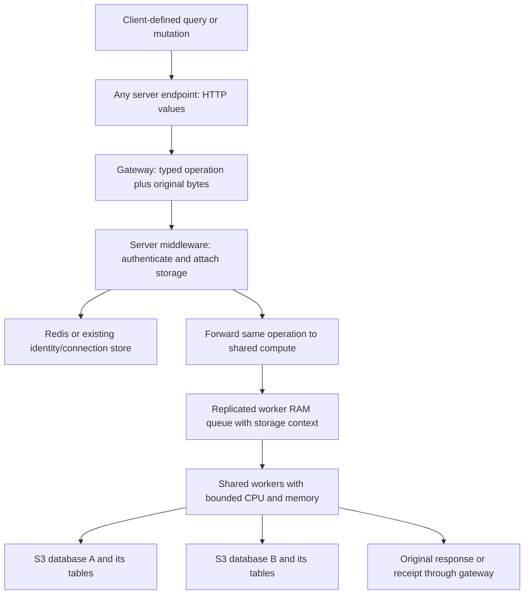

Nabedra Database should install from this repository and let one shared cluster execute client-defined operations after a Python server endpoint adds authorized storage credentials.

Status: approved and implemented, 2026-11-16. Package uploads and registry releases remain deferred. The gateway is framework independent and accepts plain HTTP data. The [usage guide](../docs/cli-and-serverless.md) records the implemented interfaces; the [execution ledger](../docs/testing/cli-serverless-evidence.md) distinguishes executed assertions from remaining acceptance boundaries. Final release installation and the listed installed S3 assertions passed; remaining acceptance boundaries are recorded in the execution ledger.

Use two modes: `fixed` binds compute to one database; `serverless` accepts database context supplied by a trusted server endpoint. An S3 bucket and prefix identify a database containing multiple tables. Applications A and B share compute while their catalogs and tables remain separate. Workers stay running by default; automatic scale-to-zero is outside this proposal.

The original Python CLI only launched workers and needed a separately built Rust binary. This implementation extends [that entry point](../orm/src/nabedra/cli.py), preserves the [public Python supervisor](../orm/src/nabedra/serve.py), and adds S3 selection and request-scoped data grants to [distributed workers](../server/src/node/runtime.rs). Fixed mode retains operator credential discovery; serverless data access uses explicit gateway snapshots.

---

Extend the existing `nabedra` entry point. A repository installer creates an isolated environment, installs the local ORM/CLI, builds the locked Rust release binary once, and copies it into the environment's `bin` directory. Require Python 3.11+ and the repository's Rust toolchain on the build machine. Starting an installed server invokes no Cargo.

```sh
# Setup from the repository root:
python3.11 scripts/install_nabedra.py --prefix .nabedra
.nabedra/bin/nabedra --version
# Install the ORM and server gateway into an application's environment:
python -m pip install '/path/to/nabedra-database/orm[gateway]'
```

Activate `.nabedra/bin/activate` to use bare `nabedra` below. Use [regular local installs](https://pip.pypa.io/en/stable/topics/local-project-installs/) for deployments and editable installs for development. Keep the core ORM standard-library-only. The local `gateway` extra supplies HTTPX for sync/async forwarding; `aws` optionally supplies Boto3 credential discovery. The gateway imports no web framework, auto-detects no framework request types and ships no framework-specific handlers. Importing the ORM or displaying help performs no network, credential resolution or process startup.

Support server builds on Linux and macOS; defer Windows server support because the supervisor uses POSIX facilities. The ORM remains platform independent. Defer public wheels, a separate runtime package, PyPI uploads and image-registry publishing. Resolve the binary in order: explicit `NABEDRA_SERVER_BINARY`, compatible environment-local executable, compatible `nabedra-database-server` on `PATH`. Invalid explicit overrides stay errors. Preserve existing Rust commands and Python `serve()`; report CLI, binary, config and protocol versions through `nabedra --version --json`.

---

Fixed mode uses the configured AWS profile/workload role and existing `NABEDRA_TOKEN`:

```sh
nabedra database serve --mode fixed --storage s3://app-a/nabedra/ --region eu-west-1
```

Shared compute uses the operator's control bucket and a protected Nabedra Database data token for trusted application gateways. The compute role accesses control storage; customer data credentials arrive from gateway middleware.

```sh
nabedra database init --mode serverless --control-storage s3://nabedra-ops/production/ \
  --region eu-west-1 --data-token-file /run/secrets/nabedra-data \
  --output nabedra-database.json
nabedra database doctor --config nabedra-database.json
nabedra database serve --config nabedra-database.json --local-workers 2
```

`init` writes strict version 2 JSON config and protected admin credentials if none were supplied. It prints paths, never secrets, refuses overwrites and provisions nothing. Ask for missing settings interactively; `--non-interactive` requires flags. Config holds secret-file references, worker resources, execution limits and cluster identity, without customer credentials. Preserve version 1 configuration support.

`serve` supervises the API and local worker processes in the foreground, forwards signals, drains owned work and preserves failure status. `--local-workers` counts processes; `--threads-per-worker` sets each process's compute ceiling. Existing Rust `serve --workers` keeps its thread meaning. Preserve explicit `--cold-start`. Local and remote workers share enrollment and execution semantics. Production replicas require separate failure domains.

Provide a local Dockerfile with `docker build -t nabedra-database:local .`. Deployment examples mount config/secrets, configure a workload role and HTTPS, and run `database serve --config /etc/nabedra/nabedra-database.json`; separate workers use `database worker --bootstrap /run/secrets/worker.json`. No implicit cloud provisioning, daemonization or image upload.

| Command | Behavior |
| --- | --- |
| `nabedra database init ...` | Generate configuration and secret references. |
| `nabedra database serve [--config nabedra-database.json]` | Start the supervised API and local workers; default config is `./nabedra-database.json`. |
| `nabedra database worker --bootstrap PATH` | Preserve the existing worker launcher. |
| `nabedra database doctor --config PATH` | Check versions, config, secret permissions and storage reads without changing data; identify unverified write permissions. |
| `nabedra database cluster status --url URL --admin-token-file PATH` | Report run, workers, pending work and resources; support `--json`. |
| `nabedra database cluster scale N --url URL --admin-token-file PATH` | Call the existing admin API; provisioning requires a configured provider. |
| `nabedra database migrate --storage URI --region REGION --cluster-id UUID --confirm-writers-stopped` | Explicitly upgrade one catalog using authorized credentials and the intended owning cluster. |

Listeners default to loopback. External traffic and worker links use verified encrypted transports. Keep admin, worker and gateway-to-compute credentials separate. CLI exit codes are `0` success, `2` invalid arguments/config and `1` runtime failure; preserve signal termination status.

---

Add a server-side `Gateway` helper that accepts the HTTP method, request path, header pairs and raw body bytes from any server. The user has already selected the query/mutation in that request. Gateway parses it into a typed, read-only operation, runs registered middleware, attaches trusted storage context and forwards the original operation to compute. The server handler never reconstructs it through `Database`, `Table`, `Query` or `Database.submit()`.

The client keeps its existing ORM and points it at the application's endpoint:

```python
from nabedra import Database
db = Database(url="https://app.example.com/nabedra", token=application_token)
# Existing table/query methods create the HTTP operations on the client.
```

That client needs no AWS credentials or new `storage=` argument. The default database comes from authenticated identity. An optional `database=` selector can set `X-Nabedra-Database`; the gateway treats it as untrusted input and authorizes it. The operation body remains the current wire envelope, for example:

```json
{"request_id":"11111111-1111-4111-8111-111111111111","operation":"table.get","payload":{"table_id":"22222222-2222-4222-8222-222222222222","key":"first"}}
```

The public forwarding methods accept plain Python values and return a framework-independent `HTTPResponse` with `status: int`, `headers: tuple[tuple[str, str], ...]` and `body: bytes`:

```python
class Gateway:
    def handle(
        self, *, method: str, path: str,
        headers: tuple[tuple[str, str], ...], body: bytes,
    ) -> HTTPResponse: ...

    async def handle_async(
        self, *, method: str, path: str,
        headers: tuple[tuple[str, str], ...], body: bytes,
    ) -> HTTPResponse: ...
```

The block above specifies signatures; the proposed server usage is:

```python
import os
from nabedra.gateway import Gateway, GatewayContext, S3

gateway = Gateway(
    cluster_url="https://compute.internal",
    token=os.environ["NABEDRA_COMPUTE_TOKEN"],
    mount_path="/nabedra",
)

@gateway.middleware
async def attach_storage(ctx: GatewayContext) -> None:
    user = await authenticate(ctx.headers.get("authorization"))
    if user is None:
        ctx.reject("unauthorized", "Authentication required")
    connection = await connections.authorized_for(user.id, ctx.database)
    ctx.principal = user.id
    ctx.storage = S3(
        bucket=connection.bucket, region=connection.region,
        prefix=connection.prefix, credentials=connection.credentials,
    )

async def handle_http(method, path, header_pairs, raw_body):
    return await gateway.handle_async(
        method=method, path=path, headers=tuple(header_pairs), body=raw_body,
    )
```

`authenticate` and `connections.authorized_for` are application-owned functions. The server's routing code supplies these HTTP values and maps the returned response to its own response object. It reads no operation fields itself and calls no ORM methods. No framework-specific object crosses the gateway interface. Header pairs preserve duplicates; `path` is the request target with its query string if present, never a full URL. The helper validates the configured mount and rejects unsupported queries/paths.

`Gateway.middleware(callback)` registers callbacks in order during setup. Each call gets fresh `GatewayContext`. Read-only fields are `method`, normalized `path`, case-insensitive `headers`, `raw_body`, `database`, `operation` and `receipt`. POST `operation` exposes `request_id`, `name` and immutable `payload`; receipt GET exposes `run_id`/`request_id`. Middleware sets `principal`/`storage` or calls `ctx.reject(code, message)`. The gateway owns forwarding after the chain.

Missing storage, middleware denial/exception or credential-provider failure stops before forwarding. Middleware can inspect the existing operation for authorization; operation bytes, ID and destination are immutable. `handle()` accepts synchronous middleware; `handle_async()` accepts async callbacks and bridges sync callbacks through bounded thread capacity. Async-only middleware passed to `handle()` fails before forwarding. Use `with gateway` or `async with gateway`, or explicit `close()`/`aclose()`, to manage resources inside the application's worker lifetime.

The optional HTTPX dependency is an HTTP transport, independent of the hosting framework. Use [its sync/async clients](https://www.python-httpx.org/async/) with bounded connections, explicit deadlines, verified TLS, no environment proxies/redirects and `retries=0` via [transport configuration](https://www.python-httpx.org/advanced/transports/). Translate rejections into a framework-neutral Nabedra Database error response; the hosting server returns those bytes/status without substituting framework error envelopes.

`S3(bucket, *, region, prefix="nabedra/", credentials)` accepts `AwsCredentials` or a zero-argument credential provider. `AwsCredentials(access_key_id, secret_access_key, *, session_token=None, expires_at=None)` uses a UTC datetime when expiry is known and includes the session token for temporary credentials. A lazy optional `nabedra.aws.default_credentials(profile=None)` uses a persistent Boto3 session and consistent snapshots with [SDK refresh behavior](https://docs.aws.amazon.com/boto3/latest/guide/credentials.html). These types belong to the server integration; the public client sends no AWS secrets.

The middleware's Redis/existing-Database lookup uses verified user/tenant identity and the authorized database selector, never the request UUID as authentication. Prefer role references and scoped temporary credentials using [STS AssumeRole](https://docs.aws.amazon.com/STS/latest/APIReference/API_AssumeRole.html) with [operator-generated external IDs](https://docs.aws.amazon.com/IAM/latest/UserGuide/confused-deputy.html). Nabedra Database has no mandatory Redis dependency or separate resolver HTTP service. Persistent per-request queue data never belongs in Redis.

---

Allowlist only `POST /v1/operations`, `POST /v1/requests`, and `GET /v1/requests/{run_id}/{request_id}` after removing the configured mount prefix. Reject other paths/methods, unexpected query parameters and admin/internal routes; the raw request cannot choose the upstream host. Run middleware for operations and every receipt access.

The hosting server must enforce the 8 MiB limit while collecting raw body bytes from its stream, independent of declared length. The gateway independently checks body/header size and bounds parsing/concurrency; a post-read size check cannot bound memory already allocated by the host. Document this integration requirement without importing a framework. Reject duplicate JSON fields, malformed envelopes, invalid IDs and unsupported operations before forwarding. Retain exact original bytes after parsing; do not normalize scalar spellings, whitespace or field order.

Gateway generates the internal headers below from server middleware. Reject externally supplied storage/identity headers, consume the application bearer for authentication and replace it with the compute bearer upstream. Never relay cookies, arbitrary client headers or hop-by-hop headers. An optional external database selector is consumed, not blindly copied as trusted identity.

```http
Authorization: Bearer <private-gateway-compute-token>
X-Nabedra-Storage: <base64url-authorized-storage-context>
```

`X-Nabedra-Storage` is unpadded base64url of strict UTF-8 JSON:

```json
{"version":1,"bucket":"app-a","region":"eu-west-1","prefix":"nabedra/","credentials":{"access_key_id":"<access-key>","secret_access_key":"<secret-key>","session_token":"<session-token>","expires_at":"2026-11-16T20:00:00Z"}}
```

Token/expiry may be null where absent. Allow only general-purpose S3 buckets and validated regions/prefixes; no caller-controlled endpoints, credential processes or profile paths. Bound decoded context to 16 KiB, its header to 24 KiB and total headers to 32 KiB; reject duplicates/unknown fields and charge buffers. Ship matching proxy limits. Require HTTPS, suppress secrets in logs/traces/errors and use `Cache-Control: no-store`. Fixed mode rejects storage context.

Forward each incoming operation exactly once using its existing request ID and raw bytes. Do not use the current `_Transport.request()`, which generates a new UUID and encodes another operation; add a raw forwarding transport. Pass upstream success/error status and JSON response bytes back unchanged, within the existing 8 MiB limit, with safe response headers. Preserve `202` receipts and terminal envelopes; never unwrap/re-wrap data or return success on a lost response. Any receipt URL must use the public mount, not the private compute host.

A pre-forward failure returns the existing correlated `not_applied` error envelope. A possibly forwarded mutation with a lost/invalid response returns `503 outcome_unknown` with `outcome: "unknown"` and the original request ID. Never resubmit automatically. Disconnect releases transport only; accepted work retains its context on workers. Bound cancellation cleanup, connection ownership, middleware/lookup deadlines and buffered response memory. Receipt polling reauthorizes and attaches fresh credentials for the same storage target.

Workflow: client-defined operation arrives at the application endpoint, gateway validates it, middleware authorizes identity/database and fills storage context, gateway forwards the same operation, workers execute, and the original result/receipt returns to the client.



---

Implement a bounded `DatabaseRegistry` and immutable worker `RequestContext`. Separate operator control/membership storage from customer data storage. Add distributed S3 execution, including conditional control writes, while retaining HTTP fixtures. All database handles share the physical worker pool and scheduler without multiplying resource ceilings.

Derive `StorageKey` from `(AWS partition, bucket, normalized prefix)`, independent of application servers, API instances and credential rotation. Region must match the bucket. Gateway bindings for pending work/receipts cannot silently change target. Reject overlapping database/control prefixes in the same bucket. Scope catalogs, tables, caches, receipts, deduplication and decisions by storage identity and check the authenticated grant before access. Identical UUIDs in different databases are independent; another body for the same identity conflicts. Digest original operation bytes, excluding replaceable credentials.

Use explicit AWS providers and separate [credential/identity caches](https://docs.aws.amazon.com/sdk-for-rust/latest/dg/credproviders.html) per grant/version. Never mutate process environment or fall back to the compute role for customer data. Authorization for cached values/receipts must cover backing objects; bypass shared caches where it cannot be established. Signed jobs, prepared outputs, pins and replicas bind storage identity, request digest, run and term to the accepted record.

Replicate complete request/context snapshots in encrypted authenticated worker RAM before `202`. Persist no AWS keys, user bearers or pending requests in control history, bootstrap files or Redis queues. Charge SDK clients, registry entries, contexts, catalogs, replicas and retained results under shared memory limits. Bound idle handle caches and pending work per authenticated compute-data grant under global limits; gateway middleware enforces finer user quotas. Preserve approved scheduling policy. Never evict pending request context.

Extend catalog fences with cluster identity through explicit migration. One storage key has one owning cluster. Fence each database before resumed dispatch after takeover/cold-start and keep authority checks in the same [conditional root write](https://docs.aws.amazon.com/AmazonS3/latest/userguide/conditional-writes.html) as publication. An inaccessible database pauses its work/reconciliation without blocking unrelated databases. Idle handle recreation/credential rotation never starts a new run. Initialize new databases on demand; explicitly migrate existing catalogs after old writers stop. Live cross-cluster transfer is deferred.

Preserve [scheduling requirements](resource-aware-scheduling.md) and [the test contract](../docs/testing/scheduler-contract.md). Gateway/application/API loss does not discard accepted work. Credentials are snapshots; a refreshed gateway credential cannot renew an already queued snapshot. Reject known-expired credentials before admission; expiry during accepted work can fail it. Reconcile potentially committed writes and retain unknown outcomes. Fresh receipt credentials can read durable decisions. Automatic renewal inside accepted work requires a separate refresh design.

Stopping every worker abandons unfinished requests and retains committed mutations. New-run startup requires explicit cold-start/fencing or authoritative configured-provider evidence; heartbeat expiry is insufficient. Never replay pending work from object listings/Redis. Preserve result expiration. Provisioning remains fixed/manual without a tested adapter; retain the configured Kubernetes adapter and add no AWS compute adapter.

---

Implementation tasks:

| Task | Deliverable | Dependencies |
| --- | --- | --- |
| [x] CLI1 | Repository installer, local Dockerfile and binary compatibility checks | None |
| [x] CLI2 | Init/serve/doctor/admin commands and local-worker supervision | CLI1 |
| [x] SL1 | Separate control/data storage, registry, distributed S3 and catalog fencing/migration | None |
| [x] GW1 | Strict raw-operation parser, request context, middleware chain and single-call forwarding | None |
| [x] GW2 | Framework-independent sync/async entry points, lifecycle and HTTP response preservation | GW1 |
| [x] SL2 | Trusted storage-context admission, global/per-grant accounting and context recovery | SL1, GW1 contract |
| [x] VERIFY | Local installation, framework-free forwarding, AWS/failure/isolation evidence and guides, with unexecuted acceptance cases recorded in the execution ledger | All |

The assertion matrix below defines acceptance requirements. Task completion is not a claim that every scenario has passed. Consult the execution ledger for actual commands, evidence and limits, and preserve every relevant scheduler-contract case.

| Cases | Assertions |
| --- | --- |
| CLI01 | Clean-checkout install and local image need no upload; version/help/import checks pass; startup never invokes Cargo and missing build tools fail setup clearly. |
| CLI02, U01, F03 | CLI local/remote behavior matches; signals drain/reap children and failures preserve exit status; doctor changes no customer objects. |
| SL01, Q05, T03, T06 | Same table names, row keys and UUIDs in separate buckets/prefixes remain independent. Credential rotation/replay within a database publishes once. |
| SL02, U02 | Forge identity/storage headers and worker context; warm caches then deny object access. No foreign data, unauthorized writes, operator-role fallback or acceptance. |
| SL03, Q03-Q06, R01-R06, T04-T05 | Kill gateway/API/holders, join with pending work and expire/rotate credentials; assert complete-context retention, reconciliation, full-stop abandonment and other-database progress. |
| SL04, C01-C07, M01-M03, Q01-Q02, F01-F03 | Concurrent tenant/gateway load respects shared compute/RAM and per-grant admission; accepted-ID conservation and progress hold. |
| SL05, T01-T06, R05 | Multiple gateways/APIs reach one storage key; second-cluster ownership conflicts and catalog fences prevent duplicate/lost publication. |
| SL06, U02 | Oversized/duplicate/truncated protocol, bad selectors/paths and middleware denial/exception produce typed errors with zero upstream submissions; sentinel secrets appear in no captured logs/history. |
| SL07, A01-A02, B01-B02 | Compare direct/shared execution and gateway cold/warm load; record middleware/lookup latency, queue/completion percentiles, throughput, RSS, charged bytes, S3/network costs and lost/duplicate IDs. |
| GW01, Q05, U02 | Plain HTTP inputs call ordered middleware and forward once with the same ID/body, including numeric spelling/whitespace. Run with web frameworks absent; assert no framework imports/type detection or server-side Database/Table/Query invocation. |
| GW02, Q04-Q06, T04 | Preserve upstream statuses, data/error envelopes and receipts; uncertain mutation transport never retries or reports not_applied/success. Receipt routes reauthorize without generating a new operation. |
| GW03, F03, M02 | Concurrent users have separate contexts; middleware/provider failures never forward; async calls do not block their event loop, and disconnect/shutdown settles transport/buffers within bounds. Assert streamed input limits in host-integration fixtures. |

Use deterministic barriers and a serial oracle. Real S3 conditional-write/permission/rotation acceptance is separate from HTTP fixtures. Benchmark with the contract's warm-up, at least three measured repetitions and recorded configuration; no invented speedup claims.
