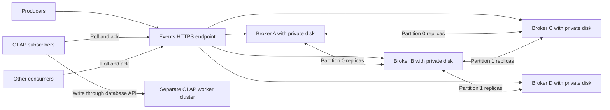

Run Nabedra Events as an independent broker cluster so HTTP producers can publish durable events and multiple consumers can process and replay them at their own pace.

**Events** is the service. A topic contains ordered partitions. A **subscription** is a named consumer with an independent checkpoint for each partition. The same implementation supports one broker on a local disk and many brokers with replicated data. The interfaces and settings below are proposals.

## Location and packaging

The OLTP checkout inspected at `6dfc713` uses one database crate at `server/Cargo.toml`. OLAP uses `server/src/engine/` and related modules gated by `olap`. OLTP uses `server/src/oltp/`, `server/src/oltp_runtime/`, and related modules gated by `oltp`. The Python package lives in `orm/python/src/nabedra/`. Recheck these paths against the delivered OLTP tree at implementation kickoff.

| Location | Responsibility |
| --- | --- |
| `server/events/` | Independent Rust crate, lockfile, `nabedra-events` binary, HTTP and peer protocols, replication and disk formats |
| `server/events/deploy/` | Broker image, multi-process fixture, AWS deployment, and operator commands |
| `orm/python/src/nabedra/events/` | Optional Python client and separate OLAP subscription runner |
| `orm/python/tests/events/` | Client tests and Events-to-OLAP integration |

Build Events with `cargo build --locked --release --manifest-path server/events/Cargo.toml`. Deploying that binary is the opt-in. It builds independently of either database engine. A later bundled release can use an additive, default-off Cargo feature and preserve the mutually exclusive engine flags. This branch changes only `plans/events.md`. Keep implementation in the paths above and verify both merge orders against the final OLTP tip. [Cargo features](https://doc.rust-lang.org/cargo/reference/features.html)

---

## Brokers and storage



Run one broker with one local disk and replication factor 1 for single-host use. On AWS, start with three or more brokers across three Availability Zones. Each has its own encrypted, retained EBS volume. Replication factor 3 places one replica per zone, and a majority of two is required to publish or advance a checkpoint. Spread partition leaders across brokers. Each disk holds the partitions and metadata replicas assigned to that broker. A replacement either reattaches its original volume in the same zone after fencing the previous process or joins with an empty volume and catches up from survivors. A broker never votes or counts toward a commit in a group, the metadata group included, from an empty volume under its old membership. It rejoins under a new broker ID, or a committed membership change first removes its old identity, it catches up as a learner, and a second committed change promotes it. A volume that lost a group cannot be told from a new one, so a broker that starts without the metadata group on its disk asks every bootstrap broker what its volume holds. It opens the group as a voter only when every one of them answers and none holds state of any group, which is a new cluster; the broker that initializes the cluster also waits until the other initial voters have opened it. One answer with state means the volume lost its replica: the broker stays out of the group and reports it until an operator re-adds it. Partition groups open only from a volume that holds them. If a majority of a group's voters lose their disks at once, the group stays unavailable; recovery is a backup restore into a fresh cluster, which loses writes after the backup cut. [Amazon EBS volumes](https://docs.aws.amazon.com/ebs/latest/userguide/ebs-volumes.html) · [Kafka partition replication](https://kafka.apache.org/43/design/design/#replication)

- Run a Raft group per partition. Its replicated state contains the retained events, next offset, publish deduplication records, retention floor, subscription checkpoints, and lease generations. Give each partition a stable identity and assign offsets from 1 in commit order. Use a separate Raft metadata group for topic IDs, placements, subscription definitions, and operator intents. It stays off the publish, poll, and ack paths. Cache bounded routing pages. Multiplex Raft traffic over a bounded pool of peer connections. Preserve control and replication capacity when a broker hosts many groups. Committed Raft membership and current leader authority govern writes.
- Use OpenRaft and `nabedra-kv` in the Events crate ([native storage engine plan](native-storage-engine.md), section 6). Pin dependency versions against the chosen Rust toolchain. Use one bounded `nabedra-kv` store and cache per mounted disk, with partition key prefixes. Coalesce appends to each partition under bounded batch size and delay, and preserve per-request receipts. Persist votes and log entries with synchronous journal writes before acknowledging replication. Apply offsets, event data, deduplication, checkpoints, and the applied index atomically as appropriate to each command. Reply to publishes and acks after quorum commit and local apply. Poll uses a quorum-confirmed leader read and applied-index barrier. [OpenRaft](https://docs.rs/openraft/latest/openraft/) · [Raft paper](https://raft.github.io/raft.pdf)
- Commit retention floors per partition from nondecreasing server publish time. Remove expired events and their deduplication records in bounded work. Keep unexpired events independently of subscriber progress. Separately compact the Raft log after a recoverable snapshot. Stream a bounded, checksummed snapshot at an applied index with retained events, deduplication, checkpoints, generations, and the floor. Fence old state on install and resume replication from that index. Budget snapshot time and pinned data, compaction I/O, replica count, and read and write buffers.
- Stamp publish, lease and retention commands from a fresh interval that bounds the time when the leader stamps the command. Request a sample from each reachable current voter during a quorum round. Bind replies to the round, group, voter incarnation and term. Each healthy voter has absolute wall-clock error at most the configured bound. Measure an upper bound on the full round age on a monotonic clock that advances during suspend. For each reply, subtract the clock error from the sample to obtain a lower endpoint and add the error and round age for the upper endpoint.
- For RF3 with one potentially inaccurate clock, take the second-largest lower endpoint and the second-smallest upper endpoint among two or more replies. With two replies, this takes the outer endpoints and can widen the interval. With three, it can discard one outlier. Require a nonempty interval within the configured uncertainty budget and discard it when its freshness budget expires or leadership changes. When the bound cannot be established, defer retention and refuse an operation that requires a fresh timestamp. RF1 requires a certified local clock bound and tolerates zero bad clocks.
- Use the upper endpoint as the publish stamp, clamped to the previous published timestamp and the retained floor. Count event age from the server-assigned publish time. Remove only events whose stamp plus retention precedes the lower endpoint. Record a new lease's deadline from the upper endpoint plus its TTL and test expiry against the lower endpoint. Clamp the replicated expiry-check clock monotonically. A range of uncertain time delays expiry rather than allowing a premature replacement.
- Guarded time is the only mode. Every broker runs it, and a broker of an older peer protocol is refused: the private routes carry the version (`/internal/raft/v2`, `/internal/events/v2`). Reuse clock samples across commands only within the sample age limit.
- Put one stable HTTPS endpoint in front of the brokers. A broker forwards to the right leader over authenticated private connections and can refresh its route once within the request deadline. A partition lacking quorum returns retryable `503 unavailable`. Healthy partitions retain progress. Initialized partitions can serve with valid grants and known routes during metadata outages. Topic creation and placement changes require the metadata quorum. [AWS HTTPS listeners](https://docs.aws.amazon.com/elasticloadbalancing/latest/application/create-https-listener.html)
- Add brokers and move replicas and leaders under live traffic. Catch up each learner under a bounded I/O budget, commit the membership change, and retire the source only after the replacement is safe. Record each move as a durable intent and resume from committed membership after interruption. Drain only when replacement capacity is ready. Use the same sequence to promote one broker to replication factor 3 for metadata and data groups while preserving all offsets and checkpoints. Start with operator-driven rebalance and drain commands. [Raft membership changes](https://raft.github.io/raft.pdf)

## Client and delivery

Publish to an explicit partition. Use 0 for a one-partition topic. For production topics, an application assigns ordering keys to partitions and keeps that assignment with events it may retry. Operators can append partition IDs online. Existing assignments stay valid, and producers can send new keys to the new partitions. Ordering is per partition. Reserve topic names so an old retry cannot hit a replacement topic.

```python
from uuid import UUID

from nabedra.events import Events

publisher = Events("https://events.example", token=publish_token)
publisher.publish(
    "orders", partition=7,
    event_id=UUID("59725617-e5a5-4a11-8ba6-e88dad46b6df"),
    data={"type": "order.created", "order_id": "A-42"},
)

consumer = Events("https://events.example", token=notifications_token)
sub = consumer.subscription("orders", "notifications", partition=7)
with sub.claim() as lease:
    batch = lease.poll(limit=100)
    for event in batch.events:
        notify_order_created(
            event.data, idempotency_key=(event.topic_id, event.partition, event.event_id),
        )
    if batch.events:
        lease.ack(batch, through=batch.events[-1].offset)
```

Expose a standard-library client in the existing Python distribution with independent URL, bearer and TLS settings. Provide `partitions(topic)` with paged discovery, `publish(topic, *, partition, event_id, data)`, `publish_batch(topic, *, partition, events)`, and `subscription(topic, name, *, partition)`. A claim returns a lease with `poll(*, limit=100)`, `renew()`, `ack(batch, *, through)`, and `close()`. The context manager releases on exit. Applications renew explicitly. Deploy bounded consumer pools over partition ranges, with a standby eligible to claim each range after its leases expire. Distinct subscription names can read the same partition independently.

```text
GET  /v1/topics/{topic}/partitions?after={partition_id}&limit=100
     200 {"topic_id":"ef7c1e67-57fc-49e1-afbd-fa81dda8f65a","partitions":[7],"next_after":null}
POST /v1/topics/{topic}/partitions/{partition}/events
     {"event_id":"59725617-e5a5-4a11-8ba6-e88dad46b6df","data":{"order_id":"A-42"}}
     201 Event for new data, 200 Event for an identical retry
POST /v1/topics/{topic}/partitions/{partition}/batches
     {"events":[{"event_id":"59725617-e5a5-4a11-8ba6-e88dad46b6df","data":{"order_id":"A-42"}}]}
     200 {"events":[Event]}
POST /v1/topics/{topic}/partitions/{partition}/subscriptions/{name}/claim
     {"claim_id":"a47bc7cd-ce72-4bfb-83d2-d759f422e756"}
     200 {"lease":"opaque","expires_at":"2026-11-17T18:01:00Z"}
POST /v1/topics/{topic}/partitions/{partition}/subscriptions/{name}/renew
POST /v1/topics/{topic}/partitions/{partition}/subscriptions/{name}/release
GET  /v1/topics/{topic}/partitions/{partition}/subscriptions/{name}/events?limit=100
     200 {"after":"120","events":[Event],"delivery":"opaque"}
PUT  /v1/topics/{topic}/partitions/{partition}/subscriptions/{name}/checkpoint
     {"delivery":"opaque","through":"125"}
     200 {"offset":"125"}
Event = {"topic_id":"ef7c1e67-57fc-49e1-afbd-fa81dda8f65a","partition":7,"offset":"125",
         "event_id":"59725617-e5a5-4a11-8ba6-e88dad46b6df",
         "published_at":"2026-11-17T18:00:00Z","data":{"order_id":"A-42"}}
```

- Scope deduplication by topic ID, partition, and event UUID. Retry the same partition, UUID and event bytes. The SDK encodes records deterministically. The same retained ID and bytes returns the original offset and timestamp. Changed bytes conflict. A batch is one partition command. Reject duplicate IDs within the input or any conflicting retained ID. Return receipts in input order for new and already committed events. Retry within retention. Encode offsets as decimal strings on the wire and expose Python integers.
- Operators create subscriptions with `earliest` or `latest`. Materialize the start as a committed checkpoint on each partition when the subscription or partition is created. Serialize those topology changes within each topic, and publish the new definition after the start records exist using a resumable metadata intent. `earliest` starts before the retention floor. `latest` starts at the tail at each partition's initialization barrier. Restarts reuse checkpoints. Replay by creating another subscription. If a checkpoint falls behind retention, return `410 checkpoint_expired` with the partition and earliest offset. Resuming from that offset requires an explicit operator choice.
- Scope claims to one topic, partition, subscription, caller and generation. Use the lease credential on poll, renew, release and ack. Retry a lost claim with the same `claim_id` under the same live grant. Commit lease changes through the partition group. The leader includes the fresh time bounds in each lease command for deterministic apply. Check generation and expiry on apply against the partition's nondecreasing replicated lease clock. An expired lease permits redelivery, so destination side effects need idempotency.
- Poll returns a contiguous page after the checkpoint and an authenticated delivery token binding the cluster, partition, subscription, lease generation and returned offset range. Ack may advance through a processed prefix and may repeat after a lost response. Verify the token and generation and advance the checkpoint monotonically in the same replicated command. If retention has advanced past the checkpoint, a forward ack can still advance through a delivered prefix when the authenticated token starts at the current checkpoint and its generation remains live. The token and range must pass the same checks as any ack. Otherwise a forward ack across the gap returns the same expiry response as poll. Fence stale holders with `409 lease_lost` and reject invalid ranges. Authentication keys must remain usable across leader failover and rotate under finite token lifetimes.
- Require TLS, scoped publish/read/operator grants, authenticated broker peers, and audited admin operations. Bound token lifetimes, HTTP bodies and egress, per-tenant byte rates, open leases, queues, and snapshot and rebalance work. Reserve control and checkpoint capacity during publish saturation. Propose 64 KiB per event and 1 MiB per batch or page, each with a count cap. Return `413` for oversized input, `429` with `Retry-After` on overload, and explicit unknown outcomes for timed-out writes. Keep credentials and payloads out of logs.

---

## OLAP ingestion and cloud operations

Events brokers own publishing, replay and checkpoints. Separate subscribers convert events to database requests. The OLAP API and workers own admission, table writes and queries. Publish availability is independent of OLAP availability.

Run `python -m nabedra.events.sink --config orders-to-olap.json` near the OLAP API, with separate credentials, a subscription, a partition range, a database scope, and a destination table name and UUID. Use an append-only table with a stable string primary key composed of topic ID, partition and event UUID. Store partition, offset, publish time, and deterministic JSON as columns. Resolve the table name to the configured UUID and validate its schema. Pause the affected sink if the table is replaced or an existing identity has different event data. If a repeat publish uses the same identity and event data at a new offset after retention, keep the original row and acknowledge the repeated event after verifying the row. Compare the deterministic payload for this check, and keep the original offset and publish time. Producers can replay an original offset while its event and deduplication record are retained. Document that the retry window is bounded by retention.

Use one in-flight mutation per consumed partition and a global in-flight limit per sink. Submit bounded batches through `Database.submit("table.insert_many", ...)`. Ack only a contiguous prefix confirmed committed. If the response is lost or the batch conflicts, observe the original receipt where available and compare existing rows by key. Submit any missing rows with a fresh request UUID after reconciliation. The primary key protects against an earlier attempt committing later. After all OLAP workers stop, the database abandons its pending requests and preserves committed rows. The unacknowledged events can be delivered again. An Events-wide restart reopens committed logs and checkpoints from disk.

The first OLAP sink inherits the inspected OLAP limits of 100,000 rows and 64 MiB decoded payload per table. Certify broker scale independently with external consumers. Large sustained ingestion into OLAP also requires verified larger tables or a destination rotation policy that preserves row identity during replay. External ETL and CDC producers can publish through the same HTTP API.

Provision stable broker IDs, separate mounts, private peer TLS, zone-aware placement, and client HTTPS ingress. Provide quorum-aware readiness, upgrades that refuse an older peer protocol or store format cleanly, and runbooks for rebalance, disk replacement, quorum loss and disaster recovery. After a zone loss, serve affected groups from their surviving quorum. Rebuild their third copies onto fresh disks in a restored or replacement zone. Keep ingress ready for healthy routes even if some partitions lose quorum. Export checksummed backups to object storage from committed snapshots, recording a compatible topology revision and the applied cut of each partition. Restore into a fresh cluster identity and verify events, offsets and checkpoints before routing traffic there. Set separate recovery targets for any future cross-region deployment.

Size disk from retained encoded bytes times the replication factor, with measured headroom for deduplication, Raft logs, compaction and rebuilds. Track publish and poll latency, replication and subscription lag, quorum availability, under-replicated partitions, load by broker, disk and I/O headroom, and cross-AZ transfer. A hot partition has one write leader, so spread independently ordered keys across partitions. Set throughput, retention, latency, RPO and RTO targets with the deployment owner before certifying a workload.

---

## Delivery and acceptance

Implement in dependency order. Use deterministic fault barriers and an event/row oracle. Cite executed assertions and applicable [scheduler contract](../docs/testing/scheduler-contract.md) cases in evidence. O01 and O02 refer to `docs/testing/oltp-contract.md` in the OLTP checkout.

| Stage | Required observations |
| --- | --- |
| Storage and HTTP, EV01–EV03 | RF1 process restart from its disk preserves committed events and checkpoints. Exercise concurrent publish, lost replies, changed-body conflicts, per-partition deduplication, independent replay, bounded batches, fake-clock retention, lease expiry and prefix acks. Reject malformed, unauthorized, oversized and low-disk requests under load while eligible traffic progresses. |
| Broker quorum, EV07 | Run three brokers on distinct mounts. Kill and isolate a leader before and after durable quorum and lose a success reply. Verify one durable offset per acknowledged ID, retained checkpoints, fenced stale leaders, safe minority behavior and an independent healthy group. Stop every Events broker and recover committed state. |
| Growth, EV08 | Promote RF1 to RF3 and rebalance a live RF3 cluster onto additional brokers. Append partitions while producers retry old positions. Kill a learner mid-copy and a controller mid-move. Verify offsets and checkpoints, committed-ID conservation, bounded catch-up and safe drain. |
| OLAP sink, EV04 | Two partition consumers ingest while an external subscription reads. Lose the OLAP reply after commit and kill the sink before ack. Verify one row per identity, ack after commit, survival with one database worker, and fresh operations after full OLAP shutdown. Apply Q02, Q04–Q06, R01, R04, T04–T06 and U01–U02 as applicable. |
| Compatibility and load, EV05 and EV09 | Apply O01 and O02 to the database and inspect Events dependencies with `cargo tree`. Measure 1, 3 and 6+ brokers under declared limits. Hold RF3 constant across multi-node runs. Run sustained retention, balanced and skewed publish, fan-out, slow consumers, broker failure and live rebalance. Report throughput, p99, lag, RSS, disk amplification, inter-AZ bytes, lost/duplicate IDs and recovery time. Apply B02 for mixed OLAP traffic. |
| Cloud and restore, EV06 and EV10 | Run RF3 on real EBS across three zones. Test broker replacement with its retained volume and with a fresh disk, zone loss, credential rotation, rolling upgrade and backup restore. Confirm acknowledged publishes and checkpoints survive supported failures. Report measured RPO and RTO and keep local evidence separate from cloud evidence. |

---

## Design review

Reviewed on 2026-11-26 against `main` e6b4040b (wave rv-events). Level L2. Findings EVENTS-1 to EVENTS-9 are in the review's findings file. The ones that change this plan are listed under Counterexamples.

| Part | Content |
| --- | --- |
| Guarantees | EVT-G01: `G01_AckedPublishSurvives`, `G01_CommittedPrefixesAgree`, `L_Replicated`. EVT-G02: `G02_OffsetsStable`, `G02_Contiguous` (both specs). EVT-G03: `G03_RetryReturnsOriginal`, `L_PublishCompletes`. EVT-G04: `G04_BatchWhole`. EVT-G05: `G05_AckOnlyDelivered`, `G05_StaleGenerationFenced`, `G05_NoRevivedLease`, `L_Drain`. EVT-G06: `G06_ReadIndexSafe` (EventsLog), `G06_PollLinearizable` (EventsDelivery). EVT-G08: `G08_RetentionByPublishTime`, `G08_PublishTimeMonotone`. EVT-G09: only the re-add path after a lost disk (`ReAdd`). Moves, the learner copy, partition append and controller fencing are not modelled. EVT-G14: restart without the disk under a stable ID (`RestartWithoutDisk`). Not modelled: EVT-G07 (limits are request validation), EVT-G10 (the OLAP sink, a later spec), EVT-G11 (byte-level compatibility), EVT-G12 (TLS and backup images) and EVT-G13 (timing). |
| Topology | Brokers n1 to n3 host one Raft group. It is a partition group or the metadata group: both run the same protocol and differ only in their reopen rule. Producers p1 and p2 and consumers c1 and c2 reach the leader through any broker. Raft RPCs: an election is one round, replication is one round to one follower, and loss is a step not taken. Duplication, reordering and delay of Raft messages are left out, because OpenRaft's terms and log matching handle them. Client channel: loss of a request or a reply, and duplication (a retry racing its original), are modelled. Disk: the vote and the synced log survive a crash, and the applied state is rebuilt. Faults modelled: a crash and restart with the disk, a restart without the disk under the same ID, a stop of every broker, isolation of one broker and the heal, clock jumps within MaxDrift (EventsDelivery) and a consumer crash. Out of scope: torn snapshot files and snapshot install (R-events-03, R-events-17), membership moves and RF1 to RF3 (R-events-05, R-events-06), one-way link failures, and an unbounded clock jump (the spec bounds drift; see EVENTS-2). |
| Spec | `specs/events/EventsLog.tla` with `MCEventsLog.tla`. Baselines: `EventsLog.cfg` (crash, isolation and duplicate, 1 each), `EventsLog.disk.cfg` (wipe, stop of every broker and isolation), `EventsLog.client.cfg` (crash, drop and duplicate) and `EventsLog.live.cfg` (liveness with wipe and drop, no symmetry). All use MaxTerm 4, 3 brokers and 2 producers. With every fault kind in one baseline, run 45803599697 stopped at the 900 s budget (4.5 million states, 1.7 million queued), so the fault kinds are split over three safety baselines. Every kind has a budget of 1 in at least one baseline, and L2 asks for no overlap of faults. A reviewer should confirm this split. `specs/events-delivery/EventsDelivery.tla` with `EventsPartition.tla`: One safety baseline per fault kind, each with Variant `drift_bound_stated` and every safety property: `EventsDelivery.cfg` (leader failover), `.isolation.cfg`, `.clock.cfg` (a clock jump within MaxDrift), `.crash.cfg` (consumer crash), `.drop.cfg` and `.dup.cfg`. Also `EventsDelivery.strict.cfg` (the clock settings, EVT-G08 with no clock tolerance, expected to fail until EVENTS-2 is decided) and `EventsDelivery.live.cfg` (drop, two claim IDs per consumer instead of three, because with three it stopped at 900 s with 534,220 states queued). They use 3 brokers, 1 producer, 2 consumers, MaxTime 3, LeaseTtl 1, RetainAfter 2, MaxDrift 1 and a budget of 1 per fault. With every fault in one baseline the run stopped at 900 s with 11.8 million states and 7.6 million queued; with two or three kinds per baseline it still stopped (9.4 to 17.1 million states, run 45816604738). So the T1 delivery baselines check one fault kind at a time. The overlapping faults (leader failover with isolation, with a clock jump and with a consumer crash, at the same bounds) are the T2 check `events-delivery-large`, exhaustive with a 5 h budget; if it stops at the budget, its state counts are recorded under Results and the overlap is a declared limit of this review. Fairness: the OpenRaft election timer and heartbeats, the HTTP handler on the leader, the SDK retry timers and response handling, the retention loop and the 410 runbook, the consumer pool's claim and poll loop, the heal, and time. The operator's re-add carries none. T checks: `events-log` and `events-delivery` (T1), `events-log-large` (T2, simulation at larger bounds) and `events-delivery-large` (T2, overlapping faults, exhaustive, 5 h). |
| Results | On 21b2101f, [run 45839343957](https://github.com/zPy52/nabedra-database/actions/runs/45839343957) passed events-log (17 actions, at least 4,878 evaluations per action, 13 of 13 mutants) and testing-bugs. The larger log simulation hit its internal 900 s budget. Delivery and overlapping faults run in separate jobs. |
| Mutants | EventsLog: `ack_before_fsync` and `ack_unreachable_appends` (G01_AckedPublishSurvives); `prefix_empty_disk_rejoins_voter`, `volatile_vote` and `readd_without_removal` (G01_CommittedPrefixesAgree); `dedup_ignore_body` and `reuse_offset_after_dedup` (G02_OffsetsStable); `conflict_consumes_offsets` (G02_Contiguous); `reexecute_on_retry` (G03); `partial_batch` (G04); `poll_local_read` (G06_ReadIndexSafe); `no_retry` (L_PublishCompletes); `stop_replication_after_commit` (L_Replicated). EventsDelivery: `reuse_offset_after_dedup`, `earliest_not_advanced`, `reexecute_on_retry`, `ack_to_tail`, `ack_skip_lease_check`, `lease_clock_follows_command`, `ack_regress`, `poll_local_read`, `retain_by_checkpoint`, `raw_publish_time`, and `claim_ignores_expiry` (L_Drain). Counterexample lengths in states (runs 45816604738 and 45831059295): EventsLog `ack_before_fsync` 7, `ack_unreachable_appends` 5, `conflict_consumes_offsets` 4, `dedup_ignore_body` 4, `no_retry` 7 (lasso), `partial_batch` 4, `poll_local_read` 6, `prefix_empty_disk_rejoins_voter` 6, `readd_without_removal` 9, `reexecute_on_retry` 4, `reuse_offset_after_dedup` 5, `stop_replication_after_commit` 11 (lasso), `volatile_vote` 9. EventsDelivery `ack_regress` 21, `ack_skip_lease_check` 14, `ack_to_tail` 12, `earliest_not_advanced` 8, `lease_clock_follows_command` 19, `poll_local_read` 9, `raw_publish_time` 7, `reexecute_on_retry` 7, `retain_by_checkpoint` 21, `reuse_offset_after_dedup` 10; `claim_ignores_expiry` needs a finished liveness control. |
| Counterexamples | EVENTS-1 (record `docs/testing/bugs/2026-11-26-design-events-empty-volume-metadata-voter.toml`): a broker restarted on an empty volume under its stable ID voted with no log, and a candidate without a committed entry won. 1. n1 leads term 1. 2. n1 appends an entry. 3. The entry commits on {n1, n2} and the client gets its reply. 4. n1 restarts on an empty volume and rejoins as a voter. 5. n1 wins term 2 with the vote of n3, which never had the entry. 6. n1 replicates its log to n2 and overwrites the committed entry. A stale leader that promotes the broker without first removing its old identity loses the entry the same way (mutant `readd_without_removal`, 9 states). This plan now says that a broker never votes from an empty volume under its old membership, and it names the re-add path and the recovery after a majority loses its disks ("Brokers and storage"). The code applies the rule since fx-events (`Control::reopen` and `Control::join_metadata`, `raft::rejoin`); the simulator restarts wiped nodes through the same rule. EVENTS-2: a leader clock that jumps ahead removes events early. The strict baseline fails in 8 states. The approved plan uses a guarded interval with conservative publication and deletion stamps. EventsTime checks the interval and timestamp choices independently of Raft. Guarded time is the only mode, with no activation step. |
| Cost | Publish of one coalesced entry (up to 100 events, 1 MiB), RF3: client to any broker, one forward hop, and one AppendEntries round to two followers. The leader syncs its append, its commit record and its apply, and each follower syncs the same three. That is 9 synced writes per entry in the cluster, 3 of them on the leader's reply path. Poll: one forward hop and one quorum confirmation round (ReadIndex), with no log entry. Ack, claim, renew and release: one log entry each, with the same fsyncs as a publish, not coalesced. Retention: one entry per 128 events removed. Snapshot: every 1,024 entries, each replica rewrites every retained byte. Consumer failover: the standby's claim succeeds after the holder's lease expires (lease_ms is 30 s by default) plus the clock error. It takes one claim entry per partition, with no group-wide rebalance. Metadata stays off the publish, poll and ack paths, and brokers cache topic pages. The plan states no numeric targets yet (EV09). The measured limits that matter are in EVENTS-3 to EVENTS-7. |
| Independent read | `wave-dr/reads/events.md` (2026-11-24; the plan had not changed since then). R-01: dedup at apply (`PubLoop` in apply, `reexecute_on_retry`). R-02: coalesced requests apply as independent publishes in order, which EventsLog models as consecutive commands. R-03 and R-17: snapshot install is not modelled; the code's snapshot copies every state record, including the next offset and the lease clock. R-04: `RestartWithoutDisk`, `ReAdd` and `prefix_empty_disk_rejoins_voter` (EVENTS-1). R-05 and R-06: membership moves are not modelled; the code fences controller steps with `require_current`. R-07: `ClockJump` and the strict G08 (EVENTS-2). R-08: `lease_clock_follows_command`. R-09 does not apply, because subscriptions cannot be deleted. R-10: `ApplyClaim` with claim IDs. R-11 and R-12: `ApplyAck`, and polls start after the checkpoint (EVENTS-8). R-13: `poll_local_read` in both specs. R-14: `G03_RetryReturnsOriginal` allows a new offset only after expiry (EVENTS-9). R-15: apply is deterministic by construction, and the code refuses a low disk before it proposes. R-16: partition append is not modelled. R-18: the OLAP sink is not modelled. R-19: `StopAll` with the synced prefix, and `ack_before_fsync` (RF1 is not modelled). R-20: token keys are not modelled. |

### Guarded time and retention-gap acknowledgements

The `events-time` model explores three voter clocks and arbitrarily chosen quorums with up to one bad source, two publishers, and two consumers. Healthy clock samples vary across the bounded round. It checks `TrustedProof`, `FreshPublishTime`, `G08_RetentionAge` and `G05_LeaseAge`. An exhaustive local run reached 618,692 distinct states at depth 16, with all six actions reached. Its five mutants hit their intended properties in 2, 4, 2, 6 and 6 states for a single fast lower endpoint, expired-proof reuse, a single unguarded upper endpoint, retention based on the upper endpoint, and lease expiry based on the upper endpoint, respectively.

The `events-ack-gap` model runs the partition's actual apply operators for a retained-prefix acknowledgement after retention, an older token, a stale generation, another holder and an out-of-range offset. The exhaustive local run reached two distinct states and both actions. Reintroducing the shipped gap rejection and accepting an older token both violate `G05_AckAcrossGap` in two states.

These checks establish separate timing and acknowledgement properties. The guarded-time model abstracts Raft, proof transport, crash and restart.

### Implementation of guarded time

`raft::clock` (fx-events, 2026-11-27) samples each voter's wall clock over the peer route `/internal/raft/v2/clock` and builds the interval of `EventsTime`: for `f = (voters - 1) / 2` the (f+1)-th largest lower endpoint and the (f+1)-th smallest upper endpoint among at least f+1 samples younger than `sample_max_age_ms`, refused when the interval is wider than `max_uncertainty_ms`. Samples are per broker and shared by its groups. The leader stamps publishes with the upper bound, lease commands and polls with the lower bound and a TTL widened by the interval's width, and retention cutoffs from the lower bound. Without an interval the command is refused with 503 and retention waits. The broker configuration states the bound as `clock` (defaults 250 ms error, 2,000 ms uncertainty, 1,000 ms sample age). Two wrong clocks among three voters are outside the stated bound and can move the interval. A clock counts as wrong for two sample ages after it returns inside the bound, because leaders keep its older samples that long.

Open: the round age is measured on the monotonic clock, which on Linux does not advance during system suspend; the stamp is not bound to the proposing term and validated again on apply; a lease credential whose reply arrives late is not checked for remaining validity; delivery tokens and grants are still checked against the ingress broker's clock.
