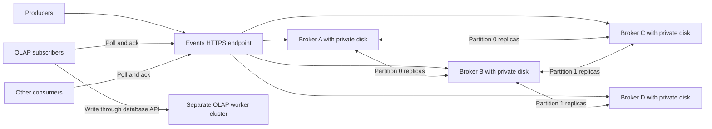

Run Nabedra Events as an independent broker cluster so HTTP producers can publish durable events and multiple consumers can process and replay them at their own pace.

**Events** is the service. A topic contains ordered partitions. A **subscription** is a named consumer with an independent checkpoint for each partition. The same implementation supports one broker on a local disk and many brokers with replicated data. The interfaces and settings below are proposals.

## Location and packaging

The OLTP checkout inspected at `6dfc713` uses one database crate at `server/Cargo.toml`. OLAP uses `server/src/engine/` and related modules gated by `olap`. OLTP uses `server/src/oltp/`, `server/src/oltp_runtime/`, and related modules gated by `oltp`. The Python package lives in `orm/python/src/nabedra/`. Recheck these paths against the delivered OLTP tree at implementation kickoff.

| Location | Responsibility |
| --- | --- |
| `server/events/` | Independent Rust crate, lockfile, `nabedra-events` binary, HTTP and peer protocols, replication and disk formats |
| `server/events/deploy/` | Broker image, multi-process fixture, AWS deployment, and operator commands |
| `orm/python/src/nabedra/events/` | Optional Python client and separate OLAP subscription runner |
| `orm/python/tests/events/` | Client tests and Events-to-OLAP integration |

Build Events with `cargo build --locked --release --manifest-path server/events/Cargo.toml`. Deploying that binary is the opt-in. It builds independently of either database engine. A later bundled release can use an additive, default-off Cargo feature and preserve the mutually exclusive engine flags. This branch changes only `plans/events.md`. Keep implementation in the paths above and verify both merge orders against the final OLTP tip. [Cargo features](https://doc.rust-lang.org/cargo/reference/features.html)

---

## Brokers and storage



Run one broker with one local disk and replication factor 1 for single-host use. On AWS, start with three or more brokers across three Availability Zones. Each has its own encrypted, retained EBS volume. Replication factor 3 places one replica per zone, and a majority of two is required to publish or advance a checkpoint. Spread partition leaders across brokers. Each disk holds the partitions and metadata replicas assigned to that broker. A replacement either reattaches its original volume in the same zone after fencing the previous process or joins with an empty volume and catches up from survivors. [Amazon EBS volumes](https://docs.aws.amazon.com/ebs/latest/userguide/ebs-volumes.html) · [Kafka partition replication](https://kafka.apache.org/43/design/design/#replication)

- Run a Raft group per partition. Its replicated state contains the retained events, next offset, publish deduplication records, retention floor, subscription checkpoints, and lease generations. Give each partition a stable identity and assign offsets from 1 in commit order. Use a separate Raft metadata group for topic IDs, placements, subscription definitions, and operator intents. It stays off the publish, poll, and ack paths. Cache bounded routing pages. Multiplex Raft traffic over a bounded pool of peer connections. Preserve control and replication capacity when a broker hosts many groups. Committed Raft membership and current leader authority govern writes.
- Start with OpenRaft and RocksDB in the Events crate. Verify and pin dependency versions against the chosen Rust toolchain in a storage spike. Use a bounded shared RocksDB instance and cache per mounted disk, with partition key prefixes. Coalesce appends to each partition under bounded batch size and delay, and preserve per-request receipts. Persist votes and log entries with synchronous WAL writes before acknowledging replication. Apply offsets, event data, deduplication, checkpoints, and the applied index atomically as appropriate to each command. Reply to publishes and acks after quorum commit and local apply. Poll uses a quorum-confirmed leader read and applied-index barrier. [OpenRaft](https://docs.rs/openraft/latest/openraft/) · [Raft paper](https://raft.github.io/raft.pdf) · [RocksDB atomic and synchronous writes](https://github.com/facebook/rocksdb/wiki/Basic-Operations)
- Commit retention floors per partition from nondecreasing server publish time. Remove expired events and their deduplication records in bounded work. Keep unexpired events independently of subscriber progress. Separately compact the Raft log after a recoverable snapshot. Stream a bounded, checksummed snapshot at an applied index with retained events, deduplication, checkpoints, generations, and the floor. Fence old state on install and resume replication from that index. Budget snapshot time and pinned data, compaction I/O, replica count, and read and write buffers.
- Put one stable HTTPS endpoint in front of the brokers. A broker forwards to the right leader over authenticated private connections and can refresh its route once within the request deadline. A partition lacking quorum returns retryable `503 unavailable`. Healthy partitions retain progress. Initialized partitions can serve with valid grants and known routes during metadata outages. Topic creation and placement changes require the metadata quorum. [AWS HTTPS listeners](https://docs.aws.amazon.com/elasticloadbalancing/latest/application/create-https-listener.html)
- Add brokers and move replicas and leaders under live traffic. Catch up each learner under a bounded I/O budget, commit the membership change, and retire the source only after the replacement is safe. Record each move as a durable intent and resume from committed membership after interruption. Drain only when replacement capacity is ready. Use the same sequence to promote one broker to replication factor 3 for metadata and data groups while preserving all offsets and checkpoints. Start with operator-driven rebalance and drain commands. [Raft membership changes](https://raft.github.io/raft.pdf)

## Client and delivery

Publish to an explicit partition. Use 0 for a one-partition topic. For production topics, an application assigns ordering keys to partitions and keeps that assignment with events it may retry. Operators can append partition IDs online. Existing assignments stay valid, and producers can send new keys to the new partitions. Ordering is per partition. Reserve topic names so an old retry cannot hit a replacement topic.

```python
from uuid import UUID

from nabedra.events import Events

publisher = Events("https://events.example", token=publish_token)
publisher.publish(
    "orders", partition=7,
    event_id=UUID("59725617-e5a5-4a11-8ba6-e88dad46b6df"),
    data={"type": "order.created", "order_id": "A-42"},
)

consumer = Events("https://events.example", token=notifications_token)
sub = consumer.subscription("orders", "notifications", partition=7)
with sub.claim() as lease:
    batch = lease.poll(limit=100)
    for event in batch.events:
        notify_order_created(
            event.data, idempotency_key=(event.topic_id, event.partition, event.event_id),
        )
    if batch.events:
        lease.ack(batch, through=batch.events[-1].offset)
```

Expose a standard-library client in the existing Python distribution with independent URL, bearer and TLS settings. Provide `partitions(topic)` with paged discovery, `publish(topic, *, partition, event_id, data)`, `publish_batch(topic, *, partition, events)`, and `subscription(topic, name, *, partition)`. A claim returns a lease with `poll(*, limit=100)`, `renew()`, `ack(batch, *, through)`, and `close()`. The context manager releases on exit. Applications renew explicitly. Deploy bounded consumer pools over partition ranges, with a standby eligible to claim each range after its leases expire. Distinct subscription names can read the same partition independently.

```text
GET  /v1/topics/{topic}/partitions?after={partition_id}&limit=100
     200 {"topic_id":"ef7c1e67-57fc-49e1-afbd-fa81dda8f65a","partitions":[7],"next_after":null}
POST /v1/topics/{topic}/partitions/{partition}/events
     {"event_id":"59725617-e5a5-4a11-8ba6-e88dad46b6df","data":{"order_id":"A-42"}}
     201 Event for new data, 200 Event for an identical retry
POST /v1/topics/{topic}/partitions/{partition}/batches
     {"events":[{"event_id":"59725617-e5a5-4a11-8ba6-e88dad46b6df","data":{"order_id":"A-42"}}]}
     200 {"events":[Event]}
POST /v1/topics/{topic}/partitions/{partition}/subscriptions/{name}/claim
     {"claim_id":"a47bc7cd-ce72-4bfb-83d2-d759f422e756"}
     200 {"lease":"opaque","expires_at":"2026-11-17T18:01:00Z"}
POST /v1/topics/{topic}/partitions/{partition}/subscriptions/{name}/renew
POST /v1/topics/{topic}/partitions/{partition}/subscriptions/{name}/release
GET  /v1/topics/{topic}/partitions/{partition}/subscriptions/{name}/events?limit=100
     200 {"after":"120","events":[Event],"delivery":"opaque"}
PUT  /v1/topics/{topic}/partitions/{partition}/subscriptions/{name}/checkpoint
     {"delivery":"opaque","through":"125"}
     200 {"offset":"125"}
Event = {"topic_id":"ef7c1e67-57fc-49e1-afbd-fa81dda8f65a","partition":7,"offset":"125",
         "event_id":"59725617-e5a5-4a11-8ba6-e88dad46b6df",
         "published_at":"2026-11-17T18:00:00Z","data":{"order_id":"A-42"}}
```

- Scope deduplication by topic ID, partition, and event UUID. Retry the same partition, UUID and event bytes. The SDK encodes records deterministically. The same retained ID and bytes returns the original offset and timestamp. Changed bytes conflict. A batch is one partition command. Reject duplicate IDs within the input or any conflicting retained ID. Return receipts in input order for new and already committed events. Retry within retention. Encode offsets as decimal strings on the wire and expose Python integers.
- Operators create subscriptions with `earliest` or `latest`. Materialize the start as a committed checkpoint on each partition when the subscription or partition is created. Serialize those topology changes within each topic, and publish the new definition after the start records exist using a resumable metadata intent. `earliest` starts before the retention floor. `latest` starts at the tail at each partition's initialization barrier. Restarts reuse checkpoints. Replay by creating another subscription. If a checkpoint falls behind retention, return `410 checkpoint_expired` with the partition and earliest offset. Resuming from that offset requires an explicit operator choice.
- Scope claims to one topic, partition, subscription, caller and generation. Use the lease credential on poll, renew, release and ack. Retry a lost claim with the same `claim_id` under the same live grant. Commit lease changes through the partition group. The leader includes time in each lease command for deterministic apply. Use bounded lease deadlines and monitor clock skew. Check generation and expiry on apply against the partition's nondecreasing replicated lease clock. An expired lease permits redelivery, so destination side effects need idempotency.
- Poll returns a contiguous page after the checkpoint and an authenticated delivery token binding the cluster, partition, subscription, lease generation and returned offset range. Ack may advance through a processed prefix and may repeat after a lost response. Verify the token and generation and advance the checkpoint monotonically in the same replicated command. A forward ack across a retention gap fails with the same expiry response as poll. Fence stale holders with `409 lease_lost` and reject invalid ranges. Authentication keys must remain usable across leader failover and rotate under finite token lifetimes.
- Require TLS, scoped publish/read/operator grants, authenticated broker peers, and audited admin operations. Bound token lifetimes, HTTP bodies and egress, per-tenant byte rates, open leases, queues, and snapshot and rebalance work. Reserve control and checkpoint capacity during publish saturation. Propose 64 KiB per event and 1 MiB per batch or page, each with a count cap. Return `413` for oversized input, `429` with `Retry-After` on overload, and explicit unknown outcomes for timed-out writes. Keep credentials and payloads out of logs.

---

## OLAP ingestion and cloud operations

Events brokers own publishing, replay and checkpoints. Separate subscribers convert events to database requests. The OLAP API and workers own admission, table writes and queries. Publish availability is independent of OLAP availability.

Run `python -m nabedra.events.sink --config orders-to-olap.json` near the OLAP API, with separate credentials, a subscription, a partition range, a database scope, and a destination table name and UUID. Use an append-only table with a stable string primary key composed of topic ID, partition and event UUID. Store partition, offset, publish time, and deterministic JSON as columns. Resolve the table name to the configured UUID and validate its schema. Pause the affected sink if the table is replaced or a row identity conflicts.

Use one in-flight mutation per consumed partition and a global in-flight limit per sink. Submit bounded batches through `Database.submit("table.insert_many", ...)`. Ack only a contiguous prefix confirmed committed. If the response is lost or the batch conflicts, observe the original receipt where available and compare existing rows by key. Submit any missing rows with a fresh request UUID after reconciliation. The primary key protects against an earlier attempt committing later. After all OLAP workers stop, the database abandons its pending requests and preserves committed rows. The unacknowledged events can be delivered again. An Events-wide restart reopens committed logs and checkpoints from disk.

The first OLAP sink inherits the inspected OLAP limits of 100,000 rows and 64 MiB decoded payload per table. Certify broker scale independently with external consumers. Large sustained ingestion into OLAP also requires verified larger tables or a destination rotation policy that preserves row identity during replay. External ETL and CDC producers can publish through the same HTTP API.

Provision stable broker IDs, separate mounts, private peer TLS, zone-aware placement, and client HTTPS ingress. Provide quorum-aware readiness, rolling upgrades with mixed-version disk and wire tests, and runbooks for rebalance, disk replacement, quorum loss and disaster recovery. After a zone loss, serve affected groups from their surviving quorum. Rebuild their third copies onto fresh disks in a restored or replacement zone. Keep ingress ready for healthy routes even if some partitions lose quorum. Export checksummed backups to object storage from committed snapshots, recording a compatible topology revision and the applied cut of each partition. Restore into a fresh cluster identity and verify events, offsets and checkpoints before routing traffic there. Set separate recovery targets for any future cross-region deployment.

Size disk from retained encoded bytes times the replication factor, with measured headroom for deduplication, Raft logs, compaction and rebuilds. Track publish and poll latency, replication and subscription lag, quorum availability, under-replicated partitions, load by broker, disk and I/O headroom, and cross-AZ transfer. A hot partition has one write leader, so spread independently ordered keys across partitions. Set throughput, retention, latency, RPO and RTO targets with the deployment owner before certifying a workload.

---

## Delivery and acceptance

Implement in dependency order. Use deterministic fault barriers and an event/row oracle. Cite executed assertions and applicable [scheduler contract](../docs/testing/scheduler-contract.md) cases in evidence. O01 and O02 refer to `docs/testing/oltp-contract.md` in the OLTP checkout.

| Stage | Required observations |
| --- | --- |
| Storage and HTTP, EV01–EV03 | RF1 process restart from its disk preserves committed events and checkpoints. Exercise concurrent publish, lost replies, changed-body conflicts, per-partition deduplication, independent replay, bounded batches, fake-clock retention, lease expiry and prefix acks. Reject malformed, unauthorized, oversized and low-disk requests under load while eligible traffic progresses. |
| Broker quorum, EV07 | Run three brokers on distinct mounts. Kill and isolate a leader before and after durable quorum and lose a success reply. Verify one durable offset per acknowledged ID, retained checkpoints, fenced stale leaders, safe minority behavior and an independent healthy group. Stop every Events broker and recover committed state. |
| Growth, EV08 | Promote RF1 to RF3 and rebalance a live RF3 cluster onto additional brokers. Append partitions while producers retry old positions. Kill a learner mid-copy and a controller mid-move. Verify offsets and checkpoints, committed-ID conservation, bounded catch-up and safe drain. |
| OLAP sink, EV04 | Two partition consumers ingest while an external subscription reads. Lose the OLAP reply after commit and kill the sink before ack. Verify one row per identity, ack after commit, survival with one database worker, and fresh operations after full OLAP shutdown. Apply Q02, Q04–Q06, R01, R04, T04–T06 and U01–U02 as applicable. |
| Compatibility and load, EV05 and EV09 | Apply O01 and O02 to the database and inspect Events dependencies with `cargo tree`. Measure 1, 3 and 6+ brokers under declared limits. Hold RF3 constant across multi-node runs. Run sustained retention, balanced and skewed publish, fan-out, slow consumers, broker failure and live rebalance. Report throughput, p99, lag, RSS, disk amplification, inter-AZ bytes, lost/duplicate IDs and recovery time. Apply B02 for mixed OLAP traffic. |
| Cloud and restore, EV06 and EV10 | Run RF3 on real EBS across three zones. Test broker replacement with its retained volume and with a fresh disk, zone loss, credential rotation, rolling upgrade and backup restore. Confirm acknowledged publishes and checkpoints survive supported failures. Report measured RPO and RTO and keep local evidence separate from cloud evidence. |
