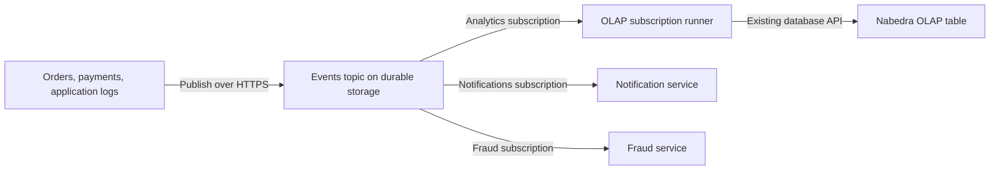

Give any HTTP producer a durable way to publish events once and let Nabedra OLAP and other consumers read them independently.

The proposed module name is **Events**. A topic is an ordered log of published events. A **subscription** is a named consumer checkpoint on one topic. The interface, limits, and deployment below are proposals.

## Location and packaging

The OLTP implementation checkout at `6dfc713` plus its working changes has one Rust database crate at `server/Cargo.toml`. OLAP lives in `server/src/engine/` and related modules gated by `olap`. OLTP lives in `server/src/oltp/`, `oltp_runtime/`, and related modules gated by `oltp`. The Python package lives in `orm/python/src/nabedra/`. Recheck these paths against the delivered OLTP tree at implementation kickoff.

| Location | Responsibility |
| --- | --- |
| `server/events/` | Independent Rust crate, lockfile, `nabedra-events` binary, HTTP API, SQLite log and checkpoints |
| `orm/python/src/nabedra/events/` | Optional import of the Python HTTP client and the OLAP subscription runner |
| `orm/python/tests/events/` | Client tests and Events-to-OLAP process tests |
| `server/events/deploy/` | Service image and cloud deployment example |

Build Events on demand with `cargo build --locked --release --manifest-path server/events/Cargo.toml`. A separate crate is the opt-in for v1. It builds without either engine and needs no change to the database manifest, lockfile, or engine flags. If a later release bundles both executables, an additive, default-off `events` feature can gate that integration. Keep the existing mutually exclusive engine selection. [Cargo features](https://doc.rust-lang.org/cargo/reference/features.html)

Keep this branch to `plans/events.md`. The implementation can add the paths above and test against the OLTP branch during development, then verify both merge orders against the final OLTP tip. Add integration to shared packaging or routers after OLTP lands if a later release needs it.

---

## Python client

Expose `nabedra.events.Events` in the existing Python distribution, using the standard library. It has its own URL, bearer token, and TLS settings. Existing `Database`, `Table`, and `Query` calls keep their data API. Python applications can import Events without a database connection. Other languages can call the HTTP API directly.

```python
import os
from uuid import UUID

from nabedra.events import Events

producer = Events("https://events.example", token=os.environ["ORDERS_PUBLISH_TOKEN"])
producer.publish(
    "orders",
    event_id=UUID("59725617-e5a5-4a11-8ba6-e88dad46b6df"),
    data={"type": "order.created", "order_id": "A-42", "total_cents": 3900},
)

consumer = Events("https://events.example", token=os.environ["NOTIFICATIONS_TOKEN"])
subscription = consumer.subscription("orders", "notifications")
for event in subscription.poll(limit=100):
    notify_order_created(event.data, idempotency_key=str(event.event_id))
    subscription.ack(event.position)
```

The producer supplies a stable ID from its own application so network retries reuse it. In the example, `notify_order_created` belongs to the consuming application. A long-running consumer repeats `poll`, backing off on an empty response or retryable error. The client makes no background requests. A crash after the side effect and before `ack` can redeliver the event, so consumers that need duplicate protection use the event ID at their destination.

```python
from dataclasses import dataclass
from uuid import UUID

@dataclass(frozen=True, slots=True)
class Event:
    event_id: UUID
    position: int
    published_at: str
    data: dict[str, object]

class Events:
    def __init__(self, url: str, *, token: str, timeout: float = 10.0,
                 ca_file: str | None = None) -> None: ...
    def publish(self, topic: str, *, event_id: UUID,
                data: dict[str, object]) -> Event: ...
    def subscription(self, topic: str, name: str) -> Subscription: ...

class Subscription:
    def poll(self, *, limit: int = 100) -> list[Event]: ...
    def ack(self, position: int) -> int: ...
```

## HTTP and storage

Operators provision topics and subscription names in service configuration. Require names to match `[a-z0-9][a-z0-9_-]{0,63}`. Grant each bearer publish access to explicitly listed topics or poll and ack access to explicitly listed subscriptions. Initialize a new subscription's checkpoint in a transaction to one before the first retained position (`earliest`) or the current tail (`latest`). On an empty log, both use the last assigned position, or zero for a new topic. Restarting with the same name reopens that checkpoint. Create a new named subscription with `earliest` to replay retained history without disturbing an existing subscriber.

```text
POST /v1/topics/{topic}/events
  {"event_id":"59725617-e5a5-4a11-8ba6-e88dad46b6df","data":{"order_id":"A-42"}}
  201 Event on insert, 200 Event on identical retry
GET /v1/topics/{topic}/subscriptions/{subscription}/events?limit=100
  200 {"events":[Event]}
PUT /v1/topics/{topic}/subscriptions/{subscription}/checkpoint
  {"position":"1"}
  200 {"position":"1"}
Event = {"event_id":"59725617-e5a5-4a11-8ba6-e88dad46b6df","position":"1",
         "published_at":"2026-11-17T18:00:00Z","data":{"order_id":"A-42"}}
Error = {"code":"checkpoint_expired","message":"...","earliest_position":"50"}
```

- Accept bounded UTF-8 JSON with a UUID and a finite JSON object. Serialize deterministically in the SDK. On a publish retry, resend the same JSON bytes. Within the retained topic log, the same ID and body returns the original event, while changed bytes return `409 event_id_conflict`. After expiry, the service can accept that ID again. Keep producer retries within the retention window. Assign positions from 1 in commit order per topic. Encode positions as decimal strings on the wire and validate them as signed 64-bit positive integers, with 0 reserved for the initial checkpoint.
- Poll returns immediately in position order, starting one past the last ack. Polling does not move the checkpoint. Ack in order after the side effect succeeds. An ack at or below a live checkpoint returns the current checkpoint. A higher ack must be the next retained position, or the server returns `409 invalid_checkpoint`. Run one active consumer per named subscription. Consumers that each need every event use distinct names.
- Retain a contiguous suffix for the configured duration independently of ack. Poll or forward ack across a purged gap returns `410 checkpoint_expired` with the earliest retained position. Recovery requires an explicit new subscription or a backfill from the producer. No request silently jumps across the gap.
- Start with a 64 KiB publish body cap, 100 events and 1 MiB per poll response, and a configured retention period, topic count, subscription count, and disk watermark. Bound concurrent requests, JSON nesting, and storage work. Reply `413` for oversized input, `429` with `Retry-After` when capacity is exhausted, and `503` for unavailable storage. The SDK validates responses and reports typed errors including expiry and unknown publish outcome. Keep responses out of intermediary caches.

Use one SQLite database on a local durable volume. Store the next position and retention floor by topic, event bodies under `(topic, position)` with a unique index on `(topic, event_id)`, and checkpoints under `(topic, subscription)`. Append and advance the position in one transaction. Use server publish time for expiry and keep it nondecreasing per topic so an expired range remains a prefix. Delete expired prefixes and move the retention floor in the same transaction. Return publish or ack success only after commit. Use one active service instance, a bounded storage executor, WAL with `synchronous=FULL`, bounded retention deletes, and disk headroom for the WAL. Use a locked, patched bundled SQLite through `rusqlite`. [SQLite WAL](https://sqlite.org/wal.html) · [SQLite durability settings](https://sqlite.org/pragma.html#pragma_synchronous) · [rusqlite bundled builds](https://github.com/rusqlite/rusqlite#notes-on-building-rusqlite-and-libsqlite3-sys)

---

## OLAP subscription and cloud deployment



Run one supervised Python process per topic-to-table binding. Launch it with `python -m nabedra.events.sink --config orders-to-olap.json`. The config identifies both URLs, separate bearer-token environment variables, the topic and subscription, the database selector if required, and the destination table name and UUID. Provision a dedicated, append-only table per topic with `event_id: str` as its primary key and `position: int`, `published_at: str`, and `data_json: str` as columns. Use a deterministic JSON representation for `data_json`. Resolve the table by name at startup and verify its UUID and schema. A dropped or replaced table pauses the runner until an operator reconfigures it.

For each delivery, insert the row using the existing `Database.submit("table.insert", ...)` and observe its `RequestReceipt` before acking. Use one in-flight database write per runner. A `202` only supplies the database receipt. On an insert conflict or an uncertain outcome, reconcile with the receipt when available and read the row by `event_id`. An identical row may be acked. A differing row pauses the subscription and raises an alert. A definitive pre-commit failure or abandonment with no matching row allows a fresh insert with a fresh request UUID. If the receipt is unavailable, keep the cursor in place, reconcile by key, and back off. A redelivery may issue a fresh conditional insert after checking the key. The destination primary-key check prevents a second insertion if the previous attempt wins. A terminal schema, permission, storage limit, or identity error pauses that subscription. Bounded retries and lag alerts cover transient overload and outages.

The durable log records published events as data. The database uses its existing replicated worker-RAM queue for each insert. After a full worker shutdown, old pending requests are abandoned. The subscription reads the durable event again and can start a fresh destination write under the current run. Thus a crash after database commit but before event ack can resume without a second destination row. The sink uses the same public database contract that OLTP implements, so an OLTP target can follow after compatibility tests.

Deploy `nabedra-events` separately from the database and run the subscriber near the OLAP API. On AWS, start with one supervised instance on EC2, an encrypted EBS volume retained on replacement, and TLS at ingress. Replace the host in the same Availability Zone and reattach its volume before starting the replacement. Keep the service private where producers and consumers can reach it. Use a separate instance per tenant where tenants need deployment isolation. Keep credentials in runtime secrets and out of event payloads and logs. Report publish latency, retained bytes, oldest retained position, subscription lag/age, runner errors, and disk/WAL headroom. Document consistent backup and restore. Restore a historical backup as a separate log and reconcile consumer checkpoints before switching traffic. The cloud release starts as single-AZ with restart recovery. [Amazon EBS volumes](https://docs.aws.amazon.com/ebs/latest/userguide/ebs-volumes.html) · [SQLite backup API](https://www.sqlite.org/backup.html)

This covers application events, analytics ingestion, notifications, fraud processing, log collection, and replay within retention. External ETL or CDC adapters can publish to the same contract. Automatic emission from Nabedra table changes, atomic publish alongside an application database commit, and large-scale partitioned ingestion each need a separate design. The first OLAP sink inherits the existing table limits of 100,000 rows and 64 MiB decoded payload in the inspected tree. Alert and pause on those limits. Sustained analytics ingestion will need table rotation or larger OLAP tables.

---

## Implementation and acceptance

Run the following assertions before claiming support. Use deterministic fault barriers and a serial event/row oracle. Link executed evidence to [the scheduler contract](../docs/testing/scheduler-contract.md). The OLTP-specific compatibility case IDs come from `docs/testing/oltp-contract.md` in the OLTP checkout.

| ID | Required observation |
| --- | --- |
| EV01 | Publish concurrently to two topics, lose the reply after append, and retry the same ID. Verify a single committed offset, correct per-topic order, scoped identity, and conflict on changed bytes. Restart Events from the same volume and verify the original receipt. Kill it before commit and prove the append is absent. |
| EV02 | Independent subscriptions receive the same ordered events. Kill a consumer before ack and lose an ack reply after commit. Verify redelivery or checkpoint recovery respectively. Reject skipped ack, cross-scope poll/ack, and expired checkpoints. Replay retained data under a new subscription without moving the original checkpoint. |
| EV03 | Flood malformed, oversized, or slow requests while a separate subscription reads. Verify request and poll bounds, explicit overload or low-disk rejection, isolation, bounded WAL/checkpointing, and defined retention cutoff under a fake clock. |
| EV04 | Ingest through the real OLAP API while an external consumer reads the same topic. Lose the database reply after commit, kill the sink before event ack, and test both surviving-worker and full-worker-shutdown cases. Verify one matching row per event, no old request resubmission, no early ack, and pause on conflicting row/schema or a table limit. Exercise Q02, Q04–Q06, R01, R04, T04–T06 and U01–U02 for the affected integration paths. |
| EV05 | Build Events independently, run the unchanged ORM program on both database builds, and inspect dependencies with `cargo tree`. Apply O01 and O02. Measure publish and publish-to-row p50/p95/p99, sink lag, throughput, RSS, and disk growth while ordinary OLAP queries run. Use B02 for mixed-load evidence. |
| EV06 | Exercise TLS, scoped credentials, persistent volume replacement, and backup restore in the target cloud deployment before claiming cloud recovery. Keep cloud evidence separate from local process tests. |
