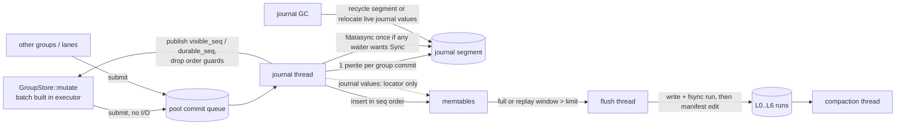
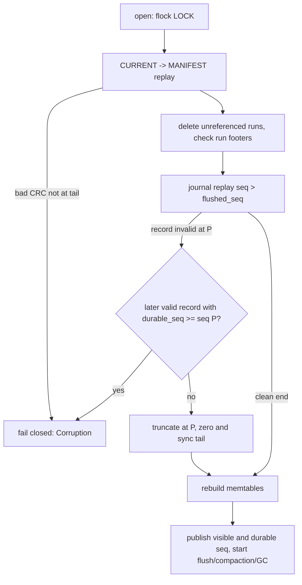

Replace RocksDB with `kv`, an in-tree storage engine written in safe Rust with std and two crates the server already uses. The engine keeps every guarantee the OLTP callers rely on. It also writes Raft log entries to disk once and lets concurrent groups on a worker share one fsync.

Status: proposed 2026-11-19 against `nabedra/oltp-direct-path` (`f4f3091`) and T2's branch `nabedra/oltp-direct-path-t2` (`e3ef8e6`). Nothing here is implemented or measured. The user decided on 2026-11-19 that RocksDB goes and the engine is built in-tree. This plan does not reopen that decision.

## Open questions for the user

| # | Question | Recommendation |
| --- | --- | --- |
| Q1 | **Existing RocksDB data.** Write an offline import tool, or make a clean break? | Clean break, with no in-place converter. The new pool format is `pool_format_version: 2`, and a native build refuses a version 1 pool with an explicit error. RF3 clusters migrate by rolling replica replacement: wipe one replica's volume, and it rejoins as a learner and receives a Raft snapshot. Snapshot files and the wire format do not depend on the engine, so mixed-engine groups work (NS19). RF1 and standalone stores migrate through the existing logical `backup` / `import` archives. An import tool would need RocksDB linked for one more release, and only RF1 deployments without a backup would need it. |
| Q2 | **Feature switch for one release?** | Yes. Add a non-default cargo feature `oltp-rocksdb` that keeps RocksDB behind the same engine enum for one release, for the A/B benchmark, differential tests and an emergency fallback. The pool manifest records the engine, and nothing converts a pool between engines. Release N+1 removes the feature (NS12). |
| Q3 | **Legacy standalone `OltpEngine`** (`oltp/mod.rs` formats 1 and 2, `state_machine.rs`, `snapshot.rs`, `query.rs`, `oltp_replication/log.rs`). Production never constructs it: only tests and `LocalRuntime`, which only tests build, do. Delete it or port it? | Delete it, together with its tests, if no deployment still has a format 1 or 2 store. Otherwise port it mechanically (NS8). |
| Q4 | **`server/events`** has its own `rocksdb = 0.25` and its own lock file. Is it in scope? | Not in this plan. Reuse `kv` there once it ships. |
| Q5 | **Torn tail policy.** RocksDB's `AbsoluteConsistency` refuses to open a WAL with a torn final record, so a power loss can strand a replica. | Truncate only bytes that no later record proves durable, and fail closed on anything else (section 2). Acknowledged writes stay exactly as safe, and a replica comes back after a power loss. This is a deliberate change of behavior, so please confirm it. |

## Decisions (proposed)

| Topic | Decision | Why |
| --- | --- | --- |
| Structure | One LSM per pool: journal, memtables, sorted runs, leveled compaction. Same key layout as today. | Tables may outgrow RAM (O21), so a hash index that must fit in RAM is ruled out. A copy-on-write B+tree needs its own fsync and page writes per commit, so it cannot let applies skip the fsync and rely on the next synced write. An update-in-place B+tree needs torn-page protection and ARIES-style recovery. An LSM is crash-consistent through immutable files plus journal replay. It also fits the measured access patterns: small point writes, seeks to the newest version, and scans of at most 128 items. |
| Raft log bytes | **Journal values.** `put_journal(key, value)` leaves the bytes in the journal record and stores a 24-byte locator under the key in the LSM. | Today each log entry is written to the WAL, then usually flushed to L0 before it is purged, then compacted. A journal value is written once. The log index stays in the LSM, so `truncate_after` and `purge` remain range deletes of small keys, atomic with `tail` and `purged`. This follows TiKV's move of Raft logs out of RocksDB into Raft Engine. |
| Group commit | One journal and one writer thread per pool. The thread writes everything queued as one `pwrite`, then makes one `fdatasync` if any waiter asked for a sync. | Every group and lane in a pool shares the fsync. Callers do not hold an executor slot while they wait (section 3), so concurrency is not limited to the 1 or 2 executor threads. |
| Visibility | A write becomes visible only after its journal bytes reach the OS, and after the fsync when it asked for one. Sequence numbers follow journal order. | This matches RocksDB: `WriteGroupToWAL` runs before `InsertInto`. It preserves O29 and T2's argument for unsynced applies. |
| Durability modes | `Sync` and `NoSync`. A `NoSync` write is `pwrite`n before the call returns, so it survives a process kill. Any later completed sync covers every earlier write. | This is the contract T2 relies on (`WriteSync::{Synced, Unsynced, ApplyHint}`), provided natively through sequence numbers instead of T2's ticket counters. |
| Memtable | Ordered maps sharded 16 ways by the 17-byte group prefix: `RwLock<BTreeMap<InternalKey, Value>>`, inserted by the journal thread alone. Values are `bytes::Bytes`. Cross-group scans merge the shards. | Safe Rust with a single writer. Locks are held for about a microsecond per lookup. A lock-free arena skiplist is a follow-up only if NS-B shows contention. |
| Compression | None. | Same as the current `DBCompressionType::None`, and it needs no dependency. |
| Tuning | Same knobs as the current RocksDB options: 10-bit whole-key bloom filter, index and filter blocks in the block cache, `max_open_files` 128, L0 trigger 4 / slowdown 20 / stop 36, 64 MiB target run, 256 MiB level base, ratio 10. | The benchmark then compares engine structure, not tuning. |
| Checksums | In-tree CRC32C: SSE4.2 `_mm_crc32_u64` on x86_64 and `__crc32cd` on aarch64, chosen at run time, with a slicing-by-8 fallback. Masked CRCs cover every journal record, block, run footer and manifest record. Snapshot files keep SHA-256. | No new crate. `crc32fast` computes plain CRC32, not CRC32C. |
| Dependencies | std, `libc` (already a unix dependency, for `fallocate`, `posix_fadvise` and `flock`), `bytes` (already a dependency), `tokio` oneshot channels for async waits. No C or C++. Removing RocksDB drops `librocksdb-sys`, `bindgen`, `cc` and the clang from the Dockerfile. | Requirement 5. |
| fsync | Linux: `fdatasync` on journal segments, which are preallocated and zero-filled so an overwrite changes no metadata. `fsync` on runs, the manifest and directories. macOS: `fcntl(F_FULLFSYNC)` for every sync. Rust's `File::sync_data` and `sync_all` already do this on Apple targets; directories are opened with `File::open` and synced with `sync_all`. Never `F_BARRIERFSYNC` for an acknowledgment. | On macOS, `fsync` does not flush the drive cache. Docker Desktop runs Linux inside a VM, so its durability depends on the VM disk. B01 and B02 already label that. |
| fsync errors | The first failed `write`, `fdatasync` or `fsync` latches the store into `RecoveryRequired`: no retry, and every pending and later commit fails as ambiguous. Only reopening clears it. | After a failed fsync, Linux may have dropped the dirty pages ("fsyncgate"). This keeps today's `recovery_unknown()` latch (O29). |
| Engine seam | `enum PoolEngine { Native(kv::Store), #[cfg(feature = "oltp-rocksdb")] RocksDb(RocksAdapter) }` in `pool.rs`, with the same snapshot, iterator, batch and commit shapes. | One binary can run A/B benchmarks and differential tests. Deleting the variant later is a small change. |
| Module | `server/src/kv/`, behind `#[cfg(feature = "oltp")]`, with no dependency on `protocol`, `oltp` or `scheduling`. Charges come from budget handles passed in. | It can be tested and fault-injected in isolation, and `events` can reuse it later. |

---

## 1. Current RocksDB usage (inventory)

**Instances.** A worker opens one RocksDB `DB` per pool: one per registered volume, or one directory in development. The default allows up to `max_open_pools = 8`. `serve` and the benchmark open one pool per worker. That pool holds every group the worker hosts (Control, Timestamps, Status, Catalog and the Data ranges); the registered profile allows up to 272 resident groups. All pools on a worker share one LRU `Cache` (`cache_bytes`, 16 MiB by default), one `WriteBufferManager` (`write_buffer_bytes`, 16 MiB, `allow_stall=true`) and one process-global `Env`: `background_threads` = 2, with HIGH=1, LOW=n-1 and BOTTOM=0.

**Memory charges** in `pool/resources.rs`:
- Charged once per worker: `cache_bytes + write_buffer_bytes + stack reservation + 16 MiB`.
- Charged per pool: `POOL_OVERHEAD_BYTES` = 64 MiB.
- Charged per resident group: `RAFT_REPLICA_BYTES` = 8 MiB, plus 64 KiB for each handle and endpoint.
- Reported in `/v1/runtime/stats` as `block_cache {configured_bytes, usage_bytes, pinned_bytes}` (`worker_runtime.rs:1791`, `data_worker_process.rs:889`).

**Shared options** (`pool.rs:155-170`, `mod.rs:299-318`): `create_if_missing`, no compression, `AbsoluteConsistency` WAL recovery, write buffer of `wb/2` ×2, `max_open_files` 128, `max_total_wal_size = wb`, block-based tables with the shared cache, `cache_index_and_filter_blocks`, 10-bit bloom filter. T2 adds `set_manual_wal_flush(true)` in tests only, to model losing the unsynced WAL.

| File | RocksDB APIs | Keys | Reads | Writes | Guarantee relied on |
| --- | --- | --- | --- | --- | --- |
| `oltp/pool.rs`, the production path | `DB::open`, `Options`, `BlockBasedOptions`, `DBCompressionType`, `DBRecoveryMode`, `WriteBatch` (`put`, `delete`, `delete_range`, `with_capacity_bytes`, `clear`), `write_opt` + `WriteOptions{sync}`, `snapshot()`, `get_pinned` (returns `DBPinnableSlice`), `raw_iterator` (`seek`, `next`, `key`, `value`, `status`). T2 adds `sync=false`, `flush_wal(true)` and `latest_sequence_number` in tests. | `\0typed-pool-v1` identity; `0x40‖group(16)‖tag`. Tags: `i` identity, `a` active generation, `t` staging generation, `f` snapshot file, `p` applied (56 B), `r` last response, `m` membership, `s‖gen(8)‖logical` state, `u‖gen` staging metadata, `l‖…` Raft log, plus the placement learner key. Logical MVCC keys under `s`: `h` head, `v‖table‖id‖pk‖!commit_ts` (newest first), `i` intent, `t`/`d`/`b`/`w`/`a`/`p` transaction records, `F`/`G`/`X`/`R`/`S`/`q`/`j`/`P`, config `mvcc/config/v1`, and `D` dedup records from the direct path. | Point `get_pinned`; `first_from` (seek, then the first key under a prefix, which is how the newest version at or below `read_ts` is found); `scan_page` (forward, at most 128 items, with a resumable cursor); `list_groups` (seeks past each group's range). Every read pins one native snapshot for its callback. | One batch per `GroupStore::mutate`, built under the group's lane mutex (`order`, `log_order`, `log_metadata_order`). Applied position, response and membership go in the same batch. The batch budget is up to 32 MiB plus 128 KiB. | Atomic batch, read-your-writes after the call returns, and a consistent snapshot. Synced writes survive power loss. T2: an unsynced apply is made durable by any later synced write in the same WAL (`defer_apply_sync`, `ensure_applied_durable`, `sync_deferred_applies`). Any write error latches `recovery`. |
| `oltp/pool/resources.rs` | `Cache::new_lru_cache`, `get_usage`, `get_pinned_usage`, `WriteBufferManager::new_write_buffer_manager`, `Env` | none | none | none | Native memory stays within the charged `cache + wb`, shared by every pool. |
| `oltp/pool/tests.rs` | `DB::open_for_read_only`, `ErrorKind::Corruption`, `latest_sequence_number`, `Options`, `DBRecoveryMode` | as pool | none | none | A corrupt WAL is refused (O06); a replayed entry writes nothing. |
| `oltp/mod.rs` (legacy `OltpEngine`) | Everything above plus `Env`, `DB::get`, `iterator(IteratorMode::Start)`, `iterator_opt(From, Forward)` with `set_iterate_upper_bound` and `fill_cache(false)`, `put_opt`. Also hosts `sync_options`, `storage_error`, `native_environment` and `configure_native_jobs`, which `pool.rs` reuses. | `\0m` manifest, `\0g` active, `\0b` database; `0x01‖gen‖{t,n,d,r}` with `r‖table‖gen0‖pk` (`codec.rs`) | Snapshot gets, forward prefix scan of names | One synced batch per mutation under the writer mutex; `delete_range` for a table drop | Response after WAL sync; uncertain write latch (O29) |
| `oltp/state_machine.rs` | `Snapshot`, `WriteBatch` | `0x01‖gen‖{p,v,a}` | Snapshot gets | One synced batch with data, result and applied position | Same as pool |
| `oltp/snapshot.rs` | `iterator_opt(From, Forward)`, `ReadOptions` (upper bound, `fill_cache(false)`), `WriteBatch`, `delete_range` | generation prefixes | Forward scan of the whole generation | Stages a generation in batches, then activates it and retires the old one with `delete_range` | Activation is atomic |
| `oltp/query.rs` | `iterator_opt(From, Forward)`, lower and upper bounds, `fill_cache(false)` | rows | Bounded forward range scans | none | Snapshot consistency |
| `oltp_replication/log.rs` (legacy) | `DB`, `iterator_opt` **`Direction::Reverse`** (the only reverse read: finding the last log entry), `ReadOptions` lower and upper bounds, `WriteBatch`, `put_opt` sync, `delete_range` | `0x30‖group‖/log/‖idx(be)`, `/meta/{vote,committed,purged,identity}` | Point gets, forward range read, reverse seek to the last entry | Synced append batch, synced vote/committed, `delete_range` for truncate and purge | Synced Raft storage |
| `oltp/DESIGN.md` | Documentation of the WAL-before-memtable order, the uncertainty latch and the dependency pin | none | none | none | none |

The brief listed nine files. These also call RocksDB through `PoolInner.db` without importing the crate:

| File | Use |
| --- | --- |
| `oltp/pool/snapshot.rs` | Export: one snapshot, `raw_iterator` forward over the active generation, and gets of `p`/`m`/`r`. Install: synced staging batches, then one activation batch that `delete_range`s the old generation. T2 adds `sync_deferred_applies` before export. |
| `oltp/pool/restore.rs` | `raw_iterator` checks for an empty log; `flush_wal(true)` and `flush()` before an offline restore is verified. |
| `oltp/pool/closed.rs` | `flush_wal(true)` on close; snapshot plus `raw_iterator` over the groups. |
| `oltp/pool/placement.rs`, `oltp/pool/activation.rs` | `get_pinned` |
| `tests/oltp_replicated_durability/fixture.rs` | Opens RocksDB read-only to assert that corruption is detected. |
| `Dockerfile`, `server/README.md`, `Cargo.toml` (`oltp = ["dep:rocksdb", …]`) | Build toolchain and documentation. |

`typed_log.rs` reaches storage only through `GroupStore`. It stores `e‖idx` for an entry, `i‖idx` for a log id, and `tail`, `purged`, `node`, `vote` and `committed`. It truncates and purges with `delete_range`. T2 batches appends to at most 64 entries and 1 MiB per synced batch, and makes `save_committed` unsynced. Backups (`oltp/backup*`, `oltp-backup-s3`) are logical MVCC cuts read through `GroupStore::read_archive`. Snapshot files use our own `NABEDRA-GRP-0001` format. Neither depends on RocksDB's file format.

---

## 2. Engine



**Files.**

```text
<pool>/NABEDRA_OLTP_POOL.json   identity, pool_format_version 2, engine "native-kv-1"
<pool>/kv/LOCK                  flock held while open
<pool>/kv/CURRENT               names the live MANIFEST (temp file + rename + directory fsync)
<pool>/kv/MANIFEST-<n>          CRC'd version edits: runs added/removed, flushed_seq, next file, segment set
<pool>/kv/journal/<seg>.jnl     64 MiB, preallocated, zero-filled, recycled
<pool>/kv/runs/<id>.run         immutable sorted runs
```

**Journal record.** `crc32c | len u32 | kind u8 | flags u8 | segment_epoch u64 | first_seq u64 | count u32 | durable_seq u64 | payload`. The payload is the encoded batch: puts, deletes, range deletes and journal values. `segment_epoch` grows each time a segment file is reused, so a stale record left by an earlier use reads as the end of the log. `durable_seq` is the highest sequence a completed fsync had covered when this record was written.

**Group commit.** The journal thread repeats these steps:
1. Drain the queue, up to `max_group_bytes` (4 MiB) or until it is empty. Submissions that arrive during an fsync form the next group.
2. Encode the records and make one `pwrite`, rolling to a preallocated segment when the current one is full. A sync that spans a roll also syncs the previous segment.
3. If any waiter asked for `Sync`, `fdatasync`, then pad the write position to the next 4 KiB. **Invariant: no write ever touches a byte that a completed sync covered**, so a torn page cannot damage acknowledged data, whatever the device's sector atomicity. The padding costs at most 4 KiB per fsync and is recycled.
4. Insert into the memtables in sequence order, publish `visible_seq` and then `durable_seq`, and complete the waiters. A waiter's completion payload (its group order guard and charges) is dropped here, on the journal thread. Cancelling the caller therefore never releases ordering while disk work is outstanding.

A batch takes `count` consecutive sequence numbers, so a later operation on the same key in the same batch wins, including a put after a `delete_range`. While the memtable budget is exhausted and a flush is still behind, step 4 waits and `stall_ms` is counted. Writers wait, and are never refused because of memory.

**Snapshots.** A `Snapshot` pins `(visible_seq, Arc<memtables>, Arc<Version>)`. The engine keeps a list of live snapshot sequences. Compaction drops an older version of a key only if no live snapshot falls between it and the newer one, and drops a tombstone only at the bottom level under the same rule. Range tombstones are fragmented and sorted in memtables and stored in a separate block in each run. Point reads and iterators skip every entry that a newer covering tombstone hides.

**Runs.**
- Data blocks are 4 KiB, with prefix-compressed keys, a restart point every 16 keys, and a CRC32C trailer. An oversized value forms its own block.
- Each run has an index block holding the last key of every block, a bloom block, a range-delete block, and a 64-byte footer: magic, offsets, sequence range, key range and entry counts, CRC.
- Reads use `pread` (`FileExt::read_exact_at`) on files from an LRU of at most 128 open descriptors.
- The block cache is a 16-shard LRU of `Bytes` keyed by `(run_id, offset)`, and also holds index and filter blocks. A `Bytes` still held by a caller counts as `pinned_bytes`.
- `fill_cache=false` scans read through the cache without inserting.
- Compaction and flush output is followed by `posix_fadvise(DONTNEED)` on Linux, so the page cache does not duplicate the block cache.

**Flush and compaction.** A memtable is frozen when the pool's share of `write_buffer_bytes` is used, or when the journal written since `flushed_seq` exceeds `max_replay_bytes` (default 64 MiB). This is the equivalent of `max_total_wal_size`, and it bounds recovery even when most journal bytes are log entries. A flush writes an L0 run, fsyncs it and its directory, then appends and fsyncs a manifest edit `{add run, flushed_seq}`. Leveled compaction mirrors the RocksDB settings above, with one flush thread and `background_threads - 1` compaction threads shared by every pool on the worker. Inputs are deleted only after the manifest edit that removes them is synced. When the store opens, it deletes any run that no version references.

**Journal values (Raft log bytes).**
- `WriteBatch::put_journal(key, value)` keeps `value` in the journal record. Applying the batch puts `Locator { segment, epoch, offset, len, crc32c }` (24 B) under `key`.
- Reads resolve a locator transparently: `pread` the value, check its CRC, and cache it in the block cache under `(segment, epoch, offset)`.
- **Journal GC** runs while the journal is larger than `max_journal_bytes` (default 512 MiB), oldest segment first:
  - A segment is reusable once `flushed_seq` covers all its state records, no locator visible at the current sequence points into it, and the oldest live snapshot is newer than the GC decision.
  - Live values found there are rewritten at the head of the journal with an internal `Relocate { key, old, new }` operation. The journal thread applies it only if the key still holds `old`. Replay makes the same check, so the result is deterministic.
  - Only groups that purge slowly pay for relocation, and NS-B counts the bytes.

**Recovery** (one pass, fail-closed):
1. Take `LOCK`, read `CURRENT` and replay the `MANIFEST`. A torn final manifest record was never acknowledged, because the edit it carried was not yet relied on, so it is dropped. Any other bad CRC is reported as corruption.
2. Delete runs that no version references, and check each referenced run's footer CRC.
3. Replay journal records with `seq > flushed_seq` in segment order. Each record's CRC, epoch and sequence continuity must hold.
4. At the first invalid record P, scan the rest of the readable journal. If any later valid record of the current epoch has `durable_seq >= seq(P)`, a record a sync had covered is corrupt, so **fail closed** with `Corruption`. Otherwise everything from P onwards came after the last completed sync. Truncate there, zeroing the tail and syncing the zeros, even past records that look valid, so the result is an exact prefix.
5. Rebuild the memtables, publish `visible_seq = durable_seq = last replayed`, and start the background threads.

Recovery reads at most `max_replay_bytes` of state plus the log values interleaved with it, so it is bounded and small. Media corruption of the final synced group, when no later record names it as durable, cannot be told apart from a torn write. Every WAL engine has this limit, and Raft replicas cover it (risk R6).



**Read path.** A point `get`:
1. Look up the active and immutable memtables: O(log n) each, under one shard read lock.
2. For each L0 run, newest first, check the bloom filter (cached), binary-search the index (cached) and read the data block (cached, or one `pread`).
3. For each deeper level, do the same against the one run whose key range contains the key.
4. Resolve a locator if the value is one.

There is no FFI, and the value comes back without a copy. A seek merges heap iterators over the memtables and runs. That cost matches RocksDB. It saves the FFI boundary and the copy from `DBPinnableSlice` into `ChargedBytes` where callers only inspect the value.

### Interfaces

```rust
// server/src/kv/mod.rs
pub struct Store { /* Arc<StoreInner> */ }
pub struct Options {
    pub fs: Arc<dyn Fs>,                 // RealFs, or FaultFs in tests
    pub cache: Arc<BlockCache>,          // worker-shared, cache_bytes
    pub memtables: Arc<MemtableBudget>,  // worker-shared, write_buffer_bytes (replaces WriteBufferManager)
    pub background: Arc<Background>,     // worker-shared, background_threads (replaces Env)
    pub journal: JournalOptions,         // segment 64 MiB, max_group 4 MiB, max_replay 64 MiB, max_journal 512 MiB, sync_align 4096
    pub levels: LevelOptions,            // RocksDB-equivalent knobs listed in Decisions
    pub max_open_runs: usize,            // 128
}
pub enum Durability { Sync, NoSync }
pub type Seq = u64;

impl Store {
    pub fn open(dir: &Path, options: Options) -> Result<Store, Error>;
    /// Never blocks on I/O. Submission order is commit order.
    pub fn submit(&self, batch: WriteBatch, durability: Durability, on_done: Box<dyn Any + Send>) -> Result<Commit, Error>;
    /// Durably covers every write submitted before this call. Replaces flush_wal(true).
    pub fn sync(&self) -> Result<Commit, Error>;
    pub fn snapshot(&self) -> Snapshot;
    pub fn flush(&self) -> Result<(), Error>;              // replaces DB::flush (offline restore)
    pub fn visible_seq(&self) -> Seq;
    pub fn durable_seq(&self) -> Seq;                       // replaces T2's WalDurability tickets
    pub fn requires_recovery(&self) -> bool;
    pub fn stats(&self) -> StoreStats;
}
pub struct Commit { /* seq + oneshot */ }
impl Commit {
    pub fn seq(&self) -> Seq;
    pub fn wait(self) -> Result<Seq, Error>;                // blocking callers (legacy, tests)
    pub async fn done(self) -> Result<Seq, Error>;
}

#[derive(Clone)]
pub struct Snapshot { /* seq, Arc<SuperVersion> */ }
impl Snapshot {
    pub fn get(&self, key: &[u8]) -> Result<Option<Bytes>, Error>;   // replaces get_pinned / DBPinnableSlice
    pub fn iter(&self, lower: Bound<&[u8]>, upper: Bound<&[u8]>, fill_cache: bool) -> Iter;
}
pub struct Iter { /* merged, snapshot-filtered */ }
impl Iter {
    pub fn seek(&mut self, key: &[u8]);
    pub fn seek_for_prev(&mut self, key: &[u8]);
    pub fn seek_to_first(&mut self);
    pub fn seek_to_last(&mut self);
    pub fn next(&mut self);
    pub fn prev(&mut self);
    pub fn valid(&self) -> bool;
    pub fn key(&self) -> &[u8];
    pub fn value(&self) -> Result<Bytes, Error>;   // resolves journal values
    pub fn status(&self) -> Result<(), Error>;
}

#[derive(Default)]
pub struct WriteBatch { /* encoded ops + byte count */ }
impl WriteBatch {
    pub fn put(&mut self, key: &[u8], value: &[u8]);
    pub fn put_journal(&mut self, key: &[u8], value: &[u8]);   // Raft log entries
    pub fn delete(&mut self, key: &[u8]);
    pub fn delete_range(&mut self, start: &[u8], end: &[u8]);
    pub fn encoded_bytes(&self) -> usize;
    pub fn clear(&mut self);
}

#[derive(Debug)]
pub enum Error {
    Corruption { file: FileId, offset: u64, what: &'static str },
    Io(io::ErrorKind),
    NoSpace,
    RecoveryRequired,
    Closed,
}

pub trait Fs: Send + Sync {                 // every byte goes through this, so faults can be injected
    fn open(&self, path: &Path, mode: OpenMode) -> io::Result<Arc<dyn FsFile>>;
    fn rename(&self, from: &Path, to: &Path) -> io::Result<()>;
    fn remove(&self, path: &Path) -> io::Result<()>;
    fn list(&self, dir: &Path) -> io::Result<Vec<PathBuf>>;
    fn sync_dir(&self, dir: &Path) -> io::Result<()>;
    fn lock(&self, path: &Path) -> io::Result<FsLock>;
}
pub trait FsFile: Send + Sync {
    fn write_all_at(&self, buf: &[u8], offset: u64) -> io::Result<()>;
    fn read_exact_at(&self, buf: &mut [u8], offset: u64) -> io::Result<()>;
    fn sync_data(&self) -> io::Result<()>;   // fdatasync on Linux, F_FULLFSYNC on Apple (std)
    fn sync_all(&self) -> io::Result<()>;    // fsync on Linux, F_FULLFSYNC on Apple (std)
    fn preallocate(&self, len: u64) -> io::Result<()>;
    fn len(&self) -> io::Result<u64>;
}

pub struct StoreStats {
    pub journal_syncs: u64,          // fdatasync / F_FULLFSYNC on the journal
    pub file_syncs: u64,             // runs, manifest, directories
    pub commits: u64,
    pub synced_commits: u64,
    pub group_commits: u64,
    pub user_bytes: u64,
    pub journal_bytes: u64,
    pub flush_bytes: u64,
    pub compaction_bytes: u64,
    pub relocated_bytes: u64,
    pub stall_ms: u64,
    pub memtable_bytes: u64,
    pub l0_runs: u32,
    pub recovery_ms: u64,
    pub corruption_detected: u64,
}
```

---

## 3. Pool integration

| Today | Native |
| --- | --- |
| `PoolInner.db: DB` | `PoolInner.engine: PoolEngine`. Opening it creates `kv/`; a version 1 (RocksDB) pool is refused with `"RocksDB pool format 1: migrate by replica replacement or archive import"`. |
| `durable_write(batch)` blocks an executor thread through the fsync | `mutate` builds the batch on the executor, calls `submit(batch, durability, on_done = (order guard, generation guard, batch charge))` there, leaves the executor, then awaits `commit.done()`. A cancelled caller never releases the order guard early, because the journal thread drops it after visibility. Waiting for storage holds no compute permit, as the scheduling plan requires. |
| T2: `WriteSync::{Synced, Unsynced, ApplyHint}`, `WalDurability` tickets, `has_unsynced_writes`, `sync_wal`, `ticket_durable` | `Durability::{Sync, NoSync}`; the deferred tail becomes `(applied index, Seq)`. `has_unsynced_writes` becomes `visible_seq > durable_seq`, `sync_wal` becomes `store.sync().done()`, and `ticket_durable(t)` becomes `durable_seq >= t`. `defer_apply_sync` keeps its same-pool and same-group check. |
| `DBPinnableSlice<'a>`, `ScopedRecord { DBRawIterator }` | `Bytes` and `ScopedRecord { kv::Iter }`. Callers use `&[u8]` through `Deref`. |
| `typed_log` append `tx.put(e‖idx, bytes)` | `tx.put_journal(e‖idx, bytes)`. Nothing else changes: `i‖idx`, `tail`, truncate and purge stay small keys and range deletes. |
| `flush_wal(true)` on close and on restore, `flush()` on restore | `sync().wait()`, then `flush()` |
| `Cache`, `WriteBufferManager`, `Env` in `WorkerSharedResources` | `BlockCache`, `MemtableBudget`, `Background`, with the same config fields and the same single charge per worker. `block_cache_usage()` keeps its JSON shape. |
| Thread names `rocksdb:high` / `rocksdb:low` (O05) | `kv-flush` ×1 and `kv-compact` ×(n-1) per worker, plus `kv-journal` ×1 per pool. `NativeThreadBudget` gains one journal thread per open pool, and the O05 probe is updated. |

**Memory (requirement 4).** Every byte stays inside a charge that exists today, with no new budget line:
- **Block cache** (index and filter blocks, pinned `Bytes`, cached journal values): `cache_bytes`.
- **Active and immutable memtables of every pool**: `write_buffer_bytes`, the same role as the `WriteBufferManager` with stalling allowed.
- **Per pool, inside the existing 64 MiB `POOL_OVERHEAD_BYTES`**: the journal's group encoding buffer (≤ 4 MiB), flush and compaction I/O buffers (2 × 1 MiB per thread), manifest and versions (≈ 200 B per run), the descriptor LRU and the snapshot list.
- **Per group**: nothing is resident, because the log index lives in the LSM. `RAFT_REPLICA_BYTES` keeps its current role.

Data larger than RAM is supported: runs live on disk, and only the bounded cache and memtables are resident. Disk is bounded by the LSM size plus `max_journal_bytes`. The page cache is reclaimable and is not used as a second cache.

---

## 4. Performance expectations and how they are measured

| Metric | RocksDB (with T2) | Native, expected | Measured by |
| --- | --- | --- | --- |
| fsyncs per Raft append on one replica | 1 per synced `write_opt`. RocksDB groups concurrent syncs, but at most `query_threads + control_threads` (2 in the benchmark) callers write at once. | 1 per group commit shared by every group and lane in the pool. With k concurrent appenders that is 1/k per append, and never more than 1. | `journal_syncs / synced_commits` in `/v1/runtime/stats`. T2's `synced_writes` gives the RocksDB side. |
| fsyncs per apply or commit hint | 0 (unsynced) | 0 | same |
| Raft log write amplification | WAL plus an L0 flush before purge (retained log bytes far exceed the 16 MiB buffer) plus compaction until the range tombstone drops it: about 2-4× | 1×, plus relocation for slow-purging groups | `(journal + flush + compaction + relocated) / user_bytes`, cross-checked against `/proc/<pid>/io` `write_bytes` and cgroup `io.stat` |
| State write amplification | WAL + flush + leveled compaction | Same structure and knobs, so parity. Less compaction input, because log bytes no longer enter the LSM. | same |
| Point get, warm | memtable, then bloom, index and block in cache, behind FFI | same path, no FFI, `Bytes` without a copy | NS-B library microbench |
| Short scan (10 and 128 items) | merged iterator | merged iterator | NS-B |
| Snapshot install | staged `WriteBatch`es through WAL, memtable, flush and compaction, then a `delete_range` | Same in phase 1. NS9 adds bulk ingest: the snapshot stream is already sorted, so it is written straight to bottom-level runs plus one manifest edit, written once. | NS-B, 256 MiB group |
| Recovery | WAL ≤ 16 MiB plus the manifest | at most `max_replay_bytes` (64 MiB) of state plus interleaved log values. At least 1 GB/s sequential read and hardware CRC32C should give under 0.5 s on NVMe. | `recovery_ms`, measured cold after SIGKILL with a full replay window |

**Gate before RocksDB is removed (NS12).** NS-B must show, in one binary built with `oltp-rocksdb`, on the same host and volume type, in the Linux benchmark container at 2.15 GB and the benchmark CPU quota, with 10 repetitions each:
- the native median throughput at least RocksDB's,
- the native p99 at most 1.05 × RocksDB's,
- fsyncs per commit at most RocksDB's,
- total write amplification at most RocksDB's,
- recovery at most max(1 s, RocksDB's) for every microbench and both end-to-end runs.

Any miss blocks removal unless the user accepts it explicitly.

---

## Tasks

Owned paths do not overlap. NS1 to NS4 can run in parallel. Every task adds its own NS tests, named `ns04_…` and so on, and runs `cargo fmt`, `clippy` and the `kv` tests with `--no-default-features --features oltp`.

| Task | Deliverable | Depends on | Owns | Scenarios |
| --- | --- | --- | --- | --- |
| NS1 | `kv` skeleton, `Error`, CRC32C (x86_64, aarch64, software, with known-answer vectors), the `Fs` trait, `RealFs`, and `FaultFs`: crash at the n-th write or sync, drop unsynced bytes per sector in any subset, flip a bit, return EIO or ENOSPC | none | `server/src/kv/{mod,error,crc}.rs`, `kv/fs/**` | NS15, NS-unit |
| NS2 | Journal: record format, segments, recycling, journal thread, group commit, sync alignment, `Commit`, the recovery scan and truncation rule | NS1 | `kv/journal/**` | NS04 to NS09 (journal level), NS12 |
| NS3 | `WriteBatch`, internal keys and sequence numbers, sharded memtable, range tombstones, the snapshot list, merged iterators forward and reverse with bounds | NS1 | `kv/{batch,memtable,iter}/**` | NS01, NS02, NS21 |
| NS4 | Run writer and reader, blocks, index, bloom filter, footer, `BlockCache`, descriptor LRU | NS1 | `kv/{run,cache}/**` | NS07 (run level), NS01 |
| NS5 | `Version`, `MANIFEST`, `CURRENT`, flush, leveled compaction, stalls, `Background`, orphan cleanup, journal values and their GC and relocation, `Store` assembly and recovery | NS2 to NS4 | `kv/{version,compaction,gc,store}.rs`, `kv/tests/**` | NS01 to NS14, NS17 |
| NS6 | Pool integration (section 3): `PoolEngine`, the async commit with `on_done` guards, T2's API moved onto sequence numbers, resources and thread budget, stats, `pool/{snapshot,restore,closed,placement,activation}.rs`, the version 2 manifest. The `oltp-rocksdb` feature keeps RocksDB as `RocksAdapter`. | NS5, **T2 merged** | `oltp/pool.rs`, `oltp/pool/**`, `oltp/native.rs`, `Cargo.toml` features | O05, O06, O11, O29, NS08, NS10, NS19 |
| NS7 | `typed_log` writes entries with `put_journal`; port T2's hosted and typed_log tests from `manual_wal_flush` to `FaultFs` | NS6 | `oltp_replication/typed_log.rs`, `typed_log/tests.rs`, `hosted/tests.rs` | O06, O11, D09, NS13 |
| NS8 | Depends on Q3. Either delete the legacy `OltpEngine` and its users, or port `oltp/{mod,state_machine,snapshot,query}.rs` and `oltp_replication/log.rs` (reverse seek via `seek_for_prev`). Port `tests/oltp_replicated_durability/fixture.rs` either way. | NS5 | those files | O29, O11 (legacy), NS21 |
| NS9 | Bulk ingest of a sorted snapshot stream into bottom-level runs, used by `install_snapshot` | NS6 | `kv/ingest.rs`, `oltp/pool/snapshot.rs` install path | O16, NS14 |
| NS10 | Whole-system crash and power-loss campaign, plus the differential test against the `BTreeMap` model and `RocksAdapter` | NS6 | `server/src/kv/tests/campaign/**`, `server/tests/kv_crash.rs` | NS04, NS05, NS16, NS17, NS19, NS20, O06, O11, O29, R04, R05, D09 |
| NS11 | NS-B: a library microbench (an ignored test binary, no new crates) and `benchmark_oltp_nabedra.py --storage-engine rocksdb\|native`, both run in the Docker lane | NS6, NS7, (NS9) | `server/tests/kv_bench.rs`, `scripts/benchmark_oltp_nabedra.py`, evidence directory | NS18, B01, B02, O24 |
| NS12 | Remove RocksDB: the dependency, the `oltp-rocksdb` feature, `RocksAdapter`, the Dockerfile clang step, `ROCKSDB_*` build variables, `DESIGN.md`, README and the O02 dependency check. Release N+1, if Q2 is accepted. | NS11 gate, user approval | `Cargo.toml`, `Cargo.lock`, `Dockerfile`, docs | O02, all suites |

---

## Tests

Add these rows to `docs/testing/oltp-contract.md` under "Native storage engine". Every crash and fault scenario runs on `FaultFs`, and is repeated where noted with real processes (SIGKILL). Power-loss evidence comes from `FaultFs`, and is labeled as a fault model, not as physical power-loss evidence (O29 wording).

| ID | Scenario | Required assertions |
| --- | --- | --- |
| NS01 | Differential model: 10⁶ seeded random operations (put, journal put, delete, `delete_range`, multi-op batches, snapshots held across flushes and compactions, iterators forward and reverse with bounds, `seek_for_prev`) against a `BTreeMap` oracle and `RocksAdapter` | Every get, scan and iteration matches the oracle at the snapshot's sequence. Shrink failing seeds and keep them as regressions. |
| NS02 | Atomic batches under 16 readers and 8 writers, with flush and compaction forced every N operations | No reader ever sees part of a batch. A later read sees the whole batch once `submit` completes. |
| NS03 | A snapshot held during flush, compaction, journal GC and relocation | Reads stay identical. Runs and segments are released only after the snapshot is dropped. |
| NS04 | **Crash at every boundary**: each `pwrite`, `fdatasync`, run write, run fsync, manifest append, manifest fsync, `CURRENT` rename, directory fsync, segment preallocation, recycle and relocation, enumerated one by one | After reopening, the state equals the oracle at some prefix p with last synced ack ≤ p ≤ last submit. Every write acknowledged as synced is present. Reopening again changes nothing. |
| NS05 | Power loss: drop any subset of the unsynced sectors, reorder them, keep the synced ones | Same as NS04. A torn tail is truncated to an exact prefix. A record named durable by a later one is never silently dropped. |
| NS06 | Torn final record: a partial write of the last group, before its sync completed | The store opens and the prefix is exact. `recovery_ms` is reported. |
| NS07 | **Bit flips** in a synced journal record that a later record names durable, and in a data block, index block, bloom block, footer, `MANIFEST` record, `CURRENT` and a journal value | The journal and manifest cases fail closed with `Corruption`. A bad run or journal-value read returns `Corruption` and counts `corruption_detected`. No wrong value is ever returned. A compaction that hits corruption latches `RecoveryRequired`. |
| NS08 | **Group commit**: 64 groups × 4 lanes of concurrent synced and unsynced writers on one pool, with 1 query thread and 1 control thread | `journal_syncs < synced_commits`, and the ratio is reported. A synced write makes every earlier unsynced write durable (T2's contract, under the NS05 power-loss model). No waiter holds an executor slot. `/v1/runtime/stats` shows the counters. |
| NS09 | EIO on `fdatasync` and on `pwrite` (fsyncgate) | The store latches `RecoveryRequired` and never retries. Pending commits return ambiguous. Every alias of the pool shares the latch. Reopening recovers from disk only. |
| NS10 | Memory: load 4× the worker memory budget of data at 2.15 GB into 2 pools, then mixed reads and writes | Charges stay within `cache + wb + pool overhead`. cgroup `memory.peak` stays under the limit with no OOM. Writers stall instead of overrunning. |
| NS11 | ENOSPC during a journal write, a flush, a compaction and a manifest write | An explicit `NoSpace` error with no corruption. Background work resumes after space frees up. Committed data stays intact. |
| NS12 | Recovery time with a full replay window and a full `max_journal_bytes` | `recovery_ms` is recorded on the evidence host, and the gate in section 4 holds. |
| NS13 | Raft log on journal values: append, `truncate_after`, purge, and a lagging group that pins the oldest segment, with crashes injected during relocation | Log reads match the oracle. Segments are recycled. Relocated bytes are counted. No locator dangles after any crash point. |
| NS14 | Snapshot install (staged and ingest), crashing at each step | The old generation stays active until activation. The new generation and the applied position activate atomically. Orphaned runs and stages are cleaned up. |
| NS15 | Platform sync | On Linux, journal syncs are `fdatasync` and file and directory syncs are `fsync`. On macOS every sync is `F_FULLFSYNC`. Asserted through the `Fs` call log, with the real calls confirmed by `strace -f -e trace=fdatasync,fsync` on Linux. |
| NS16 | SIGKILL of a real worker process under write load, 50 iterations (in the style of `oltp_storage.rs`) | Every acknowledged write is present and recovery succeeds every time. |
| NS17 | Stress: random sleeps in flush, compaction, GC and the journal thread, with cancelled callers | No deadlock, no order guard released before visibility, no leaked charge. The Raft-append cancellation regression passes. |
| NS18 | **RocksDB versus native benchmark (NS-B)** | Microbench: synced and unsynced 100 B and 1 KiB point puts with 1 to 64 writers; hot and cold point gets; scans of 10 and 128; Raft appends of 64 × 1 KiB; purges; a 256 MiB snapshot install; recovery. End to end: the serial pair and the sweep from the direct-path plan. Report p50, p95 and p99, throughput, fsyncs per commit, write amplification, RSS and recovery, and apply the section 4 gate. |
| NS19 | Mixed engines: a RocksDB replica and native replicas in one RF3 group, then rolling replacement to all native | O06 holds throughout. The snapshot transfer is identical. A native build refuses a version 1 pool with the migration error. |
| NS20 | Backups: back up a RocksDB cluster with `oltp-backup-s3`, restore into native, and back up and restore native to native | Checksums, the schema and per-range hashes match (O19). |
| NS21 | Iterator edges: empty ranges, bounds at both ends, direction switches, `seek_for_prev` on a tombstoned key, a range tombstone straddling runs | Matches the oracle. |

**Existing scenarios that must still pass on the native engine:**

| Scenario | Why it is affected | Run in |
| --- | --- | --- |
| O05 | Thread names and counts change | NS6 |
| O06 | fsync failure, corrupt logs and checkpoints, quorum | NS6, NS10 |
| O11 | Crash between log sync, state batch, applied position, checkpoint and truncation | NS6, NS7, NS10 |
| O16 | Snapshot install interrupted | NS9 |
| O19 | Backup and restore | NS20 |
| O21 | Growth beyond RAM | NS10 |
| O26 | Multiple pools share budgets | NS10 |
| O29 | Ambiguous error after the journal write, now injected for real through `FaultFs` | NS6, NS10 |
| R04 | Every worker stops, then a cold start | NS10 |
| R05 | Partition and takeover | NS10 |
| D09 | Kill every worker under load | NS7, NS10 |
| O02 | No `rocksdb`, `librocksdb-sys`, `bindgen` or `cc` in `cargo tree -e normal --features oltp` | NS12 |

Run them alongside T2's group-commit replay test, the OLTP library suite, the four OLTP integration tests and `scripts/acceptance_oltp.py`, with `oltp-rocksdb` both on and off. The five native library failures recorded in the scoped-queue evidence are the known baseline.

## Risks

| ID | Risk | Mitigation |
| --- | --- | --- |
| R1 | A new storage engine can lose or corrupt data | Differential testing (NS01) against an oracle and RocksDB; crash points enumerated exhaustively (NS04); the power-loss model (NS05); RocksDB kept for one release (Q2). |
| R2 | Size: about 8 to 12 thousand lines including tests | Five parallel tasks, each with its own tests. Journal values and ingest are separable (NS7, NS9). |
| R3 | Tail latency from compaction stalls at 16 MiB of write buffer and 2 background threads | Same knobs as RocksDB. NS18 measures `stall_ms`. Stalls never block the journal thread's fsyncs, only memtable insertion. |
| R4 | A group that purges slowly pins journal segments | GC relocation, measured by `relocated_bytes` (NS13). |
| R5 | `BTreeMap` memtable contention | NS18 detects it. The fallback is a single-writer arena skiplist, which the journal thread design already allows. |
| R6 | Media corruption of the very last synced group cannot be told apart from a torn write | It is documented. Raft quorum and replica replacement cover it, as they do for every WAL engine. |
| R7 | Moving the commit wait off the executor changes ordering and cancellation behavior | The `on_done` guards are dropped by the journal thread. NS17 and the existing cancellation regressions cover it. |

## Out of scope

Compression, encryption at rest, `io_uring`, direct I/O, column families, transactions inside the engine (the MVCC stays in `oltp/mvcc`), the `server/events` crate (Q4), and any change to Raft, wire or snapshot formats.
