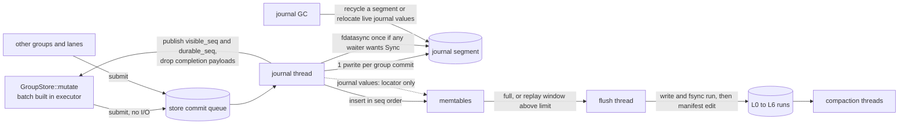
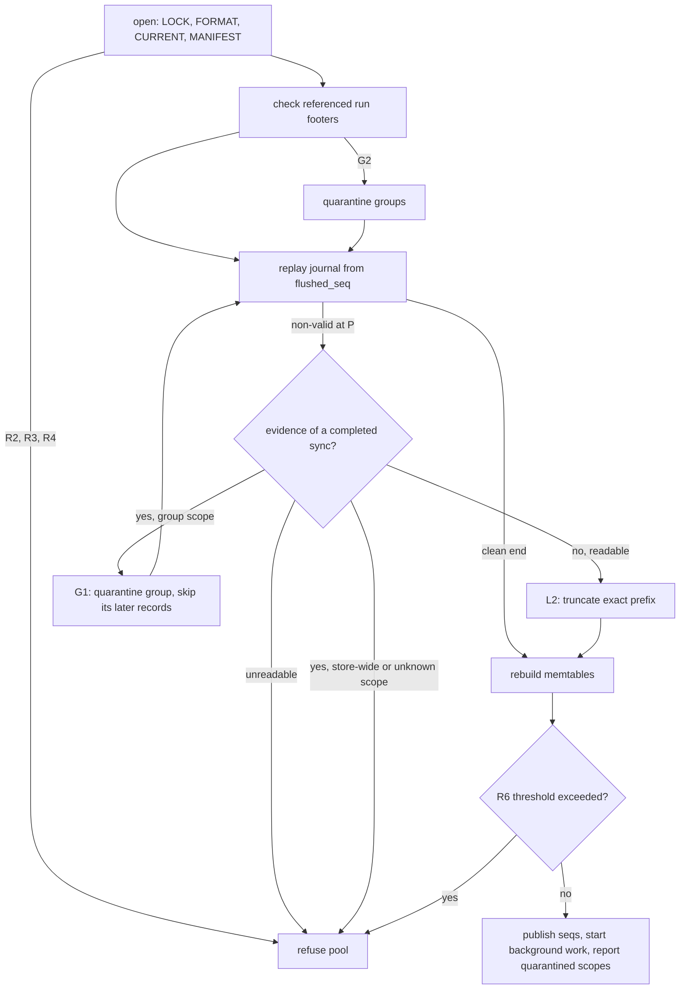

Replace RocksDB everywhere with `nabedra-kv`, an in-tree storage engine in safe Rust that depends only on std, `libc`, `bytes` and `tokio` (sync). It keeps every guarantee the OLTP and Events callers rely on. It also writes each Raft log entry to disk once and lets every group on a pool share one fsync.

Status: revised 2026-11-19 on `nabedra/remove-rocksdb` (`638e162`), after T2 merged (`e781adb`) and the lead committed the shared contract (`be2b173`, `fbbe0b1`). Nothing beyond that contract is implemented or measured. The user decided on 2026-11-19 that RocksDB goes and that the engine is built in-tree.

## Decisions

The user (Q1 to Q5) and the lead settled these on 2026-11-19. Do not reopen them.

| Topic | Decision | Why |
| --- | --- | --- |
| Old data (Q1) | Clean break. No migration path, converter or old-format reader. Opening an old store fails with `Error::UnsupportedFormat` and names the path. That error is the only old-format detection. | User decision. |
| Transition (Q2) | RocksDB leaves in the same PR as the engine. There is no `oltp-rocksdb` feature, `PoolEngine` enum, `RocksAdapter` or dual-engine binary. The gate (section 8) compares the candidate with the prebuilt RocksDB binary `nabedra-db-b29a178` and with ScyllaDB 6.2.3. | User decision. |
| Scope (Q3, Q4) | RocksDB leaves the server OLTP pools, `server/events`, the legacy test-only `OltpEngine` (deleted with its tests, not ported), `tests/oltp_replicated_durability/fixture.rs`, both Dockerfiles, the Cargo files, `scripts/check_engine_features.py` and the docs that describe it as the engine. | User decision. Section 1 is the inventory. |
| Damage and torn tails (Q5) | Recovery follows ScyllaDB's commitlog replay where that is Raft-safe and is stricter where it is not. Section 3 lists, case by case, what recovers locally, what quarantines one group and re-syncs it from peers, and what refuses to open the pool. A quarantined replica never votes or acknowledges again under its old identity. | User decision. ScyllaDB skips corrupt commitlog data, including group0 Raft state, and relies on repair. A Raft voter must not silently forget entries it acknowledged. |
| Crate | Package `nabedra-kv` at `server/kv`, a member of the workspace rooted at `server/Cargo.toml` (`members = [".", "kv"]`, `exclude = ["events"]`). `server/events` depends on it by path. `cargo test -p nabedra-kv` builds it alone in seconds. | Lead decision. |
| Shared contract | The lead owns `server/kv/src/{types,batch,coding,error,source}.rs`, `fs/mod.rs` and `fs/real.rs`. Section 4 points to them and lists the additions this revision needs. | NS1 to NS4 can then run in parallel. |
| Order with the direct path | T2 (`WriteSync`, `WalDurability`) is merged. NS6 ports T2's API onto sequence numbers (section 5). Raft and `openraft` do not change. | Lead decision. |
| Structure | One LSM per store: journal, memtables, sorted runs, leveled compaction. Same key layout as today. | Tables may outgrow RAM (O21), which rules out a hash index that must fit in memory. A copy-on-write B+tree needs its own fsync and page writes per commit, so applies could not skip the fsync and rely on the next synced write. An update-in-place B+tree needs torn-page protection and ARIES-style recovery. An LSM gets crash consistency from immutable files and journal replay. It fits the access pattern too: small point writes, seeks to the newest version, and scans of at most 128 items. |
| Raft log bytes | `put_journal(key, value)` leaves the value in the journal record and stores a 32-byte `Locator` under the key. | Today each entry goes to the WAL, usually to L0 before it is purged, then through compaction. A journal value is written once. The log index stays in the LSM, so `truncate_after` and `purge` remain range deletes of small keys, atomic with `tail` and `purged`. TiKV made the same move from RocksDB to Raft Engine. |
| Group commit | One journal and one journal thread per store. The thread writes everything queued with one `pwrite` and makes one `fdatasync` if any waiter asked for a sync. | Every group and lane in a pool shares the fsync. Waiters hold no executor slot (section 5), so concurrency is not limited to the one or two executor threads. |
| Visibility | A write becomes visible only after its journal bytes reach the OS, and after the fsync when it asked for one. Sequence numbers follow journal order. | RocksDB does the same (`WriteGroupToWAL` before `InsertInto`). It preserves O29 and T2's argument for unsynced applies. |
| Durability modes | `Sync` and `NoSync`. A `NoSync` write is `pwrite`n before the call returns, so it survives a process kill. Any later completed sync covers every earlier write. | T2's contract (`WriteSync::{Synced, Unsynced, ApplyHint}`), provided by sequence numbers instead of ticket counters. |
| Record scope | Every journal record carries the key prefix its batch is confined to: `0x40‖group` (17 bytes) for a pool group, `group/{id}/` for an Events group, empty for store-wide keys. A batch that leaves its scope is rejected. | Recovery can then name the one group a damaged record belongs to and keep the rest of the pool serving. Every pool batch already writes one group (`group_key` in `pool.rs`). |
| Memtable | 16 shards by the scope prefix, each `RwLock<BTreeMap<InternalKey, Bytes>>`, inserted by the journal thread alone. Cross-group scans merge the shards. | Safe Rust with a single writer. A lock-free arena skiplist is a follow-up only if NS18 shows contention. |
| Compression | None. | Same as today's `DBCompressionType::None`, and no dependency. |
| Tuning | Today's RocksDB knobs: 10-bit whole-key bloom filter, index and filter blocks in the block cache, 128 open files, L0 trigger 4, slowdown 20, stop 36, 64 MiB target run, 256 MiB level base, ratio 10. | The comparison then measures structure, not tuning. |
| Checksums | In-tree CRC32C (`crc.rs`): SSE4.2 on x86_64 and ARMv8 CRC on aarch64, chosen at run time, slicing-by-8 otherwise. Masked CRCs cover every journal record header and payload, block, run footer and manifest record. Snapshot files keep SHA-256. | No new crate. `crc32fast` computes plain CRC32, not CRC32C. CRC32C is a checksum, not cryptography; TLS and hashing stay on vetted crates. |
| fsync | Linux: `fdatasync` on journal segments, which are preallocated and zero-filled so an overwrite changes no metadata, and `fsync` on runs, manifests and directories. macOS: `F_FULLFSYNC` for every sync, which `std`'s `sync_data` and `sync_all` already do. Never `F_BARRIERFSYNC` for an acknowledgment. | macOS `fsync` does not flush the drive cache. Docker Desktop durability depends on the VM disk; B01 and B02 already label that. |
| fsync errors | The first failed `write`, `fdatasync` or `fsync` latches `RecoveryRequired`. Nothing retries. Pending and later commits fail as ambiguous until the store is reopened. | After a failed fsync Linux may drop the dirty pages ("fsyncgate"). It keeps today's `recovery_unknown()` latch (O29). |
| Events | Events uses the same `Store` with its own resources (64 MiB cache, 48 MiB memtables, 2 background threads) and `put_journal` for log entries (section 6). | One engine to test. Its access pattern is a subset of the pool's. |

---

## 1. RocksDB inventory

### Server OLTP pools

A worker opens one RocksDB `DB` per pool: one per registered volume, or one directory in development, up to `max_open_pools = 8`. `serve` and the benchmark open one pool per worker, holding every hosted group (Control, Timestamps, Status, Catalog and Data ranges); the registered profile allows 272 resident groups. All pools on a worker share one LRU `Cache` (`cache_bytes`, 16 MiB default), one `WriteBufferManager` (`write_buffer_bytes`, 16 MiB, stalls allowed) and one process-wide `Env` with `background_threads` = 2 (HIGH 1, LOW n-1, BOTTOM 0).

`pool/resources.rs` charges `cache_bytes + write_buffer_bytes + stack reservation + 16 MiB` once per worker, `POOL_OVERHEAD_BYTES` (64 MiB) per pool, and `RAFT_REPLICA_BYTES` (8 MiB) plus 64 KiB per handle and endpoint for each resident group. `/v1/runtime/stats` reports `block_cache {configured_bytes, usage_bytes, pinned_bytes}`.

The shared options in `pool.rs` are `create_if_missing`, no compression, `AbsoluteConsistency` WAL recovery, two write buffers of `wb/2`, 128 open files, `max_total_wal_size = wb`, block-based tables on the shared cache, cached index and filter blocks, and a 10-bit bloom filter. T2 adds `set_manual_wal_flush(true)` in tests to model losing the unsynced WAL.

| File | RocksDB use | Guarantee relied on |
| --- | --- | --- |
| `oltp/pool.rs` | `DB::open`, `WriteBatch` (`put`, `delete`, `delete_range`, `with_capacity_bytes`, `clear`), `write_opt` with `sync`, `snapshot()`, `get_pinned`, `raw_iterator` (`seek`, `next`, `key`, `value`, `status`). T2: `sync=false`, `flush_wal(true)`, `latest_sequence_number`. Keys: `\0typed-pool-v1`, then `0x40‖group(16)‖tag` with tags `i a t f p r m s u l v` and MVCC keys under `s`. Reads: point gets, `first_from` (seek to the newest version at or below `read_ts`), `scan_page` (forward, at most 128 items, resumable), `list_groups`. Writes: one batch per `GroupStore::mutate` under the group's lane mutex, up to 32 MiB plus 128 KiB. | Atomic batch, read-your-writes, consistent snapshot, synced writes survive power loss, T2's "a later synced write covers earlier unsynced applies" (`defer_apply_sync`, `ensure_applied_durable`, `sync_deferred_applies`), write errors latch recovery. |
| `oltp/pool/resources.rs` | `Cache::new_lru_cache`, `get_usage`, `get_pinned_usage`, `WriteBufferManager`, `Env` | Native memory stays within the charged `cache + wb`, shared by every pool. |
| `oltp/pool/tests.rs` | `DB::open_for_read_only`, `ErrorKind::Corruption`, `latest_sequence_number` | A corrupt WAL is refused (O06); a replayed entry writes nothing. |
| `oltp/pool/snapshot.rs` | Through `PoolInner.db`: export iterates the active generation under one snapshot; install writes synced staging batches, then one activation batch that `delete_range`s the old generation. T2 calls `sync_deferred_applies` before export. | Activation is atomic (O16). |
| `oltp/pool/restore.rs` | Iterator to check for an empty log; `flush_wal(true)` and `flush()` before verifying an offline restore. | Restored state is durable before verification. |
| `oltp/pool/closed.rs` | `flush_wal(true)` on close; snapshot and iterator over the groups. | Close leaves nothing unsynced. |
| `oltp/pool/placement.rs`, `pool/activation.rs` | `get_pinned` | Point reads. |
| `oltp/pool/mount.rs`, `oltp/native.rs`, `oltp_runtime/queue.rs` | Comments only; `native.rs` sizes the RocksDB thread pools for O05. | none |

`typed_log.rs` reaches storage only through `GroupStore`. It stores `e‖idx` (entry), `i‖idx` (log id), `tail`, `purged`, `node`, `vote` and `committed`, and truncates and purges with `delete_range`. T2 batches appends to at most 64 entries and 1 MiB per synced batch and makes `save_committed` unsynced. Backups (`oltp/backup*`, `oltp-backup-s3`) are logical MVCC cuts read through `GroupStore::read_archive`, and snapshot files use the `NABEDRA-GRP-0001` format, so neither depends on RocksDB's file format.

### Legacy standalone engine (deleted, not ported)

`OltpEngine` in `oltp/mod.rs` (store formats 1 and 2) with `state_machine.rs`, `snapshot.rs`, `query.rs`, `codec.rs` and `oltp_replication/log.rs` (`LogStore`, the only reverse iterator user). Production does not construct it. `oltp_runtime::run` opens `WorkerRuntime::open_configured`, which uses pools. `LocalRuntime` (`oltp_runtime/queue.rs`) and `oltp_runtime::router` wrap `OltpEngine`, and only tests call them: `tests/oltp_storage.rs`, `tests/oltp_replication.rs`, and unit tests in `state_machine.rs`, `oltp_replication/log/tests.rs` and `oltp_runtime/queue.rs`. `pool.rs` reuses four helpers from `oltp/mod.rs` (`sync_options`, `storage_error`, `native_environment`, `configure_native_jobs`). NS6 replaces them before NS8 deletes the module. NS8 confirms the claim by compiling `--bin nabedra-db` for every OLTP feature set with the legacy code gone.

The deleted tests name O01, O02, O03, O04, O06, O07, O08, O10, O11, O15, O21 and F03. NS8 maps each to a test on the pool path and adds one where none exists (NS28).

### Events (`server/events`, own `Cargo.lock`, `rocksdb = 0.25`)

One `DB` per broker at `<root>/rocksdb`, with its own 64 MiB LRU cache, cached index and filter blocks, 16 MiB write buffers ×3, 2 background jobs, 128 open files and RocksDB's default WAL recovery, `kPointInTimeRecovery` (`options.h:1480` in 11.8.1). Point-in-time recovery stops replay at the first bad record and opens the store, so today a mid-log corruption silently drops later acknowledged writes. Work runs in `spawn_blocking` behind two semaphores (8 for I/O, 1 for bulk).

| File | RocksDB use | Keys | Guarantee relied on |
| --- | --- | --- | --- |
| `raft/store.rs` | `DB::open`, `get`, `snapshot()` and `Snapshot::get`, `iterator_opt(From, Forward)` with `iterate_upper_bound`, `WriteBatch` (`put`, `delete`, `delete_range`), `write_opt(sync=true)` for every write | `identity/v1`, `hosted/{id}`, `retired/v1/{id}`, `group/{id}/state-header`, `group/{id}/state/{generation}/{key}`, `group/{id}/staged-generation`, `group/{id}/snapshot`, `group/{id}/restore-cut` | Every write synced. A `Transaction` reads one snapshot plus its pending map and commits data and the applied log id in one batch. `forget` deletes a group's whole prefix. |
| `raft/log.rs` | `iterator_opt(From, Forward)` bounded by the next index, `iterator_opt(From, Reverse)` with `iterate_lower_bound` (last log id), `WriteBatch`, `delete_range` | `group/{id}/log/{idx be}` (JSON entries), `vote`, `committed`, `purged` | Synced append, vote and committed. Truncate and purge are synced range deletes; purge writes `purged` in the same batch. |
| `raft/snapshot.rs` | Export scans one generation with `fill_cache(false)`. Install stages 8 MiB synced batches, then one publish batch: new header, `delete_range` of the old generation, `hosted`, clear the stage marker. | as above | Activation is atomic; an interrupted stage is cleaned on open. |
| `raft/mod.rs` | `WriteBatch` with `delete_range` of a group prefix when an obsolete leader is reset; `key_may_exist` then `get` for the hosted-group limit | `group/{id}/…`, `hosted/{id}` | Same. |
| `raft/store/tests.rs` | `sync_write`, `get` | | |
| `control/backup*.rs`, `deploy/aws/README.md`, `tests/evidence/*.md` | Comments and documentation | | |

### Build and documentation

| Item | Change |
| --- | --- |
| `server/Cargo.toml` | `oltp` loses `dep:rocksdb` and gains `dep:nabedra-kv` (`{ path = "kv", version = "=0.1.0", optional = true }`); the version is required because the server package publishes to crates.io. |
| `server/Cargo.lock`, `server/events/Cargo.lock` | `rocksdb`, `librocksdb-sys`, `bindgen`, `clang-sys`, `libz-sys` and `bzip2-sys` disappear: in both lock files they have no other dependent. `cc` and the `cmake` crate stay, because `ring` and `aws-lc-sys` use them. |
| `Dockerfile` | Drop `cmake clang libclang-dev`. `aws-lc-sys` 0.47 builds with `cc` and the image's gcc on x86_64 and aarch64 Linux and lists `cmake` only as a fallback builder; NS12 confirms it with a Docker build, and `plans/fast-builds.md` owns the TLS provider question. Drop `libstdc++6` from the runtime stage if `ldd` shows no dependency. |
| `server/events/deploy/Dockerfile` | Same removals. The build context moves from `server/events` to `server` so `kv/` is copied. |
| `scripts/check_engine_features.py` | The OLTP assertion `native == {'rocksdb', 'librocksdb-sys'}` becomes "none of the six crates above in any build" (O02, NS26). |
| Docs | `server/README.md`, `oltp/DESIGN.md`, `oltp/pool/DESIGN.md`, `docs/architecture/oltp-serialization.md`, `docs/testing/oltp-evidence.md`, `plans/*.md` that describe RocksDB as the current engine, `server/events/deploy/aws/README.md`. Evidence under `docs/testing/evidence/**` and `server/events/tests/evidence/**` records what was measured and keeps its RocksDB wording. |
| Test fixture | `tests/oltp_replicated_durability/fixture.rs` opens RocksDB read-only to prove the corrupt voter WAL is detected. NS8 replaces that with `nabedra_kv::Store::open` returning `Corruption`, and keeps the `OltpPool` assertion. |

---

## 2. Engine



### Files

```text
<pool>/NABEDRA_OLTP_POOL.json   identity, pool_format_version 2, engine "nabedra-kv-1"
<pool>/kv/LOCK                  flock held while open
<pool>/kv/FORMAT                "nabedra-kv 1", written once, fsynced with the directory
<pool>/kv/CURRENT               names the live MANIFEST (temp file, rename, directory fsync)
<pool>/kv/MANIFEST-<n>          CRC'd edits: runs added and removed with key ranges, flushed_seq,
                                next file number, segment set, quarantined scopes
<pool>/kv/journal/<seg>.jnl     64 MiB, preallocated, zero-filled once, recycled
<pool>/kv/runs/<id>.run         immutable sorted runs
```

Events uses `<root>/kv/` with the same layout and no pool manifest.

### Journal format

A segment starts with a 4 KiB header block: magic `NBKVJNL1`, format version, segment number, epoch, and a CRC. Records start at offset 4096.

```text
record = header(48) ‖ scope(scope_len) ‖ payload(payload_len)
header = header_crc u32 | payload_crc u32 | payload_len u32 | kind u8 | flags u8 | scope_len u8 | 0 u8
       | epoch u64 | first_seq u64 | count u32 | 0 u32 | durable_seq u64
```

- `header_crc` covers header bytes 4 to 47 and the scope, so the scope stays trustworthy when only the payload is torn. `payload_crc` covers the payload, which is the `WriteBatch` encoding from `batch.rs`.
- `kind` is `Batch`, `Relocate` (journal GC) or `Pad`. `flags` has `SYNC`, set when the submitter asked for `Durability::Sync`.
- `epoch` grows each time a segment file is reused. A record of an older epoch is leftover data and reads as the end of the log.
- `durable_seq` is the highest sequence a completed fsync covered when the record was written. Recovery uses it as evidence (section 3).
- A clean close syncs, then writes and syncs one `Pad` record whose `durable_seq` covers every earlier record. After a clean shutdown, damage to any earlier record therefore has evidence and can never pass as a torn tail.
- A scope is a promise that every key of the batch lies under that prefix. The empty scope allows any key.

### Group commit

The journal thread repeats these steps:
1. Drain the queue up to `max_group_bytes` (4 MiB) or until it is empty. Submissions that arrive during an fsync form the next group.
2. Encode the records and make one `pwrite`, rolling to the next preallocated segment when the next record does not fit. A roll ends the old segment with a `Pad` record flagged `ROLL` when at least 48 bytes remain; with fewer, the segment simply ends. A sync covers every segment that holds unsynced bytes, however many rolls happened since the last sync (design review, LSM-3).
3. If any waiter asked for `Sync`, pad the write position to the next 4 KiB with a `Pad` record (a gap shorter than a 48-byte header takes one more block), write the pad with the group, then `fdatasync`. A pad is never written after the sync, and padding is never zeros, which recovery would read as the end of the log. **Invariant: no write touches a byte that a completed sync covered.** A torn page therefore cannot damage acknowledged data, whatever the device's sector atomicity. Every group commit that follows a sync also starts on a 4 KiB boundary, which lets recovery find record boundaries again after a damaged header. Padding costs at most 4 KiB per fsync.
4. Insert into the memtables in sequence order, publish `visible_seq` and then `durable_seq`, and complete the waiters. The journal thread drops each waiter's completion payload (its order guard and charges) here, so a cancelled caller never releases ordering while disk work is outstanding.

A batch takes `count` consecutive sequence numbers (`types.rs`), so a later operation on the same key in the same batch wins, including a put after a `delete_range`. While the memtable budget is exhausted and a flush is behind, step 4 waits and counts `stall_ms`. Writers wait; memory pressure never fails them.

### Snapshots

A `Snapshot` pins `(visible_seq, Arc<memtables>, Arc<Version>)`, and the store keeps a list of live snapshot sequences. Compaction drops an older version of a key only if no live snapshot falls between it and the newer one, and drops a tombstone only at the bottom level under the same rule. Range tombstones (`source.rs`) are fragmented and sorted in memtables and stored in their own block in each run. Point reads and iterators skip every entry that a newer covering tombstone hides.

### Runs

- Data blocks are 4 KiB, with prefix-compressed keys, a restart point every 16 keys and a CRC32C trailer. An oversized value gets its own block.
- Each run has an index block (the last key of every block), a bloom block, a range-delete block and a 64-byte footer with magic, offsets, sequence range, key range, entry counts and CRC. The manifest also records each run's smallest and largest key, so recovery knows a run's key range even when the file is unreadable.
- Reads use `pread` (`FsFile::read_exact_at`) on files from an LRU of at most 128 descriptors.
- The block cache is a 16-shard LRU of `Bytes` keyed by `(run_id, offset)` that also holds index and filter blocks. A `Bytes` still held by a caller counts as `pinned_bytes`.
- Scans with `fill_cache = false` read through the cache without inserting.
- On Linux, flush and compaction output is followed by `advise_dont_need`, so the page cache does not duplicate the block cache.

### Flush and compaction

A memtable is frozen when the store's share of the memtable budget is used, or when the journal written since `flushed_seq` exceeds `max_replay_bytes` (64 MiB). The second trigger plays the role of `max_total_wal_size` and bounds recovery even when most journal bytes are log entries. A flush first syncs the journal up to the memtable's last sequence, because no run or manifest edit may reference journal bytes that are not durable. It then writes an L0 run, fsyncs it and its directory, and appends and fsyncs the manifest edit `{add run, flushed_seq}`. Compaction and ingest outputs are fsynced with the `runs/` directory before their edit too (LSM-3, LSM-4). Leveled compaction uses the knobs in Decisions, with one flush thread and `background_threads - 1` compaction threads shared by every store on the worker. Inputs are deleted only after the manifest edit that removes them is synced, and open deletes any run no version references.

### Journal values (Raft log bytes)

- `WriteBatch::put_journal(key, value)` keeps `value` in the journal record. Applying the batch stores `Locator { segment, epoch, offset, len, crc32c }` (`types.rs`, 32 bytes) under `key` as `Kind::JournalPut`.
- Reads resolve a locator: `pread` the value, check its CRC, and cache it under `(segment, epoch, offset)`.
- **Journal GC** runs while the journal exceeds `max_journal_bytes` (512 MiB), oldest segment first. A segment is reusable once `flushed_seq` covers all its state records, no locator visible at the current sequence points into it, and the oldest live snapshot is newer than the GC decision. Live values found there are rewritten at the head of the journal by a `Relocate { key, old, new }` record, which the journal thread applies only if the key's newest version at the record's `first_seq - 1` still holds `old`. Replay makes the same check at the same point, so the outcome is deterministic. A segment retires only on durable facts: the manifest edit that drops it is synced, `flushed_seq` covers it, and either nothing references it, or its last `Relocate` (taken as at least the sequence GC scanned at, so an unsynced write that hid a locator is waited for) is visible and durable and every live snapshot is at or above it. GC syncs the journal itself when its relocations are visible but not durable (LSM-4). Only groups that purge slowly pay for relocation, and `relocated_bytes` counts it.

### Read path

A point `get` looks up the active and immutable memtables (one shard read lock), then each L0 run newest first (bloom, index, block, each cached or one `pread`), then the one run per deeper level whose key range contains the key, and finally resolves a locator if the value is one. The value comes back as `Bytes` without a copy and without crossing FFI. A seek merges `InternalIterator`s (`source.rs`) over memtables and runs.

---

## 3. Recovery and damage (Q5)

### What ScyllaDB 6.2.3 does

Sources are pinned to tag `scylla-6.2.3`. Line numbers refer to that tag.

| Situation | ScyllaDB behavior | Source |
| --- | --- | --- |
| Segment file header all zero | An empty preallocated file. Replay stops for that segment. | `db/commitlog/commitlog.cc:3403` |
| File header id differs from the file name | "assume not valid/recycled". Replay stops for that segment. | `commitlog.cc:3410` |
| Bad magic, unknown version, bad file header CRC | `invalid_segment_format`, `std::invalid_argument`, `header_checksum_error`. The replayer rethrows them and startup fails. | `commitlog.cc:3416`, `3430`; `db/commitlog/commitlog_replayer.cc:196` |
| All-zero sector | Accepted without a CRC check. A zero chunk header then means end of file ("in a pre-allocating world, this means eof"), and a zero entry size skips to the next chunk. | `commitlog.cc:3467`, `3554`, `3754` |
| Sector whose embedded segment id differs (a recycled sector) | `segment_truncation`: the end of the log. The replayer logs "Truncated file" and continues. | `commitlog.cc:3498`; `commitlog_replayer.cc:194`, `372` |
| Non-zero sector with a bad per-sector CRC | `segment_data_corruption_error("Data corruption", alignment)`. Reading the segment stops there, so the rest of the segment is skipped. The replayer adds the bytes to `corrupt_bytes`, logs "Corrupted file: … bytes skipped." and **startup continues**. | `commitlog.cc:3495`; `commitlog_replayer.cc:192`, `369` |
| Bad chunk header CRC | The rest of the segment counts as corrupt and is skipped. Same warning, startup continues. | `commitlog.cc:3569`, `3772` |
| Bad entry header CRC | The rest of that chunk is skipped and the next chunk is read. Same warning. | `commitlog.cc:3754` area |
| Sync modes | `periodic` (default, acknowledged before the sync, 10 s period) or `batch` (acknowledged after fsync). Our ScyllaDB benchmark runs `--commitlog-sync=batch`. | `db/config.cc:542-546`; `scripts/benchmark_scylla/compose.yaml` |
| group0 Raft state | `system.raft`, `raft_snapshots`, `raft_snapshot_config` and related tables use the schema commitlog, which is always `BATCH`, so Raft state is fsynced before acknowledgment. The schema commitlog is replayed by the same replayer at startup, so a corrupt sector there is also skipped with a warning. | `db/system_keyspace.cc:79`, `100`; `replica/database.cc:856`; `main.cc:1315` |
| SSTable corruption | Malformed components found at load (for example a missing or empty TOC) raise `malformed_sstable_exception`. Data checksum errors surface on read or compaction. `nodetool scrub` has modes ABORT, SKIP, SEGREGATE and VALIDATE, moves corrupt SSTables into a `quarantine` directory, and repair restores the data from replicas. | `sstables/sstables.cc:844`, `849`; `docs/operating-scylla/nodetool-commands/scrub.rst:52-59`; `replica/distributed_loader.cc:307`, `317` |

The earlier agent's summary was partly wrong. Zero sectors and recycled sectors do mark the end of the log. However, a per-sector CRC failure on a non-zero sector is a data-corruption error, not an end of log: it skips the rest of that segment and startup continues. That last behavior is the part we do not copy. A ScyllaDB group0 voter that loses a synced sector replays without it, so it can forget entries and votes it acknowledged.

### Our rule

Recovery reads the journal from `flushed_seq` in segment order and classifies each position:

- **End marker**: an all-zero header, a record of an older epoch, or fewer than 48 bytes left in a segment that is followed by no segment of the current set. This is the clean end of the log.
- **Valid**: header CRC, payload CRC, current epoch and sequence continuity all hold.
- **Damaged, scope known**: the header CRC holds but the payload CRC fails.
- **Damaged, scope unknown**: a non-zero header whose CRC fails.
- **Unreadable**: the read returned an I/O error. An unreadable region is never treated as a torn write.

At the first non-valid position P, recovery scans the rest of the readable journal for evidence. After a damaged
header it resumes at the next 4 KiB boundary that holds a valid header, because every group commit after a sync
starts on one. **Evidence** is any later valid current-epoch record with `durable_seq >= seq(P)`, where `seq(P)` is the
previous valid record's `first_seq + count`. The durable manifest's `flushed_seq` also certifies the sequence prefix it
covers, because a flush syncs the journal before it publishes the manifest edit.

Skip a known-length damaged record whose last sequence is covered by `flushed_seq`. For unknown-length damage starting
in that prefix, preserve the segment and find a validated resync point. Classify any gap above `flushed_seq` using
its own durability evidence and scope. If the only remainder is covered state or an uncertified tail, and the scan
cannot establish a safe append offset, preserve the recorded segment and activate a fresh segment at the recovery
point. Use the existing synced void pad in the fresh segment to bridge a gap through the flushed prefix. The first
new write takes a sequence at least one past the flush, and a reader replaying from an older sequence still sees a
contiguous journal. The new directory entry and header follow the existing durable segment activation order.

Before repair writes, derive the proposed post-repair segment identities from the scan. Validate that each segment
number and epoch recorded by the manifest exists both on disk and in that result. A missing identity returns R3
before cleanup. Keep each recorded segment's epoch and the bytes referenced by its live journal locators (LSM-2).

| # | Case | Outcome | ScyllaDB analogue |
| --- | --- | --- | --- |
| L1 | End marker at P | Clean end. Local. | Zero sector, recycled sector, zero chunk |
| L2 | Damaged record at P (either kind), readable, no evidence | Torn tail. Truncate at P: zero the tail, sync the zeros, and drop every later record even if it looks valid, so the result is an exact prefix. Local. Counts `tail_truncations` and `tail_bytes`. | Truncation, or corruption at the tail |
| L3 | Torn final `MANIFEST` record | Dropped; the edit was never relied on. Local. | none |
| L4 | Unreferenced runs, a stale `CURRENT` temp file, an unused segment whose header is bad | Deleted or ignored. Local. | none |
| G1 | Damaged record with known group scope, with evidence | Quarantine that group. Replay skips this record and every later record of the same scope and replays the others. The pool opens. | Data corruption skipped; repair later |
| G2 | A data, index or bloom block, footer, or missing file of a referenced run | Quarantine every group whose prefix overlaps the damaged range: the block's range from the index, else the run's range from the footer or manifest. Reads in that range return `Corruption`. Detected at open (footer, missing file) or at read or compaction time (blocks). | Malformed SSTable, then scrub and repair |
| G3 | A journal value whose CRC fails when read | Quarantine the scope of the key that holds the locator. The read returns `Corruption`. | none |
| R1 | Damaged record with store-wide scope, or scope unknown, with evidence | Refuse to open the pool: `Corruption`. | Data corruption skipped |
| R2 | Unreadable journal, manifest or `CURRENT` in the replay range | Refuse to open the pool: `Io`. | Startup failure |
| R3 | Bad `MANIFEST` record before its end, bad or dangling `CURRENT`, bad referenced segment header, sequence discontinuity between valid records, unknown record kind | Refuse to open the pool: `Corruption`. | Bad header or magic fails startup |
| R4 | `FORMAT` missing on a non-empty directory, unknown format, RocksDB files, `pool_format_version` ≠ 2, foreign identity, `LOCK` held | Refuse to open: `UnsupportedFormat` or the existing identity errors (Q1). | none |
| R5 | Damage in a store-wide range found at run time (G2 or G3 with an empty scope) | Latch `RecoveryRequired`. The next open then refuses under R1 to R3. | none |
| R6 | More than 8 groups, or more than 10% of a pool's groups, quarantined by one open | Refuse the pool instead of starting that many replacements: damage this wide is more likely systemic (a bad disk or a bug) than local. Run-time quarantines are accepted one at a time and do not count; Control replaces at most two replicas at a time and one per pool. A window limit for run-time damage is open (LSM-6). | none |

L2 matches every WAL engine's behavior and ScyllaDB's. One case cannot be told apart from a torn write: silent media corruption of the last synced group commit, when no later record exists, that still reads without an I/O error. Most media faults return EIO, and R2 covers those. The silent case is risk R6, and the open question at the end of this plan asks the user whether to close it.



### Raft safety of a quarantined group

1. The pool does not start the group's Raft node: no vote, no append acknowledgment, no ReadIndex, no snapshot export, and no published route. The group is treated like a learner that left. A quarantine found at open goes into the open's fresh manifest before anything is served or flushed, so `flushed_seq` never passes the damaged record while the quarantine is volatile. A quarantine found at run time stops the node at once and is written with its own manifest edit; if that edit fails, the store retries it, and a crash before it succeeds forgets the quarantine until the damaged bytes are read again (a residual, LSM-5).
2. The worker reports `quarantined_groups` in `/v1/runtime/stats` and sends `GroupDamaged { group, replica, reason, first_bad_seq }` to Control.
3. Control replaces the damaged replica with the existing joint-membership `replace_voter` in `oltp_replication/manager/lifecycle.rs`. The old identity is the damaged replica. The new identity is a fresh replica (new node id), never on the damaged replica's pool, because the quarantined scope `0x40‖group` carries no node id. The worker reports `GroupDamaged` again every second until Control records it, and Control keys the record by group and node id. It starts as a learner, installs a snapshot (O16), catches up and is promoted. The damaged identity never rejoins.
4. The store keeps the damaged bytes until the membership change that removes the old identity commits. Only then does the pool call `Store::release_scope`, which writes a `delete_range` over the prefix, flushes until `flushed_seq` passes it (so a later replay never meets the scope's damaged records again and never skips the delete behind them), then writes the release edit, and retires the group's snapshot file.
5. If the group cannot commit that change without this replica (RF1, or a second voter is down or damaged), the group stays unavailable with `StorageCorrupt`, nothing is deleted, and an operator restores from a backup (O19) or abandons the group explicitly. The system never reports availability it does not have (O06).
6. A refused pool takes the existing failed-mount path (O26). The worker stays up, its other pools keep serving, and Control replaces every replica on that pool (O17). NS14 checks that the worker indeed stays up when one pool fails to open and fixes it if not.

Events follows rules 1, 2, 4 and 5. Its broker has `add_learner` but no voter replacement flow, so NS13 leaves a quarantined Events group stopped and reported, and the operator re-adds it through the existing Events membership and backup tools.

---

## 4. Interfaces

### Shared contract (lead, committed)

Read these files rather than a copy here. They are authoritative.

| File | Contents |
| --- | --- |
| `server/kv/src/types.rs` | `Seq`, `MAX_SEQ`, `Kind { Delete, Put, JournalPut, RangeDelete }`, internal key `user_key ‖ be64((seq << 8) \| kind)`, `compare_internal_keys`, `seek_key`, `parse_internal_key`, `Locator` (32 bytes) |
| `server/kv/src/batch.rs` | `WriteBatch` (`put`, `put_journal`, `delete`, `delete_range`, `with_capacity_bytes`, `count`, `encoded_bytes`, `clear`, `iter`, `from_encoded`), `BatchOp`, `JournalValueRef`. The encoding is the journal payload. |
| `server/kv/src/source.rs` | `InternalIterator`, `RangeTombstone` |
| `server/kv/src/error.rs` | `Error { Corruption { file, offset, what }, Io, NoSpace, RecoveryRequired, Closed, UnsupportedFormat, InvalidArgument }`, `FileId`, `is_ambiguous` |
| `server/kv/src/fs/mod.rs`, `fs/real.rs` | `Fs`, `FsFile`, `OpenMode`, `FsLock`, `RealFs` |
| `server/kv/src/coding.rs`, `crc.rs` | Varints and fixed-width helpers; CRC32C reference with `mask` and `unmask` (NS1 adds the fast paths) |

### Contract additions this revision needs (lead, before NS2 and NS5 start)

```rust
// batch.rs: the scope a batch is confined to (empty = store-wide).
impl WriteBatch {
    pub fn set_scope(&mut self, prefix: &[u8]);   // every later key and range must lie under it
    pub fn scope(&self) -> &[u8];
}
// A key or range outside the scope makes submit return InvalidArgument("batch leaves its scope").

// error.rs or a new damage.rs
pub enum DamageReason { JournalRecord, RunFile, RunBlock, JournalValue }
pub struct Damage { pub scope: Bytes, pub reason: DamageReason, pub file: FileId, pub first_bad_seq: Option<Seq> }
```

### Store (NS5)

```rust
// server/kv/src/store.rs
pub struct Store { /* Arc<StoreInner> */ }
pub struct Options {
    pub fs: Arc<dyn Fs>,
    pub cache: Arc<BlockCache>,          // worker-shared, cache_bytes
    pub memtables: Arc<MemtableBudget>,  // worker-shared, write_buffer_bytes (replaces WriteBufferManager)
    pub background: Arc<Background>,     // worker-shared, background_threads (replaces Env)
    pub journal: JournalOptions,         // segment 64 MiB, max_group 4 MiB, max_replay 64 MiB, max_journal 512 MiB, sync_align 4096
    pub levels: LevelOptions,            // the knobs in Decisions
    pub max_open_runs: usize,            // 128
    pub scope_of: fn(&[u8]) -> usize,    // length of a key's scope prefix; 0 = store-wide
    pub max_quarantined: QuarantineLimit,// R6: 8 scopes or 10%
}
pub enum Durability { Sync, NoSync }
pub struct Opened { pub store: Store, pub quarantined: Vec<Damage>, pub recovery: RecoveryReport }
pub struct RecoveryReport { pub replayed_records: u64, pub tail_truncations: u64, pub tail_bytes: u64, pub recovery_ms: u64 }

impl Store {
    pub fn open(dir: &Path, options: Options) -> Result<Opened, Error>;
    /// Never blocks on I/O. Submission order is commit order. `on_done` is dropped on the
    /// journal thread after the write is visible (and durable, for Sync).
    pub fn submit(&self, batch: WriteBatch, durability: Durability, on_done: Box<dyn Any + Send>) -> Result<Commit, Error>;
    /// Durably covers every write submitted before this call. Replaces flush_wal(true).
    pub fn sync(&self) -> Result<Commit, Error>;
    pub fn snapshot(&self) -> Snapshot;
    pub fn flush(&self) -> Result<(), Error>;                 // replaces DB::flush (offline restore)
    pub fn ingest(&self, scope: &[u8], sorted: impl Iterator<Item = (Bytes, Bytes)>) -> Result<Seq, Error>; // NS9
    pub fn release_scope(&self, prefix: &[u8]) -> Result<Commit, Error>; // section 3, rule 4
    pub fn on_damage(&self, notify: Box<dyn Fn(Damage) + Send + Sync>); // G2 and G3 found at run time
    pub fn visible_seq(&self) -> Seq;
    pub fn durable_seq(&self) -> Seq;                          // replaces T2's WalDurability tickets
    pub fn requires_recovery(&self) -> bool;
    pub fn stats(&self) -> StoreStats;
}
pub struct Commit { /* seq + oneshot */ }
impl Commit {
    pub fn seq(&self) -> Seq;
    pub fn wait(self) -> Result<Seq, Error>;    // blocking callers (Events, tests)
    pub async fn done(self) -> Result<Seq, Error>;
}

#[derive(Clone)]
pub struct Snapshot { /* seq, Arc<SuperVersion> */ }
impl Snapshot {
    pub fn get(&self, key: &[u8]) -> Result<Option<Bytes>, Error>;   // replaces get_pinned and DBPinnableSlice
    pub fn iter(&self, lower: Bound<&[u8]>, upper: Bound<&[u8]>, fill_cache: bool) -> Iter;
}
pub struct Iter { /* merged, snapshot-filtered, resolves locators */ }
impl Iter {   // seek, seek_for_prev, seek_to_first, seek_to_last, next, prev, valid, key, status as in InternalIterator
    pub fn value(&self) -> Result<Bytes, Error>;   // user value; resolves journal values
}

pub struct StoreStats {
    pub journal_syncs: u64, pub file_syncs: u64, pub commits: u64, pub synced_commits: u64,
    pub group_commits: u64, pub user_bytes: u64, pub journal_bytes: u64, pub flush_bytes: u64,
    pub compaction_bytes: u64, pub relocated_bytes: u64, pub stall_ms: u64, pub memtable_bytes: u64,
    pub l0_runs: u32, pub recovery_ms: u64, pub corruption_detected: u64,
    pub tail_truncations: u64, pub quarantined_scopes: u32,
}
```

---

## 5. Pool integration (NS6)

| Today | Native |
| --- | --- |
| `PoolInner.db: DB` | `PoolInner.store: nabedra_kv::Store`. Opening creates `kv/`. A pool manifest with `pool_format_version` 1 or a directory with RocksDB files fails with `UnsupportedFormat`, mapped to `ErrorCode::StorageUnavailable` with the path in the message. |
| `durable_write(batch)` blocks an executor thread through the fsync | `mutate` builds the batch on the executor, sets its scope to `0x40‖group`, calls `submit(batch, durability, on_done = (order guard, generation guard, batch charge))`, leaves the executor, then awaits `commit.done()`. A cancelled caller never releases the order guard early, because the journal thread drops it after visibility. Waiting for storage holds no compute permit, as the scheduling plan requires. Pool-wide writes (`POOL_KEY`) use the empty scope. |
| T2: `WriteSync::{Synced, Unsynced, ApplyHint}`, `WalDurability` tickets, `has_unsynced_writes`, `sync_wal`, `ticket_durable`, `defer_apply_sync`, `ensure_applied_durable`, `sync_deferred_applies` | `Synced` maps to `Durability::Sync`, `Unsynced` and `ApplyHint` to `NoSync`. A ticket becomes the commit's `Seq`; the deferred tail becomes `(applied index, Seq)`. `has_unsynced_writes` is `visible_seq > durable_seq`, `sync_wal` is `store.sync()` awaited, and `ticket_durable(t)` is `durable_seq >= t`. `defer_apply_sync` keeps its same-pool and same-group check. `WalDurability`'s stats keep their JSON names. |
| `DBPinnableSlice<'a>`, `ScopedRecord { DBRawIterator }` | `Bytes` and `ScopedRecord { nabedra_kv::Iter }`. Callers use `&[u8]` through `Deref`. |
| `typed_log` append `tx.put(e‖idx, bytes)` | `tx.put_journal(e‖idx, bytes)` (NS7). `i‖idx`, `tail`, truncate and purge stay small keys and range deletes. |
| `flush_wal(true)` on close and restore, `flush()` on restore | `sync()` awaited, then `flush()` |
| `Cache`, `WriteBufferManager`, `Env` in `WorkerSharedResources` | `BlockCache`, `MemtableBudget`, `Background`, with the same config fields and the same single charge per worker. `block_cache_usage()` keeps its JSON shape. |
| `sync_options`, `storage_error`, `native_environment`, `configure_native_jobs` imported from `oltp/mod.rs` | Moved into `oltp/pool/storage.rs` or replaced, so NS8 can delete the legacy module. |
| Thread names `rocksdb:high` and `rocksdb:low` (O05) | `kv-flush` ×1 and `kv-compact` ×(n-1) per worker, plus `kv-journal` ×1 per open pool. `NativeThreadBudget` counts the journal threads and the O05 probe changes with it. |
| Corruption on open is `StorageUnavailable` for the whole pool | Section 3. `Opened::quarantined` and `on_damage` feed NS14. |

**Memory.** Every byte stays inside an existing charge, with no new budget line:
- The block cache (index and filter blocks, pinned `Bytes`, cached journal values) is inside `cache_bytes`.
- Active and immutable memtables of every pool are inside `write_buffer_bytes`, with stalling allowed.
- Inside the 64 MiB `POOL_OVERHEAD_BYTES` per pool: the journal's group encoding buffer (at most 4 MiB), flush and compaction I/O buffers (2 × 1 MiB per thread), manifest and versions (about 200 bytes per run), the descriptor LRU and the snapshot list.
- Per group, nothing is resident, because the log index lives in the LSM. `RAFT_REPLICA_BYTES` keeps its role.

Data larger than RAM works: runs live on disk and only the bounded cache and memtables are resident. Disk use is the LSM plus `max_journal_bytes`.

---

## 6. Events on nabedra-kv (NS13)

| Today | Native |
| --- | --- |
| `rocksdb = "=0.25.0"` in `server/events/Cargo.toml` | `nabedra-kv = { path = "../kv", version = "=0.1.0" }`. `server/kv/Cargo.toml` must not use workspace inheritance, so it builds as a path dependency of a crate outside the workspace. |
| `DB::open(<root>/rocksdb)` with its own cache, write buffers and jobs | `Store::open(<root>/kv)` with `BlockCache` 64 MiB, `MemtableBudget` 48 MiB and `Background` of 2 threads (1 flush, 1 compaction), all owned by the broker. If `<root>/rocksdb` exists, open fails with `UnsupportedFormat` (Q1). `scope_of` returns the length of `group/{id}/` for group keys and 0 otherwise. |
| `sync_write(db, batch)` | `store.submit(batch, Sync, Box::new(())).and_then(Commit::wait)`, still inside `spawn_blocking` behind the same semaphores. Batches that touch only `group/{id}/` keys (transactions, log writes, staging) set that scope. Batches that also touch `identity/v1`, `hosted/` or `retired/v1/` (`mark_hosted`, the snapshot publish batch, `forget`) keep the empty scope and stay single batches. The empty scope allows any key, so damage to such a record refuses the store (R1). |
| `db.get`, `snapshot().get`, `key_may_exist` then `get` | `store.snapshot().get`; `key_may_exist` is dropped. |
| Forward `iterator_opt` with `iterate_upper_bound`, `fill_cache(false)` | `Snapshot::iter(Included(start), Excluded(end), fill_cache)` |
| Reverse iterator with a lower bound for the last log id | `seek_for_prev(log/{u64::MAX})` bounded below by `log/` |
| Log append `batch.put(log/{idx}, json)` | `put_journal`, the same change as NS7. |
| `delete_range` for truncate, purge, generation retirement and `forget` | Unchanged API. |
| Point-in-time WAL recovery (silent cut at the first corrupt record) | Section 3. A quarantined Events group is not started and is reported (section 3, last paragraph). |

The Events Docker build context becomes `server`, copying `kv/` and `events/` and building with `--manifest-path events/Cargo.toml`.

---

## 7. Removal checklist (same PR)

1. `server/Cargo.toml`, `server/Cargo.lock`: drop `rocksdb`, add `nabedra-kv` to `oltp` (NS6).
2. `server/events/Cargo.toml`, `server/events/Cargo.lock` (NS13).
3. Delete the legacy engine, its tests and `LocalRuntime`; port `fixture.rs` (NS8).
4. `Dockerfile` and `server/events/deploy/Dockerfile`: drop clang, libclang-dev and cmake, and `libstdc++6` if unused; move the Events context (NS12).
5. `scripts/check_engine_features.py`, and the `ROCKSDB_LIB_DIR` and `ROCKSDB_STATIC` notes in docs and briefs (NS12).
6. Docs listed in section 1 (NS12).
7. `rg -i rocksdb` over the tree, excluding `docs/testing/evidence/**`, `server/events/tests/evidence/**`, `orm/python/tests/events/evidence.md`, `server/tests/render_oltp_evidence.py` (historical evidence), this plan and the release notes, returns nothing except the clean-break detection code and its tests (NS22) and the forbidden-crate list in `scripts/check_engine_features.py` (NS26).

---

## 8. Performance gate

The gate runs once the PR is otherwise complete, in the Docker lane, on one host, one system at a time.

| System | Build |
| --- | --- |
| Baseline | `nabedra-db-b29a178` (RocksDB, before T1 and T2), mounted with `benchmark_oltp_nabedra.py --binary` from `/Users/antoniopenapena/.t3/worktrees/nabedra-database/nabedra-oltp-direct-path/.nabedra/workflows/oltp-direct-path/bin/nabedra-db-b29a178` |
| Candidate | The PR head, release profile, `--no-default-features --features oltp`, mounted the same way |
| ScyllaDB | 6.2.3 from `scripts/benchmark_scylla/compose.yaml` (RF3, QUORUM, `--commitlog-sync=batch`, 1 CPU, 2.15 GB, `--smp=1`, `--memory=1700M` per node) |

**Caps** from `docs/testing/evidence/oltp-latency/README.md`: three worker containers at 1 CPU and 2.15 GB each, the API at 0.35 CPU and 550 MB, the driver at 0.65 CPU and 900 MB, 4 CPUs and 7.9 GB in aggregate, swap off. Docker inspection and `cpu.max` confirm them on every run.

**Workloads.**
- The serial pair and the update sweep from `plans/oltp-direct-path.md` with identical arguments, plus its point-get sweep and 95/5 read/write mix.
- A storage soak: seed rows until the data is at least 4× the worker's `cache_bytes + write_buffer_bytes`, then 10 minutes at the highest rate that the candidate sustains without rejections, so flush and compaction run.
- Recovery: SIGKILL one worker at the end of the soak and time it from process start to serving and caught up.
- Fsync counts come from a separate run of the same workload under `strace -f -c -e trace=fsync,fdatasync`, because strace distorts latency.

**Pass criteria, candidate against baseline.** Each criterion uses the repetitions the direct-path plan states (10 for the serial pair, 3 per sweep rate).

| # | Criterion |
| --- | --- |
| G1 | Zero snapshot mismatches and zero unresolved outcomes for both systems. |
| G2 | Median acknowledged throughput at least the baseline's at every rate. |
| G3 | Median successful p99 at most 1.05 × the baseline's at every rate. |
| G4 | Fsyncs per acknowledged write at most the baseline's. |
| G5 | Bytes written per acknowledged write (cgroup `io.stat` `wbytes`) at most the baseline's. |
| G6 | Recovery at most max(1 s, the baseline's). |
| G7 | Largest worker `memory.peak` at most 1.05 × the baseline's, with zero OOM events. |

The candidate also contains T2 and whatever else has merged since `b29a178`, so G2 to G5 do not isolate the engine. The NS18 microbench reports the engine alone (group commit ratio, write amplification, stalls, recovery time), with no RocksDB counterpart. The report also records Docker build time and image size for `plans/fast-builds.md`. ScyllaDB's numbers sit next to both systems in the report; the direct-path plan owns the ScyllaDB targets. Any miss blocks the merge unless the user accepts it explicitly.

---

## 9. Rollout

- One PR from `nabedra/remove-rocksdb` to `main` carries the engine, the pool and Events ports, the legacy deletion, the Docker, script and doc changes and the gate evidence. No feature flag.
- On disk this is a clean break (Q1). Existing pools, legacy stores and Events `rocksdb/` directories fail to open with `UnsupportedFormat`. Deploy the release on empty volumes. The plan does not test restoring archives written by older releases (NS20 covers native to native only).
- Wire protocols, Raft log entries, snapshot files, HTTP and the ORM interface do not change (O01). Mixed releases inside one cluster are still impossible in practice, because an older binary cannot open a native pool and the other way round.
- `nabedra-kv` publishes to crates.io before `nabedra-database`, since the server depends on it with a version.
- Rollback is fix-forward. An older release cannot read native pools, so going back means restoring from a backup on that release. Risk R1 covers this.
- The release notes state the clean break, the new `UnsupportedFormat` error, the quarantine and re-sync behavior, and the new stats fields.

---

## Tasks

Tasks with disjoint owned paths run in parallel. NS1 to NS4 start as soon as the contract additions in section 4 land; NS13 runs alongside NS6. Every task names its tests with the scenario prefix (`ns07_…`), runs `cargo fmt` and clippy, and runs `CARGO_BUILD_JOBS=2 cargo test --manifest-path server/Cargo.toml -p nabedra-kv`. Tasks that touch the server also run the OLTP library suite with `--no-default-features --features oltp`.

| Task | Deliverable | Depends on | Owns | Scenarios |
| --- | --- | --- | --- | --- |
| NS0 | Lead: crate, workspace and shared contract (done in `be2b173`, `fbbe0b1`), plus the section 4 additions (`WriteBatch` scope, `Damage`) | none | `server/kv/src/{types,batch,coding,error,source}.rs`, `fs/mod.rs`, `fs/real.rs`, `lib.rs`, `server/kv/Cargo.toml` | NS-unit |
| NS1 | CRC32C fast paths with known-answer and cross-path tests; `FaultFs`: crash at the n-th write or sync, drop any subset of unsynced sectors, reorder them, flip bits, return EIO or ENOSPC, and log every call | NS0 | `server/kv/src/crc.rs`, `server/kv/src/fs/fault.rs` | NS15, NS-unit |
| NS2 | Journal: segment header, record format with scope and flags, recycling with epochs, the journal thread, group commit, sync alignment, `Commit`, and the recovery scan with the section 3 classification (L1, L2, G1, R1 to R3 at journal level) | NS0 (NS1 for fault tests) | `server/kv/src/journal/**` | NS04 to NS07, NS09, NS25 (journal level) |
| NS3 | Sharded memtable, range tombstone fragmenting, the snapshot list, merging iterators forward and reverse with bounds | NS0 | `server/kv/src/{memtable,iter}/**` | NS01, NS02, NS21 |
| NS4 | Run writer and reader, blocks, index, bloom filter, footer, `BlockCache`, descriptor LRU, block-range lookup for G2 | NS0 | `server/kv/src/{run,cache}/**` | NS07 (run level), NS01 |
| NS5 | `Version`, `MANIFEST`, `CURRENT`, `FORMAT`, flush, leveled compaction, stalls, `Background`, orphan cleanup, journal values with GC and relocation, quarantine bookkeeping and `release_scope`, `Store` assembly and recovery, `Store`-level fault tests | NS1 to NS4 | `server/kv/src/{version,manifest,compaction,gc,store,recovery,quarantine}.rs`, `server/kv/tests/**` | NS01 to NS07, NS11 to NS14, NS17, NS22, NS25 |
| NS6 | Pool integration (section 5): async commit with `on_done` guards, T2's API on sequence numbers, scopes, resources, thread budget, stats, `pool/{snapshot,restore,closed,placement,activation}.rs`, pool format 2, helper moves out of `oltp/mod.rs`, the `rocksdb` dependency out of `server/Cargo.toml` and its lock | NS5 | `server/src/oltp/pool.rs`, `server/src/oltp/pool/**`, `server/src/oltp/native.rs`, `server/Cargo.toml`, `server/Cargo.lock` | O05, O06, O11, O29, NS08, NS10, NS22 |
| NS7 | `typed_log` writes entries with `put_journal`; T2's hosted and `typed_log` tests move from `manual_wal_flush` to `FaultFs` | NS6 | `server/oltp-replication/src/oltp_replication/typed_log.rs`, `typed_log/tests.rs`, `hosted/tests.rs` | O06, O11, D09, NS13 |
| NS8 | Delete the legacy `OltpEngine`, `state_machine.rs`, `snapshot.rs`, `query.rs`, `codec.rs`, `oltp_replication/log.rs` and `log/tests.rs`, `LocalRuntime` and `oltp_runtime::router`, `tests/oltp_storage.rs`, `tests/oltp_replication.rs`; confirm `--bin nabedra-db` builds for every OLTP feature set; map each scenario the deleted tests named to a pool-path test; port `tests/oltp_replicated_durability/fixture.rs` | NS6 | those files, `server/src/oltp/mod.rs`, `server/src/oltp_runtime/{mod,queue,http}.rs`, `server/oltp-replication/src/oltp_replication/mod.rs`, `server/tests/oltp_replicated_durability/fixture.rs` | NS28, O06, O29 |
| NS9 | Bulk ingest of a sorted snapshot stream into bottom-level runs for `install_snapshot` | NS6 | `server/kv/src/ingest.rs`, the install path in `server/src/oltp/pool/snapshot.rs` | O16, NS14 |
| NS10 | Whole-system crash and power-loss campaign and the 10⁶-operation differential test against the `BTreeMap` oracle | NS5 (library), NS6 (pool) | `server/kv/tests/campaign/**`, `server/tests/kv_crash.rs` | NS01, NS04, NS05, NS16, NS17, O06, O11, O29, R04, R05, D09 |
| NS11 | Native microbench (an ignored test binary, no new crates) and the section 8 gate run with its evidence | NS6, NS7, NS8, NS12, NS13, NS14 (NS9 if merged) | `server/tests/kv_bench.rs`, `scripts/benchmark_oltp_nabedra.py`, `docs/testing/evidence/oltp/native-storage/**` | NS12, NS18, B01, B02, O24 |
| NS12 | Dockerfiles, `scripts/check_engine_features.py`, docs (section 1), a Docker build of the OLTP and Events images to confirm they need no clang or cmake | NS6, NS8, NS13 | `Dockerfile`, `server/events/deploy/Dockerfile`, `scripts/check_engine_features.py`, `server/README.md`, `server/src/oltp/DESIGN.md`, `server/src/oltp/pool/DESIGN.md`, `docs/architecture/oltp-serialization.md`, `docs/testing/oltp-evidence.md`, `plans/*.md` except this one | NS26, O02 |
| NS13 | Events on `nabedra-kv` (section 6) | NS5 | `server/events/src/raft/**`, `server/events/Cargo.toml`, `server/events/Cargo.lock` | NS24, NS27 |
| NS14 | Quarantine and peer re-sync for pool groups (section 3, rules 1 to 6): do not start quarantined groups, report them, send `GroupDamaged` to Control, run `replace_voter`, call `release_scope` after the commit, keep the worker up when one pool is refused | NS6 | `server/src/oltp/pool/damage.rs`, its hook in `server/oltp-replication/src/oltp_replication/manager/lifecycle.rs`, the Control handler for `GroupDamaged` | NS23, NS24, O06, O17, O26 |

---

## Tests

Add these rows to `docs/testing/oltp-contract.md` under "Native storage engine". Every crash and fault scenario runs on `FaultFs`, and where noted also with real processes and SIGKILL. Power-loss evidence from `FaultFs` is labeled as a fault model, not as physical power-loss evidence (O29 wording).

| ID | Scenario | Required assertions |
| --- | --- | --- |
| NS01 | Differential model: 10⁶ seeded operations (put, journal put, delete, `delete_range`, multi-op batches, snapshots held across flushes and compactions, iterators forward and reverse with bounds, `seek_for_prev`) against a `BTreeMap` oracle | Every get, scan and iteration matches the oracle at the snapshot's sequence. Failing seeds are shrunk and kept as regressions. |
| NS02 | Atomic batches under 16 readers and 8 writers, with flush and compaction forced every N operations | No reader sees part of a batch. Once `submit` completes, a later read sees the whole batch. |
| NS03 | A snapshot held during flush, compaction, journal GC and relocation | Reads stay identical. Runs and segments are released only after the snapshot is dropped. |
| NS04 | Crash at every boundary: each `pwrite`, `fdatasync`, run write, run fsync, manifest append, manifest fsync, `CURRENT` rename, directory fsync, segment preallocation, recycle and relocation, enumerated one by one | After reopening, the state equals the oracle at some prefix p with last synced ack ≤ p ≤ last submit. Every write acknowledged as synced is present. Reopening again changes nothing. |
| NS05 | Power loss: drop any subset of the unsynced sectors, reorder them, keep the synced ones | Same as NS04. A torn tail becomes an exact prefix (L2). A record named durable by a later one is never dropped silently: it ends in G1 or R1. |
| NS06 | Torn final record: a partial write of the last group before its sync completed | The store opens with an exact prefix. `recovery_ms` and `tail_truncations` are reported. |
| NS07 | Bit flips in a synced journal record that a later record names durable (group scope, store-wide scope, header and payload), and in a data block, index block, bloom block, footer, `MANIFEST` record, `CURRENT` and a journal value | Each case gets the section 3 outcome: G1, G2 or G3 quarantine exactly the overlapping scopes, and R1 or R3 refuse the pool. No wrong value is ever returned. `corruption_detected` counts each detection. Store-wide damage found at run time latches `RecoveryRequired` (R5). |
| NS08 | Group commit: 64 groups × 4 lanes of concurrent synced and unsynced writers on one pool, with 1 query thread and 1 control thread | `journal_syncs < synced_commits`, with the ratio reported. A synced write makes every earlier unsynced write durable under the NS05 model. No waiter holds an executor slot. `/v1/runtime/stats` shows the counters. |
| NS09 | EIO on `fdatasync` and on `pwrite` (fsyncgate) | The store latches `RecoveryRequired` and never retries. Pending commits return ambiguous. Every alias of the pool shares the latch. Reopening recovers from disk only. |
| NS10 | Memory: load 4× the worker memory budget into 2 pools at 2.15 GB, then mixed reads and writes | Charges stay within `cache + wb + pool overhead`. cgroup `memory.peak` stays under the limit with no OOM. Writers stall instead of overrunning. |
| NS11 | ENOSPC during a journal write, a flush, a compaction and a manifest write | An explicit `NoSpace` error with no corruption. Background work resumes after space frees up. Committed data stays intact. |
| NS12 | Recovery time with a full replay window and a full `max_journal_bytes` | `recovery_ms` is recorded on the evidence host, and G6 holds. |
| NS13 | Raft log on journal values: append, `truncate_after`, purge, a lagging group that pins the oldest segment, crashes during relocation | Log reads match the oracle. Segments are recycled. Relocated bytes are counted. No locator dangles after any crash point. |
| NS14 | Snapshot install (staged and ingest), crashing at each step | The old generation stays active until activation. The new generation and the applied position activate atomically. Orphaned runs and stages are cleaned up. |
| NS15 | Platform sync | On Linux, journal syncs are `fdatasync` and file and directory syncs are `fsync`; on macOS every sync is `F_FULLFSYNC`. Asserted through the `FaultFs` call log, and on Linux confirmed with `strace -f -e trace=fdatasync,fsync`. |
| NS16 | SIGKILL of a real worker under write load, 50 iterations | Every acknowledged write is present and recovery succeeds every time. |
| NS17 | Stress: random sleeps in flush, compaction, GC and the journal thread, with cancelled callers | No deadlock, no order guard released before visibility, no leaked charge. The Raft-append cancellation regression passes. |
| NS18 | Native microbench and the section 8 gate | Microbench: synced and unsynced 100 B and 1 KiB puts with 1 to 64 writers, hot and cold gets, scans of 10 and 128, Raft appends of 64 × 1 KiB, purges, a 256 MiB snapshot install, recovery. Report p50, p95, p99, throughput, fsyncs per commit, write amplification, `stall_ms` and RSS. End to end: G1 to G7 with the ScyllaDB numbers alongside. |
| NS19 | Retired (mixed RocksDB and native replicas). The ID is not reused. | none |
| NS20 | Backups native to native: back up a native cluster with `oltp-backup-s3`, restore it into a fresh native cluster | Checksums, schema and per-range hashes match (O19). |
| NS21 | Iterator edges: empty ranges, bounds at both ends, direction switches, `seek_for_prev` on a tombstoned key, a range tombstone straddling runs | Matches the oracle. |
| NS22 | Clean break: open a format 1 pool, a raw RocksDB directory, a legacy `OltpEngine` store and an Events root with `rocksdb/` | Each fails with `UnsupportedFormat` naming the path. The directory is byte-identical afterwards. |
| NS23 | Group re-sync from peers, RF3 with real workers: damage a synced record of group g (G1), then separately a run block holding only g's keys (G2) and a journal value of g (G3) | The worker stays up and every other group serves. g's damaged replica never votes, acknowledges or serves after restart, checked in Raft RPC logs and stats. Control replaces it under a new identity, the new replica catches up from a snapshot, and every acknowledged write of g is present. The damaged bytes are deleted only after the membership change commits. With a second voter of g stopped, g stays quarantined and nothing is deleted. At RF1, g is unavailable with `StorageCorrupt` and nothing is deleted. |
| NS24 | Refused pool: R1, R2 (EIO on a recovery read), R3 and R6 on one of two pools | That pool is refused with the matching error. The worker stays up and the other pool serves. Control treats the refused pool's replicas as lost (O26). An EIO region is never truncated as a torn tail. |
| NS25 | Tail classification with the ScyllaDB parity cases: all-zero header, older-epoch record, short segment end, torn header, torn payload, each without evidence | Local recovery to an exact prefix (L1, L2), correct counters, and a second open identical to the first. |
| NS26 | No RocksDB anywhere | `cargo tree -e normal` for every O02 build and for `server/events` lists none of `rocksdb`, `librocksdb-sys`, `bindgen`, `clang-sys`, `libz-sys`, `bzip2-sys`. Both Dockerfiles install no clang, libclang or cmake, and both images build. `scripts/check_engine_features.py` passes. The section 7 `rg` check returns nothing. |
| NS27 | Events on `nabedra-kv` | The Events unit tests, `server/events/tests/acceptance.py` and `snapshot_gate.py` pass. Under `FaultFs`, every synced Events write survives a crash at each boundary. The last log id matches the oracle after truncate and purge. A quarantined Events group is not started and is reported. |
| NS28 | Coverage after deleting the legacy engine | Each scenario the deleted tests named (O01, O02, O03, O04, O06, O07, O08, O10, O11, O15, O21, F03) has a named pool-path test that passes, listed in the NS8 report. |

**Existing scenarios that must still pass:**

| Scenario | Why it is affected | Run in |
| --- | --- | --- |
| O02 | No RocksDB in any build; `check_engine_features.py` changes | NS12 |
| O05 | Thread names and counts change | NS6 |
| O06 | fsync failure, corrupt logs and checkpoints, quorum; corruption now quarantines or refuses per section 3 | NS6, NS10, NS14 |
| O11 | Crash between log sync, state batch, applied position, checkpoint and truncation | NS6, NS7, NS10 |
| O16 | Snapshot install interrupted | NS9 |
| O17 | Voter replacement now also starts from `GroupDamaged` | NS14 |
| O19 | Backup and restore | NS20 |
| O21 | Growth beyond RAM | NS10 |
| O26 | Multiple pools share budgets; a refused pool takes the failed-mount path | NS10, NS14 |
| O29 | Ambiguous error after the journal write, injected through `FaultFs` | NS6, NS10 |
| R04, R05 | Every worker stops, then a cold start; partition and takeover | NS10 |
| D09 | Kill every worker under load | NS7, NS10 |

Also run T2's group-commit replay test, the OLTP library suite, the four OLTP integration tests, `scripts/acceptance_oltp.py`, both ORM suites (O01) and the Events suites. The five native library failures in `docs/testing/evidence/oltp/scoped-queues/README.md` are the known baseline.

## Risks

| ID | Risk | Mitigation |
| --- | --- | --- |
| R1 | A new engine can lose or corrupt data, and no RocksDB fallback remains | The NS01 differential test, crash points enumerated one by one (NS04), the power-loss model (NS05), the gate, and Raft replicas. Rollback means restoring from a backup on the previous release, so the release notes say so. |
| R2 | Size: about 9 to 13 thousand lines including tests | Parallel tasks with their own tests. Journal values, ingest and re-sync can land separately inside the PR (NS7, NS9, NS14). |
| R3 | Tail latency from compaction stalls with 16 MiB of write buffer and 2 background threads | Same knobs as RocksDB. NS18 reports `stall_ms`. Stalls block memtable insertion, never the journal thread's fsyncs. |
| R4 | A group that purges slowly pins journal segments | GC relocation, measured by `relocated_bytes` (NS13). |
| R5 | `BTreeMap` memtable contention | NS18 detects it. The fallback is a single-writer arena skiplist, which the journal thread design already allows. |
| R6 | Silent media corruption of the last synced group commit, with no later record and no read error, looks like a torn write and is truncated (L2) | EIO never counts as torn (R2), clean shutdown leaves a later record, and Raft quorum covers a single replica. See the open question. |
| R7 | Moving the commit wait off the executor changes ordering and cancellation | The journal thread drops the `on_done` guards. NS17 and the existing cancellation regressions cover it. |
| R8 | A bug that reports false damage triggers replacement storms | The R6 threshold refuses the pool instead, Control replaces one voter at a time, and every quarantine is counted and logged with its file and offset. |
| R9 | `aws-lc-sys` may still need cmake in some build environment | NS12 builds both images. If cmake is needed, the Dockerfiles keep `cmake` alone, and `plans/fast-builds.md` decides the TLS provider. |

## Open question for the user

| # | Question | Recommendation |
| --- | --- | --- |
| U1 | After a crash, a damaged final record that no later record names durable is truncated (L2). The design review (LSM-2) found the shipped residual wider: damage at or below `flushed_seq` also re-epochs the segment and refuses the pool; the section 3 text now closes that part. If it held a synced Raft write and the disk corrupted it silently, the voter forgets an entry it acknowledged. Closing this means quarantining and re-syncing every group with a `SYNC` record in a truncated tail. That costs a snapshot transfer for a few groups after most power losses, even though the truncated writes were almost always never acknowledged. Accept the residual, or pay for re-sync? | Accept it. It is the same limit as RocksDB, etcd and ScyllaDB, EIO is excluded, and quorum covers one replica. |

## Out of scope

Compression, encryption at rest, `io_uring`, direct I/O, column families, transactions inside the engine (MVCC stays in `oltp/mvcc`), changes to Raft, `openraft`, the wire format or snapshot formats, and any import of RocksDB data.

---

## Design review

Reviewed 2026-11-26 (wave-rv, task rv-lsm) against `main` `e6b4040b`; `server/kv/**` is unchanged since `7dadd41d`.
Specs in `specs/lsm/`. Local TLC runs are `local, unattested`; the T check results are in the Results row.

| Part | Content |
| --- | --- |
| Guarantees | LSM-G01: `G01_AckedSurvive` and `G03_NoFalseDamage` (`Lsm`), `G02_ExactPrefix` (`JournalGc`), `G03_ServeOracle` (`Quarantine`). LSM-G02: `G02_ExactPrefix`, `G02_RecoveryIdempotent`, `NoResurrection`, `NoDeletedFileRead`, `NS03_SnapshotStable` (`Lsm`), `G02_ExactPrefix`, `NS03_SnapshotStable`, `NS13_RetiredFlushed` (`JournalGc`). LSM-G03: `G03_CertifiedLossDetected`, `G03_NoFalseDamage` (`Lsm`), `G03_QuarantineSticky`, `G03_ReleaseClean`, `R6_Bounded` (`Quarantine`). NS20 and O19 (backup): `NS20_BackupExact` (`Quarantine`). Not modelled: byte compatibility of the formats, CRC strength (LSM-1 is a code-reading finding), timing and throughput (the cost row). |
| Topology | One store per pool (one node). Processes: writers (`GroupStore::mutate`), `kv-journal`, `kv-flush`, `kv-compact` (compaction and journal GC), snapshot and backup readers, the pool's damage path, Control. Channels: the commit queue (FIFO, in memory), the `visible_seq` and `durable_seq` atomics, the damage hook and watch, `GroupDamaged` to Control (retried by `settle_damage`). Stores: journal segments, runs, MANIFEST and CURRENT, the pool's accepted-quarantine record. Modelled faults: kill (OS layer kept), power loss (each unsynced journal slot kept, lost or torn; a 4 KiB page mixing synced and unsynced bytes destroyed; pending directory entries kept or lost), media damage of synced bytes (payload, header, zeroed sector, EIO region; run block or journal value), whole-volume loss, a failed manifest edit, a crash during an open. Out of scope: ENOSPC and fsync errors in `Lsm` (the latch is code-checked by NS09), header copy A/B damage, a torn final manifest record (folded into the atomic edit), CRC forgery (byte layout, LSM-1), the first-open and `kv/` directory loss case (R-lsm-16, pool identity), clock and network faults (no part inside the engine). |
| Spec | `specs/lsm/Lsm.tla` (`MCLsm.tla`): two writers, two scopes, journal, flusher, compactor, a reader; T1 baselines `Lsm.cfg` (two crashes), `Lsm.values.cfg` (journal values and early rolls, one crash), `Lsm.media.cfg` (one media damage overlapping one crash), `Lsm.wipe.cfg` (volume loss overlapping a crash), `Lsm.ops.cfg` (three writes, no faults), `Lsm.live.cfg` (liveness, no symmetry); T2 `Lsm.large.cfg`. `specs/lsm/gc/JournalGc.tla`: two writers, two scopes, journal, flusher, compactor, journal GC, a reader; `JournalGc.cfg` (MaxSeq 4, three segments, two crashes), `JournalGc.live.cfg`. `specs/lsm/quarantine/Quarantine.tla`: two groups on a pool, their nodes, journal, flusher, damage reader, backup reader, release path, Control; `Quarantine.cfg` (two crashes, two media damages, one failed edit), `Quarantine.live.cfg`. Bound decision for `Lsm`: the L3 minimum (every actor, two scopes, one fault of each kind and two overlapping faults) is met per fault kind across the `Lsm` baselines, not in one run; this needs a non-author reviewer's approval. Fairness, each with its mechanism: journal steps (the `kv-journal` loop woken on submit and on sync requests), flush (`schedule_flush`), compaction edit and purge (`compact_once`, `RunHandle` drop), GC retirement (`journal_gc` every `GC_WAIT`) and its sync (`sync_journal` in `journal_gc`), damage reports (`settle_damage`, every second), release (`release_damaged_group`), open (the mount retries). T checks: `lsm-lsm`, `lsm-journal-gc`, `lsm-quarantine` (T1), `lsm-lsm-large` (T2). |
| Results | See the PR's `Evidence:` line and `wave-rv/reports/rv-lsm.md`. Actions run 45816454257 (on `c9022d75`, before the coverage fix): all six `Lsm` baselines exhaustive (`Lsm.cfg` 235,530 states, `Lsm.media.cfg` 414,802, `Lsm.ops.cfg` 11,084,730, `Lsm.values.cfg` 650,079, `Lsm.wipe.cfg` 82,791, `Lsm.live.cfg` 82,969). Local, unattested: `JournalGc.cfg` 587,391 states, depth 27; `JournalGc.live.cfg` 150,965 states; `Quarantine.cfg` 3,533,070 states, depth 28; `Quarantine.live.cfg` 94,598 states. |
| Mutants | `Lsm`: 28 cases in `specs/lsm/mutants/` (each cfg's first line names its property; lengths 5 to 20 states on Actions run 45816454257). `snapshot_values_unprotected` from the draft is not caught at the T1 bounds and was dropped (open gap). `JournalGc`: `gc_ignores_durable` (`G02_ExactPrefix`, 12 states), `gc_no_scan_floor` (`NS03_SnapshotStable`, 11), `gc_ignores_snapshot` (`NS03_SnapshotStable`, 11), `reloc_unconditional` (`G02_ExactPrefix`, 11), `retire_ignores_flushed` (`NS13_RetiredFlushed`, 7), `flush_no_journal_sync` (`G02_ExactPrefix`, 7), `gc_no_sync` (`L_ClearedRetires`, 12). `Quarantine`: `g1_unpersisted` (`G03_QuarantineSticky`, 9), `detect_no_stop` (`G03_QuarantineSticky`, 5), `release_without_flush` (`G03_ReleaseClean`, 11), `g1_skip_all_scopes` (`G03_ServeOracle`, 6), `backup_skips_damaged` (`NS20_BackupExact`, 5), `no_r6` (`R6_Bounded`, 8), `no_damage_report` (`L_QuarantineReleased`, 13). Lengths are local; the T check records them on the PR head. |
| Counterexamples | Plan text fixed in this revision (code already right): group-commit pad and multi-segment sync, roll pad, directory sync of every run output (mutants `pad_after_sync`, `sync_prev_segment_only`, `no_sync_pad`, `roll_gap_is_end`, `no_run_dir_sync`; record `2026-11-26-design-lsm-plan-sync-order`); flush and journal GC tied to durable state (`JournalGc` mutants); quarantine durability, release order and replacement placement (`Quarantine` mutants). Design gaps with records: LSM-2 (`2026-11-26-design-lsm-u1-flushed-values`, durable-prefix recovery and pre-repair validation checked by the NS07 regressions), LSM-5 (residual written into section 3, code pending), LSM-6 (run-time R6 rule, code pending). User decision: LSM-1, keyed record CRCs (`2026-11-26-design-lsm-forged-evidence`), an on-disk format change, not made in this plan. |
| Cost | Synced write (group of n writers): one pwrite of the group, one `fdatasync` per segment with unsynced bytes (one, or two across a roll), and a pad of at most 4 KiB + 48 bytes per sync; an unsynced write: one pwrite, no sync. Flush: one `fdatasync` if the journal is behind, one `fsync` per output run, one `runs/` directory `fsync`, one manifest append and `fsync` (four syncs when the manifest rolls), then retirement (a rename and a journal directory `fsync`). Compaction: one `fsync` per output, one directory `fsync`, one manifest `fsync`. Journal GC: each live journal value in a relocated segment is written once more (`relocated_bytes`), in NoSync records, plus one journal sync if no writer synced. Open: an `fsync` of every live segment (at most `max_journal_bytes / segment_bytes` = 8), the journal directory, the new manifest, CURRENT and the directory, plus a read of every referenced run's footer (O(runs)). Plan targets: "one pwrite, one fdatasync if any waiter asked for a sync" holds except across a roll (two); the others are not stated in the plan. |
| Independent read | `wave-dr/reads/lsm.md` (2026-11-24; the plan has not changed since). R-lsm-01 `pad_after_sync`; 02 pads are `Pad` records with a minimum length (code `format.rs:257`), not modelled at byte level; 03 `roll_gap_is_end` with `EarlyRoll`; 04 `sync_prev_segment_only`; 05 `roll_no_dir_sync` and the segment set recording only segments whose first record is durable; 06 `flush_no_journal_sync` (both specs); 07 `gc_ignores_durable`; 08 `gc_no_scan_floor`; 09 `retire_before_edit`; 10 not modelled (segment numbers are never reused; the code gives a recycled file a new number and epoch and syncs its header in `segment::activate`); 11 `keep_later_segments`, `no_zero_tail`; 12 not modelled (manifest edits are atomic in the spec): open gap; 13 not modelled: the code serializes edits under the `vs` lock; 14 `cleanup_before_current_sync` and the open steps; 15 `no_run_dir_sync`; 16 out of scope (pool identity layer): open gap; 17 `g1_unpersisted`; 18 not modelled: Control refuses a replacement on the damaged pool; 19 `release_without_flush`; 20 `DamageStored` on runs with `ReadFindsDamage` (`quarantine_run` writes its edit before the run leaves the version); 21 not modelled: `quarantine_run` removes the damaged run from the version, so compaction no longer picks it; 22 `reloc_unconditional`, with the check at `first_seq - 1` on apply and replay; 23 `no_open_sync`; 24 out of scope (fsync errors; NS09); 25 `no_damage_report`; 26 `gc_ignores_snapshot`; 27 the freeze is one step (`switch_locked` under the `active` lock); 28 LSM-1, not modelled (byte layout); 29 `MediaDamage` with a zeroed sector, under the U1 exception, and LSM-2. |

### Flushed prefix and recovery preflight

The `FlushedPrefixRecovery.tla` refinement checks LSM-G03 (NS07) at the boundary between the read-only scan,
manifest validation and disk mutation. It starts with a durable manifest, a recorded locator, and a crash.
The scan may find a covered header or payload fault, an uncertified torn tail, a missing recorded segment,
or separate evidence of a durable gap above the flush. The projected repair must retain recorded identities
and the intact value bytes they reference. A missing identity causes refusal before repair, and a gap above
the flush follows its own evidence.

The T1 check is `lsm-flushed-prefix`. Local pinned TLC completed 27 distinct states at depth 6 and reached all
six actions. It caught re-epoching before validation in five states, refusing a recoverable covered header
in four, cleanup before validation in five, and accepting a certified unflushed gap in six. The broad LSM
baselines remain applicable for liveness, multiple scopes, physical file cuts and reopening. Phase 2 needs
an NS07 regression against the recovery implementation.
