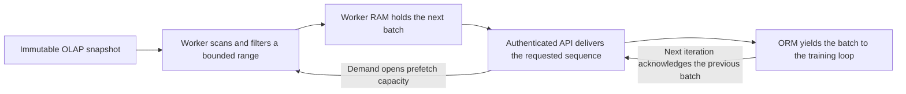

Nabedra OLAP should prepare the next query batch in worker RAM while PyTorch trains on the current batch, so storage and query execution can overlap with GPU work.

The SDK signatures, routes, and resource settings are proposals for approval.

## Branch and module layout

The OLTP checkout at `6dfc713` plus its in-progress changes uses one Rust crate in `server/`. The `olap` feature owns `server/src/engine/`, `server/src/node/`, `server/src/snapshot/`, and the router in `server/src/api.rs`. The Python package lives in `orm/python/src/nabedra/`. Use this observed layout for implementation. The OLTP branch's earlier `plans/oltp-engine.md` proposed `server/src/engine/olap/`.

Keep this planning branch to this file. At implementation kickoff, recheck the final OLTP tree and branch from the integrated `main`. Put the new code in `server/src/engine/stream/`, `server/src/api/stream.rs`, and `orm/python/src/nabedra/stream.py`. Keep registration small in the OLAP router, worker runtime, and engine module, plus `Query` and the ORM transport. Gate the Rust Arrow IPC dependency to `olap` and run both build variants. Leave the existing 13 ORM operations and their envelopes intact.

---

## Python ORM

```python
from nabedra import Database, col

db = Database("https://nabedra.example", database="ml", mode="olap")
query = db.table("training_examples").query()
query = query.where((col("split") == "train") & (col("weight") > 0))
query = query.select("features", "label")

# tensorize is supplied by the training application.
with query.stream(batch_rows=64, format="arrow", drop_last=True) as batches:
    for batch in batches:
        features, labels = tensorize(batch)
        train_step(features.to(device), labels.to(device))
```

Add these methods to the immutable `Query` builder. `Row` is the existing ORM type and `RecordBatch` is the PyArrow type imported only for typing or Arrow decoding. The base SDK keeps its existing dependencies. Add the `nabedra[arrow]` extra for PyArrow.

```python
from collections.abc import Iterator
from types import TracebackType
from typing import Literal, Self, TypeVar, overload

T = TypeVar("T")

class BatchStream(Iterator[T]):
    def __enter__(self) -> Self: ...
    def __exit__(self, exc_type: type[BaseException] | None,
                 exc: BaseException | None, traceback: TracebackType | None) -> None: ...
    def __next__(self) -> T: ...
    def close(self) -> None: ...

class StreamSnapshot:
    @property
    def id(self) -> str: ...
    def __enter__(self) -> Self: ...
    def __exit__(self, exc_type: type[BaseException] | None,
                 exc: BaseException | None, traceback: TracebackType | None) -> None: ...
    def close(self) -> None: ...

class Query:
    @overload
    def stream(self, *, batch_rows: int = 64, prefetch_batches: int = 1,
               format: Literal["rows"] = "rows", drop_last: bool = False,
               snapshot: str | None = None, shard: int = 0) -> BatchStream[list[Row]]: ...
    @overload
    def stream(self, *, batch_rows: int = 64, prefetch_batches: int = 1,
               format: Literal["arrow"], drop_last: bool = False,
               snapshot: str | None = None, shard: int = 0) -> BatchStream[RecordBatch]: ...

    def stream_snapshot(self, *, shards: int) -> StreamSnapshot: ...
```

`BatchStream[T]` is a single-use synchronous context manager and iterator. Entering opens the stream and starts the first batch if lookahead is enabled. Each successful `next()` yields a decoded batch. EOF raises `StopIteration`. `close()` and context exit issue bounded, idempotent cleanup, including on early exit or decoder failure. Request construction is local. Check the optional Arrow dependency before opening the stream. Reuse the existing URL, TLS, authentication, and database scope. Give the stream transport a reusable HTTP connection to avoid a handshake per batch. Use the server response to determine support because `Database.mode` is a client preference. [Python HTTP client](https://docs.python.org/3.11/library/http.client.html#httpconnection-objects)

For multiple GPUs, rank 0 opens `with query.stream_snapshot(shards=world_size) as snapshot:` and broadcasts `snapshot.id`. Each rank supplies `snapshot=<broadcast ID>, shard=rank` to the same query and opens one iterator per rank. Rank 0 holds the snapshot context through all rank exits. `StreamSnapshot.id` is available after entry. A single rank may also use a snapshot with `shards=1` to repeat a scan against the same version before expiry.

Each shard owns a contiguous, disjoint slice of the pinned manifest's physical row positions. Divide the raw row count into near-equal ranges with boundaries `floor(rank * row_count / shards)` using checked arithmetic. Use manifest counts and row-group offsets to seek to a boundary. Index manifest entries by cumulative row count where needed so ranks avoid decoding skipped partitions. A shared boundary file may incur duplicate metadata or data-page I/O. Reject `Query.limit()` for multi-shard streams until a global limit can be distributed without an extra full scan. Filtering can make ranks uneven. `drop_last` discards each rank's short tail. For DDP, use a prepared dataset with equal full-batch counts or an explicit uneven-input policy such as `DDP.join()` where the model's collectives support it. If using a `DataLoader`, start with `batch_size=None` and `num_workers=0` so it receives existing batches and opens one stream per rank. [PyTorch DataLoader](https://docs.pytorch.org/docs/2.15/data.html#disable-automatic-batching) · [PyTorch DistributedDataParallel](https://docs.pytorch.org/docs/2.15/generated/torch.nn.parallel.DistributedDataParallel.html)

Use a fixed snapshot per epoch or reuse a pinned snapshot across epochs while its lease is live. Start with stable order. For training that needs shuffle, prepare a reproducible shuffled dataset version upstream or add seeded shard or block permutation as a separate operator. Avoid a full-table shuffle in the first implementation.

---

## Query and delivery contract

Accept projections, the existing bounded boolean/comparison predicate tree, a scan-wide `limit`, and implicit or explicit ascending primary-key order. Judge streamability by the plan's state and ordering requirements. A nested predicate can run row by row with bounded work. A global sort or shuffle, a join, or a blocking aggregate needs a different operator or a prepared table. Reject unsupported plans at open with `unsupported_operation`. Later, admit operators with proven memory bounds and reproducible checkpoints.

The scan yields batches of exactly `batch_rows` matching rows in primary-key order. The final batch may be shorter unless `drop_last=True`. A stream with no matches or `limit(0)` gives EOF without an empty batch. The row cap is per batch and the query limit spans the full scan. Enforce a separate encoded byte cap. If even one otherwise valid full batch exceeds the cap, fail with `limit_exceeded` and suggest choosing fewer rows or fewer columns. Keep this rule for the short tail too.

```text
GET /v1/streams/capabilities
  200 {version: 1, run_id, max_batch_rows, max_batch_bytes, max_prefetch_batches}
POST /v1/streams
  {request_id, expected_run_id, table_id, query, batch_rows, prefetch_batches, format, drop_last, snapshot_id, shard}
  201 {stream_id, run_id, prefetch_batches, expires_at}
POST /v1/streams/{run_id}/{stream_id}/batches/{sequence}
  200 application/json {rows: [...]}
  200 application/vnd.apache.arrow.stream <one self-contained IPC stream with one record batch>
  204 EOF
DELETE /v1/streams/{run_id}/{stream_id}
  204
POST /v1/stream-snapshots
  {request_id, expected_run_id, table_id, query, shards}
  201 {snapshot_id, run_id, expires_at}
DELETE /v1/stream-snapshots/{run_id}/{snapshot_id}
  204
```

Open uses the existing query payload and table UUID. A null `snapshot_id` pins a private snapshot and requires shard zero. A shared `snapshot_id` is opaque to callers and identifies its run. Authenticate every request. Bind handles to the database, authorized caller, run, table identity and normalized query. Require the same binding and a valid shard when using a shared snapshot. Discover the current run before open and reuse that `expected_run_id` on every retry. A cold start rejects the old run even if the first open response was lost. Within a run, the same UUID and body returns the original handle and deadlines for that caller. A different body conflicts. Retain bounded terminal identity records through the open retry window. Closing a shared snapshot stops new rank streams and releases the shared pin after its last active stream settles. A shared lease's absolute expiry also bounds its rank streams.

Sequence starts at zero. Re-requesting the last demanded sequence replays that batch or EOF. Requesting its successor acknowledges the prior batch and allows its buffer to be freed. The ORM advances only after a complete, validated frame, and requests the next sequence on the next iteration. Reject skipped or acknowledged sequences with `conflict`. Bound active deliveries to one per stream. During an overlapping retry, return retryable `overloaded` with backoff guidance. The same-run retry budget covers transport failures and transient overload. Expired and old-run handles produce distinct, typed stream errors. The SDK never starts a new scan silently after a read failure.

Use the existing protocol error envelope shape with `stream_expired` and `stream_abandoned` codes on stream routes. OLTP and older servers can omit stream routes. Map a missing capabilities route to an SDK unsupported-stream error and preserve typed authorization and table lookup failures. Disable intermediary caching. Enforce byte limits before buffer growth during server encoding and client reads. The ORM also enforces its own hard response ceiling. Validate projected types and row count, and require a complete frame, including the IPC end marker for Arrow. A self-contained Arrow IPC batch carries its schema and can be decoded independently on retry. [Apache Arrow IPC](https://arrow.apache.org/docs/python/ipc.html)

---

## Worker execution, memory, and recovery



Pin a validated catalog version and table identity before dispatch. Traverse immutable Parquet ranges in key order. Decode bounded row groups or smaller chunks with projection pushdown, keeping the predicate and key columns internally. Evaluate filters using the shared query semantics. Verify projected reads preserve the existing integrity checks. Use a bounded legacy reader that sorts once within its reservation for legacy unordered data, or return `unsupported_operation` when that fallback cannot run. Advance by physical partition and row-group position with a raw row offset and a remaining match count. Keep the scan incremental even when one batch crosses partitions or filters are sparse. Never use repeated offset queries from the start or call `collect()` and slice the full result. [Parquet Arrow reader](https://docs.rs/parquet/latest/parquet/arrow/arrow_reader/struct.ArrowReaderBuilder.html)

Default to one prefetched batch ahead. Start batch zero at open for positive depth. Once the client demands batch `n`, let its worker produce `n+1` as soon as the cursor advances and resources are available. For an accepted depth of two, the worker can continue to `n+2`. Count ready and in-progress batches in the same window. The current unacknowledged batch is a separate slot. Accept depths 0, 1, and 2 and return the configured ceiling if it reduces the requested depth. A depth of zero produces on demand. A second batch can absorb short storage or scheduling stalls. If the worker produces batches more slowly than the GPU consumes them, the buffer eventually empties at either depth. The link also has to sustain the GPU's input rate.

Charge the live cursor, metadata, encoded input, decoded work, lookahead, unacknowledged output, replication, and proxy egress before allocation. At 100 active streams with 2 MiB encoded batches, one batch ahead plus the replay slot can hold 400 MiB of encoded output across workers. Two ahead raises that to 600 MiB before scan and delivery overhead. Set finite caps for each batch, stream, database, and worker, plus active handles, idle time, absolute lifetime, and failure retries. Use the same node CPU, memory, I/O, and control budgets as ordinary OLAP work. Demand uses normal read priority and speculative scans yield eligible slots under contention. Reserve resources for demand and settlement so idle lookahead cannot starve either. Evict unused speculative buffers under pressure and rewind to a valid checkpoint. Release compute permits while a client waits, reads slowly, or disconnects. Stream worker responses through the API with bounded egress buffers. Keep lookahead on workers.

Extend the replicated worker RAM queue with the full accepted stream request, immutable snapshot reference, acknowledged cursor and sequence, and deterministic replay checkpoint. Include any shared snapshot descriptors needed to recover active streams. Reserve replica bytes and follow all-ready admission, join, drain and takeover rules. Replicate the demanded batch's checkpoint and enforce the current run and term before authoritative delivery. Keep batch bytes as a worker-local cache. If its worker fails, a surviving holder can recompute the same sequence on the pinned snapshot. Match the original terminal error or EOF where one was already established. Reauthorize access before reading or delivering. Protect pinned files from reclamation for the lease and settlement lifetime. A complete worker shutdown abandons the old handles, and the committed data remains available to fresh scans. [Scheduling plan](resource-aware-scheduling.md)

The server can hide query time while the GPU works. Network transfer, CPU decoding, and host-to-device copies can still show up in GPU idle time. Keep the ORM's default pull path free of client lookahead. Measure one optional pinned host-memory batch per rank if delivery and device copies dominate. The training application controls VRAM allocation.

---

## Implementation and acceptance

| Step | Deliverable | Acceptance |
| --- | --- | --- |
| 1 | Bounded snapshot scan, projection and predicate parity, deterministic cursor, row/byte limits | ST01, ST02, C04, M01, M03, F01, T01, T06 |
| 2 | OLAP API and worker-owned lookahead through shared scheduling, scoped admission, replay, close and expiry | ST03, ST04, C05–C07, M02, Q01–Q06, F02–F03, R01–R06, U01–U03 |
| 3 | ORM iterator, JSON and Arrow decoding, pinned snapshot sharding, PyTorch example, both-engine compatibility | ST05, U01–U02, T06 |
| 4 | Mixed workload, multi-rank training, and documented dataset-size limits | ST06, B01–B02 |

- **ST01.** Match the serial result on a captured snapshot with nested predicates, omitted key columns, empty and sparse results, limits, legacy data, and partition/row-group boundaries. Check rejection of blocking plans, and mutate or drop/recreate a table between batches to verify snapshot and UUID behavior.
- **ST02.** Check exact row counts and the short tail, both `drop_last` choices, wide rows, oversized batches, tiny byte budgets, and both encodings. Verify a rejected batch releases its charges and never advances the acknowledged cursor.
- **ST03.** With barriers, prove the next batch is ready before demand when capacity permits. Pause consumers and exhaust independent count and byte caps. Assert peak charged memory, window limits, ordinary query progress, and cleanup after close, disconnect/expiry, and cancellation.
- **ST04.** Lose an open reply and a batch reply, truncate a body, race two APIs, kill the scan worker before and after checkpoint replication, and restart the API. Assert same-run result/cursor replay, no holes or duplicates in the ORM iterator, stale-term rejection, and old-run abandonment after all workers stop. Retry the unanswered open against the new run and assert no stream starts. Check unauthorized, expired, malformed and cross-scope requests.
- **ST05.** Compare the union of sharded scans with one scan of the pinned query. Check disjoint membership, stable repeat scans, uneven and empty shards, and useful I/O bounds. Run a CPU-only multi-rank PyTorch integration and an actual GPU run for the performance claim. Run the unchanged ORM operations against both builds and test the stream call against OLTP and an older OLAP server. If configured worker drain or autoscaling touches stream ownership, also execute A01/A02 as applicable.
- **ST06.** Compare depth 0, 1, and 2 on identical snapshots and simulated training intervals, then on representative multi-GPU training. Measure first-batch latency, p50/p95/p99 steady-state `next()` wait, GPU input idle time, samples/sec, per-rank skew, scanned bytes per emitted row, cache hits, network and host-to-device time, worker RSS and charged bytes, and contention with ordinary queries. Include fast and slow consumers, variable row width, selective filters, and storage jitter. Follow the warm-up, repetitions, and provenance rules in [the scheduler test contract](../docs/testing/scheduler-contract.md). Promote depth two only where measured GPU savings justify extra server memory and ordinary queries still make progress.

Current OLAP storage limits include 100,000 rows and 64 MiB decoded payload per table, plus a 1 MiB catalog. This first scan implementation can exceed the existing `collect()` response row limit by delivering multiple batches. Production training on larger datasets also needs a separate OLAP storage change to remove whole-table caps with bounded, versioned manifests, or a later stream over a versioned set of tables. Keep per-batch, partition, and worker resource limits in either design. Require a dataset larger than the current table limits and larger than a worker's RAM before claiming large-dataset support.
