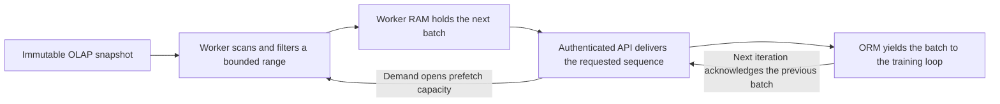

Nabedra OLAP should prepare the next query batch in worker RAM while PyTorch trains on the current batch, so storage and query execution can overlap with GPU work.

The SDK signatures, routes, and resource settings are proposals for approval.

## Branch and module layout

The OLTP checkout at `6dfc713` plus its in-progress changes uses one Rust crate in `server/`. The `olap` feature owns `server/src/engine/`, `server/src/node/`, `server/src/snapshot/`, and the router in `server/src/api.rs`. The Python package lives in `orm/python/src/nabedra/`. Use this observed layout for implementation. The OLTP branch's earlier `plans/oltp-engine.md` proposed `server/src/engine/olap/`.

Keep this planning branch to this file. At implementation kickoff, recheck the final OLTP tree and branch from the integrated `main`. Put the new code in `server/src/engine/stream/`, `server/src/api/stream.rs`, and `orm/python/src/nabedra/stream.py`. Keep registration small in the OLAP router, worker runtime, and engine module, plus `Query` and the ORM transport. Gate the Rust Arrow IPC dependency to `olap` and run both build variants. Leave the existing 13 ORM operations and their envelopes intact.

---

## Python ORM

```python
from nabedra import Database, col

db = Database("https://nabedra.example", database="ml", mode="olap")
query = db.table("training_examples").query()
query = query.where((col("split") == "train") & (col("weight") > 0))
query = query.select("features", "label")

# tensorize is supplied by the training application.
with query.stream(batch_rows=64, format="arrow", drop_last=True) as batches:
    for batch in batches:
        features, labels = tensorize(batch)
        train_step(features.to(device), labels.to(device))
```

Add these methods to the immutable `Query` builder. `Row` is the existing ORM type and `RecordBatch` is the PyArrow type imported only for typing or Arrow decoding. The base SDK keeps its existing dependencies. Add the `nabedra[arrow]` extra for PyArrow.

```python
from collections.abc import Iterator
from types import TracebackType
from typing import Literal, Self, TypeVar, overload

T = TypeVar("T")

class BatchStream(Iterator[T]):
    def __enter__(self) -> Self: ...
    def __exit__(self, exc_type: type[BaseException] | None,
                 exc: BaseException | None, traceback: TracebackType | None) -> None: ...
    def __next__(self) -> T: ...
    def close(self) -> None: ...

class StreamSnapshot:
    @property
    def id(self) -> str: ...
    def __enter__(self) -> Self: ...
    def __exit__(self, exc_type: type[BaseException] | None,
                 exc: BaseException | None, traceback: TracebackType | None) -> None: ...
    def close(self) -> None: ...

class Query:
    @overload
    def stream(self, *, batch_rows: int = 64, prefetch_batches: int = 1,
               format: Literal["rows"] = "rows", drop_last: bool = False,
               snapshot: str | None = None, shard: int = 0) -> BatchStream[list[Row]]: ...
    @overload
    def stream(self, *, batch_rows: int = 64, prefetch_batches: int = 1,
               format: Literal["arrow"], drop_last: bool = False,
               snapshot: str | None = None, shard: int = 0) -> BatchStream[RecordBatch]: ...

    def stream_snapshot(self, *, shards: int) -> StreamSnapshot: ...
```

`BatchStream[T]` is a single-use synchronous context manager and iterator. Entering opens the stream and starts the first batch if lookahead is enabled. Each successful `next()` yields a decoded batch. EOF raises `StopIteration`. `close()` and context exit issue bounded, idempotent cleanup, including on early exit or decoder failure. Request construction is local. Check the optional Arrow dependency before opening the stream. Reuse the existing URL, TLS, authentication, and database scope. Give the stream transport a reusable HTTP connection to avoid a handshake per batch. Use the server response to determine support because `Database.mode` is a client preference. [Python HTTP client](https://docs.python.org/3.11/library/http.client.html#httpconnection-objects)

For multiple GPUs, rank 0 opens `with query.stream_snapshot(shards=world_size) as snapshot:` and broadcasts `snapshot.id`. Each rank supplies `snapshot=<broadcast ID>, shard=rank` to the same query and opens one iterator per rank. Rank 0 holds the snapshot context through all rank exits. `StreamSnapshot.id` is available after entry. A single rank may also use a snapshot with `shards=1` to repeat a scan against the same version before expiry.

Each shard owns a contiguous, disjoint slice of the pinned manifest's physical row positions. Divide the raw row count into near-equal ranges with boundaries `floor(rank * row_count / shards)` using checked arithmetic. Use manifest counts and row-group offsets to seek to a boundary. Index manifest entries by cumulative row count where needed so ranks avoid decoding skipped partitions. A shared boundary file may incur duplicate metadata or data-page I/O. Reject `Query.limit()` for multi-shard streams until a global limit can be distributed without an extra full scan. Filtering can make ranks uneven. `drop_last` discards each rank's short tail. For DDP, use a prepared dataset with equal full-batch counts or an explicit uneven-input policy such as `DDP.join()` where the model's collectives support it. If using a `DataLoader`, start with `batch_size=None` and `num_workers=0` so it receives existing batches and opens one stream per rank. [PyTorch DataLoader](https://docs.pytorch.org/docs/2.15/data.html#disable-automatic-batching) · [PyTorch DistributedDataParallel](https://docs.pytorch.org/docs/2.15/generated/torch.nn.parallel.DistributedDataParallel.html)

Use a fixed snapshot per epoch or reuse a pinned snapshot across epochs while its lease is live. Start with stable order. For training that needs shuffle, prepare a reproducible shuffled dataset version upstream or add seeded shard or block permutation as a separate operator. Avoid a full-table shuffle in the first implementation.

---

## Query and delivery contract

Accept projections, the existing bounded boolean/comparison predicate tree, a scan-wide `limit`, and implicit or explicit ascending primary-key order. Judge streamability by the plan's state and ordering requirements. A nested predicate can run row by row with bounded work. A global sort or shuffle, a join, or a blocking aggregate needs a different operator or a prepared table. Reject unsupported plans at open with `unsupported_operation`. Later, admit operators with proven memory bounds and reproducible checkpoints.

The scan yields batches of exactly `batch_rows` matching rows in primary-key order. The final batch may be shorter unless `drop_last=True`. A stream with no matches or `limit(0)` gives EOF without an empty batch. The row cap is per batch and the query limit spans the full scan. Enforce a separate encoded byte cap. If even one otherwise valid full batch exceeds the cap, fail with `limit_exceeded` and suggest choosing fewer rows or fewer columns. Keep this rule for the short tail too.

```text
GET /v1/streams/capabilities
  200 {version: 1, run_id, max_batch_rows, max_batch_bytes, max_prefetch_batches}
POST /v1/streams
  {request_id, expected_run_id, table_id, query, batch_rows, prefetch_batches, format, drop_last, snapshot_id, shard}
  201 {stream_id, run_id, prefetch_batches, expires_at}
POST /v1/streams/{run_id}/{stream_id}/batches/{sequence}
  200 application/json {rows: [...]}
  200 application/vnd.apache.arrow.stream <one self-contained IPC stream with one record batch>
  204 EOF
DELETE /v1/streams/{run_id}/{stream_id}
  204
POST /v1/stream-snapshots
  {request_id, expected_run_id, table_id, query, shards}
  201 {snapshot_id, run_id, expires_at}
DELETE /v1/stream-snapshots/{run_id}/{snapshot_id}
  204
```

Open uses the existing query payload and table UUID. A null `snapshot_id` pins a private snapshot and requires shard zero. A shared `snapshot_id` is opaque to callers and identifies its run. Authenticate every request. Bind handles to the database, authorized caller, run, table identity and normalized query. Require the same binding and a valid shard when using a shared snapshot. Discover the current run before open and reuse that `expected_run_id` on every retry. A cold start rejects the old run even if the first open response was lost. Within a run, the same UUID and body returns the original handle and deadlines for that caller. A different body conflicts. Retain bounded terminal identity records through the open retry window. Closing a shared snapshot stops new rank streams and releases the shared pin after its last active stream settles. A shared lease's absolute expiry also bounds its rank streams.

Sequence starts at zero. Re-requesting the last demanded sequence replays that batch or EOF. Requesting its successor acknowledges the prior batch and allows its buffer to be freed. The ORM advances only after a complete, validated frame, and requests the next sequence on the next iteration. Reject skipped or acknowledged sequences with `conflict`. Bound active deliveries to one per stream. During an overlapping retry, return retryable `overloaded` with backoff guidance. The same-run retry budget covers transport failures and transient overload. Expired and old-run handles produce distinct, typed stream errors. The SDK never starts a new scan silently after a read failure.

Use the existing protocol error envelope shape with `stream_expired` and `stream_abandoned` codes on stream routes. OLTP and older servers can omit stream routes. Map a missing capabilities route to an SDK unsupported-stream error and preserve typed authorization and table lookup failures. Disable intermediary caching. Enforce byte limits before buffer growth during server encoding and client reads. The ORM also enforces its own hard response ceiling. Validate projected types and row count, and require a complete frame, including the IPC end marker for Arrow. A self-contained Arrow IPC batch carries its schema and can be decoded independently on retry. [Apache Arrow IPC](https://arrow.apache.org/docs/python/ipc.html)

---

## Worker execution, memory, and recovery



Pin a validated catalog version and table identity before dispatch. Traverse immutable Parquet ranges in key order. Decode bounded row groups or smaller chunks with projection pushdown, keeping the predicate and key columns internally. Evaluate filters using the shared query semantics. Verify projected reads preserve the existing integrity checks. Use a bounded legacy reader that sorts once within its reservation for legacy unordered data, or return `unsupported_operation` when that fallback cannot run. Advance by physical partition and row-group position with a raw row offset and a remaining match count. Keep the scan incremental even when one batch crosses partitions or filters are sparse. Never use repeated offset queries from the start or call `collect()` and slice the full result. [Parquet Arrow reader](https://docs.rs/parquet/latest/parquet/arrow/arrow_reader/struct.ArrowReaderBuilder.html)

Default to one prefetched batch ahead. Start batch zero at open for positive depth. Once the client demands batch `n`, let its worker produce `n+1` as soon as the cursor advances and resources are available. For an accepted depth of two, the worker can continue to `n+2`. Count ready and in-progress batches in the same window. The current unacknowledged batch is a separate slot. Accept depths 0, 1, and 2 and return the configured ceiling if it reduces the requested depth. A depth of zero produces on demand. A second batch can absorb short storage or scheduling stalls. If the worker produces batches more slowly than the GPU consumes them, the buffer eventually empties at either depth. The link also has to sustain the GPU's input rate.

Charge the live cursor, metadata, encoded input, decoded work, lookahead, unacknowledged output, replication, and proxy egress before allocation. At 100 active streams with 2 MiB encoded batches, one batch ahead plus the replay slot can hold 400 MiB of encoded output across workers. Two ahead raises that to 600 MiB before scan and delivery overhead. Set finite caps for each batch, stream, database, and worker, plus active handles, idle time, absolute lifetime, and failure retries. Use the same node CPU, memory, I/O, and control budgets as ordinary OLAP work. Demand uses normal read priority and speculative scans yield eligible slots under contention. Reserve resources for demand and settlement so idle lookahead cannot starve either. Evict unused speculative buffers under pressure and rewind to a valid checkpoint. Release compute permits while a client waits, reads slowly, or disconnects. Stream worker responses through the API with bounded egress buffers. Keep lookahead on workers.

Extend the replicated worker RAM queue with the full accepted stream request, immutable snapshot reference, acknowledged cursor and sequence, and deterministic replay checkpoint. Include any shared snapshot descriptors needed to recover active streams. Reserve replica bytes and follow all-ready admission, join, drain and takeover rules. Replicate the demanded batch's checkpoint and enforce the current run and term before authoritative delivery. Keep batch bytes as a worker-local cache. If its worker fails, a surviving holder can recompute the same sequence on the pinned snapshot. Match the original terminal error or EOF where one was already established. Reauthorize access before reading or delivering. Protect pinned files from reclamation for the lease and settlement lifetime. A complete worker shutdown abandons the old handles, and the committed data remains available to fresh scans. [Scheduling plan](resource-aware-scheduling.md)

The server can hide query time while the GPU works. Network transfer, CPU decoding, and host-to-device copies can still show up in GPU idle time. Keep the ORM's default pull path free of client lookahead. Measure one optional pinned host-memory batch per rank if delivery and device copies dominate. The training application controls VRAM allocation.

---

## Implementation and acceptance

| Step | Deliverable | Acceptance |
| --- | --- | --- |
| 1 | Bounded snapshot scan, projection and predicate parity, deterministic cursor, row/byte limits | ST01, ST02, C04, M01, M03, F01, T01, T06 |
| 2 | OLAP API and worker-owned lookahead through shared scheduling, scoped admission, replay, close and expiry | ST03, ST04, C05–C07, M02, Q01–Q06, F02–F03, R01–R06, U01–U03 |
| 3 | ORM iterator, JSON and Arrow decoding, pinned snapshot sharding, PyTorch example, both-engine compatibility | ST05, U01–U02, T06 |
| 4 | Mixed workload, multi-rank training, and documented dataset-size limits | ST06, B01–B02 |

- **ST01.** Match the serial result on a captured snapshot with nested predicates, omitted key columns, empty and sparse results, limits, legacy data, and partition/row-group boundaries. Check rejection of blocking plans, and mutate or drop/recreate a table between batches to verify snapshot and UUID behavior.
- **ST02.** Check exact row counts and the short tail, both `drop_last` choices, wide rows, oversized batches, tiny byte budgets, and both encodings. Verify a rejected batch releases its charges and never advances the acknowledged cursor.
- **ST03.** With barriers, prove the next batch is ready before demand when capacity permits. Pause consumers and exhaust independent count and byte caps. Assert peak charged memory, window limits, ordinary query progress, and cleanup after close, disconnect/expiry, and cancellation.
- **ST04.** Lose an open reply and a batch reply, truncate a body, race two APIs, kill the scan worker before and after checkpoint replication, and restart the API. Assert same-run result/cursor replay, no holes or duplicates in the ORM iterator, stale-term rejection, and old-run abandonment after all workers stop. Retry the unanswered open against the new run and assert no stream starts. Check unauthorized, expired, malformed and cross-scope requests.
- **ST05.** Compare the union of sharded scans with one scan of the pinned query. Check disjoint membership, stable repeat scans, uneven and empty shards, and useful I/O bounds. Run a CPU-only multi-rank PyTorch integration and an actual GPU run for the performance claim. Run the unchanged ORM operations against both builds and test the stream call against OLTP and an older OLAP server. If configured worker drain or autoscaling touches stream ownership, also execute A01/A02 as applicable.
- **ST06.** Compare depth 0, 1, and 2 on identical snapshots and simulated training intervals, then on representative multi-GPU training. Measure first-batch latency, p50/p95/p99 steady-state `next()` wait, GPU input idle time, samples/sec, per-rank skew, scanned bytes per emitted row, cache hits, network and host-to-device time, worker RSS and charged bytes, and contention with ordinary queries. Include fast and slow consumers, variable row width, selective filters, and storage jitter. Follow the warm-up, repetitions, and provenance rules in [the scheduler test contract](../docs/testing/scheduler-contract.md). Promote depth two only where measured GPU savings justify extra server memory and ordinary queries still make progress.

Current OLAP storage limits include 100,000 rows and 64 MiB decoded payload per table, plus a 1 MiB catalog. This first scan implementation can exceed the existing `collect()` response row limit by delivering multiple batches. Production training on larger datasets also needs a separate OLAP storage change to remove whole-table caps with bounded, versioned manifests, or a later stream over a versioned set of tables. Keep per-batch, partition, and worker resource limits in either design. Require a dataset larger than the current table limits and larger than a worker's RAM before claiming large-dataset support.

---

## Design review

Reviewed as a shipped design (2026-11-24). Two TLA+ specs in `specs/olap-stream/`: `OlapStream` models the data
protocol (demand, checkpoint, replay, takeover, cold start, table commits), and `join/OlapStreamJoin` models joins
and the join seal. The interface between them is one invariant: every ready worker holds every replied stream entry.
`OlapStream` assumes it across fixed membership, and `OlapStreamJoin` proves it across joins.

### Guarantees

| Guarantee | Properties (spec) | Notes |
| --- | --- | --- |
| OLAP-STR-G01 | `G01_OracleOrder`, `G01_FreshPin`; batch content through `G03_ReplyMatchesOracle` | A batch is a pure function of the pinned catalog version and the cursor. Sharded ranges, filters, byte limits, Arrow encoding and byte compatibility are not modelled (pure computation or client encoding; the sim and unit checks cover them). |
| OLAP-STR-G02 | `G02_OneHandle` | The body conflict rule is not modelled: the digest comparison is pure, and the same request ID is serialised by the coordinator. |
| OLAP-STR-G03 | `G03_ReplyMatchesOracle`, `G03_AckFence` | Replay identity holds because content is deterministic. Byte-level encoding differences across versions are not modelled. |
| OLAP-STR-G04 | `G04_ReplyImpliesReplicated`, `G04_NoSpuriousFailure`, `G04_HoldersAgree`, `G04_HolderMonotone`, `Termination`; `G04_ReadyHoldsReplied`, `G04_ServingIsCurrent`, `JoinProgress` in the join spec | The L2 guarantee. |
| OLAP-STR-G05 | `G05_OldRunNeverServed` | Run and handle checks on every request, and a cold start. |
| OLAP-STR-G06 | `G06_NoRescan` | Cursor level only. File-level and prefetch rescans stay with the sim counter. |

Not modelled: idle and absolute expiry, close, output slots and memory caps (timing or resources), shared snapshots
and shards (pure row-range arithmetic), table drop or recreate, prefetch, and reclamation of pinned files. No OLAP
code in this repository deletes table objects today, so pin lifetime has nothing to race, but the plan states the
rule without naming a reclaimer. Legacy peers without the stream route are also out of scope: while any ready peer
is legacy, streams are unavailable, so no protocol step changes.

### Topology

```text
 ORM client --HTTP--> API node (forwards) --signed HTTP--> scheduler owner (stream coordinator)
                                                               |  StreamInstall (sequential transfers)
                                                               v
                                        every ready worker (RAM copy of each stream entry)
 control root, catalog fence (run, term, scheduler, ready set), OLAP table catalog: object store (durable)
```

| Channel or store | Modelled faults | Out of scope |
| --- | --- | --- |
| Client to coordinator and back | Loss, duplication, delay, reordering. A retry racing its reply is duplication. | Truncated bodies: the ORM accepts only a complete frame (client encoding) |
| Coordinator to holders (StreamInstall) | Loss, delayed delivery after the coordinator gave up, duplication, reordering, transfer to a subset of holders | Corrupted entries (checksums) |
| Workers (RAM) | Crash (empty registry), a coordinator crash after a subset of transfers, partition of one worker, return only through a join | Byzantine workers |
| Control root and catalog | Durable and atomic. A takeover (new term) and a join publication (CAS) are single steps. | Object-store inconsistency |
| Join | Seal expiry (30 s), a joiner crash during the join, publication after the seal | Slow copies inside the join |

Faults left out: clock drift (timers are events here and nothing depends on their values), storage faults on GET (a
failed scan sends no reply and the client retries), and table drop or recreate.

### Spec

| | Value |
| --- | --- |
| Specs | `specs/olap-stream/OlapStream.tla` (data protocol), `specs/olap-stream/join/OlapStreamJoin.tla` (joins) |
| T1 bounds, data protocol | 3 workers, 2 concurrent clients (the second only opens), `batch_rows` 2, table versions of 2 and 3 rows, 1 crash, 1 message loss, 1 duplicate, 1 delayed transfer, 1 partition, 1 concurrent table commit. A coordinator crash mid-commit takes the crash budget. |
| T1 liveness, data protocol | `OlapStream.live.cfg`: 2 workers, 1 client, no symmetry (deviation, see below) |
| T1 bounds, joins | 3 workers, 2 request IDs, 1 crash, 1 partition, 1 seal expiry, 1 partial commit. Liveness at the same bounds without symmetry. |
| Symmetry | Nodes, and request IDs in the join spec, in safety runs only. Not in any liveness run. |
| State constraints | None. Every run is finite because every fault has a finite budget. |
| Fairness | Weak fairness on the ORM's retry timer, the coordinator's handlers and transfers, delivery of in-flight transfers, the operator's cold start, and partition healing (join spec). Strong fairness on the join's readiness publication: the provider retries the join loop. Each is named next to its mechanism in the spec. Election and recovery are inside the loss step. |
| T checks | `olap-stream-olap-stream`, `olap-stream-olap-stream-join`, `olap-stream-olap-stream-long` (T2, exhaustive with a 5-hour budget), `olap-stream-olap-stream-large` (T2, simulation) |

Abstractions, stated in the specs:

- A1. A commit is one step. `WorkerDriver::commit` holds `lock_stream_changes` across the local install, every
  transfer and the final authority recheck, so the only outcomes are "every ready peer installed and the reply was
  sent" or "a subset installed and no reply" (`CommitPartial`, `CrashMidCommit`). Undelivered transfers stay in
  flight and can land later (`DeliverInstall`).
- A2. The reply is folded into the step that sends it. The ORM's next request still travels through `reqs`, where it
  can be lost, duplicated, reordered or delayed.
- A3. A lost worker, the election of the next scheduler and stream recovery by that scheduler are one step
  (`Settle`). The time while a lost worker is still listed as ready adds only unreplied partial commits.
- A4. Membership in `OlapStream` only shrinks, except in a cold start. Joins are in `OlapStreamJoin`.
- A5. Streams are independent. They share only membership, the atomic commit and the handle counter. One full
  stream plus one client that only opens covers two streams, since every property is per handle or per key.
- J1 to J3 in `OlapStreamJoin`: versions stand in for entries, a commit is one step, and recovery is eager on a loss
  and lazy after a join, as in the code.

Reduced bounds, for reviewer approval: the liveness run of the data protocol uses 2 workers and 1 client, because
the exhaustive temporal check at the safety bounds does not fit the 15-minute budget. Safety and the join liveness
use the L2 minimums. The safety baseline at the L2 minimums (`OlapStream.cfg`) does not finish within the 15-minute
T1 budget either (re-checked 2026-11-26: stopped with about 2M states on the queue), so the T1 check reports it
`not-run`, and the T2 check `olap-stream-olap-stream-long` runs it exhaustively with a 5-hour budget. Neither bound is
cut: the open work is an abstraction or an Apalache run that fits T1.

### Results

Re-checked against main e6b4040b on 2026-11-26 (wave rv, task rv-olap); the code locations above still hold. TLC
v1.8.0, pinned image.

| Run | Result | Distinct states | Depth |
| --- | --- | --- | --- |
| `OlapStream.cfg` (3 workers, 2 clients), Actions run 45800777105 at 0f075ab3 | not-run: stopped at the 900 s budget, 1,985,088 states left on the queue | | |
| `OlapStream.live` (2 workers, 1 client, all faults), Actions run 45800777105 | pass, safety and liveness, exhaustive | 210,676 | 16 |
| `OlapStreamJoin.cfg` (plan rule), Actions run 45805193196 at b46b0e5c | pass, exhaustive | 18,401 | 14 |
| `OlapStreamJoin.fanout.cfg` (candidate fix), same run | pass, exhaustive | 18,001 | 14 |
| `OlapStreamJoin.repair.cfg` (candidate fix), same run | pass, exhaustive | 23,421 | 14 |
| `OlapStreamJoin.live.cfg`, same run | pass, exhaustive | 192,840 | 14 |
| `OlapStream` with a 5-hour budget (`olap-stream-olap-stream-long`) | pending | | |

Every mutant of both specs was caught on its expected property in run 45800777105, except `no_client_retry`, which
deadlocked before its liveness check with several TLC workers (and `seal_never_released` the same way in the join
spec). Both now run without deadlock checking; the join spec's mutants all pass in run 45805193196.

### Mutants

Every property has a mutant. Counterexample lengths are in states. Local, unattested until the T check runs.

| Property | Mutant | Length |
| --- | --- | --- |
| `G01_OracleOrder` | `scan_latest_catalog` | 5 |
| `G01_FreshPin` | `stale_capture` | 4 |
| `G02_OneHandle` | `reopen_new_handle` (planted bug `ReplayNewHandle`) | 5 |
| `G03_ReplyMatchesOracle` | `checkpoint_prev_sequence` (planted bug `GapAfterKill`) | 6 |
| `G03_AckFence` | `replay_acked_from_history` | 6 |
| `G04_ReplyImpliesReplicated` | `reply_before_replicate` | 3 |
| `G04_NoSpuriousFailure` | `reply_before_replicate_visible` | 5 |
| `G04_HolderMonotone` | `install_last_writer_wins` | 6 |
| `G04_HoldersAgree` | `install_last_writer_wins_agree` (3 workers) | 6 |
| `G05_OldRunNeverServed` | `no_run_check` | 6 |
| `G06_NoRescan` | `rescan_from_first` (planted bug `RescanOnReconnect`) | 5 |
| `Termination` | `no_client_retry` | 4 (lasso) |
| `G04_ReadyHoldsReplied` (join) | `prefix_join_seal_expiry` (the shipped code) | 5 |
| `G04_ServingIsCurrent` (join) | `prefix_join_seal_expiry_serving` | 6 |
| `JoinProgress` (join) | `seal_never_released` | 4 (lasso) |

Recovery that keeps the coordinator's own copy instead of merging is not distinguishable here: every ready worker
already holds every replied entry, so the merge matters only for unreplied entries, which the ORM's retry rebuilds
deterministically. This is an equivalent mutant, not a weaker property.

### Counterexamples

One design finding. It is a code bug against the plan's join rule, and a plan gap.

**F1, a stream joiner can turn ready without the latest stream entry.** Record
`docs/testing/bugs/2026-11-24-design-stream-join-seal-expiry.toml`. `Command::Join` copies the stream registry to a
joiner under `lock_stream_changes` and keeps the lock as a 30 s seal (`retain_seal`). The controller publishes
readiness later without checking that the seal is still live (`server/src/cluster/runtime.rs`, publish then a
failing `Unseal`). If the seal expires first, commits resume without the joiner, and the joiner then becomes ready
with an older entry. Stream recovery is lazy, so nothing repairs the joiner until the next stream request. In the
join spec, the shipped publication (`prefix_join_seal_expiry`) violates `G04_ReadyHoldsReplied` in 5 states:

1. `JoinCopy(n2)`: the scheduler n1 copies its registry to the joiner n2 and holds the seal.
2. `SealExpire`: the 30 s deadline passes.
3. `Commit(n1, k1)`: n1 commits a new entry for key k1. n2 is not Ready, so the fan-out does not include it.
4. `PublishReady(n2)`: the controller publishes n2 as Ready. n2 does not hold the replied entry.

Once the current holders fail, the next demand is answered from n2's older copy. The trace is visible to a
client: with one ready worker and a second joining, the seal expires, an open commits on the first worker and is
replied, the second turns ready, the first crashes, and the client's demand gets `stream_expired` within the same
run. An earlier version of the data-protocol spec, which included joins, found this in 15 states with
`G04_NoSpuriousFailure`. A joiner that already holds an earlier checkpoint would answer with `conflict` instead.

The plan's rule ("copy before readiness", R03) forbids this. The plan is silent on commits that race the copy.
Candidate fixes, all checked in `OlapStreamJoin` and all passing: (a) publication must not succeed after the seal
expired, as the plan requires (`Variant = "plan"`); (b) commits also go to workers that hold a Join copy
(`fanout_joiner`); (c) publication re-copies the joiner from the scheduler (`repair_publish`). The fix is a code
change with no public contract. The reverted fix is the mutant `prefix_join_seal_expiry`.

### Cost

Counted from the spec's actions. The plan gives no RPC, fsync or round-trip targets, so this is a baseline for
`scripts/testing/ab.py`.

| Operation | Round trips and transfers | Authority reads | Fsyncs |
| --- | --- | --- | --- |
| Open or reopen | 1 client request; 1 StreamInstall and acknowledgement per other ready worker | 2 fence reads per commit (before and after the transfers) | 0 |
| Demand, first delivery | 1 client request, the same transfers | 2 | 0 |
| Demand, replay in the same term | 1 client request, the same transfers of the same entry | 2 | 0 |
| Takeover | 1 recovery page per ready peer, then 1 repair transfer per ready peer | 1 | 0 |
| Join | 1 copy per entry under the seal, then 1 readiness CAS | 1 | 0 |

The batch work (one scan step and its GETs) is per demand and is not counted as protocol messages. The plan's
400 MiB output budget is a resource bound that no spec action counts.

### Independent read

The read (`wave-dr/reads/olap-stream.md`) lists 17 scenarios. Encoding:

| Read ID | Encoding |
| --- | --- |
| R-01 | `DriverCommit`, `CommitPartial`, `CrashMidCommit`; `reply_before_replicate`; `G04_ReplyImpliesReplicated` |
| R-02 | `CommitPartial` with a delayed transfer, then a takeover and `DeliverInstall` under the sender, term and version fence; `G04_HolderMonotone`; `install_last_writer_wins` |
| R-03 | `OlapStreamJoin`; `prefix_join_seal_expiry` (finding F1) |
| R-04 | `Settle` merges the highest version and repairs every ready holder; keeping a lower copy is an equivalent mutant (see Mutants) |
| R-05 | Not modelled: byte-level encoding across versions. Replay identity is content identity. |
| R-06 | Not modelled as a separate outcome: retryable errors commit nothing, and non-retryable errors are committed like batches in the code but the spec has no error frame. A gap. |
| R-07 | A stale demand (duplicate or delayed) processed after the client advanced; `G03_AckFence` |
| R-08 | Covered by A1 and A3: a takeover cannot fall inside a commit; `CrashMidCommit` covers the crash cut; recovery takes the highest version |
| R-09 | `ColdStart`, `G05_OldRunNeverServed`, `no_run_check` |
| R-10 | `G02_OneHandle` for the same ID; the body conflict is not modelled (pure comparison) |
| R-11, R-12, R-16 | Not modelled: shared snapshots, pin lifetime and shard arithmetic |
| R-13, R-14 | Prefetch is not modelled; `G06_NoRescan` covers the cursor, and the sim's file counter covers files |
| R-15 | The checkpoint is one tuple (sequence, cursor before, cursor after, outcome); `checkpoint_prev_sequence` |
| R-17 | Not modelled: the ORM accepts only complete frames (client encoding) |

Gaps: the terminal-error frame (R-06), byte-level replay across mixed versions (R-05), reclamation of pinned files
(R-11, R-12), and the trace corpus. No simulation workload emits traces yet, and none exercises `distributed.rs`, so
no `-trace` check exists. The draft trace spec used the trace helpers that the tooling has since removed, so it is
not carried over; the first implementation change on the stream protocol writes it against `TraceStep` and adds
trace output. The mapping is in the review wave's `sim-mapping/olap-stream.md`.

Performance (review 2026-11-26): every stream batch in the cluster is committed by the scheduler under one lock per
worker, with a sequential transfer to every other ready worker and about four control-root and catalog reads on the
scheduler plus two per holder, so the cluster's stream throughput falls as workers are added (finding OLAPS-2). A
join stalls admission and every stream commit for the whole copy (OLAPS-3). Neither changes the protocol steps above.

Simulation coverage of the same design stays partial: the in-process workload has one worker registry, so it cannot
reproduce F1 or any transfer loss.

### Fenced join implementation and rollout

The join lock covers both stream replicas and accepted queue records. Copy them at an exact
control-root base identified by cluster, revision and change ID. The controller submits readiness
with the captured backend Match token. Worker timeout, transport timeout and a controller crash
cannot invalidate the token. The coordinator keeps the join seal until a fresh storage observation
shows a strictly newer root from the same cluster. If publication is ambiguous and the root is
still the base, the controller races it with a metadata-only conditional renewal on that base
using a new change ID. Either conditional can win. Both outcomes invalidate the old Match.
Subsequent controller acquisition also advances the root. If a read or competing write remains
ambiguous, preserve the seal and retry observation. An elapsed time alone releases only the
separate drain seal.

The coordinator refreshes the ready members from the successor and confirms its own authority
before reopening work. If the coordinator changed, the previous one can retire its seal after it
observes the successor. The new coordinator uses the existing recovery procedure before admitting
operations. Commands that waited behind a seal must re-read authority before mutating the queue or
stream state. A published join must use the exact candidate corresponding to the copied worker
incarnation and session. A failed join retries the copy with a new observation.

The following sequence supports rolling workers and APIs that share the existing root format:

1. Roll workers through the existing handoff while the old API is still active. Before activating
   the new protocol, ensure the coordinator and workers eligible to take over can handle the
   fenced join command. A new API uses a distinct signed join command and accepts a fenced reply
   only. An old worker rejects the distinct command, so joins pause if it is coordinator.
2. Quiesce admissions and legacy joins before transferring controller ownership. Stop every legacy
   controller incarnation eligible to reacquire control. The new controller's acquisition must
   advance the control root by Match before it enables fenced joins. It must observe the root that
   won, because a pending legacy readiness write can race acquisition. Verify the current ready
   copy set and repair its queue and stream state from surviving current holders before resuming
   admitted work. If that state cannot be recovered, leave admission closed and use the existing
   recovery procedure.
3. Resume under the new API. Keep the old join command for workers talking to an old API before
   activation. Return to a legacy controller only from a stopped, fenced deployment through an
   explicit recovery procedure. Running old controllers may not compete for ownership after
   activation.

This adds an internal command discriminant and binds the reply to the captured base. It needs no
extra round trip for a successful join or on ordinary client traffic. Resolution of an ambiguous
join can add a control read and conditional metadata write. ST04 and R03 cover stream and queue
continuity. The runtime regression must delay readiness at the object store, roll the seal clock
past its deadline, and hold admissions until either readiness or a competing CAS resolves. Resume
the old write after the competing CAS and assert a conditional conflict. Also test the case where
readiness wins and the controller loses the reply. The joiner must have the accepted request and
stream copies before the coordinator reopens either path.

The rollout refinement is `specs/olap-stream/join/rollout/OlapJoinRollout.tla`. It covers one
coordinator, a ready peer, a joiner, mixed-version coordination, the controller activation fence
and an ambiguous readiness write. Its initial committed prefix is recoverable. Worker crash and
controller takeover after activation are covered by `OlapJoinFence`. Eventual coordinator upgrade
follows the operator's rollout, and the controller drives conditional resolution and retry.
Local TLC completed both safety and liveness over 570 distinct states at depth 16, with 14 covered
actions and minimum coverage 12. Mutant traces have 8 states for legacy fallback, 7 for a reused
activation base, 4 for a legacy controller returning, and a 7-state lasso for missing coordinator
upgrade. The `olap-join-rollout` check is pending attestation on this revision.
**Runtime coverage boundary.** The focused regression exercises the worker's two local guards and
both conditional write winners independently. Lost-reply end-to-end admission, deployed mixed
binaries and simulator replay still require an integrated fixture. Delayed receiver-side copy RPCs
are a separate candidate: a legacy-shaped Bootstrap or StreamReset may authenticate against its
old root and wait before applying. Verify whether an old copy can erase newer data across a join
retry, including on an already-ready target. A future fix should bind destructive copy steps to
the copy generation at the receiver without adding control reads to successful ordinary operations.

**Receiver-side copy generation (fx-sched, 2026-11-27).** A fenced join sends its control-root base
with the two destructive copy steps, `Bootstrap` and `StreamReset`. The joiner applies each reset
only when its own fresh root equals that base, at most once per base, and never after a newer base.
The check and the reset run under one lock. A reset delayed from an earlier attempt therefore cannot
erase a later attempt's copy, and a reset the joiner already sees as fenced is refused. A second
attempt at an unchanged base waits until the root advances, for example at the next lease renewal
or the controller's competing CAS. Once a fenced reset has reached a worker, a legacy reset (no
base) is refused there. Installs need no binding: they are version-monotone, and an older record
version is refused as stale. The field is serialized only for a fenced join; a legacy joiner rejects
it, so a fenced join to a legacy joiner pauses, as the rollout above already requires. Successful
ordinary operations read nothing extra. Regression tests:
`st04_r03_delayed_reset_from_an_earlier_join_attempt_is_refused` and
`st04_r03_failed_reset_does_not_consume_its_base`. `OlapJoinFence` models it: a failed attempt leaves its
reset in flight (`JoinFail`), the reset lands later (`LateReset`), and the mutant `unbound_reset`, the
receiver before the fix, breaks `G07_ReadyHoldsAccepted` in 7 states. Local TLC: both baselines pass
with 53,937 distinct states at depth 19, 16 actions covered, all five mutants caught.

A coordinator that still holds an unresolved fenced seal refuses a new fenced join at once instead
of waiting behind its own seal for the 30 s exchange deadline, during which the controller would hold
its change lock and delay lease renewal and loss observation.

**No readiness without a copy (SCHED-1).** The controller publishes a Starting worker Ready without a
join copy only when no Ready worker exists: the first enrollment of a run, or after every holder was
lost. While any Ready worker may hold accepted requests and no Ready scheduler exists, for example
between a published owner loss and the coordinator reassignment, the probe repairs the assignment
and waits. A new scheduler owner also merges the records that the surviving ready peers hold before
it admits or starts work: a missing accepted record is added, and a peer's terminal or accepted copy
replaces the owner's less advanced one. The model is `specs/scheduler/QueueReady.tla` (baselines
`QueueReady.cfg` and `QueueReady.total.cfg`).

**Stream commit cost (OLAPS-2).** A commit now transfers to every holder concurrently, so the critical
section under the stream change lock is one round trip instead of one per holder. Each worker reads
the catalog fence once per scheduler term: with the fresh control root still at the term of a fence
already read, that fence is current, because a term's fence is written once, after the root moved to
that term. That removes two catalog reads per commit on the scheduler and one per install on each
holder; the fresh root read remains. Deferred: per-stream change locks. The single lock is also the
join seal, so splitting it needs a seal over every stream lock and a model change; the measurement to
justify it is the per-batch critical section with the fixes above, from
`scripts/benchmark_olap_streaming.py` at 1, 2 and 4 concurrent streams on 3 and 5 workers.

**Join stall (OLAPS-3, SCHED-6).** The sealed copy now orders records once (O(N log N)) instead of
rescanning the queue for every record (O(N^2)), keeps three installs in flight to the joiner, and
each replica reads the catalog fence once per term instead of once per installed record. Deferred: a
two-phase join that copies a snapshot without the seal and seals only for the delta and the readiness
CAS, and paged installs. Both change the join protocol and need the join models extended first.
