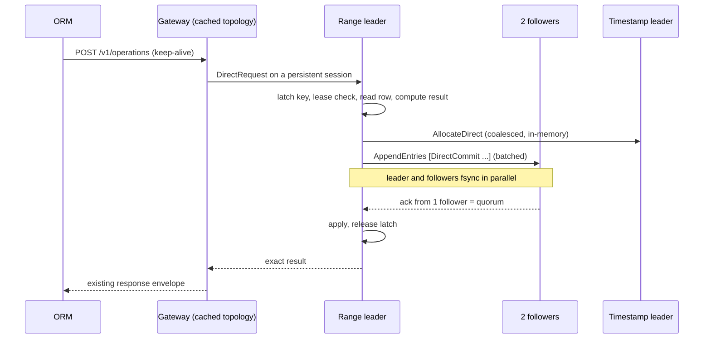

Single-key OLTP operations take about 1.7 s at RF3 because each one crosses five Raft groups over throwaway connections. Route them straight to the replicas that own the key and commit each with one replicated log entry, the way ScyllaDB serves a QUORUM write.

Status: proposed 2026-11-19 against `b29a178`. Nothing here is implemented or measured. The latency figures in the last section are targets.

## Decisions

The user decided these on 2026-11-19. They supersede the conflicting rules in [the scheduling plan](resource-aware-scheduling.md), [the shard refactor](oltp-shard-refactor.md) and Q03, Q05 and O23 for the operations listed under "Eligible operations".

| Topic | Decision |
| --- | --- |
| Replication | The leader of the key range's Data Raft group commits one log entry to 2 of 3 voters. No leaderless last-write-wins. |
| Queue | Synchronous eligible operations skip the replicated RAM queue. They are committed, or they fail and the client retries the same `request_id`. No accepted-but-pending state exists for them. |
| Request IDs | Reuse is detected per table and key, in the same commit as the row. Cluster-wide detection stays on the queued path only. |
| Rollout | On by default once every member supports it. `direct_oltp: false` restores the queued path. |

## Measured starting point

One serial `table.update` on three workers, from [the latency evidence](../docs/testing/evidence/oltp-latency/README.md) and a code trace of `b29a178`.

| Cost today | Where | After this plan |
| --- | --- | --- |
| New TCP and mTLS handshake per RPC, Raft appends and heartbeats included | [`multiplex/transport.rs`](../server/src/oltp_replication/multiplex/transport.rs) | One persistent multiplexed session per peer pair |
| About 42 RPCs and 15 Raft writes across Control, Status, Timestamp, Catalog and Data | [`worker_runtime.rs`](../server/src/oltp_runtime/worker_runtime.rs), [`transaction.rs`](../server/src/oltp_runtime/transaction.rs) | 1 Data entry, 0 or 1 coalesced Timestamp RPC |
| One entry per append, about 3 fsyncs per entry per replica | [`hosted.rs`](../server/oltp-replication/src/oltp_replication/hosted.rs), [`pool.rs`](../server/oltp-storage/src/oltp/pool.rs) | Batched appends, one group-committed fsync per replica |
| Four queue copy phases to every ready worker | `oltp_runtime/replica` | None |
| Gateway polls for completion, sleeping 50 to 500 ms | [`remote_api.rs`](../server/src/oltp_runtime/remote_api.rs) | Reply on the request stream |
| 88 MiB charged per request before the body is read | [`http.rs`](../server/src/oltp_runtime/http.rs) | Charge the actual body size |
| New HTTPS connection per ORM call | `orm/python`, `orm/typescript` | Keep-alive connections |

---

## Request flow



## Eligible operations

| Operation | Direct when | Otherwise |
| --- | --- | --- |
| `table.get` | Always | Queued path |
| `table.insert`, `upsert`, `update`, `delete` | Always | Queued path |
| `table.insert_many` | Every key maps to one range and the encoded entry is at most 1 MiB | Queued path |
| `query.collect`, `count`, `explain` | Phase 2, see "Snapshot queries" | Queued path |
| `table.create`, `describe`, `list`, `drop`, `POST /v1/requests`, receipts | Never | Queued path, unchanged |

The leader returns `Fallback` when the key holds an intent from a queued transaction or the range is mid-split. The gateway then sends that request down the queued path. Wire format, results, errors and all thirteen ORM operations stay unchanged (O01).

---

## 1. Persistent peer sessions

Replace connect-per-RPC in [`multiplex/transport.rs`](../server/src/oltp_replication/multiplex/transport.rs) and [`typed_network.rs`](../server/oltp-replication/src/oltp_replication/typed_network.rs) with one long-lived mTLS connection per ordered peer pair and traffic class. Negotiate it with ALPN `nabedra-otp/2` and fall back to the one-shot `NABOTP01` exchange when the peer does not offer it.

```rust
// Each frame on a session. The body is the existing prologue, header and sections.
struct StreamFrame { stream_id: u64, flags: u8 /* REQUEST | REPLY | CANCEL */, len: u32 }

pub(crate) struct PeerSessions { /* (worker, incarnation, lane class) -> Session */ }
impl PeerSessions {
    async fn call(&self, to: &Endpoint, lane: Lane, request: Frame, deadline: Instant) -> Result<Frame, TransportError>;
}
```

- Verify the certificate pin, ALPN and `directory.verify` once per connection. Close a session when its peer's incarnation leaves the local directory.
- Keep the per-lane semaphores as limits on concurrent streams. Raft progress and control lanes keep their protected capacity (O05, C07).
- Set `TCP_NODELAY` and write each frame with one vectored write.
- Cache a receiver's `service_role` and `service_grant` result per caller incarnation and role. Drop the entry when the locally applied Control revision changes or after 5 s. A revoked caller can therefore act for at most 5 s. Data safety does not depend on this cache, because every write checks its fence in the Data log.
- A request that fails after the frame was written has an unknown outcome, as today.

## 2. Raft batching and group commit

In [`hosted.rs`](../server/oltp-replication/src/oltp_replication/hosted.rs) replace `single_entry_config` with byte-bounded batching: at most 64 entries and 1 MiB per append, `api_batch_linger_ms = 0`. Then change the three storage calls.

| Write | Today | Change |
| --- | --- | --- |
| Log append in [`typed_log.rs`](../server/oltp-replication/src/oltp_replication/typed_log.rs) | One synced `WriteBatch` per entry | One synced `WriteBatch` per append batch. The pool's nabedra-kv journal group-commits concurrent syncs from other groups on the same pool. |
| `save_committed` | Synced | Unsynced. OpenRaft treats it as a recovery hint. |
| Apply in [`pool.rs`](../server/oltp-storage/src/oltp/pool.rs) `mutate` | One synced batch per entry | One unsynced batch for all entries in the apply call, with position, reply and membership inside it. |

An unsynced apply is safe because the log and the state share one nabedra-kv journal. A crash loses only a suffix of the journal, and the surviving log replays what the lost applies covered. Purge the log and build snapshots only up to an applied index that a later synced write has made durable. Journal recovery follows `plans/native-storage-engine.md` section 3 (exact-prefix truncation of a torn tail, never past a record a later sync proved durable). Rerun O06, O11, O29 and the Raft-append cancellation regression on this change alone before building on it.

Sections 1 and 2 also speed up the queued path. Benchmark them alone as a checkpoint.

## 3. Topology cache

Add `oltp_runtime/application/direct.rs` on the gateway.

```rust
struct TopologyCache { /* bounded LRU */ }
struct TableRoute { table_id: Uuid, key_type: KeyType, schema_epoch: u64, ranges: Vec<RangeRoute> }
struct RangeRoute { span: KeySpan, group: GroupId, routing_epoch: u64, voters: [Endpoint; 3], leader_hint: Option<WorkerId> }
```

Fill an entry from one Catalog read and one Control placement read on a miss. Refresh it only when a worker answers `StaleRoute { schema_epoch, routing_epoch }`, `NotLeader { hint }` or `UnknownTable`. The steady state makes zero Control or Catalog calls per request. A cached route never authorizes a write. The leader and the log entry check epochs and fences.

## 4. One-entry commit

Add `server/src/oltp/mvcc/store/direct.rs` and one `ParticipantCommand::Direct(DirectCommit)` variant in [`store.rs`](../server/oltp-storage/src/oltp/mvcc/store.rs).

```rust
pub(crate) struct DirectCommit {
    authority: Authority,        // run and group fence, checked at apply
    table_id: Uuid,
    schema_epoch: u64,
    routing_epoch: u64,
    request_id: Uuid,
    digest: Digest,              // SHA-256 of the exact request body
    commit_ts: CommitTs,
    writes: Vec<DirectWrite>,    // 1 for point operations
    result: RawValue,            // exact `data` value of the response
}
pub(crate) struct DirectWrite {
    key: MvccKey,
    expected_version: Option<CommitTs>,   // None = key has no visible row
    value: Option<RawValue>,              // None = tombstone
    index: Vec<IndexChange>,
}
pub(crate) enum DirectReply { Applied { commit_ts: CommitTs }, Replayed { result: RawValue }, Rejected(Fault) }
```

Apply validates in this order and writes nothing on failure: the group is not frozen for a split, `authority` matches the current fence, both epochs match the group config, every key belongs to the group, no key has an intent, each `head.version == expected_version`, and `commit_ts` is above each key's newest version. It then writes the `'v'` versions, the `'h'` heads, the index entries and one dedup record in the same batch as the applied position.

```text
dedup key   = 'D' ‖ table_id ‖ anchor primary key ‖ request_id     anchor = smallest key in the request
dedup value = { digest, commit_ts, result, applied_unix_ms }
```

An existing dedup record with the same digest returns `Replayed`. A different digest returns the existing `conflict` error. Dedup records sort with their anchor row, so splits, snapshots and backups must carry the `'D'` namespace. A background task deletes records older than `direct_dedup_retention_ms`, default 24 h.

**Retry results (lead decision 2026-11-24, at the user's request).** On the direct path, a retry of a mutation with the same request ID and body returns the first definite result of that identity while its dedup record is retained. That includes a no-op (`update` or `delete` of a missing row) and a row conflict (`insert` of a present row). Unknown outcomes, unavailable or overloaded answers and validation errors are not results and are not recorded. Reads have no identity. A recorded outcome is a `DirectCommit` member with no row write: it carries the dedup record, and an `expected_version` for every key its result read, and it takes no row version. Apply checks the dedup record first, then intents and `expected_version` for those keys as for written ones, so a stale read is `Rejected(Conflict)` and the leader recomputes from step 3. A digest mismatch never writes a record. The member registers its keys in `pending` so that `wait_latest` of a later attempt sees it, and leaves on apply like any other. Leaders propose recorded outcomes only once the cluster feature `data.direct.record-outcomes` is enabled; until then they recompute them, as an older replica would apply such a member differently. The cost is a Data log entry for outcomes that commit none today, so no-ops and refused inserts get slower. Recomputing lets a later answer contradict an earlier one. Status: the shipped executor recomputes no-ops and row conflicts on retry today, which is a known gap (DR-1, draft PR #118, reproduced locally on one seed in a simulation fault model, not independently reviewed), and the implementation waits for a design review.

**Batched commits (GC2, user decision 2026-11-21).** While a proposal for a range is in flight, the range leader queues further `DirectCommit`s for that range and proposes them together as one `DirectBatch` entry, at most 64 members and 1 MiB encoded. A lone commit is proposed at once, with zero linger, as a one-entry `Direct` commit. Each member keeps its own request ID, digest, `commit_ts`, result and dedup record. Apply validates each member in the order above against the state left by the members before it. A rejected member writes nothing and the others apply. The entry's reply lists one outcome per member; a replayed member's result is read from its dedup record, so the reply stays within the participant reply bound. Members never share a key: the leader's key latches are held from the read to the apply, and apply refuses a member that shares a key with an earlier one. A proposal error reaches every member, and each retries through its dedup record. Split barrier, frozen source, forward markers, backups and snapshots apply per member, unchanged. The leader proposes `DirectBatch` only while the cluster feature `data.direct.batch` is enabled; otherwise it proposes one `Direct` entry per commit.

**Cluster features (GC2).** As with ScyllaDB's cluster features, every worker advertises the features its build supports, and Control enables a feature once every enrolled worker advertised it with its current identity. Every Control voter and learner is an enrolled worker, so it then runs a build that knows the feature. The enablement is a durable Control fact that never reverts, and afterwards a worker identity that did not advertise it cannot join a Data group or the ready set. The advert is an ordinary `data.direct.v1` `Advertise { version: 1 }` whose operation ID is derived from the feature name and the exact worker identity, so Control replicas of the previous build apply it byte for byte alike; the feature-aware build reads the advert from its operation receipt. Downgrading a worker below a build that knows an enabled feature is unsupported, as for `data.direct.v1`. The features form one registry (CAP1): `data.direct.batch`, `status.queued-snapshot-retry`, `data.index.reclaim` and `data.direct.record-outcomes`. Data leaders propose `ReclaimIndex` entries, and workers send the index reclamation service calls, only once `data.index.reclaim` is enabled. A per-connection ALPN capability is kept only for transport behaviour that changes no frame, entry or log format (`nabedra-otp/4`, direct admission); the former `nabedra-otp/3` gate for index reclamation is retired.

**Mixed versions.** Add a Control capability `data.direct.v1` next to the existing [scoped-queue capability](../server/oltp-replication/src/oltp_replication/authority/control/machine/scoped_queue/capability.rs). Control activates it automatically when every voter and learner advertises it. No leader proposes `Direct` before activation, since an older replica cannot decode the variant.

## 5. Commit timestamps

Direct commits need timestamps from the same domain as queued snapshots, so cross-shard snapshot reads stay consistent. Today every allocation is a Timestamp Raft write. Add a durable window in [`authority/timestamp.rs`](../server/oltp-replication/src/oltp_replication/authority/timestamp.rs).

```rust
TimestampCommand::ReserveWindow { authority: Authority, count: u64 }   // high_watermark += count, replies with the range
```

The Timestamp leader hands out values from its reserved window in memory through a new `AllocateDirect { count }` service method, after `ensure_linearizable(ReadPolicy::LeaseRead)`. Applying any other command that moves `high_watermark` discards the rest of the window, so issued values stay monotonic in real time across both paths. A new leader starts above the durable watermark. Each worker coalesces concurrent `AllocateDirect` callers into one RPC, and a leader co-located with the Timestamp leader calls in process.

Each range leader keeps this state in memory.

```rust
struct RangeClock { max_read_ts: ReadTs, pending: BTreeMap<CommitTs, PendingKeys> }
```

1. A direct commit takes its timestamp after latching its keys. If `commit_ts <= max_read_ts`, it fetches a new one. It registers in `pending` before proposing and leaves on apply or rejection. A proposal error whose outcome is unknown, such as the executor's deadline, is neither: the entry stays pending until it applies or leadership changes.
2. Every snapshot read at `s` on the leader, direct or queued, raises `max_read_ts` to `s` and waits until no `pending` entry is at or below `s`. Add this to `read_at`, `read_page` and the scan path in [`store/handle.rs`](../server/oltp-storage/src/oltp/mvcc/store/handle.rs).
3. A new leader serves nothing until its first entry of the new term applies. That empties `pending`.

Rule 1 keeps a commit from landing below a snapshot that already read the range. Rule 2 keeps a reader from missing a commit still in flight (O07, O09). Queued prepares already conflict when a newer committed version exists, so they see direct commits as ordinary committed versions.

## 6. Leader execution

Add `oltp_runtime/direct/` with one service method on the ingress lane.

```rust
Method::Direct(DirectRequest { database, table_id, schema_epoch, routing_epoch, group, request_id, digest, body, deadline })
enum DirectResponse { Done(RawValue), Failed(ProtocolError), Fallback, StaleRoute { .. }, NotLeader { hint } }
```

Mutation steps on the leader:

1. Charge the body bytes and one in-flight slot against the worker's existing budgets. When full, return `429 overloaded` with `not_applied`.
2. Check leadership and both epochs. Latch the keys in sorted order in a striped `KeyLatches` table, bounded by the deadline.
3. Look up the dedup record. Read each row head and newest version from local applied state.
4. Validate the row against the cached table descriptor. Compute the new row, the index changes and the exact result, reusing the planner's row and index functions from [`planner.rs`](../server/oltp-storage/src/oltp/mvcc/planner.rs).
5. Allocate `commit_ts`, register in `pending`, propose `DirectCommit` and await apply.
6. On `Rejected(Conflict)` from a leadership race, go back to step 3 while the deadline allows. Release the latches and reply.

`table.get` runs step 1 without latches, then `ensure_linearizable(ReadPolicy::LeaseRead)`, falling back to `ReadIndex` when the lease is stale, and then checks leadership and both epochs on the applied state at or after that read index. It reads the newest version and returns `Fallback` on an intent. It needs no timestamp. It waits for any `pending` commit on its key.

The gateway retries `NotLeader` and `StaleRoute` against the refreshed route. After a lost reply it resends the same `request_id` and body, and the dedup record makes the retry exactly-once. When the deadline expires, it returns `outcome_unknown`. Reduce the ingress charge in [`http.rs`](../server/src/oltp_runtime/http.rs) to twice the body length for direct requests.

## 7. Schema changes

The direct path takes no Catalog lifecycle guard, so `table.drop` and index publication must stop direct writers in the Data log. Before the Catalog publishes either change, the DDL coordinator commits the new `schema_epoch` to every Data group of the table through the existing `Fence` command. A `DirectCommit` carrying the old epoch then fails at apply, and the gateway refreshes its route. The implementer must confirm which DDL paths already bump the group epoch before publication and add the step where one does not. Run O08 and O12 with direct writers racing each DDL.

## 8. ORM connections

Reuse HTTPS connections in both ORMs, in the same PR and under one version bump from `0.2.0`, per [the parity rule](../docs/testing/orm-parity.md). Python keeps a small pool of `http.client.HTTPSConnection` objects per `_Transport` behind a lock. TypeScript defaults to an `https.Agent` with `keepAlive: true`. Neither ORM gains a retry. Confirm the server keeps HTTP/1.1 connections alive.

## Snapshot queries (phase 2)

The gateway takes one `AllocateDirect` timestamp `s`, sends `DirectScan { span, s, plan }` to each intersecting range leader in parallel, and merges with the planner's bounded merge. Leaders apply rule 2. Any intent or split returns `Fallback` for the whole query. Phase 2 starts only after phase 1 passes its tests and benchmark.

## Scaling

A point operation touches three voters regardless of cluster size. Throughput grows with the number of ranges and how evenly their leaders are spread. New tables start as one range, so one worker leads all of a small table's writes. The existing automatic split creates more ranges under load. Add a Control task that moves range leaders until per-worker leader counts differ by at most one. Measure 3 and 6 workers before claiming a scaling factor (O25).

---

## Failure behavior

| Event | Result |
| --- | --- |
| Gateway or client dies mid-request | The entry commits or it does not. A retry with the same ID and body returns the one result. |
| Leader dies before quorum | The gateway retries on the new leader. The dedup record decides whether the first attempt committed. |
| One follower slow or down | Commits continue on the leader and the other follower. |
| Two voters down | No commit. The gateway returns `outcome_unknown` or unavailable at the deadline. |
| All workers stop | Committed rows and dedup records recover from disk. Nothing pending exists to abandon. |
| Split or leader move | `StaleRoute` or `NotLeader`, one cache refresh, retry within the deadline. |
| Queued transaction holds an intent on the key | `Fallback` to the queued path. |

## Tasks

Cite the scenario IDs in test evidence. Tasks 1, 2, 3 and 8 have no dependencies and can run in parallel.

| Task | Deliverable | Depends on | Scenarios |
| --- | --- | --- | --- |
| T1 | Persistent peer sessions, cached grants | None | O05, O06, C07, D10 |
| T2 | Raft batching and group commit | None | O06, O11, O29, D09 |
| T3 | `ReserveWindow`, `AllocateDirect`, coalescing client | None | O09, D06 |
| T4 | `DirectCommit`, dedup records, `RangeClock` read rules | T3 types | O07, O09, O11, D03, D06 |
| T5 | Leader executor, latches, admission, `Method::Direct` | T3, T4 | O03, O08, O13, D01 to D05 |
| T6 | Gateway topology cache, routing, retry, fallback, ingress charge | T5 types | O03, O16, D01, D07, D08 |
| T7 | `data.direct.v1` capability, `direct_oltp` switch, DDL fence | T4 | O02, O08, O12, D11 |
| T8 | ORM keep-alive in Python and TypeScript, version bump | None | O01, parity checks |
| T9 | D01 to D12 tests, existing suites, RF1 `serve` | T5 to T7 | All D, O01, U01 |
| T10 | Benchmark runner changes, paired runs, evidence | T9 | O24, B01, B02 |
| T11 | Phase 2 queries, leader balancing | T10 | O04, O25 |

## Tests

Add these to [the OLTP contract](../docs/testing/oltp-contract.md) under "Direct point protocol". Use real workers over mTLS for every row except D06.

| ID | Scenario | Required assertions |
| --- | --- | --- |
| D01 | All eligible operations through both ORMs at RF1 and RF3 | Results, errors and types equal the queued path for the same program. Stats show zero queue copies and one Data entry per mutation. |
| D02 | Kill the gateway after the leader proposes, then retry the same ID and body through another gateway | One committed version, the original result, one dedup record. |
| D03 | Same ID with a different body on the same key, then on a different key | The first is a conflict. The second executes, as decided above. |
| D04 | Kill the leader before quorum and after quorum | No acknowledged write is lost and none applies twice. The retry completes on the new leader. |
| D05 | Pause one follower, then two | One paused: writes succeed within the deadline. Two paused: no success response and the row is unchanged. |
| D06 | A snapshot scan at `s` races direct commits, including across a Timestamp leader change | The scan sees every commit at or below `s` and none above. No commit appears below a snapshot that already read the range. |
| D07 | Split a range and move its leader during a write load | Each request gets one outcome, with no lost or duplicate rows. Stale routes refresh once. |
| D08 | Direct and queued writers on the same keys, including an intent held open | Histories match a serial order. Direct requests fall back while the intent exists. |
| D09 | Kill all workers under write load, then cold start | Every acknowledged write is present. Dedup records replay acknowledged IDs. |
| D10 | Drop sessions mid-stream, exhaust a lane, offer an old one-shot peer | Callers see unknown-outcome or overload errors, Raft progress continues, and the old peer still interoperates. |
| D11 | Drop a table and publish an index during direct writes | No row lands in a dropped table and no write uses a retired schema epoch. |
| D12 | Offer more load than the leader's in-flight budget | Explicit `429` before execution, bounded memory, and every acknowledged ID verified afterwards. |

Also run the existing OLTP library suite, the four OLTP integration tests, `scripts/acceptance_oltp.py`, both ORM suites and the scoped acceptance runners with `direct_oltp` on and off. The five native failures recorded in [the scoped evidence](../docs/testing/evidence/oltp/scoped-queues/README.md) are the known baseline.

## Benchmark

Compare three targets on the same host, one at a time, under the existing 4 CPU and 7.9 GB cap: `b29a178` release, the candidate release, and ScyllaDB 6.2.3 at RF3, QUORUM, batch commit-log sync.

- Update [`benchmark_oltp_nabedra.py`](../scripts/benchmark_oltp_nabedra.py) so it no longer requires queue-owner stage stats. Add a `direct` section to `/v1/runtime/stats` with entries proposed, batch sizes, fallbacks and retries. Add `--direct-oltp on|off`.
- Run the serial pair unchanged for continuity: `--rates 0.2 --seconds 5 --warmup-seconds 5 --repetitions 10 --clients 1 --rows 2000 --seed 20261118 --timeout 10`.
- Run the sweep `--rates 1,2,5,20,50,100,200,500,1000` and continue until p99 exceeds 100 ms or rejections begin. Add a point-get sweep and a 95/5 read/write mix.
- Report scheduled-arrival p50, p95 and p99, acknowledged throughput, rejections, timeouts, unresolved outcomes, CPU throttling and fsync counts. Verify the snapshot after each phase.
- Checkpoint after T1 and T2 with `--direct-oltp off` to show what transport and batching contribute alone.

Targets, in order: serial update p50 at or below 15 ms; zero rejections through 200 updates/s with p99 at or below 25 ms; then the ±20% band from [the shard refactor](oltp-shard-refactor.md). Nabedra's `update` reads the row before writing and returns whether it existed, which ScyllaDB only does with lightweight transactions. Report that difference next to the numbers.

## Addendum 2026-11-19: exactly-once across paths, backups, splits

Found in review of T4 (`RV-T4`). These refine section 4 and 6 without changing the Decisions table.

- **A request ID that may have run directly is settled at its anchor before it goes queued.** Before any eligible
  mutation takes the queued path (a `Fallback` on an intent, a multi-range `insert_many` after a split, an oversized
  entry, `direct_oltp: false` while `data.direct.v1` is active), the anchor key's range leader commits
  `DirectForward { request_id, digest }`. If a dedup record already exists it returns `Replayed` instead. Otherwise it
  writes a *forward marker* under the same `'D'` key. A later direct attempt of that request ID sees the marker and
  returns `Fallback`, so it can never apply after the queued path accepted it. Markers expire with dedup records.
  When the anchor leader cannot be reached, the gateway returns `outcome_unknown` rather than going queued.
  `table.get` is excluded (see the M3 item below).
- **Backups.** Incremental backups export only Status-decided transactions, so they would miss direct commits. While
  `data.direct.v1` is active, incremental backups are refused and a full backup is taken instead, until incremental
  export scans images for changes since the previous backup.
- **Splits under write load.** The split coordinator stops direct commits with a replicated barrier entry in the source
  range before allocating the cut, so a leader change cannot lose the pause. A frozen range answers a dedicated
  `SplitInProgress`, which the gateway treats as `Fallback`, not as a stale route.
- **Range clock.** A pending commit is bound to the leadership generation in which its timestamp was fetched, and a
  leadership change fails reads that were waiting on pending commits instead of releasing them.
- **Activation boundary (T7c, 2026-11-20).** The queue owner applies the forward rule where it reserves the request
  ID of an eligible mutation, whatever the sending gateway did. Before its switch observes activation, the owner first sends
  Control `QueuedHistory`. Control then activates, and the owner settles the request, or it durably records that
  unsettled queued history exists. An activation with that history opens a window of one dedup retention. Inside
  it, a leader answers `Fallback{History}` for any ID with no record at its anchor, so the queued path answers
  pre-activation IDs: the original result, a conflict, or `404` abandoned. The window applies to mutations only.
- **Gets have no exactly-once identity (user decision 2026-11-21, RV-FINAL M3).** This follows ScyllaDB: a read
  does not mutate, so serving a retried get again is safe. A get is never settled. The gateway (asynchronous,
  `ForwardOnly`, after a direct `Fallback`) and the queue owner (`settle_before_reserve`, `ScopedSubmit`) send no
  `DirectForward` for it and send no `QueuedHistory` note. A leader answers a get forward from an older gateway with
  `Fallback{Ineligible}` and writes nothing. A queued get therefore costs no Data entry, dedup record or expiry key,
  including in rollback mode (`direct_oltp: false` while `data.direct.v1` is active), where the earlier rule wrote one
  marker per read and kept it 24 h. A direct get still reads its key's record, a local lookup with no RPC. A get
  that reuses a mutation's ID on the same key is `409`, and a mutation's marker sends it to the queued path. Inside
  the history window, gets run directly: a read cannot apply or hide a pre-activation mutation, and the window keeps
  every mutation ID with no record on the queued path. Gateways in the window (`DirectMode::Settling`) still settle
  mutations and send gets directly.
  Consequences:
  - A queued get abandoned by a cold start and retried through `/v1/operations` on the direct path gets a new
    linearizable read (`200`), not `404`. Its old receipt still reports it abandoned. On the queued path, Status
    still knows the ID and answers as before.
  - A mutation that reuses a queued get's ID runs on the direct path instead of being refused. This is client
    misuse, and the mutation still applies at most once.
  - In rollback mode, a get that reuses the ID of a mutation committed directly on its key is not refused on the
    queued path, which never sees that dedup record. It runs as a read. It reports only its own read and changes
    nothing.

  Mutation exactly-once rests only on mutation records (dedup records, mutation markers, the window), so all of it
  stays as it was.
- **Marker lifetime against receipt lifetime (RV-FINAL M2, 2026-11-20).** A forward marker (mutations only, since M3) (and the T7c history
  window) must outlive every queued receipt of the same request ID, or a direct retry after the marker expired would
  run the request again. A marker is stamped when the request is settled at its anchor and kept 24 h
  (`DEFAULT_DIRECT_DEDUP_RETENTION_MS`). The receipt is kept `result_retention_ms` after the request finishes. The
  invariant is `24 h ≥ result_retention_ms + (queue wait + execution)`. Startup validation caps
  `result_retention_ms` at 12 h (`MAX_RESULT_RETENTION_MS`), which leaves a 12 h allowance for queue wait plus
  execution. Queued requests have no hard lifetime, so a request settled more than 12 h before it finishes and
  retried directly near the end of its receipt's retention is outside the guarantee. That is an accepted limit.

## Out of scope

Removing the queued point path or the scoped queue from PR #19. Both stay in the tree, and the scoped queue stays off by default. A thread-per-core runtime. Hash partitioning. Follower reads. Cross-range one-phase commit.
