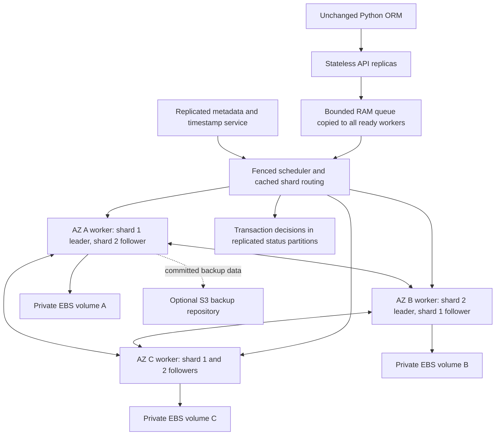

Add an indexed, transactional OLTP engine backed by worker-attached SSD volumes while preserving Nabedra's existing ORM calls and keeping OLAP and OLTP as mutually exclusive server builds.

Status: proposed design, 2026-11-16. This is a plan, not an implementation or performance claim. Configuration, internal types, packaging changes, and transaction guarantees below require implementation and acceptance evidence before release. Repository inspected at `0d02e105183e12626e18332bfd35a23ba3266530`.

User requirement recorded on 2026-11-16: logical tables have no fixed row or byte cap. A table grows across shards, attached volumes, and workers. Remove the current whole-table limits in the initial OLTP work; do not preserve them for an intermediate compatibility release. Shard and execution bounds remain independent of table size.

Follow [the scheduling requirements](resource-aware-scheduling.md), [the scheduler test contract](../docs/testing/scheduler-contract.md), and [the additional OLTP acceptance contract](../docs/testing/oltp-contract.md). The request queue remains replicated worker memory. Durable database recovery must never become replay of abandoned application requests.

---

## Recommended architecture

Use a shared API/protocol/admission layer and two independent execution engines. For OLTP, use `nabedra-kv`, the in-tree storage engine ([native storage engine plan](native-storage-engine.md)), on worker-attached EBS filesystems, key-range shards, a Raft replication group per shard, MVCC row/index versions, and distributed transactions for operations that cross shards. Start with three storage workers across three availability zones, with an independent EBS volume on each worker. Support multiple data volumes per worker and growth through additional volumes or workers. Co-locate the initial control replicas on those workers; larger deployments can give control replicas their own nodes and disks.

Route an indexed point read to its owning shard. That shard serves many concurrent reads through bounded executor threads and a shared block cache. Parallelize broad queries across relevant shards. No worker opens every other worker's volume, and ordinary operations do not parse the whole database. Existing OLAP primary-key routing already selects a Parquet partition; the OLTP improvement replaces partition download/decode with indexed row access.

| Choice | Read behavior | Write/scaling consequences | Decision |
| --- | --- | --- | --- |
| Parquet files on EBS | Still decodes files and scans for many filters | Still rewrites partitions; disk placement alone adds no distributed transaction protocol | Reject for the OLTP engine |
| One indexed server with a volume | Good starting point for local correctness and latency | One machine's capacity and failure boundary | Implement as the standalone development topology |
| Indexed shards with independent replicated volumes | Direct primary-key reads, indexed ranges, parallel broader queries | Requires consensus, stateful rebalancing, and cross-shard commit | Production target |
| EBS Multi-Attach as shared database storage | Shares blocks, not database ownership or indexes | Requires separate concurrency/fencing machinery and remains within one AZ | Reject |

`nabedra-kv` is the local storage engine ([native storage engine plan](native-storage-engine.md)), not a distributed transaction system. Raft orders and replicates a shard, not a transaction across several shards. Build the transaction layer explicitly. Lock OpenRaft to an exact reviewed version and prove crash/storage behavior with Nabedra's Rust toolchain. The storage engine needs no native build toolchain. [OpenRaft](https://docs.rs/crate/openraft/latest), [Raft paper](https://raft.github.io/raft.pdf).

Reusing a full transactional store such as TiKV would reduce the amount of consensus and transaction code Nabedra owns, but would add a separate storage service and its operational dependencies. This plan chooses an embedded OLTP module to match the requested deployment model. P0 must record that ownership cost before proceeding beyond the prototype. Its failure gate is a reason to reconsider that decision, not to release a weaker transaction contract under the same name.



All three workers also retain request queue copies. Replication links carry the shard's log to its replicas; they do not mean that every shard exists on every worker in a larger cluster. This example starts with one volume per worker. A volume holds many shard replicas, and a table can span many volumes on many workers. Shard count, volume count, worker count, replica count, and executor thread count are independent.

The [request-path diagram](assets/oltp-request-paths.html) compares a point lookup, a distributed indexed filter, and an atomic batch in this proposed placement. Its highlights describe routing, not measured latency or throughput.

## Identical application experience

This existing code must run against either deployment without changing its imports, calls, arguments, result types, or query language:

```python
from nabedra import Database, col

db = Database(url="https://database.example", token="configured-token")
users = db.create_table("users", {"id": str, "age": int}, key="id")
users.insert_many([{"id": "alice", "age": 24}, {"id": "bob", "age": 17}])
assert users.get("alice") == {"id": "alice", "age": 24}
assert users.where(col("age") >= 18).order_by("age").select("id").limit(20).collect() == [{"id": "alice"}]
assert users.where(col("age") >= 18).count() == 1
assert users.update("bob", {"age": 18}) is True
assert users.delete("missing") is False
```

Preserve all thirteen operations, synchronous methods, `submit`/`receipt`, authentication, database selection, validation, and the existing error/outcome envelopes. `insert`/`upsert` return `None`; `insert_many` returns its submitted count; `update`/`delete` return a boolean. Preserve immutable table IDs and stale-handle errors. No SQL or model invocation enters the execution path. Any caller that constructs today's operation payloads continues to use them.

The current ORM is a typed row API with `str`, signed `int64`, finite `float64`, and `bool`. Keys are strings or integers. Preserve its lack of nulls, nested documents, joins, and executable expressions. "NoSQL" does not require changing those existing rules.

Two compatibility issues need deliberate handling:

1. `Database(mode="oltp")` already exists, defaults to `"oltp"`, and currently only records a client preference. Keep it optional and advisory. The deployed server selects its engine; a Python argument must neither switch storage nor reject otherwise compatible calls.
2. Creation payloads and strict descriptor decoders require `format="parquet"`. Retain that field as legacy logical format/export metadata in the compatibility protocol. Record the actual engine and disk format separately in storage manifests and authenticated management capabilities. Do not require `format="nabedra-kv"`, add unknown descriptor fields, or imply that OLTP's physical files are Parquet. A future protocol can remove this storage-format leak without changing ordinary ORM calls.

Keep ordering exact: no `order_by` means primary key ascending; ordered queries use the primary key ascending to break equal sort values, even when the requested sort is descending. `count()` applies the explicit query limit and has no 100,000-row decoder ceiling. Filtering precedes ordering and limit; projection comes last. Preserve duplicate-key conflicts and all-or-nothing batches. `explain()` remains a string but describes the chosen engine, index, shard count, merge, and consistency path. The matching ORM release removes the count ceiling without changing calls or response shapes; existing client versions need an upgrade to decode larger counts.

Each call is one transaction. A successful `get()` followed by `update()` is two transactions and does not implement an atomic read-modify-write sequence. The current API has no transaction context, conditional update, or multi-table application transaction. Any future addition must be engine-independent and separately designed; it is outside this implementation.

## Cargo and engine boundaries

Keep the package `nabedra-database`, binary `nabedra-db`, and Python package `nabedra`. Make `olap` and `oltp` mutually exclusive features. Move the existing engine, Parquet codec, S3 catalog publication, and OLAP-specific recovery behind `olap`; make Arrow/Parquet dependencies optional. Keep S3 transport separately optional so an OLTP build can use S3 backups without linking the OLAP engine.

```toml
# Proposed feature section; optional dependency declarations must change with it.
[features]
default = ["olap", "s3"]
olap = ["dep:arrow-array", "dep:arrow-schema", "dep:parquet"]
oltp = ["dep:nabedra-kv", "dep:openraft"]
s3 = ["dep:aws-config", "dep:aws-sdk-s3"]
oltp-backup-s3 = ["oltp", "s3"]
```

```rust
#[cfg(all(feature = "olap", feature = "oltp"))]
compile_error!("select exactly one engine: olap or oltp");
#[cfg(not(any(feature = "olap", feature = "oltp")))]
compile_error!("select exactly one engine: olap or oltp");
```

After implementation, builds use `cargo build --locked --manifest-path server/Cargo.toml --no-default-features --features oltp`; the default continues to select OLAP. After publishing a release containing these features, the corresponding installation is `cargo install nabedra-database --locked --no-default-features --features oltp`. These features do not exist in the current published release. Enabling both fails; one binary cannot host both engines. Update installer/Docker/release assets to identify the engine and prevent accidental replacement with the wrong build. Never recommend `--all-features` for this matrix.

| Area | Proposed responsibility |
| --- | --- |
| `server/src/engine/contract.rs` | Engine-neutral execution, snapshot token, durable decision lookup, capabilities, and lifecycle contracts |
| `server/src/engine/olap/` | Existing `Engine<B: ObjectStore>`, partition execution, catalog and object publication |
| `server/src/engine/oltp/` | `codec`, `store`, `index`, `planner`, `mvcc`, `transaction`, `raft`, `routing`, `recovery`, and `backup` modules |
| `api`, `executor`, `request_queue`, `scheduling`, `worker_pool` | Shared protocol, admission, receipts, fairness, ownership, and aggregate resource limits |
| `cluster`, `node`, `config`, `runtime`, `cli` | Engine-specific bootstrap and worker messages behind a shared deployment lifecycle |
| `orm/python/`, `scripts/install_nabedra.py`, `Dockerfile` | Preserve application API; expose deployment choice and package the selected server |

The seam must remove `ObjectStore`, Parquet files, catalog ETags, and S3 control leases from shared OLTP execution. Replacing `ObjectStore` with a filesystem adapter would preserve the wrong algorithms. Move pure predicate/comparison code into a shared module and reuse it as the semantic oracle. Represent pinned snapshots and durable decision proofs with versioned engine-tagged wire types; never serialize an OLTP snapshot as a catalog ETag.

Cluster configuration, storage manifests, enrollment fingerprints, API/worker handshakes, and health output must agree on engine, format version, cluster UUID, and features. Reject mixed-engine workers and opening another engine's data directory. `serve` composes the same API and worker runtime as the distributed topology. An OLTP server must not require an S3 bucket or S3 catalog lease to start.

---

## Shards, disk layout, and indexes

Partition by primary-key range by default because current queries have deterministic key ordering and support ranges. The replicated routing map contains table ID, half-open key bounds, shard ID, placement epoch, replica identities, worker/pool placement, and leader hints. APIs cache bounded portions of it and refresh on redirects or epoch errors. Every worker validates the epoch and ownership; a cached route is never authority to write. Shard metadata and routing enumeration use versioned pages so a table's shard list never has to fit one catalog object, control message, or process buffer. [Range versus hash partitioning](https://tikv.org/deep-dive/scalability/data-sharding/).

Use multiple shards per volume and worker, and distribute shard leaders across workers. Bound the resident shard count and Raft heartbeat overhead per worker; add capacity rather than imposing a table-wide shard count. Split based on stored bytes, optional per-shard row thresholds, and sustained load, independently of the OLAP encoded-partition-size setting. Start with a proposed 256 MiB shard target for experiments, not a promised optimal default. A split threshold initiates creation of more shards under the same table ID. It is not a table limit. Define how a bounded atomic batch can temporarily exceed a split target or wait for a split without partial commit. Range partitioning can concentrate sequential writes in the last shard; splitting does not fix a single hot key. Measure this explicitly. A future operator-selected hash-prefix layout can spread sequential inserts, at the cost of broader range reads and merges; it must not change ORM ordering.

Represent each attached data volume as a registered storage pool with its own `nabedra-kv` store and bounded key namespaces for MVCC data, intents, index entries, transaction records, applied-log positions, and Raft metadata/logs. Many shards share a pool. Share cache/write-buffer budgets and native execution capacity across all pools on a worker; adding a volume must not multiply those limits. A shard replica's base rows, local indexes, intents, and applied position stay in one pool so its local write batch stays atomic. Two stores on the same worker still require the cross-shard transaction protocol when an operation spans them. Avoid requiring LVM/RAID or stretching one store directory over new mount points merely to add storage.

Track pool UUID, provider volume identity, filesystem identity, worker ownership/incarnation, mount path, generation, free/reserved bytes, and health in authenticated inventory and placement records. Verify the mounted volume before opening a store, including after restart; an absent mount must not redirect database writes into an ordinary directory on the root disk. Never format or adopt an existing disk based only on a reused path. Two pools on one worker do not provide two independent Raft votes or failure domains. A replica whose pool is empty, replaced or may be older than what the replica already told its peers never votes or acknowledges under its old identity, in a Data group or a system group (Control, Timestamps, Status, Catalog) alike. Restoring or cloning a pool's contents from a copy mints a new pool identity, Control revokes the old one before any group opens, and the replicas rejoin as learners (design review, RANGES-0).

Define a versioned, length-delimited binary key codec with table/shard/generation prefixes. Signed integer encodings must preserve numeric order; float indexes must preserve the existing treatment of both zero signs and reject NaN/infinity. JSON lexical order is not numeric order.

Store complete row versions under the primary key and commit timestamp, plus tombstones. Maintain local secondary indexes in the same shard as the base row. Index keys include the indexed values, primary key, and MVCC version; old entries receive tombstones in the same transaction as new entries. Local indexes keep single-row data/index updates together, but a secondary predicate without primary-key bounds must search indexes on every relevant shard.

Always create the primary index. Support operator-declared secondary, composite, and covering indexes without requiring an ORM change. For example, an administrative index definition for `users(age, id)` accelerates the sample query. Collect per-query-shape statistics and recommend indexes; do not create unbounded indexes automatically. Global secondary indexes can later route selective non-key reads to fewer shards, but their row/index changes become distributed transactions. Implement them only after the base transaction path and measurements justify the extra write work.

Build an index online at snapshot `s`, retain committed changes after `s`, backfill with bounded CPU/I/O, replay those changes, validate against the base table, then publish one schema/index epoch. Queries must not select the index before publication. Interrupted builds resume from their checkpoint or remain invisible. Schema changes use catalog guards; failed builds cannot expose partial results.

## Read execution and read optimization

| Operation | Execution |
| --- | --- |
| `get(key)` and primary-key equality | One owning data shard; primary index and block cache; no table scan |
| Primary-key range | Only intersecting ranges; ordered iterators |
| Secondary predicate | Local index seeks per relevant shard, residual predicate checks, bounded merge |
| `order_by(...).limit(k)` | Matching ordered/covering index when available; otherwise bounded top-k and global merge with exact tie-breaking |
| `count()` | Exact versioned counter only when applicable; otherwise count matching visible index entries/rows, respecting limit |
| Unindexed broad filter | Explicit scan plan with bounded work; scale does not make this a constant-time query |

A coordinator obtains one read timestamp when execution starts and replicates it and its snapshot/schema identity in the RAM request record before dispatch. Every participating shard reads that timestamp. A local store snapshot alone cannot create a cross-worker snapshot. Retries retain the original timestamp and compatible shard lineage. Readers must encounter or resolve intents for absent rows and secondary-index insert/delete ranges as well as existing rows; otherwise a scan can silently omit an in-flight committed insert.

Start with strong leader reads and an applied-log/read-authority barrier. No stale follower or cached query result may silently replace a strong read. Later, a follower can serve the same pinned snapshot only after a leader-derived read barrier, its local applied position, and its MVCC availability prove safety. Adding followers can then increase read capacity; it does not increase the write capacity of a hot shard. Lease reads and timestamp-free point reads are separate optimizations with clock/fencing and linearizability tests. A leader serves under its lease only for the lease minus a margin that covers the clock-rate error of both clocks over one lease: with a stated drift bound ρ and openraft's lease `L = election_timeout_max`, the leader uses `L(1 − 2ρ) − ε` (design review, RANGES-3). [Quorum-confirmed Raft reads](https://docs.rs/openraft/latest/openraft/docs/protocol/read/index.html).

Use an explicitly sized shared block cache, Bloom filters for point misses, cached index/filter blocks, bounded prefetch and multi-get, and covering indexes for frequent projections. Prefer leveled compaction for the first read-heavy profile; benchmark compression and block sizes on the actual EBS workload. Scans should avoid evicting the point-read working set. Account for pinned blocks, iterators, memtables, native allocations, page cache, and read/reduction buffers. The store's cache and memtable charges are not a process memory limit.

Stream shard iterators into a bounded merge and stop safely when the global limit is satisfied. Do not collect an entire table to sort it or apply a local limit before residual filtering. For complex `or`/`not` predicates, use a proven union/dedup/residual plan or fall back to a scan. Index choice changes performance, never values, ordering, errors, or atomic visibility.

---

## ACID and distributed commit

ACID means atomicity, consistency, isolation, and durability. The target is one atomic, strongly consistent operation per existing ORM call, with a single read snapshot and no lost updates or partial batches. Target strict serializability for this supported operation model: completed operations must admit a serial order that respects response-before-invocation ordering. Do not advertise general serializable application transactions that the API cannot express. Snapshot isolation alone does not provide general serializability. [Isolation distinctions](https://www.postgresql.org/docs/current/transaction-iso.html).

Use a documented Percolator-style MVCC protocol as the starting algorithm. Add explicit key validation/locking for every key a mutating operation reads, including absent keys, plus shared schema/lifecycle guards. Today's mutations read only their target rows and write those rows, with a bounded known key set for `insert_many`. Hold those guards/intents through the durable decision and validate conflicting committed versions. This restricted read/write model is essential to the serializability argument. Any future predicate mutation or multi-call transaction requires read-set and predicate-range validation/locking as well. P0 must write and test that argument rather than infer serializability from MVCC or Raft. [Percolator protocol](https://tikv.org/deep-dive/distributed-transaction/percolator/).

Use a replicated, monotonically increasing timestamp service per database consistency domain, initially hosted by the control group. It must preserve real-time ordering through leader changes and restarts. Batch allocations behind a currently proven leader; never hand independent APIs unordered timestamp ranges or use unbounded clock assumptions. Persist a high watermark before using reserved timestamps and fence a previous allocator. Reads receive `s`; commits receive `c > s` only after every participant has prepared. This ordering prevents a writer from later inserting a commit behind a snapshot that already read its keys. The timestamp service is a measured capacity and availability dependency. [Timestamp protocol and its limitations](https://tikv.org/deep-dive/distributed-transaction/timestamp-oracle/).

Store transaction records in replicated status partitions distributed across workers by logical request identity. They contain database/run/request identity, payload digest, attempt generation, schema/routing versions, immutable participant manifest, prepare evidence, state, commit timestamp, and terminal operation result. Do not put every decision behind one global catalog lock. This baseline adds a status-group step even for a one-data-shard mutation. A later one-phase optimization is legal only when all affected data, indexes, and the authoritative decision share one Raft group and its timestamp/read-fence proof is complete.

Workflow for a mutation:

1. The API validates/bounds the envelope, installs full request copies on all ready workers, and accepts the request. A `202` is acceptance, not commit. The scheduler chooses execution capacity with data locality.
2. The coordinator obtains `s`, resolves schema and shard ownership, computes affected keys/index entries, and records the immutable transaction manifest. Normal validation failures happen before durable preparation where possible.
3. Participants acquire intents and validate target versions/schema guards under their shard authority, including uniqueness and per-pool space reservations. They replicate private row/index versions and prepare records to a durable quorum. Only acknowledged prepares enter the commit proof. Do not check a whole-table row/byte limit or serialize inserts through a global table quota counter. Use bounded conflict retries and a deterministic deadlock policy; never hold executor permits while waiting on another participant.
4. After all prepares, obtain `c` and conditionally commit exactly one `COMMIT(c, result)` record in the transaction's status group. That group's log must check the active run/owner fence in the same state transition. Before this decision, a fenced authority may decide `ABORT`; afterward, rollback is forbidden.
5. Participants apply the decision idempotently. Each local store batch updates visible row/index versions, deduplication/result state, and the applied-log position together. A reader at `s_read >= c` resolves any remaining intent through the authoritative decision; it never returns a partial batch. A reader with `s_read < c` sees the prior versions.
6. Acknowledge success after the durable decision and participant visibility are established, then replicate the terminal receipt. If a response is lost, reconcile by identity/digest. An uncertain storage/consensus result stays `outcome_unknown` until a decision proves the result. Never report `not_applied` merely because a timeout elapsed.

The COMMIT record is the logical transaction decision. Distributed visibility follows its timestamp plus mandatory intent resolution, not whichever participant happens to apply first. Conflicting writers cannot ignore unresolved intents. A resolver may complete an existing committed decision after a coordinator dies; it must not fabricate a new commit from a participant timeout or a missing network reply.

A retryable aborted attempt gets a new transaction attempt ID under the original logical request. Advance that request's attempt generation conditionally only after the prior ABORT is authoritative; retain its rollback markers so late prepares fail. At most one generation may commit. A possibly committed attempt must be reconciled before another attempt starts. Keep the original payload digest and accepted authorization snapshot through these internal retries.

For local durability, Raft acknowledgments mean the required vote/log state reached stable storage. Update state and its applied position atomically; replay of a committed log entry is idempotent. Keep the store journal and synchronous durability enabled in the initial design. Raft's log and the store's state have different roles; eliminate redundant flush work only after proving crash recovery and safe log truncation ([OLTP direct path](oltp-direct-path.md)). A `WriteBatch` submitted without `Durability::Sync` provides neither machine-crash durability nor distributed commit.

Create/drop and schema/index publication use the same identity/decision rules. A drop closes new writers through an exclusive lifecycle guard, waits for prepared writers to resolve, then publishes the metadata tombstone. Existing pinned reads can finish from their captured schema/data. Durable no-op results and failures that require stable replay must retain their original identity/result too.

## Queue, scheduler, and failure semantics

Retain all-ready-worker RAM replication before acceptance, identity/digest deduplication, bounded count/bytes/results, fair scheduling, cancellation ownership, and run/term fencing. Queue replication and data replication are separate. A read executes on one data shard even though its admission record reaches every ready worker. For `W` workers and request size `R`, admission alone sends roughly `R × (W - 1)` additional payload bytes and waits for required acknowledgments. Its slowest required replica and the single scheduler owner can limit latency/throughput. Changing this contract to shard-scoped or quorum queue replication requires a separate approved design.

Make data ownership an eligibility constraint in the existing CPU/memory scheduler. Idle unrelated workers cannot execute a shard's index without its data. A broad query can use several eligible workers up to `max_workers_per_request`, including reduction; process more shards in waves. Consensus replication/status participants are storage/control work and need explicit bounded budgets even when they do not count as query compute allocations. All native compaction/flush threads count against the advertised execution budget; bound separate I/O/control overhead and reserve progress capacity for consensus, settlement, and lock resolution.

Extend memory accounting to block cache, memtables/write buffers, pinned MVCC snapshots, intent/lock tables, Raft buffers, snapshot transfer, index builds, and native library overhead. Bound disk IOPS, compaction, WAL growth, free space, and lock waits as well as CPU/RAM. At disk high watermarks, reject new work before acceptance or retain accepted work with an explicit terminal/reconciling outcome. Do not exhaust the space needed to write ABORT/COMMIT and settle existing transactions. Logical reservations and actual RSS/cgroup limits are separate measurements.

| Event | Required behavior |
| --- | --- |
| API loss or client disconnect | Retain accepted requests on workers and reconnect by the same receipt |
| One worker/disk/AZ loss with surviving data quorum | Elect safe shard leaders, retain request copies, resolve decisions; no duplicate mutation |
| Only a queue replica survives, but a data/status quorum is unavailable | Retain the request and report/wait for unavailable authority; queue survival cannot manufacture quorum |
| Rolling restart or scale-in | Copy queue state, resolve/transfer transactions, move shard leadership/replicas, then drain and fence before termination |
| Network partition | Only authoritative quorums may decide writes/strong reads; heartbeat loss alone does not authorize cold start |
| Every worker stops | Start a fresh run with an empty queue; abandon old pending work; recover committed database state |

On cold start, restore authoritative consensus state, establish a new run fence in metadata and every relevant shard/status group, and resolve old transaction states before admitting new mutations. Every decision transition checks its group's fence, not a separate earlier metadata read. A pre-existing COMMIT that wins ordering before the new fence remains committed, including an ambiguous decision recovered from the old log; an old decision after the fence must fail. Abort remaining prepared transactions without a committed decision, reclaim their private versions, and never resume their user operation. Require an explicitly authorized cold-start transition or authoritative shutdown evidence, not a timeout heuristic.

WAL replay may finish applying already committed state. It must not reconstruct a pending request queue, re-run old validation/computation, or submit a new logical mutation. Old receipts consult durable decisions before returning abandonment. The OLAP rule against adding per-partition WAL files remains unchanged; OLTP storage logs are a new engine's durability mechanism, not persistence for its application request queue.

MVCC garbage collection retains every version needed by active replicated request snapshots, unresolved transactions, backups, and shard transfers. Membership loss must not advance the safe point past a snapshot still held by a surviving queue replica. Expire retained results explicitly; do not promise recomputation after the snapshot has been released. Keep decision/idempotency records and rollback fences until a documented retention rule and run fence make delayed retries harmless.

---

## AWS deployment behind the scenes

Use one region with three AZs for the first HA topology. Put stateless API replicas behind a private or public TLS load balancer as appropriate. Run storage workers in private subnets on EBS-optimized EC2 instances. Start with at least one worker per AZ, one independently attached encrypted data volume per worker, and one voter per shard per AZ. Raft commits require two durable voters out of three. Losing one AZ retains quorum; losing two does not. Quorum loss stops strong operations instead of acknowledging unsafe writes.

EBS volumes attach within their AZ. Reattaching a failed worker's disk is a same-AZ recovery optimization, not the cross-AZ failover mechanism. Cross-AZ availability comes from independent database replicas. Do not mount one store directory from several servers. [EBS attachment constraints](https://docs.aws.amazon.com/ebs/latest/userguide/ebs-volumes.html), [Multi-Attach filesystem limitations](https://docs.aws.amazon.com/ebs/latest/userguide/ebs-volumes-multi.html).

Use gp3 as the first cost/performance test profile. Its included baseline is 3,000 IOPS and 125 MiB/s; AWS describes single-digit millisecond storage latency. Test io2 Block Express when cold-read or durable-write tail latency justifies its price. Its advertised sub-millisecond storage behavior is not an end-to-end query guarantee. Prefer RAM hits for hot reads in either profile. Validate current regional volume limits and account quotas when provisioning. [gp3 and io2 guidance](https://docs.aws.amazon.com/ebs/latest/userguide/general-purpose.html).

Size worker RAM for the hot indexed working set and transaction/control reserves, then choose a non-burstable EC2 class with enough sustained CPU, network, EBS IOPS, and EBS bandwidth. Provisioned volume throughput cannot exceed the instance's aggregate EBS ceiling. Keep data and Raft/WAL directories on durable storage, never a container's writable layer. Start with one data volume; a separate log volume is an experiment for contention and recovery, not a substitute for replication. [Instance EBS ceilings](https://docs.aws.amazon.com/AWSEC2/latest/UserGuide/ebs-optimization-performance.html).

Use EKS on EC2 as the reference managed deployment, with the standard EBS CSI driver. API Pods can scale independently; storage Pods need persistent identities and volume retention. EBS volumes cannot be mounted by Fargate Pods. Keep bootstrap credentials in scoped Secrets and workload roles; use worker/control mTLS and restrict data ports to cluster peers. Separate application bearer credentials from administration and provisioning authority. [EKS EBS CSI requirements](https://docs.aws.amazon.com/eks/latest/userguide/ebs-csi.html).

```yaml
# Proposed standard EBS CSI StorageClass, not an EKS Auto Mode class.
apiVersion: storage.k8s.io/v1
kind: StorageClass
metadata:
  name: nabedra-oltp-gp3
provisioner: ebs.csi.aws.com
volumeBindingMode: WaitForFirstConsumer
reclaimPolicy: Retain
allowVolumeExpansion: true
parameters:
  type: gp3
  encrypted: "true"
  csi.storage.k8s.io/fstype: xfs
  iops: "3000"
  throughput: "125"
```

Use operator-managed one-replica StatefulSets per storage worker, grouped by AZ, so each worker can have its own list of explicit PVC mounts. Keep worker identity stable across replacement Pods, and apply host anti-affinity and explicit placement constraints. The operator manages PVC retention independently of a worker's lifetime. Use a PodDisruptionBudget plus the database controller's stronger per-shard quorum check; the controller authorizes drain before replacing/removing a worker. `WaitForFirstConsumer` selects a volume topology compatible with the Pod. A PDB does not replace transaction drain or protection from involuntary failure. [Storage topology](https://kubernetes.io/docs/concepts/storage/storage-classes/#volume-binding-mode), [PVC retention](https://kubernetes.io/docs/concepts/workloads/controllers/statefulset/#persistentvolumeclaim-retention), [CSI parameters](https://github.com/kubernetes-sigs/aws-ebs-csi-driver/blob/master/docs/parameters.md).

Existing PVC expansion uses the supported CSI/filesystem expansion path. Adding another PVC changes the worker's Pod template and requires a controlled replacement; do not promise that Kubernetes can patch a new volume mount into a running Pod. Keep other workers and their request copies alive through that replacement, then rejoin the new incarnation before proceeding. Explicit per-worker PVCs avoid treating new shared `volumeClaimTemplates` as a freely mutable live attachment API. [PVC expansion](https://kubernetes.io/docs/concepts/storage/persistent-volumes/#expanding-persistent-volumes-claims), [Pod replacement rules](https://kubernetes.io/docs/concepts/workloads/pods/#pod-update-and-replacement).

The current bundled Kubernetes provider creates individual Pods and bootstrap Secrets; it is not a StatefulSet/PVC/shard-migration controller, and there is no bundled AWS adapter. Do not claim that its existing `nodes=(min,max)` path safely autoscales OLTP. First ship a fixed/manual stateful deployment and a volume-aware lifecycle interface. A later adapter must track Pod UID, worker incarnation, PVC/volume identity, AZ, and completed database drain/migration proof. Bare EC2 deployments must implement the same steps through their own tested volume/instance adapter.

Proposed worker/cluster configuration additions below are illustrative values, not tuned defaults or the current parser's accepted schema. Retain the existing `execution` and `resources` contracts and version the bootstrap/fingerprint migration together.

```json
{
  "engine": "oltp",
  "oltp": {
    "format_version": 1,
    "data_dir": "/var/lib/nabedra",
    "storage_pools": [
      {"pool_id": "83678b41-409e-4be5-8f8f-fd60ab11b1d3", "mount_path": "/var/lib/nabedra/pools/pool-a"}
    ],
    "replication_factor": 3,
    "replica_failure_domain": "zone",
    "read_consistency": "strong",
    "shard_target_bytes": 268435456,
    "block_cache_bytes": 4294967296,
    "write_buffer_bytes": 1073741824,
    "storage_background_threads": 2
  },
  "resources": {
    "max_threads": 8,
    "memory_limit_bytes": 17179869184,
    "task_memory_limit_bytes": 536870912,
    "control_memory_reserve_bytes": 536870912
  }
}
```

The example starts with one pool; the registered inventory supports more. Keep node-local pool registration/versioning separate from the cluster's engine fingerprint so adding storage does not invalidate unrelated workers. Worker identity/control files and every pool live on verified durable mounts. The two background threads are part of the eight-thread budget, shared across pools. Cache/write-buffer budgets reserve part of the 16 GiB ceiling before task admission; queue/result/control/native overhead also consume that ceiling. A single-worker `serve` profile explicitly uses replication factor one and has no worker-failure tolerance. It uses the same transaction/snapshot rules and can add pools and shards without a fixed table cap.

## Scale-up, scale-down, and operator experience

Scale storage and compute through separate capacity observations. Storage growth can enlarge an existing volume, add another volume to an existing worker, or add a worker with new volumes. A table remains the same logical object across all three paths. Start growth before pool headroom falls below the measured provisioning/copy interval plus compaction and transaction-settlement reserves. Use per-pool free bytes and sustained demand; do not wait for a table row counter to hit a ceiling.

For an existing volume, request a supported EBS/PVC increase, observe completion of the relevant storage/filesystem expansion, and advertise only capacity visible to the mounted filesystem. EBS supports growth through Elastic Volumes; its API success alone does not expand the filesystem or make new space available to the database. [EBS volume growth](https://docs.aws.amazon.com/ebs/latest/userguide/ebs-modify-volume.html), [Filesystem expansion](https://docs.aws.amazon.com/ebs/latest/userguide/recognize-expanded-volume-linux.html).

For another volume, retain an idempotent provisioning claim, create/attach it in the worker's AZ, verify identity and exclusive ownership, mount/register a new pool, then make it eligible for placement. Place new shards or move existing replicas through the safe learner/catch-up sequence. The EKS adapter uses the controlled Pod replacement above; bare EC2 can use live attachment and mount when supported. Provision enough capacity in the other required replica AZs before assigning new replicated data. Attaching one empty volume cannot replace missing replica capacity elsewhere.

When a worker reaches its attachment, sustained EBS I/O, CPU, RAM, or resident-shard budget, place additional shards on another worker. A storage-only addition to a surviving worker does not add a request-queue replica or new compute allowance. Host volume limits are provider constraints, not logical table limits. [EC2 volume attachment limits](https://docs.aws.amazon.com/AWSEC2/latest/UserGuide/volume_limits.html).

Scale-up creates an empty worker with its own volume in the chosen AZ. It authenticates, validates its limits/engine/volume identity, and copies the outstanding RAM queue before readiness. Add shard replicas as nonvoting learners, transfer a verified bounded snapshot, catch up the committed log, then promote through safe Raft membership changes. Only after promotion should the controller move leadership or remove an old voter. Limit transfer I/O so rebuilding a replica cannot consume the foreground read budget.

Splits and moves preserve table IDs, snapshot timestamps, unresolved transaction records, deduplication history, and range lineage. Fence the old epoch and publish routing only when the new ownership is recoverable. During an epoch change, retry the same logical operation against the new route. A stale routing cache must neither duplicate rows nor skip a range. Snapshot installation activates a new replica generation atomically, including its applied-log position, without replacing unrelated shards in the target pool's store. A split is a durable state machine: a sweep on the run owner resumes every opened attempt, whatever started it, until it publishes or aborts, so a lost coordinator never leaves the source frozen or its lifecycle guard held (design review, RANGES-2).

Volume removal first drains its pool, moves every required replica, and settles/transfers transactions and snapshot pins before unmount/detach. Worker scale-down additionally re-establishes request copies on survivors and maintains the three-AZ replica policy. Move leaders, replace required replicas, and obtain fresh drain/fence evidence before stopping the process. Retain old PVCs for an explicit retention period; storage deletion is a separate operator action. Never scale below the topology's quorum/failure-domain minimum automatically. Scaling an HA cluster to zero is a deliberate maintenance operation that retains disks but abandons remaining requests under the cold-start contract.

Production storage autoscaling chooses volume growth, another pool, or another worker using free bytes, replica placement, attachment slots, sustained queue age, per-shard CPU, cache misses, EBS latency/queue depth, and compaction debt. More workers help only after data/leadership moves; more API replicas do not add storage capacity. Prefer increasing cache or volume IOPS when that is the bottleneck. Apply cooldowns, finite retry policies, explicit infrastructure/spend ceilings, and one safe membership transition at a time per shard. A failed adapter preserves accepted work. Preserve A01/A02 and pass O17/O18/O26/O27 before enabling this path. Without an adapter, support manual expansion and report provisioning as unavailable; never invent successful capacity.

Expose engine/format, leaders/followers/learners, replication health, queue age/bytes, snapshot safe point, transaction decisions/intents, cache hit rate, EBS latency/IOPS, compaction debt, per-pool capacity/reservations, attachment headroom, storage-growth decisions, routing epochs, and migration/drain progress in management status. Health must distinguish process liveness, API admission readiness, and quorum availability. Operators deploy and tune the engine; applications keep the same URL/token/query pattern.

## Backups, restore, and migration

Replication protects availability; it does not protect against logical deletion or losing all replicas. Require tested backup/restore before production release. Create a consistent backup at timestamp `b`, pin the schema and shard map, resolve transactions relevant to that cut, export committed MVCC data and required metadata, then publish one checksummed immutable backup manifest after all components exist. Backups can use optional S3 without making it a foreground read/write dependency. A backup manifest contains no pending request queue.

For point-in-time recovery, archive the complete committed change/decision history needed after the base backup and advertise only a verified recoverable timestamp. Restore all participants of each committed transaction through the target cut; never replay PREPARE-only or abandoned application requests. Track archive lag, retention, checksums, encryption keys, and periodic restore drills. The cross-AZ acknowledged-write RPO target is zero under the stated single-AZ failure model; backup RPO/RTO depend on archive lag and measured restore work and must be reported separately.

Independent EBS volume snapshots are not automatically a consistent distributed backup, and they omit unwritten application/OS buffers. Use engine checkpoints and a coordinated recovery manifest if offering that acceleration. [EBS snapshot contents](https://docs.aws.amazon.com/ebs/latest/userguide/ebs-creating-snapshot.html).

OLAP and OLTP files are not interchangeable. Initially migrate with a captured OLAP catalog, a write maintenance window, and an offline export/import tool that reads source Parquet without linking both production engines into one server. Preserve logical schema, primary keys, ordering, and table UUIDs for existing handles; refuse to import into a nonempty target. Validate row counts and deterministic per-range hashes before changing the application endpoint. Keep the source snapshot for rollback. A later online migration needs a separately designed change stream; do not implement naive dual writes. Receipt/run histories belong to their source cluster and must not be confused with target queue state.

## Tables grow with storage capacity

There is no fixed logical-table row, byte, shard, or volume cap. Shard/partition limits bound individual units of storage and work; crossing a split threshold produces additional shards under the same table ID. Tables grow through additional provisioned capacity. The current 100,000-row table cap and 64 MiB whole-table decoded-payload cap are implementation constraints to remove from the OLTP path immediately, not compatibility requirements to carry forward. The no-fixed-table-cap requirement applies to the logical model of both engines; this plan changes the new OLTP path and shared client/protocol assumptions, not the existing OLAP storage implementation.

Audit `server/src/protocol.rs`, `storage/manifest.rs`, `snapshot.rs`, `engine/read.rs`, `engine/write.rs`, `engine/mutation.rs`, `node/job.rs`, and `node/coordinator.rs` while extracting engine-specific code. Keep bounded partition/block/frame/result parsing, but remove whole-table uses of `MAX_TABLE_ROWS` and `MAX_DECODED_PAYLOAD_BYTES` from OLTP validation, planning, mutation preparation, and counters. The existing OLAP implementation retains its current constraints until its own storage work removes them; never import those constraints through a shared helper into OLTP.

Keep the 8 MiB envelope, 10,000-row batch/result, predicate-depth, schema, and per-task memory bounds unless a separate proposal changes them. A table containing millions of rows can return a bounded `collect()` or scalar `count()` without loading every row or shard descriptor into memory. Remove the Python `count()` decoder's 100,000 ceiling in the initial compatible ORM release; validate the count's type, protocol integer representation, and any explicit query limit. Existing client versions need an upgrade for larger counts, without changed application calls. Large numeric counters use checked arithmetic and never wrap or truncate.

Paginate routing/catalog/control and backup metadata as well as data iteration. No root manifest or message may require the complete shard list, so the old catalog-byte bound cannot become a new table-size cap. Retain snapshot epochs and authenticated continuation tokens while traversing pages, with bounded caches and restartable progress. The initial OLTP implementation must not depend on a fixed-size catalog listing every shard.

Reserve actual per-pool storage needed for prepared data, replication, compaction, and settlement. Do not maintain a global table row/byte quota or require every insert to update a shared table counter. Compute exact counts through versioned shard counts when valid or bounded scans. Storage growth preserves transaction/receipt/replication semantics; when provisioned resources are exhausted or authorized growth is unavailable, use bounded admission and explicit capacity errors while preserving accepted identities. A capacity error must not claim that the logical table is too large. O21/O26-O28 cover removal of hidden limits and independent storage growth.

---

## Performance goals, cost, and evidence

Treat "as fast as or faster than PostgreSQL" as an experiment, not an architectural guarantee. Indexed point reads and short range reads are the first target workloads. A warm cache can avoid storage reads; a cold lookup still pays EBS latency. Strong cross-AZ writes pay durable quorum latency, and cross-shard commits add phases. All-ready queue replication, timestamp allocation, status partitions, shard hotspots, and Python's current HTTP transport are included in end-to-end measurements.

Compare both a single-node durable deployment and a three-AZ HA deployment with equivalent PostgreSQL configurations. Match hardware, EBS type/IOPS, RAM, indexes, data shape, client location, isolation guarantee, synchronous replication, and total provisioned resources. Report PostgreSQL's normal single-statement behavior separately from stricter matched-isolation tests. Include direct-engine, HTTP, and unchanged ORM results so transport overhead cannot disappear from the headline. Do not use an in-memory Raft library benchmark as database evidence. [PostgreSQL synchronous replication](https://www.postgresql.org/docs/current/warm-standby.html#SYNCHRONOUS-REPLICATION).

| Workload | Required variations |
| --- | --- |
| Point reads/hits/misses | Warm/cold cache; uniform/hot-key distribution; existing keys and absent keys |
| Indexed filters and top-k | Selectivity, projection width, matching/missing index, local versus global fan-out |
| Mixed transactional load | 100/0, 95/5, and 80/20 read/write mixes; single-row and cross-shard batches |
| Scale and contention | 1/3/6/12 storage workers; fixed/varying dataset per worker; hot ranges and hot keys |
| Maintenance/failure | Compaction, index build, snapshot transfer, disk-full, rolling restart, worker/AZ loss |

For each configuration use warm-up and at least three measured repetitions, fixed seeds, known quotas, and bounded clients. Record throughput, p50/p95/p99 completion and queue latency, rejection rate, CPU/RSS/charged memory, disk/network bytes, cache misses, fsyncs, replication/apply lag, timestamp/status-group utilization, conflict retries, queue replication latency, accepted-ID conservation, and cost per completed workload. Include open-loop arrival rates and coordinated-omission-resistant latency accounting. Publish before/after distributions, not invented speedups. B01/B02 and O24/O25 define the acceptance evidence.

For an HA storage estimate, let `D` be logical data plus chosen indexes, `A` measured on-disk amplification from MVCC/LSM state, and `F` the chosen headroom multiplier for compaction and rebuilds. Provisioned data capacity is approximately `3 × D × A × F`, plus measured retained logs/backups; do not multiply this total by worker count again when sharding it. Every independent reader replica adds its own disk/cache/replication cost. A stored GiB in S3 and three indexed EBS copies are different cost models.

Estimate monthly cost as API/control/worker compute + provisioned EBS capacity + extra provisioned IOPS/throughput + inter-AZ transfer + backup/archive storage/requests + load balancer/EKS/observability. Retained volumes still cost money after workers stop. Obtain current region-specific prices when choosing the deployment; this plan supplies no assumed dollar quote. For gp3, charge extra performance above its included baseline. [EBS pricing model](https://aws.amazon.com/ebs/pricing/).

## Implementation order and release gates

The table lists future implementation work; no task is marked complete. P2/P4/P5 require storage and transaction algorithms beyond a storage-driver change. Independent implementation tracks can run in parallel only after the shared contracts they depend on are fixed.

| Task | Concrete deliverable | Depends on | Acceptance references |
| --- | --- | --- | --- |
| P0 | Written transaction/serialization proof for existing operations, dependency/native-build spike, timestamp/fence simulation, baseline workload and cost model | None | O01, O06-O10, O24; scheduler U03 |
| P1 | Engine seam, mutually exclusive Cargo builds, engine-tagged types, shared protocol/ORM count-limit removal, OLAP regression preservation | P0 | O01-O02, O21; U01-U02, T06 |
| P2 | Durable indexed per-volume pools, codec, MVCC, atomic local state, standalone RF1 runtime without whole-table caps | P1 | O03-O05, O11, O21, O26; F01-F03, M01-M03 |
| P3 | Streaming planner, secondary/covering indexes, online index build, bounded merge independent of table size | P2 | O03-O05, O12, O21; C04-C07 |
| P4 | Durable multi-Raft, paged routing metadata, timestamp/status services, three-AZ placement and group-local fences | P2, P0 | O06-O11, O16, O28; R01-R06 |
| P5 | Atomic multi-shard commit, intent resolution, schema guards, deduplication/receipt recovery, cold-start cleanup | P3-P4 | O07-O10, O13-O15; Q05-Q06, T01-T06, R04-R05 |
| P6 | Shared admission/queue/receipts, shard-locality scheduling and complete native memory/thread/I/O budgets | P4-P5 | O13-O15, O22-O23; C01-C07, M01-M03, Q01-Q06, F01-F03, U01-U03 |
| P7 | Safe splits, pool registration, cross-pool/worker moves, snapshot install, drain and volume identities | P5-P6 | O16-O18, O26, O28; R02-R03, A01-A02 |
| P8 | Fixed/manual multi-volume EC2/EKS deployment and growth, consistent backup/restore, offline OLAP migration | P7 | O18-O21, O26; U01, R04, A01 |
| P9 | Capacity planner for volume expansion, new pools and new workers, authenticated inventory and idempotent growth claims | P7 | O21, O26-O28; C03, M02, A01-A02 |
| P10 | Evidence-driven point-read/1PC/follower-read optimizations with explicit proofs and regression cases | P5-P6 | O07, O09-O11, O24-O25 |
| P11 | Volume-aware provisioning adapters, automatic storage/compute growth, safe stateful autoscaling and spend ceilings | P8-P9 | O17-O18, O23, O26-O27; A01-A02, R03 |
| P12 | Full operation/fault/load suite, PostgreSQL comparison, real EBS/EKS acceptance, release evidence and runbooks | P8-P11 | All OLTP cases; applicable scheduler assertions and OLAP originals |

Ship the local prototype as experimental first, the fixed three-AZ cluster after distributed correctness and restore evidence, and automatic storage growth after the stateful adapter passes provider tests. None of these milestones retains a fixed table cap. Production elastic storage requires verified growth and placement through volumes and workers; a manual prototype must identify its provisioning mode honestly. Performance optimizations cannot weaken the default consistency or bypass request retention.

The acceptance mapping distinguishes shared requirements from backend-specific mechanisms. Original S3 upload/catalog-CAS tests remain in the OLAP suite; OLTP gets explicit equivalents for preparation, durable decision, and fence ordering. Passing an OLTP test does not establish that an unexecuted scheduler or AWS assertion passed. Record commit, feature matrix, provider, topology, all commands, seeds, observations, and failures in a new evidence ledger when implementation begins. No implementation, acceptance scenarios, AWS provisioning, or performance benchmarks were executed while writing this plan.

## Design review

Reviewed 2026-11-26 (wave rv, task rv-oltp-ranges) against `origin/main` e6b4040b. Three specs cover the parts of this
plan that the other OLTP specs do not: one Raft group with replica identity and leases, a range split under direct
load, and Control's run owner. The direct path's commit and dedup rules are `specs/oltp/direct` (rv-oltp-direct) and
the queue is `specs/oltp/queue`. Results are local and unattested until the T checks below pass on Actions.

| Part | Content |
| --- | --- |
| Guarantees | OLTP-G01: `G01_CommittedNeverLost`, `G01_AckedDurable`, `G06_NoWriteLostAcrossSplit`. OLTP-G02: `G02_LeaseReadFresh` (lease reads and `AllocateDirect`). OLTP-G06: `G06_NoWriteAtOldOwner`, `G06_PublishUnderOwner`, `G06_NoRefusalForLoad`, `G06_SplitNotExhausted`, `G06_SplitPublishes`, `G06_PauseEnds`, `G06_FreezeEnds`, `G06_RoutesConverge`. OLTP-G07: `G07_NoStaleOwnerStep`, `G07_OwnerReplaced`. OLTP-G08: `G08_OneLeaderPerTerm`, `G08_NoRevote`, `G08_ZonePlacement`, `G08_MoveTerminates`, `G08_MoveEnds`, `G08_RemoveEnds`. OLTP-G10: `G10_WritesComplete`. Not modelled here: G03, G04, G05 (direct and queue specs), G09 and G13 (resources and timing), G11 (backup), G12 (client parity). |
| Topology | One Raft group of three voters in zones a, b, c and a spare in zone a (OltpRanges); a source range and two children on three workers, the coordinator, Timestamps, Status and the Catalog as one durable store each, gateways with a route cache (OltpSplit); four workers and Control as one linearizable store (OltpControl). Faults modelled: crash with the disk, crash with the pool lost, restart from an older copy of the pool, partition of one node, clock drift within a bound, coordinator crash, a lost worker incarnation, leader change, late copies of requests and of `DirectPause`, a run-owner fence. Out of scope: message loss, duplication and reordering inside Raft (covered by Raft's term and log checks), torn unsynced writes (the storage specs), snapshot transfer and activation, Catalog paging, scans. |
| Spec | `specs/oltp/ranges/OltpRanges.tla`: baselines `OltpRanges.cfg` (identity: crash, pool loss, older copy, partition, all budget 1, 3 terms), `.move.cfg` (replacement with crash, pool loss, partition), `.lease.cfg` (drift bound 1 tick, 3 drift steps, lease 3, margin 1, crash, partition), `.live.cfg`. `specs/oltp/split/OltpSplit.tla`: 3 workers, 3 ranges, 2 writers that write forever, 3 attempts; `OltpSplit.cfg` (worker faults: crash, partition, leader change, late copies), `.coord.cfg` (coordinator crash, an abort after transient failures, a run-owner fence, late copies), `.live.cfg` (coordinator crash, an abort, late copies), each fault budget 1. `specs/oltp/control/OltpControl.tla`: `OltpControl.cfg` and `.live.cfg`, 4 workers, 2 losses, 1 move, 1 removal. No state constraint. Symmetry in the safety runs only (voters, or the two voters outside the spare's zone, and clients). Fairness: the election timer while no leader reaches a node, the leader's replication loop, the client's retry, the replacement controller, the worker supervisor, the end of a partition (OltpRanges); the coordinator's work loop, the owner's resume sweep, the election timer, Raft replication of a proposed write, the gateway refresh (OltpSplit); the move workflow, `supervise_membership` and the fence driver (OltpControl). T checks: `oltp-ranges-spec`, `oltp-split-spec`, `oltp-control-spec`. OltpRanges adds a safety profile, `.move-restore.cfg`, that allows stale restore during replacement alongside crash, pool loss and partition. Its lease profile still runs separately from permanent pool loss, stale restore and replacement. OltpSplit adds a safety profile, `.combined.cfg`, that interleaves worker and coordinator faults with every existing fault budget set to 1. Its liveness profile still limits faults to coordinator crash, abort and late copies. The new profiles await attested results. The remaining profile limits require independent review. |
| Results | `oltp-split-spec` and `oltp-control-spec` pass on Actions run https://github.com/zPy52/nabedra-database/actions/runs/45815849881 at 59f396c6: OltpSplit 152,981 states (depth 23), `.coord` 257,664 (33), `.live` 226,560 (24), 25 actions covered (minimum 3,816); OltpControl 117 states (11), `.live` 1,476 (11), 9 actions (minimum 108). `oltp-ranges-spec` on run https://github.com/zPy52/nabedra-database/actions/runs/45814027915 at 377007f4: identity 80,778 states (15), lease 18,974,343 (20), move 2,496,129 (22), 20 actions (minimum 9,275); its liveness baseline failed on a spec artifact (bounded terms with spurious elections, and a lagging node that never adopted a higher term), fixed at fa49898a; the final run on the PR head is recorded in the PR. |
| Mutants | OltpRanges: `prefix_stale_rejoins` G08_NoRevote 8 states; `prefix_stale_rejoins_lost` G01_CommittedNeverLost 11; `prefix_wiped_rejoins` G01_CommittedNeverLost 10; `prefix_wiped_rejoins_durable` G01_AckedDurable 8; `vote_no_log_check` G01_CommittedNeverLost 8; `double_vote` G08_OneLeaderPerTerm 6; `prefix_no_lease_margin` G02_LeaseReadFresh 14; `drift_beyond_bound` G02_LeaseReadFresh 14; `restart_forgets_lease` G02_LeaseReadFresh 11; `no_zone_check` G08_ZonePlacement 8; `retire_on_propose` G01_AckedDurable 8; `commit_needs_all` G10_WritesComplete and `learner_not_replicated` G08_MoveTerminates (liveness, added at fa49898a). OltpSplit: `prefix_split_refused_under_load` G06_NoRefusalForLoad 8; `prefix_split_slots_exhausted` G06_SplitNotExhausted 29; `prefix_split_never_publishes` G06_SplitPublishes 32 (lasso); `prefix_no_resume_sweep` G06_FreezeEnds 11 (lasso); `pause_leak_unbound_abort` G06_PauseEnds 18 (lasso); `pause_leak_late` G06_PauseEnds 20 (lasso); `cut_before_barrier` G06_NoRefusalForLoad 10; `apply_ignores_freeze` G06_NoWriteLostAcrossSplit 13; `apply_ignores_split` G06_NoWriteAtOldOwner 13; `publish_ignores_authority` G06_PublishUnderOwner 12; `no_refresh` G06_RoutesConverge 16 (lasso). OltpControl: `prefix_move_blocks_owner_fence` G07_OwnerReplaced 6 (lasso); `prefix_move_never_ends` G08_MoveEnds 6 (lasso); `prefix_remove_owner_lost` G08_RemoveEnds 4 (lasso); `adopt_keeps_old_owner` G07_NoStaleOwnerStep 6. TypeOK is exempt in every baseline. |
| Counterexamples | (1) RANGES-0, design bug, record `2026-11-26-design-stale-pool-copy-rejoins`: a pool restored from an older copy rejoins under its identity, votes again and loses an acknowledged write (11 states; plan fixed in "Shards, disk layout, and indexes"). (2) The known open record `2026-11-25-oltp-sim-emptied-volume-votes`: system groups rejoin on an empty pool (9 states); the plan rule now names every group kind. (3) RANGES-1, code bug, record `2026-11-26-design-split-without-barrier`: without the addendum's `DirectPause` a direct commit above the cut refuses the freeze, every automatic slot can be used up, and the split never publishes under load; the addendum gains two details the fix needs (release the barrier of an attempt aborted before Bind; refuse the pause of a settled attempt). (4) RANGES-2, design bug, record `2026-11-26-design-split-coordinator-loss`: a manual split whose coordinator is lost leaves the source frozen and the Exclusive guard held until an operator retries; plan fixed in "Scale-up" (a resume sweep). (5) RANGES-3, design gap, record `2026-11-26-design-lease-no-drift-margin`: the lease has no clock margin; plan fixed in "Read execution". (6) The known open records `2026-11-24-oltp-sim-move-owner-loss` and `2026-11-25-oltp-sim-removal-owner-lost`: a lost owner blocks owner change; the fix is in `plans/oltp-shard-refactor.md` "Ownership and memory". |
| Cost | Counted from the spec actions and the shipped code (code review measures them with `scripts/testing/ab.py`). Direct write: one Data entry, one append round trip to one follower, one group-committed fsync per replica; target one entry and two of three voters (direct-path plan): met. Lease read: no round trip while the lease holds, one quorum round trip (ReadIndex) otherwise; the fixed lease is `L(1 − 2ρ) − ε`, so a lease of 3 s at ρ = 200 ppm loses 1.2 ms. Leader loss: followers refuse votes until the lease ends, so a range takes no writes for between `election_timeout_min` (1.5 s) and the lease (3 s, `bootstrap.rs:1098-1108`) plus an election and a blank commit; no plan target exists. Voter replacement: 3 membership entries (learner, joint, final), 4 Control commands, a Catalog guard acquire and release, and one full snapshot in 64 KiB chunks with no byte-rate limit; one move per cluster. Split: 1 Status reservation, 4 Timestamps entries (Open, Cut, Bind, Close), 2 Catalog guard steps and 1 publication transaction, 2 source entries (freeze, finish; 3 with the barrier), and per child a host, a fence, a stage and one import per page; the source refuses writes for the whole copy, about (range bytes / page bytes) x 2 children x one import round trip (no plan bound; finding SPLIT-COST). Owner change: one fence round trip and one Control command per group, sequential (finding CONTROL-4). Heartbeats: one per group per follower every 500 ms, up to 272 resident groups per worker. Control state: receipts and fence acknowledgements are never deleted (finding CONTROL-2). |
| Independent read | `wave-dr/reads/oltp-ranges.md`, 27 scenarios; the encoding of each is in `wave-rv/reports/rv-oltp-ranges.md`. R-06, R-07, R-09, R-10, R-14 and R-20 are OltpRanges actions or properties; R-01, R-04, R-05 and R-24 are OltpSplit's; R-08 and R-24 also OltpControl's. R-02, R-03, R-19, R-23, R-26 and R-27 belong to the direct and queue specs. R-11, R-12, R-15 to R-18, R-21, R-22 and R-25B are not modelled, with the reason recorded there. |


### Range liveness election bound

Actions run 45831410746 found an 18-state `G10_WritesComplete` lasso at the four-term bound. Term 1 elects n2,
which acknowledges c2 and adds a learner for n1's replacement. A partition elects n3 at term 2. The partition
heals and n3 loses its pool. Term 3 elects n1, which crashes before committing its blank. It restarts and wins
term 4, commits the joint and final configurations, then retires from the old pool. The surviving voters n2
and n4 hold the complete final log and form a quorum. Electing a successor requires term 5. The term cutoff
instead leaves c1 pending at the terminal stutter.

The liveness baseline and its two mutants allow term 5 to cover that post-retirement election. The safety
checks keep their existing term bounds. The fault and operation budgets, fairness and checked properties
match the prior liveness configuration. The original 18-state trace is recorded in the Actions artifact.

Both liveness mutants use the same temporal semantics as the baseline. A blocked protocol can stutter in
TLA+. TLC's optional deadlock check can stop before it reports the named temporal counterexample, so the
two mutant configs request temporal checking of the blocked behavior. The baseline retains deadlock checking.
A scratch replay of CI state 18 with `commit_needs_all` elects n2, commits its term-5 blank, then stutters with
c1 pending. A replay of CI state 13 with `learner_not_replicated` elects n1, commits its blank and c1, advances
n4's term without copying its log, then stutters with the move incomplete.

### Lease stamp projection

After a true-time tick to t, every present or future local clock is at least t minus the effective drift bound B.
The model collapses a leader stamp at or below t minus B plus the effective margin, and a voter block strictly
below t minus B, to their expired values. The different inequalities match the unchanged lease and vote checks.
The lower bound is monotone, so subsequent offsets cannot reactivate a collapsed stamp. Heartbeats, appends and
restarts construct replacement stamps from the current clock or a reset value. No action derives a fresh stamp
from an older one. This preserves the sequence of enabled actions and their observations while merging states
that differ only in expired stamps. The same projection uses each mutant's effective drift bound and margin.
The number of clock ticks, drift steps, crashes, partitions, writers and terms stays fixed.
