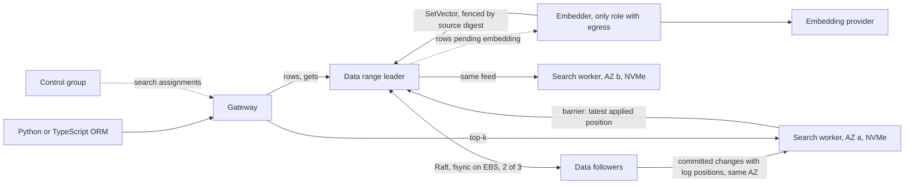

Add vector, full-text, sparse and multi-vector search to OLTP tables as new column types, served by separate search workers that tail the committed Data logs, so RAG applications get fresh, filtered top-k search without slowing point reads and writes.

Status: proposed 2026-11-25 against `37a87d19`. Nothing here is implemented or measured. The protocols are modelled in `specs/vector/`, see "Design review". Every figure marked *target* or *estimate* is a hypothesis for a gate to test.

## Decisions

| # | Topic | Decision | Decided by |
| --- | --- | --- | --- |
| 1 | Position | A column type in OLTP, not a fourth exclusive engine. Search runs on its own workers. | User (2026-11-25). Reasons in "Column or engine". |
| 2 | Build | Part of the `oltp` feature, embedding included. No new Cargo feature. | User (2026-11-25) |
| 3 | SDK | Extend `Database`, `Table` and `Query`. One `Vector` type. The operation (`cosine`, `dot`, `l2`) is part of the query. | User (2026-11-25) |
| 4 | v1 search | Dense with filters, BM25 and hybrid, sparse, multi-vector, built-in embedding | User |
| 5 | Storage | Replicated SSD, no cold tier. S3 only for backups. | User |
| 6 | Hardware | Log and rows on EBS. Search data on local NVMe, which can be rebuilt. | User |
| 7 | Slow embedding provider | Store now, embed in the background | User said "whatever scylladb would do". ScyllaDB feeds its index asynchronously after the write, so this is the closest match. |
| 8 | Workload | RAG only, in OLTP only, now and later | User (2026-11-25) |
| 9 | Simulator | Not used in this version | User |
| 10 | Verification | Planned here. Specs are written and run after the design is approved. | User |
| 11 | Search visibility | `latest` per range by default, the cheapest mode that shows every acknowledged write. `snapshot` for callers who need one cut. | User delegated the choice to performance and cost (2026-11-25) |
| 12 | Batches | As ScyllaDB: each row is atomic, isolated and durable, and a multi-row write is not one transaction. `upsert_many` and `delete_many` match its `UNLOGGED` batches, which skip the batch log for speed. [ScyllaDB's default](https://docs.scylladb.com/manual/stable/cql/dml/batch.html) is a logged batch, which eventually applies whole but is isolated only inside one partition. The shipped `insert_many` contract does not change. | User: "do whatever scylladb would have done" (2026-11-25). Unlogged follows decision 11's preference for speed. |

### Column or engine

| | Column in OLTP plus search workers (chosen) | Separate engine |
| --- | --- | --- |
| Durability, Raft, splits, membership, backup | Reused, already at L3 | Rebuilt and verified again |
| Row and vector agree | By construction: one log entry | Two systems, and the application reconciles them |
| Search slows logins | No. Search CPU, RAM and disk are on other machines. A RAG cluster can also be deployed apart from the login cluster with the same binary. | No |
| Write throughput | Bounded by OLTP. The last benchmark acknowledged 289 updates/s on three 1-CPU workers, with 4.8 ms of leader CPU per update at 100/s. Needs the bulk path in section 2. | Could skip some OLTP costs |
| Billions of rows | Bounded by Raft group count. See "Scaling". | Could use larger shards |
| Reconsider if | V0 or V2 misses its ingest gate, or a customer needs object-storage cost at more than about 10 B vectors | |

ScyllaDB made the same choice: vectors are columns, and separate Vector Store nodes hold the index ([design](https://www.scylladb.com/2025/10/08/building-a-low-latency-vector-search-engine/)). This plan changes three things: the feed carries log positions, so reads can be strongly consistent; the index is partitioned and can exceed one node's RAM; and filters are part of the index.

## Market findings that shaped the design

Haiku agents read the linked pages. The lead did not re-read them.

| System | How it is built | Taken or avoided |
| --- | --- | --- |
| [ScyllaDB](https://scylladb.com/2025/12/01/scylladb-vector-search-1b-benchmark/) | CDC-fed HNSW in RAM, one Vector Store node per replica in the same AZ. 1 B × 96-d: 252,799 QPS at p99 9.9 ms with about 70% recall, 10,206 QPS at p99 12.3 ms with about 98%. | Take node separation and AZ pairing. Avoid the whole index in one node's RAM and the unstated freshness. |
| [CockroachDB C-SPANN](https://www.cockroachlabs.com/blog/cspann-real-time-indexing-billions-vectors/) | K-means tree stored as KV rows, with fanout of about 100, RaBitQ and a [partition state machine](https://raw.githubusercontent.com/cockroachdb/cockroach/master/pkg/sql/vecindex/cspann/partition_metadata.go). Its preview had no full merges or reassignment. | Take the tree and explicit partition states. Avoid index writes inside user transactions. |
| [turbopuffer](https://turbopuffer.com/blog/ann-v3) | WAL on object storage, SPFresh-style tree, 1-bit RaBitQ, under 1% of vectors reranked, [filters inside clusters](https://turbopuffer.com/blog/native-filtering) | Take the index, rerank and filter shape. Avoid the object-store write (PUT p50 100 ms). |
| [Qdrant](https://qdrant.tech/documentation/scaling/consistency-guarantees/) | Segments with filterable HNSW. Raft covers topology only. A failed write "may be partially applied", and replicas can diverge. | Avoid: data goes through Raft here. Its [two-filter case](https://qdrant.tech/articles/filtered-vector-search-acorn/) at 70.8% recall becomes a test. |
| [Weaviate HFresh](https://weaviate.io/blog/hfresh) | Disk SPFresh. 239 MB heap against 6.67 GB for HNSW on 1 M vectors, with slower queries. | Confirms the memory shape |
| [Milvus](https://milvus.io/docs/consistency.md) | Four consistency levels, with bounded staleness by default | Take per-query consistency, reduced to two modes |
| [Cosmos DB](https://learn.microsoft.com/en-us/azure/cosmos-db/vector-search) | Each replica builds its own index, so results can differ by replica | Take. State it as the contract. |
| [Pinecone](https://www.pinecone.io/how-pinecone-works/md/) | Slabs, and never post-filters | Take "never post-filter" |

| Building block | Evidence |
| --- | --- |
| [SPFresh](https://arxiv.org/html/2410.14452) | Local split and reassign. Stable p99.9 of about 4 ms, under 20 GB RAM, 2K updates/s on one NVMe disk. Its update tests report recall above 0.862 and 0.807, below our target. |
| [Extended RaBitQ](https://arxiv.org/html/2409.09913) | Without reranking, 5 bits per dimension give over 95% recall and 7 bits over 99%. Library is Apache-2.0. |
| [Quake](https://arxiv.org/abs/2506.03437) | Per-query recall estimation picks how many partitions to read |
| [MUVERA](https://arxiv.org/html/2405.19504) | Multi-vector search through one fixed vector (10,240-d). Recall within 0.4% of PLAID on MS MARCO. |
| [Seismic](https://arxiv.org/html/2404.18812) | Sparse search in 187 to 531 µs at 90 to 97% accuracy, one thread, MS MARCO |
| [EBS gp3](https://docs.aws.amazon.com/ebs/latest/userguide/general-purpose.html) | 3,000 IOPS and 125 MiB/s included, up to 80,000 and 2,000. Single-digit ms. |
| [Instance store](https://docs.aws.amazon.com/AWSEC2/latest/UserGuide/instance-store-lifetime.html) | Survives a reboot, lost on stop, hibernate, terminate or disk failure |

Not verified: patents on ScaNN/SOAR, RaBitQ and TurboQuant, crate licences other than Tantivy's and DiskANN's, the RRF constant in its original paper, and any independent benchmark. V0 checks patents and licences before code depends on them.

---

## Architecture



- **Truth** is the Data range's Raft group on EBS. Search workers do not vote, propose or acknowledge. Losing all of them loses no data and blocks no write.
- **Unit of replication** is the Data range. **Unit of search** is a worker-wide index per table column, so moving a range does not fragment the index and a query reads one index per worker.
- **Shared-nothing inside a search worker.** Pinned thread per core, each owning a set of partitions, message passing between cores, direct I/O through io_uring with a `pread` pool where io_uring is blocked.

| Role | Command |
| --- | --- |
| Data worker, gateway | unchanged |
| Search worker | `nabedra-db search worker --config search.toml` |
| Embedder | `nabedra-db search embedder --config embed.toml` |
| All in one, for development | `nabedra-db serve` |

```toml
oltp = [..., "dep:nabedra-vector", "dep:nabedra-simd"]   # added to the existing list
```

```sh
cargo install nabedra-database --locked --no-default-features --features oltp
```

New crates: `server/vector` (feed client, index, query) and `server/simd` (distance kernels; the only new `unsafe`, checked against scalar references). `scripts/check_engine_features.py` requires both in `oltp` and `oltp-backup-s3`, and refuses both in `olap` and `cache`. The embedding client uses the `hyper` and `hyper-rustls` dependencies the server already has, and only the embedder role constructs it. No build feature removes the egress code, so isolation rests on the process role, its certificate, and the network policy that denies egress to every other role.

An OLTP cluster without search columns pays nothing: no search threads, memory charge, log entries or feed sessions, and no configuration is required. V1 and V10 gate this with paired A/B runs.

---

## 1. SDK

The column type says what the data is. Table options say what the database maintains. The query says which operation ranks the rows. `Vector` is the only new type, and it carries no metric.

```python
from nabedra import Database, Vector, col

db = Database(url, token, mode="oltp")
chunks = db.create_table("chunks", {
    "id": str,
    "tenant": str,
    "acl": list[str],
    "year": int,
    "body": str,
    "embedding": Vector(1024),
    "sparse": Vector(sparse=True),      # optional: learned sparse weights
    "tokens": list[Vector(128)],        # optional: several vectors per row
}, key="id",
   partition_by="tenant",               # optional
   full_text={"body": "english"},       # optional: allows col("body").match()
   embed={"embedding": {"source": "body", "model": "docs-v1"}})   # optional

chunks.upsert_many(rows)                # any size; each row atomic and durable, safe to retry
chunks.delete_many(["doc7#3", "doc7#4"])

mine = chunks.where((col("tenant") == "acme") & col("acl").contains_any(groups) & (col("year") >= 2024))

hits = mine.rank(col("embedding").cosine(q)).select("id", "body").limit(10).collect()
# [{"id": "doc7#0", "body": "...", "_score": 0.88}]

mine.rank(col("embedding").dot(q)).limit(10).collect()
mine.rank(col("embedding").l2(q)).limit(10).collect()
mine.rank(col("embedding").cosine("reset my password")).limit(10).collect()   # a string is embedded with the column's model
mine.rank(col("body").match("reset password")).limit(10).collect()            # BM25

# Hybrid: several operations, fused. Rerank: a second stage over the best candidates.
(mine.rank(col("embedding").cosine(q), col("body").match("reset password"), col("sparse").dot(weights))
     .rerank(col("tokens").cosine(query_tokens))
     .limit(10).collect())

mine.rank_many([col("embedding").cosine(q) for q in queries], limit=10)       # list of result lists
chunks.add_column("embedding_v2", Vector(3072), embed={"source": "body", "model": "docs-v2"})   # online
chunks.search_status()   # per column: building, ready, lag_ms, pending_embeddings, failed_embeddings, recall
```

```typescript
import { Database, vector, list, col } from "nabedra"

const chunks = await db.createTable("chunks", {
  id: String, tenant: String, acl: list(String), year: BigInt, body: String,
  embedding: vector(1024), tokens: list(vector(128)),
}, { key: "id", partitionBy: "tenant", fullText: { body: "english" },
     embed: { embedding: { source: "body", model: "docs-v1" } } })

await chunks.upsertMany(rows)
const hits = await chunks.where(col("tenant").eq("acme").and(col("acl").containsAny(groups)))
  .rank(col("embedding").cosine(q), { recall: 0.95 })
  .select("id", "body").limit(10).collect()
```

```python
class Expr:                                                   # on a bare col() only
    def cosine(self, query: VectorValue | str) -> Ranking: ...
    def dot(self, query: VectorValue | str) -> Ranking: ...
    def l2(self, query: VectorValue | str) -> Ranking: ...
    def match(self, text: str) -> Ranking: ...
    def contains(self, value: str) -> Expr: ...               # list[str] columns
    def contains_any(self, values: Iterable[str]) -> Expr: ...
    def starts_with(self, prefix: str) -> Expr: ...
class Query:
    def rank(self, *rankings: Ranking, fusion: Literal["rrf"] | Sequence[float] = "rrf", candidates: int = 100,
             recall: float = 0.95, exact: bool = False,
             consistency: Literal["latest", "snapshot"] = "latest") -> Query: ...
    def rerank(self, ranking: Ranking, *, candidates: int = 200) -> Query: ...
    def rank_many(self, rankings: Sequence[Ranking], *, limit: int, **options) -> list[list[Row]]: ...
class Table:
    def upsert_many(self, rows: Iterable[Row], *, wait_for_embedding: bool = False) -> int: ...
    def delete_many(self, keys: Iterable[Key]) -> int: ...
    def add_column(self, name: str, type: Vector | list[Vector], *, embed: Mapping | None = None) -> None: ...
    def drop_column(self, name: str) -> None: ...
    def add_full_text(self, column: str, language: str) -> None: ...
    def drop_full_text(self, column: str) -> None: ...
    def search_status(self) -> dict[str, SearchStatus]: ...
```

| Column | Value | Operations |
| --- | --- | --- |
| `Vector(n)` | n float32 values | `cosine`, `dot`, `l2` |
| `Vector(sparse=True)` | `{index: weight}` | `cosine`, `dot` |
| `list[Vector(n)]` | Several vectors | `cosine`, `dot`, each as MaxSim: for every query vector, its best row vector, summed |
| `str` in `full_text` | Text | `match` |

| Rule | Behavior |
| --- | --- |
| Operation | Chosen per query, with no default. Any listed operation works on existing data without a rebuild. An operation the column does not support is a `ValidationError` before any request. |
| `_score` | The value of the operation: cosine similarity, dot product, L2 distance or BM25, and the fused score with several rankings. Best first, then key. `l2` sorts ascending and the others descending. `order_by` cannot be combined with `rank`. `_score` is a reserved name on tables with search columns. |
| Several rankings | `"rrf"` fuses by rank. A list of weights, one per ranking, weights each ranking's reciprocal-rank share. |
| Vector input | Python: `list[float]`, `array("f")` or any float32 buffer, so NumPy needs no dependency. TypeScript: `Float32Array` or `number[]`. Wire: `{"f32": "<base64 little-endian>"}`. |
| Vector output | `array("f")` and `Float32Array`. Ranked queries omit vector columns unless selected. `get` returns the complete row. |
| Nulls | Vector columns accept `None`. Those rows never rank on that column. Other columns keep today's non-null rule. Rows omit embedded columns, and writing one explicitly is a `ValidationError`. |
| Zero vectors | Stored. `dot` and `l2` rank them. `cosine` is undefined for them, so it skips a zero row and rejects a zero query. |
| Tenants | `partition_by` gives each tenant its own tree. Prefix keys with the tenant and filter with `col("id").starts_with("acme/")` to also limit the query to that tenant's ranges. |
| `recall` | A target the engine pursues per query, not a guarantee. `exact=True` is exact. For `dot` on a `list[Vector]` column it is pursued only when the vectors have unit length. |
| `upsert_many`, `delete_many` | New. Stream any iterable in bounded chunks, grouped by range and sent to each leader in parallel. Each row is atomic, durable and applied once per request ID. The call is not atomic across rows, also when they share a range. On failure it stops sending and raises `BatchError` with the applied count and, for every row in flight, `applied`, `not_applied` or `outcome_unknown`. `insert_many` stays all or nothing. |
| Limits | 1 to 4,096 dimensions, 8 search columns, `limit` ≤ 1,000, 256 rankings per `rank_many`, 1,024 vectors per `list[Vector]` value, 1 MiB per row. Existing 10,000-row and 8 MiB request limits stay. |
| Errors | Existing classes, plus `SearchUnavailableError` (503, retryable) and `BatchError`. |

| Guarantee | What it means here |
| --- | --- |
| Atomic | Per row. A row, its vectors and its pending-embedding record are one Raft entry. `insert_many` is also atomic across rows, as today. |
| Consistent | Types, dimensions, finite values, unique keys and schema epochs are checked before anything is written. |
| Isolated | Row writes, `insert_many`, `get` and unranked queries keep OLTP's strict serializability. A ranked query follows its `consistency` mode (section 4). |
| Durable | Acknowledged after 2 of 3 replicas in different zones synced to EBS. The search index is derived and can always be rebuilt. |

Both SDKs ship in one PR under the [parity rule](../docs/testing/orm-parity.md).

---

## 2. Writes and row format

Scalars and `list[str]` stay in the row JSON. Vector values become binary records in the same Data entry and the same store batch as the row:

```text
'x' ‖ primary key ‖ column_id ‖ commit_ts  →  vector bytes as written, never normalized, CRC32C
row version gains  blobs: { column_id: commit_ts of the vector version it references }
```

A metadata update references the existing vector version and does not rewrite it. MVCC GC, splits, snapshots, backups and restore treat `'x'`, the pending embedding record `'E'` and the failure record as belonging to their row:

- A vector version is collectable only when no retained row version references it. A metadata update commits against the row version it read.
- A replica snapshot is one engine snapshot and exact. A copy at a cut (split child, backup, restore) pins the collection safe point at its cut and takes exactly the newest version at or below the cut, never one that was already collectable, with its vector. A split copies `'E'` and failure records exactly, as the range is frozen and takes no entry. A backup carries neither, and a restore derives a fresh `'E'`, with an identity of its own, for every row that has a source text and no vector. A copy activates after its rows, vectors and records are all staged. (DB-10, DB-15, DB-22)
- In a cross-range transaction, Prepare stages `'x'` and `'E'` under the transaction, and Resolve writes them under the commit timestamp.
- A damaged `'x'` value is neither null nor skipped. The voter refuses the feed of that range and follows the damage rules of the [storage engine plan](native-storage-engine.md).
- A backup that holds vector records needs a build with `data.vector.v1`. A restored range has a new group identity, so no search checkpoint of the old one is accepted.

`upsert_many` groups rows by range at the gateway and sends each group to its leader, which packs up to 1 MiB of members into `DirectBatch` entries and fsyncs once per entry. Eligibility, dedup records, latches, epochs and outcomes follow the [direct path](oltp-direct-path.md) per row. A row's request ID is derived from the call's ID and the key, so resending in other chunks after a split reuses it. A key that appears twice in one call is a `ValidationError`.

Large values in the LSM are rewritten by leveled compaction. If V2 measures more than 4× EBS write amplification, `nabedra-kv` gains separate blob runs for `'x'` values, as its own reviewed plan.

---

## 3. Search feed

Any Data voter serves its applied changes to an authorized search worker. Apply writes, in the same batch as the entry, a change record per log index: the keys it changed and how, after rejections, replays and resolves. The feed is a pure function of those records, never of the current rows, and they are truncated with the log. (DB-5) Search workers never interpret transaction commands.

```rust
Method::SearchTail { group: GroupIdentity, routing_epoch: u64, assignment_epoch: u64, after: LogId, max_bytes: u32 }
enum TailReply {
    Changes { records: Vec<Change>, through: LogId },
    SnapshotRequired { purged_through: LogId },
    StaleRoute { .. }, NotHosted,
}
struct Change { at: LogId, commit_ts: CommitTs, key: MvccKey, row: Option<RowImage> }   // None = deleted
// a Closed entry arrives as a change like any other, in log order
```

- A voter sends only changes at or below its **applied** index, so a search worker never sees an entry Raft can truncate.
- Pages are contiguous after `after`. A gap, a smaller `LogId` or another group generation is rejected. Pages may repeat and are idempotent by `(key, commit_ts)`.
- The worker reads from the voter in its own AZ and switches to another when that one lags.
- The feed holds no log. If `after` was purged, the worker installs a range snapshot at an applied cut and tails from it. A slow search worker cannot grow a voter's disk.
- A change whose row or `'x'` value GC removed is answered with `SnapshotRequired`, never omitted.
- A worker accepts a page only when it continues or overlaps its own position. A resync builds a new generation beside the old one and replaces it at once, so keys missing from the snapshot vanish and late work of the old generation is ignored.
- "Applied" on a worker means that every core and every index of the column holds the entry.

**Closing a timestamp.** The leader proposes a Data log entry `Closed { ts }` with a timestamp that the Timestamp group already handed out, at least 1 s ago. (DB-1, DB-2, DB-3)

- Apply records `ts` as the range's closed floor. It refuses any later direct commit or `SetVector` at or below the floor, and the leader retries those with a new timestamp.
- Apply refuses `Closed` while any intent is open in the range, and on a frozen split source.
- A commit timestamp of a cross-range transaction is taken after every participant prepared, so it is above every floor that closed before.
- A range closes about once per second, and only while it served a `snapshot` query in the last 60 s. Otherwise it writes nothing.

No message outside the log and no leader memory can close a timestamp. So a deposed leader, a commit of unknown outcome and a split source cannot invalidate a served cut.

---

## 4. Query protocol

| Mode | Visible rows | Coordination per query |
| --- | --- | --- |
| `latest` (default) | Every write acknowledged before the query began. Linearizable per range. An acknowledged `insert_many` is always whole. One still committing while the query runs may show in part if it spans ranges. | One coalesced barrier per (search worker, data worker) pair |
| `snapshot` | One transactionally consistent cut across ranges, at the newest `Closed` timestamp all ranges reached. Its target age is at most 2 s, measured from the wall time in the `Closed` entry. The age is a target, the cut is exact. Workers report their closed floor, the gateway picks the lowest of the ranges it needs, and a worker refuses a cut it no longer retains. | None per query. One small log entry per range and second while in use. |

`latest` takes no timestamp. A barrier that raised `max_read_ts` at query rate would keep invalidating commit timestamps between allocation and registration and starve writers.

```rust
Method::SearchBarrier { id: u64, ranges: Vec<(GroupIdentity, u64 /* routing_epoch */)>, table: Uuid, columns: Vec<ColumnId> } -> Vec<BarrierReply>
enum BarrierReply { At(LogId), NotLeader { hint }, StaleRoute, Unavailable }
```

1. The gateway reads its cached `SearchRoute`, prunes ranges by key bounds in the filter, and picks one search worker per search shard, preferring its own AZ and the shortest queue.
2. Each worker starts the barrier. It may warm caches meanwhile, but nothing it read before step 4 counts. Concurrent queries share a barrier RPC. A query joins only a barrier that has **not been sent yet**, because one in flight may have been answered before the query began. A reply counts only for the RPC identity it answers, which includes the worker's process start, so a late reply to an earlier try is dropped.
3. The leader confirms its lease (ReadIndex fallback) and that it applied the first entry of its term. It captures the committed index at that moment, because a follower may have applied it, and fed a worker, before the leader applied it. It checks that the Data group's schema epoch still serves these column incarnations (DB-9), waits until it applied the captured index, resolves every committed-but-unapplied intent, and only then reads and returns its applied `LogId`. (DB-16) The existing `lease_read_position` has this wait. When Status is unavailable it answers `Unavailable`. On a frozen split source it first confirms through a Catalog barrier that the split is unpublished. Otherwise it answers `StaleRoute`.
4. The worker waits until each range applied that position. Then, in one step, it pins its read point (applied position per range) and the list of partitions, and only then ranks, probes and scans. Every core and every ranking of the query evaluates that one pin. A version stays visible to a pin that began before it was superseded. (DB-4) It returns its candidates with `(span, group, routing_epoch, LogId)` for every range it searched.
5. The gateway accepts the result only if those spans tile the requested key span exactly, with no gap or overlap. It dedups by key, merges each ranker's list globally, fuses, and applies `limit`.

A replica that lags past 20% of the deadline, or a slow worker at the observed p95, causes one hedged request to the other search replica. A missing range after one refresh is `503 search_unavailable`. **A partial result is never returned as success**, and search never falls back to scanning data workers.

The worker holds the complete row image, so selected columns come from the same pin, never from a later read. For a `snapshot` query, a worker keeps superseded versions for 10 s, and refuses a cut below its bound: the timestamp of the newest version that superseded anything it dropped, or the largest commit timestamp, deletes included, in the range snapshot it installed. (DB-8)

Determinism: two replicas may return different approximate candidates. Both obey the same visibility rule. Rows never appear after their delete is visible.

---

## 5. Index on a search worker

Raft positions are per range and the index is per worker. Each worker builds its own index from the feed.

| Structure | Content | Where |
| --- | --- | --- |
| Row map | slot → key, range, versions with applied-at and superseded-at, columns. A slot is reused only when no entry, no copy in flight and no checkpoint names it. | RAM plus NVMe |
| Centroid tree | Balanced k-means over directions (each vector divided by its length), fanout about 100, one tree per `partition_by` value. Under 20,000 rows there is no tree and the scan is exact. | RAM |
| Partition | 128 to 512 rows in bands of similar length: exact length, 1-bit codes and 4-bit extension of the direction, filter column blocks, `(slot, version)` | 1-bit in RAM. Extension in RAM while the budget lasts, otherwise NVMe. |
| Raw vectors | f32, page-aligned | NVMe, `O_DIRECT` |
| Filter summaries | Per value: partitions and, inside each, a row bitmap. Numeric min and max. | RAM |
| Impact lists | Block-max inverted lists for BM25 (tf, length) and sparse weights, with and without division by vector length | RAM dictionary, NVMe postings |

**Insert.** Assign through the tree, encode relative to the centroid, append a new entry to the owner core's partition, then update the row map. A metadata update also appends: filter columns in an entry never change in place. The row is visible once its position counts as applied, so no separate fresh tier exists. A superseded entry stays until every pin, checkpoint and retained cut is past its successor.

**One index, every operation.** The codes estimate only the cosine between directions. With both exact lengths, `dot = len(o)·len(q)·cos` and `l2² = len(o)² + len(q)² − 2·dot`, so each operation and its error bound come from the same codes. Partitions and length bands are read in order of their best possible value under the requested operation. For unit-length vectors there is one band, and all three operations rank identically. For vectors of very different lengths, `dot` and `l2` may read more bands. V0 measures that cost. If it exceeds 2× a metric-specific index, the user decides on an optional second tree. Zero vectors live in one always-scanned list.

**Exact.** `exact=True` scores every visible entry from raw vectors. It never prunes by codes, whose error bounds are probabilistic. With several rankings, each ranking's candidate list is exact. Ties break by key.

**Dense scan.** 1-bit estimate with its error bound → survivors to the 4-bit extension → survivors to raw f32. The stop rule estimates recall from the partitions read so far and stops at `recall`.

**Partition lifecycle** (LIRE, in the background, per core):

```text
Ready → Splitting → Draining → Retired          Ready → Merging → Retired
```

A move appends to the target before it removes from the source, and removal waits until every scan and checkpoint that began before the append finished. A removal names one entry instance, never a row, so a row that moves back is safe. (DB-7) A split or merge copies every entry that a pin, a checkpoint or a retained cut can still need, and every entry beyond the applied position, because cores append ahead of it. (DB-17, DB-21) A copy that lands in a partition that drains meanwhile is sent on, and a partition that another one drains into does not start to drain, so drains end. (DB-23, DB-25) A resync or a drop of a range fails every scan that pinned it. (DB-24) A retired partition keeps its entries for the scans and checkpoints that listed it. Copies between cores name the generation of the index, and a resync makes older ones void. An entry's version is the full apply position, never shortened. Scans dedup by slot. A moved row is therefore never missed and never returned twice. Reassignment is capped per second, and re-encoding is charged to maintenance.

**Filters.** Estimate matches from the summaries. At most 20,000 matches: score all of them. Otherwise read nearest partitions that contain a match, counting only matching rows in the stop rule. Never post-filter. If at least `limit` rows match, `limit` rows return.

**BM25 and sparse** share one format and MaxScore traversal. The gateway sends table-wide document counts (refreshed every 5 s) so all workers score alike. **Multi-vector** indexes a MUVERA encoding of the normalized vectors (10,240-d, 1,280 bytes at 1 bit) as a dense vector, and reranks with the requested MaxSim over 4-bit tokens and then raw ones.

**Restart.** A checkpoint pins a read point and the partition list like a scan, and holds removals back like one. (DB-6) It writes immutable checksummed files, syncs them, and then publishes a manifest with the pinned `LogId` and the oldest servable cut per range by rename. A valid checkpoint resumes the tail. Wiped or damaged NVMe copies the checkpoint from the other search replica, or installs range snapshots. A worker serves a range only after its replay reaches a fresh barrier.

**Kernels.** Scalar, AVX2, AVX-512 with VPOPCNTDQ and NEON, chosen at run time. AVX-512 is stable since Rust 1.89, and the repository pins 1.94.1. The docs list NEON `vdotq_s32` with 1.98, so 1.94.1 uses widening multiplies.

---

## 6. Embedding

The table option `embed` names a source column and an operator-defined model: endpoint, model, dimensions, credential reference, limits. v1 speaks the OpenAI-compatible `/v1/embeddings`, which [vLLM](https://docs.vllm.ai/en/stable/serving/openai_compatible_server/) and [TEI](https://huggingface.co/docs/text-embeddings-inference/en/quick_tour) also expose, so self-hosted models work.

A model name is bound to one endpoint, model and dimension for life. Another model is another name and another column (`add_column`). A row version stores the source version of each embedded column. Backfill of a new column commits a row version with a source version and a pending record for each existing row that has no vector, pending record or failure of this incarnation, conditionally and under the new schema epoch. So tables without search columns keep their bytes. Every entry below also names the column incarnation.

1. A write that changes the source text, or inserts the row, gets a source version: its commit timestamp. The same entry clears the old vector and any failure record and writes `'E' ‖ key ‖ column → { source_version, id, attempts, limit }`, where `id` is the commit timestamp that created the record. A write that keeps the text keeps the vector and the pending record. (DB-11) The write is durable and acknowledged. The row is found by key, filters and BM25, and by its vector once it has one.
2. Embedders lease batches from the range leader. Leases live in leader RAM and only save money: a lost lease causes a second provider call, never a wrong vector.
3. `SetVector { key, column, source_version, vector }` is an ordinary conditional direct commit: latch, timestamp, expected row version, all epoch, intent, freeze, pause and floor checks, and a new row version. It applies only if the row exists, the source version and the column incarnation match, the column is an embedded one and the dimensions fit. It clears `'E'`. An update that read the row before it conflicts and retries, so it cannot drop the vector. If `SetVector` conflicts, the leader reads the row again and retries. One that already took effect is a no-op. (DB-12)
4. `EmbedFailed { key, column, source_version, id, attempt }` counts that attempt in `'E'`, durably, once, and only if all of them match. After 10 attempts the record becomes a failure record with a reason, shown in `search_status()`. `nabedra-db search retry-embeddings` requeues it: the attempt number goes on and the limit grows by 10, so a late report of an old attempt matches nothing. (DB-13, DB-18) The circuit breaker per model counts no attempt while it is open.

A query string is embedded before the search, with an LRU by `(model, digest)`. A provider outage fails those queries explicitly. `wait_for_embedding=True` waits after commit, and a timeout reports the write as applied with the embedding pending.

---

## 7. Placement, scaling and operations

Control stores `SearchAssignment { table_id, epoch, shards: [{ spans, workers }] }`. Adjacent ranges share a search shard, so fan-out is `ceil(table bytes / worker budget)` rather than one per range. Default two search replicas in different AZs.

Create or move: assign → snapshot and tail → index → caught up to a fresh barrier → publish `epoch + 1` → the old replica keeps its data 30 s more, passing the same barrier and incarnation checks, then drops. A worker serves a range only while it holds all of it. A drop names the assignment epoch it ends, so a late one cannot hit a later assignment of the same range to the same worker. A worker ignores an assignment at or below the largest epoch it dropped. A new column builds the same way and becomes visible only when every range has a ready replica that reported this incarnation. Then every Data group gets a larger schema epoch, and then the Catalog publishes. A Data group takes only a larger schema epoch, so a late or repeated fence of an old Control leader changes nothing. (DB-20) A fence and a split exclude each other through the existing lifecycle guard. A drop fences every Data group first, and a name added again is a new incarnation that never serves old data. Interrupted builds resume or stay invisible. Splits inherit the parent's assignment. A worker re-tags the parent's slots to the children only when it holds every parent entry up to the freeze. Otherwise it installs child snapshots. Either way the children take over the bound of section 4. (DB-14, DB-19)

Search workers and embedders hold no vote, no queue copy and no lead. They are never in the ready set and do not count as workers for `data.vector.v1`. A process that is not enrolled hosts no voter. Their RPCs carry their own protocol version, `nabedra-search/1`.

| Need | Action |
| --- | --- |
| More search QPS | Add search replicas |
| More vectors | Add search workers, so shards split |
| More writes | Split ranges, add data workers |
| Isolation from logins | Place vector tables on a labelled data-worker pool, or run a second cluster |

| Estimate, 768-d f32 | Per 100 M rows |
| --- | --- |
| Data tier, without text bodies | 340 GB logical, 1 TB at RF3 before space amplification |
| Search RAM, 1-bit and 4-bit hot | about 55 GB: 48 GB codes, 2.8 GB factors and IDs, 0.8 GB centroids, 3 GB row map |
| Search NVMe per replica | 307 GB raw, 48 GB codes |
| `i8g.4xlarge` ([16 vCPU, 128 GiB, 3.75 TB NVMe](https://docs.aws.amazon.com/ec2/latest/instancetypes/so.html)) | about 180 M rows fully hot, about 600 M with extensions on NVMe and more I/O per query |

Group count bounds table size: 1 B such rows are about 3.4 TB, or about 3,200 ranges at 1 GiB, 9,500 replicas, 35 data workers at today's 272 resident groups. At 4 GiB it is 9 workers. Today a split freezes writes while it copies the range, so vector tables start at 1 GiB, and V11 makes splits copy online before raising it. Bulk loads into an empty table use `nabedra-db table presplit`.

Priority classes on a search worker: apply (reserved 20% of CPU), interactive, maintenance, batch and exact. Overload returns `429` before work starts. Search lag never blocks, slows or rejects a write. A replica that cannot keep up resyncs, and `search_status().lag_ms` lets a bulk loader pace itself.

**Security.** mTLS with a `search` certificate purpose that allows tail, snapshot and barrier and cannot propose. The `embed` purpose can only lease pending rows and propose `SetVector`. Text leaves the cluster only for models an operator enabled for that database. Only the embedder has egress: allowlisted hosts, no redirects, private addresses refused unless listed, response size and dimensions checked, credentials by reference and never in a schema, log or Raft entry. Inputs reject NaN, infinity and wrong dimensions. NVMe uses dm-crypt with a key created at boot, since the data is rebuildable. Every query has CPU, I/O and memory budgets.

**Compatibility.** Cluster feature `data.vector.v1` in the existing registry. Control enables it when every worker advertises it, it never reverts, and an older `oltp` build that does not know it cannot join afterwards. Vector tables need it. Other tables keep today's bytes on disk and on the wire.

---

## Failure behavior

| Event | Result |
| --- | --- |
| Search worker dies | The other replica serves. Data writes are unaffected. |
| All search replicas of a range down | `503 search_unavailable` for queries that need it. Gets and writes continue. |
| Every machine stopped | Rows recover from EBS. NVMe is wiped and the index rebuilds. Search returns 503 until ready. |
| Data leader moves | Barrier retries on the new leader, which answers after its first entry of the term applies |
| Data quorum lost | `latest` fails. `snapshot` serves until 2 s old, then fails. |
| Log purged under a slow replica | The range resyncs from a snapshot and is not served meanwhile |
| Corrupt checkpoint or posting | Detected by checksum. That range leaves service and resyncs. |
| Provider down | Writes succeed, embeddings wait |
| Split, move or drop during a query | The barrier or the coverage check fails, one refresh, then an explicit error |
| Source text changes | The old vector is gone at once. The row ranks again when its new vector arrives. |

---

## Scenarios

| ID | Scenario |
| --- | --- |
| VS01 | Write, get the acknowledgment, query through any gateway and search worker. Repeat across a leader change, an isolated old leader, and a barrier shared by two queries. |
| VS02 | Lose, repeat, delay and reorder feed pages and barrier replies. Feed from a lagging voter. Purge the log behind a slow worker. |
| VS03 | `insert_many` across two ranges races queries, with a participant slow to resolve and a coordinator that dies. |
| VS04 | `snapshot` queries race direct commits and cross-range batches, across a leader change at each step of closing a timestamp. |
| VS05 | Update and delete rows while queries run. Crash and resync a worker between pages. |
| VS06 | Query with a stale route during a split, a move, a drop, and with every search replica of one range down. |
| VS07 | Exact queries under every operation while partitions split, merge and reassign, with unequal and zero-length vectors. |
| VS08 | Split a range under writes, with `latest` and `snapshot` queries at every step of the split. |
| VS09 | A worker that installed a range snapshot receives a `snapshot` query older than its data. |
| VS10 | Crash a search worker at each step of a checkpoint. Restart with the disk, without it, and with a damaged file. |
| VS11 | Crash, pause and isolate every search worker and embedder under OLTP load. Call forbidden methods with each certificate purpose. |
| VS12 | The provider answers late, twice, never, and with an error, while the text changes, changes back and is deleted. |
| VS13 | Exhaust the retries of a row, then change its text. Requeue failed rows. Change the leader with leases outstanding. |
| VS14 | Build, interrupt, resume, drop and re-add a column under writes, with Control failover and worker disk loss. |
| VS15 | Kill the gateway and the leader during `upsert_many` and `delete_many`, then resend. |
| VS16 | Update metadata without the vector, collect garbage, split, snapshot, back up and restore. Compare every vector byte. |
| VS17 | Inputs and loads at and beyond every limit, hostile provider replies, and a provider host that resolves to a private address. |
| VS18 | One program and its error cases through both SDKs. |
| VS19 | The performance gates. |
| VS20 | Rolling upgrade from a build without vector support, activation, and a replacement worker with the old build. |

---

## Design review

Module `vector`, level L3, because `latest` joins OLTP's real-time order and `SetVector` writes rows. Register: [vector](../docs/testing/guarantees/vector.md). Process: [design-review skill](../.agents/skills/design-review/SKILL.md).

**Deviation approved by the user.** No simulator in this version, so S cells and trace validation stay `missing` and the module cannot pass the stable release gate until they exist. Kinds used: T, M, U, H over real processes, F, D against brute force, R, P, K.

### Guarantees

| ID | Guarantee | Failure model |
| --- | --- | --- |
| VEC-G01 | A `latest` query sees every write acknowledged before it began, so every acknowledged `insert_many` whole | Leader change, lagging feed, shared barrier, split, retry |
| VEC-G02 | A `snapshot` query sees exactly the commits at or below one timestamp | Leader change, in-flight commits, multi-range batch |
| VEC-G03 | A result contains no row that is deleted, superseded or uncommitted at its read point | Reordered or repeated pages, crash, replica resync, stale partition entries |
| VEC-G04 | A successful result covers every requested range once | Stale routes, split, move, missing replica |
| VEC-G05 | With `exact`, the result of every operation equals brute force over the visible rows | Partition split, merge, reassignment and checkpoint recovery during a scan |
| VEC-G06 | Search workers never change write safety and never block commits | Search crash, lag, partition, compromise of a search certificate |
| VEC-G07 | A stored embedding belongs to the row's current source text and model | Late, duplicate or failed provider replies, concurrent update, ABA, leader change |
| VEC-G08 | Building, failed or dropped columns and assignments are never served | Control failover, interrupted build, worker loss |
| VEC-G09 | Each `upsert_many` and `delete_many` row applies once, and failures report exact outcomes | Lost replies, leader change, split |
| VEC-G10 | Vector values survive exactly wherever their row does | GC, split, snapshot install, backup, restore |
| VEC-G11 | Memory, I/O and concurrency stay in budget | Load, large rows, filters that match everything or nothing |
| VEC-G12 | Both SDKs return identical results and errors | Encodings, limits, types |
| VEC-G13 | Latency, recall, ingest and isolation targets | Load, churn, skew |
| VEC-G14 | Old and new builds never disagree about a log entry, and vector tables are served only when every worker can | Rolling upgrade, replacement by an older build |

Not modelled in TLA+: VEC-G09 (maps to OLTP-G03 and OLTP-G04, which have no spec yet, so an M model until then), and VEC-G11 to VEC-G13 and recall, which are limits, client encoding and timing.

### Topology and faults

The topology is the diagram in "Architecture". Modelled: crash and restart with and without the disk, leader change with an unaware old leader, partition as messages that never arrive, loss, duplication, reordering and delay of every message, log purge, torn unsynced checkpoint files, provider failure, and a process restart with an older build.

Left out, for the reviewer and the user to accept:

- **Clock drift and lease safety.** The barrier uses OpenRaft's lease read unchanged, as `table.get` does. The specs assume that a lease check passes only while no newer leader exists, and model the check and the answer as separate steps.
- **Raft log safety, the Timestamp group's order, the freeze that refuses open intents, the split-abort path, the lifecycle guard that keeps fences out of a split, and the resolution of decided transactions before a backup's cut.** Existing OLTP mechanisms, assumed.
- **Byzantine processes, and corruption of synced data**, which checksums detect and F and U test.

### Specs

| Spec | Models | T check |
| --- | --- | --- |
| `specs/vector/latest/SearchLatest` | `latest` reads: log, leader change, batch decision, feed, purge and resync, barrier, worker crash | `vector-latest` |
| `specs/vector/snapshot/SearchSnapshot` | `Closed` entries, floors, direct commits, batch, leader change, unknown outcomes, worker resync | `vector-snapshot` |
| `specs/vector/route/SearchRoute` | Split, stale routes, partial answers, re-tag, resync, both modes | `vector-route` |
| `specs/vector/assign/SearchAssign` | Moves of a replica, late drops, lost disk | `vector-assign` |
| `specs/vector/index/LocalIndex` | Partitions, scans at every retained cut, drains, moves, checkpoints, crashes, resync | `vector-index` |
| `specs/vector/embed/EmbedApply` | Embedding of one row and column | `vector-embed` |
| `specs/vector/lifecycle/IndexLifecycle` | Column build, publish, drop, re-add, late fences | `vector-lifecycle` |
| `specs/vector/blobs/RowBlobs` | Vector versions, collection, staged transactions, copies at a cut | `vector-blobs` |
| `specs/vector/activation/Activation` | Rolling upgrade and activation | `vector-activation` |

**Abstractions.** A non-author reviewer approved each:

- One range against an arbitrary environment (`SearchLatest`). Every property is per range, and other ranges reach it only through the batch decision, which may come at any time or be an abort.
- Any committed prefix stands for what any voter applied, so for any number of voters. Deposed leaders only refuse or answer from what they captured, so one suffices.
- One search worker in `SearchLatest` and `SearchRoute`: a query reads one worker per range, workers share nothing, and a crash stands in for changing the worker. Two or three workers in `SearchAssign` and `IndexLifecycle`.
- One range in `LocalIndex`, whose structure a resync resets as a whole. Ranges share partitions and maintenance, and each entry belongs to one.
- Reduced T1 combinations, each covered by another baseline: the two-query `SearchLatest` run has no purge, the batch run has no repeated page or purge, and the two-range `SearchSnapshot` run has one attempt per direct commit. In `LocalIndex`, the resync run has no drain or checkpoint, the crash run has no move (the crashmove run does), and no scan runs beside a checkpoint.
- One row or key in `EmbedApply`, `RowBlobs` and `SearchSnapshot`: rows share only the safe point, the floor and leases, which are not trusted.

**Fairness.** Client retry, in-order proposal service, Raft replication and apply, the transaction coordinator and resolver, the close timer, the tail and install loops, the barrier sender with its RPC deadline, the scan loop, the embedder's poll loop, the provider client's deadline, the lease timer, the backfill job, worker heartbeats and Control's reconcile loop. Each fairness assumption in a spec names one of these.

### Results

Actions run [45693260761](https://github.com/zPy52/nabedra-database/actions/runs/45693260761) on `1b6a0ca0a9f77957032acf8f8fc70883b6051cd2`, 2026-11-25. All nine evidence records verify as attested by the build workflow on that commit, with a clean tree: 220 assertions, none failed. Every baseline is exhaustive, with 0 states left. 33 baselines, 91 mutants, each with a passing control. Commits after that one change text only.

| Check | Verdict | Baselines: distinct states (depth) | Actions covered | Mutants caught |
| --- | --- | --- | --- | --- |
| `vector-latest` | pass | SearchLatest 4,071,260 (38), .batch 6,065,090 (35), .resync 1,463,895 (34), .live 329,400 (34), .commit 3,532 (20), .liveresync 1,578 (22) | 32, min 64,013 | 15 of 15 |
| `vector-snapshot` | pass | SearchSnapshot 2,228,909 (33), .direct 9,361,722 (35), .live 4,135 (29) | 16, min 15,129 | 11 of 11 |
| `vector-route` | pass | SearchRoute 11,633,078 (27), .cuts 16,275,672 (23) | 20, min 185,378 | 7 of 7 |
| `vector-assign` | pass | SearchAssign 6,411,860 (33), .three 324,845 (28), .live 56,412 (27) | 18, min 308,380 | 6 of 6 |
| `vector-index` | pass | LocalIndex 121,257 (26), .crash 1,548,783 (35), .crashmove 199,846 (25), .moves 302,821 (24), .resync 55,437 (20), .rows 100,830 (23), .live 4,697 (19), .live2 284 (15) | 22, min 4,432 | 20 of 20 |
| `vector-embed` | pass | EmbedApply 598,892 (39), .attempts 25,931 (29), .column 620,607 (35), .errors 2,793,836 (35), .live 29,156 (32), .liveerrors 17,747 (33) | 19, min 2,178 | 11 of 11 |
| `vector-lifecycle` | pass | IndexLifecycle 332,540 (43), .two 32,662,640 (51), .live 55,220 (38) | 18, min 46,244 | 8 of 8 |
| `vector-blobs` | pass | RowBlobs 2,776,848 (30) | 17, min 117,222 | 9 of 9 |
| `vector-activation` | pass | Activation 244,980 (23) | 7, min 24,500 | 4 of 4 |

Bounds are in each cfg. Counterexample lengths of the mutants are in the run's artifacts. Larger bounds (`*.large.cfg`, T2, simulation) have not run.

### Counterexamples that changed the plan

| ID | Design bug | Found by | Mutant that restores it |
| --- | --- | --- | --- |
| DB-1 | A commit of unknown outcome landed below a closed timestamp | Independent read, author | `snapshot/prefix_unknown_outcome_closes` |
| DB-2 | A deposed leader closed a timestamp | Author, independent read | `snapshot/prefix_deposed_leader_closes` |
| DB-3 | A frozen split source kept closing | Author, independent read | `route/prefix_frozen_source_closes` |
| DB-4 | A scan ranked partitions before its read point, or judged rows by the current row map | Independent read | `index/prefix_probe_before_pin`, `index/prefix_current_liveness` |
| DB-5 | The feed derived changes from current rows and omitted deletes | Independent read | `latest/prefix_feed_omits_delete` |
| DB-6 | A checkpoint overlapping a move lost a row | Author, independent read | `index/prefix_checkpoint_without_epoch` |
| DB-7 | A row that moved away and back was removed | Independent read | `index/prefix_remove_by_slot` |
| DB-8 | The bound of servable cuts missed superseded versions and deletes | Independent read, spec review | `snapshot/prefix_bound_of_dropped` |
| DB-9 | A dropped column was served through a stale route | Author, independent read | `lifecycle/prefix_barrier_without_schema` |
| DB-10 | A copy took a version that was already collectable, then lost its vector | TLC | `blobs/prefix_copy_takes_collectable` |
| DB-11 | A changed text kept its old vector | Author, independent read | `embed/prefix_stale_vector` |
| DB-12 | A concurrent update dropped a new vector | Independent read | `embed/prefix_setvector_unversioned` |
| DB-13 | A late failure report marked new text as failed | Author, independent read | `embed/prefix_unfenced_failure` |
| DB-14 | A lagging worker re-tagged a split range and lost entries | Independent read | `route/prefix_retag_before_cut` |
| DB-15 | A pending embedding was lost in a split or backup | Independent read | `blobs/prefix_copy_without_pending` |
| DB-16 | A later query could read an older position | Spec review | `latest/prefix_applied_not_committed` |
| DB-17 | A partition split dropped superseded versions that a cut or a half-applied update needed | Spec review | `index/prefix_drain_copies_current_only` |
| DB-18 | A repeated or requeued failure report was counted twice | Spec review | `embed/prefix_count_every_report`, `embed/prefix_requeue_resets_attempts` |
| DB-19 | A split dropped the bound of servable cuts | Spec review | `route/prefix_retag_drops_retained` |
| DB-20 | A late fence could serve a dropped column again | Spec review | `lifecycle/prefix_fence_not_monotone` |
| DB-21 | A partition split dropped entries that were appended ahead of the applied position | Spec re-review | `index/prefix_drain_ignores_unapplied` |
| DB-22 | A split reset embedding attempts and turned failed rows back into pending ones | Spec re-review | `blobs/prefix_split_rederives`, `embed/prefix_rederive_keeps_identity` |
| DB-23 | A copy to a partition that drains meanwhile blocked the drain for good | Spec re-review | `index/prefix_land_needs_ready` |
| DB-24 | A scan went on in an index that a resync or a drop replaced | Spec re-review | `index/prefix_scan_survives_resync` |
| DB-25 | A partition retired while another one still drained into it, which blocked that drain | Spec re-review | `index/prefix_drain_a_target` |

Also removed: throttling writes on search lag, which contradicted VEC-G06.

### Behavior a user notices

- Editing the source text removes the old vector at once.
- A model name is bound for life. Another model is another column.
- Search lag never slows or rejects a write.
- `snapshot` costs about one log entry per second and range while in use, and its 2 s age is a target.
- A key twice in one `upsert_many` is refused.

### Cost

| Cost per operation | Today | This plan |
| --- | --- | --- |
| Write: Raft entries, fsyncs per replica, quorum round trips | 1, 1, 1 | 1, 1, 1 |
| Write: extra bytes | none | vector once per voter, a change record, and one feed copy per search replica, same AZ when possible |
| `latest`: Timestamp RPCs, leader RPCs, search RPCs | – | 0, ≤ 1 coalesced per data worker, 1 per search shard |
| `snapshot`: leader RPCs per query | – | 0 |
| `snapshot`: log entries per range and second, only while in use | – | 1 |
| Embedding: extra entries per embedded row | – | 1 `SetVector` |

### Independent read and spec review

A fresh agent read the plan without the specs and returned 17 suspected breaks, 11 scenarios to cover and 16 loose rules. DB-1 to DB-9 and DB-11 to DB-15 encode the breaks that are protocol steps. The loose rules became plan text in sections 2 to 7. A second agent reviewed the specs against the plan and rejected six of eight. Its 14 blocking findings are fixed: DB-8 and DB-16 to DB-20, the moves spec, resync and late copies in the index, real fault budgets, and the clock-drift statement above. Its re-review accepted 12 of the 14 fixes and raised six more, which are fixed as DB-21 to DB-24, two more liveness runs and the wording of VEC-G08. Its third pass raised two, fixed as DB-25 and one more `EmbedApply` baseline, and approved all nine specs and abstractions on that condition.

Covered by U or M instead of T: that a change record equals what apply did for rejected, replayed and resolved members, slot reuse, and the retry of a conflicted client update.

---

## Tasks

| Task | Deliverable | Depends on | Gate |
| --- | --- | --- | --- |
| V0 | Throwaway measurements: RaBitQ recall on 3 real embedding sets and one with unequal lengths, under all three operations, kernels on i8g and an AVX-512 host, barrier round trip, EBS write amplification, patents and licences | Approval | Numbers recorded. Decisions 1 and 6 are confirmed or return to the user. |
| V1 | Types, row blobs, `upsert_many`, `delete_many`, `data.vector.v1`, both SDKs, VEC-G09 and G10 | Design review gate | VS rows green. Tables without search columns keep their bytes on disk and wire. |
| V2 | Feed, snapshot resync, `Closed` | V1 | Ingest target |
| V3 | `nabedra-simd`, local index, checkpoint, exact and dense scan, filters | V1 types | Recall and D tests |
| V4 | Barrier, gateway routing, coverage, hedging, `rank`, `rank_many` | V2, V3 | VEC-G01 to G05 |
| V5 | Assignments, online build, move, `add_column`, `drop_column`, full-text options, status and CLI | V4 | VEC-G08 |
| V6 | Impact index, BM25, hybrid | V5 | Differential against Tantivy scores |
| V7 | Sparse | V6 | D against brute force |
| V8 | Multi-vector and `rerank` | V5 | D against brute-force MaxSim |
| V9 | Embedder role | V5 | VEC-G07 |
| V10 | AWS and kind deployment, dashboards, runbooks, benchmarks | V6 to V9 | Performance gates |
| V11 | Online split copy, 4 GiB ranges | V5, own design review | Write pause ≤ 1 s |

V1, V4 and V11 touch files that the simulator thread also edits. They start after that thread releases the files.

## Performance gates

Same hosts, same recall, client on a separate machine, one system at a time: Nabedra, Qdrant, Milvus and ScyllaDB Vector Search. Data: Cohere 10 M × 768 and OpenAI 5 M × 1536, plus filtered (10%, 1%, 0.1%, two combined) and churn workloads. Every point reports recall@10, QPS, p50, p95, p99 and CPU. All values are *targets*.

| Gate | Target |
| --- | --- |
| Dense, 10 M, `latest`, recall ≥ 0.95, half of peak load | p50 ≤ 3 ms and p99 ≤ 10 ms at the gateway |
| Peak, same data | At least the best competitor at equal recall and equal hourly cost |
| Operations | `cosine`, `dot` and `l2` each reach recall ≥ 0.95. On unit-length data their p99 is within 5% of each other. |
| Filters | Recall ≥ 0.95 in every filtered case, p99 ≤ 2× unfiltered |
| Ingest, three data workers with 16 vCPU | 10,000 vectors/s sustained, EBS write amplification ≤ 4× |
| Freshness | Barrier wait p99 ≤ 5 ms at 5,000 writes/s |
| Isolation | Point get and update p99 ≤ 1.05× with search at peak (paired A/B) |
| Unused | With no search column: point p99, memory and log bytes ≤ 1.05× the build before this change. Build time and binary size are recorded. |
| Churn | 100% of rows replaced, recall falls ≤ 0.5 points, no rebuild |
| Rebuild | 100 M rows on empty NVMe in ≤ 30 min |
| Scaling | 1 → 2 → 4 search shards and 2 → 4 replicas, with at least 80% of linear QPS |

## Risks

| Risk | Response |
| --- | --- |
| OLTP write throughput today is far below the ingest target | V2 gate. The bulk path packs hundreds of rows per entry. A miss reopens decision 1. |
| OLTP is still maturing (exactly-once gap DR-1, split freeze, 1.6 to 2.8× ScyllaDB update latency) | This plan inherits it. DR-1 is fixed before V1. |
| Scope: four index kinds and embedding in v1 | V1 to V5 ship dense search alone if the rest slips |
| Random ranges per worker cost more CPU at very large scale than a vector-partitioned cluster | Worker-wide index keeps fan-out low. Revisit if the scaling gate misses. |
| io_uring blocked in containers | `pread` pool, measured separately |
| SPFresh recall under updates is below our target in its own paper | Extended codes, adaptive stop rule, churn gate in V3 |

## Out of scope

ML training, OLAP, graph search, GPU indexing, S3 cold tier, cross-region, row-level security enforced by token, in-process models, server-side vector aggregation, change feed to other systems.

## Gate

The user ordered the implementation on 2026-11-25, to start once this review is finished: T checks green and attested on the plan's commit, and no blocking finding open.
