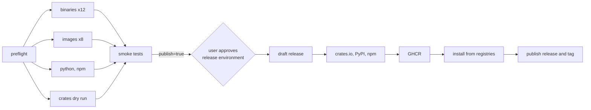

# Releases

Build a manually dispatched workflow that publishes one verified version of Nabedra to GitHub Releases, crates.io, PyPI, npm and GHCR. The process for users of it is in [Releasing Nabedra](../.agents/skills/nabedra-change/references/releasing.md).

Status: measured on `621af635`. Nothing here is implemented. Decisions 4 and 5 are open.

## User decisions (2026-11-25)

1. One version for the server, its crates, Events and both ORMs. The first is `0.3.0-rc.1`, above the ORMs' `0.2.2`.
2. Candidates may ship with red cells, all listed in the notes. Stable releases need the gate to pass, with deferred cells listed but not blocking. This changes today's rule, where deferred cells block.
3. Keep crates.io. Also publish `nabedra-sim` and `nabedra-check`, described as internal with no stability promise.

- Design review (TLA+) checks new and revised features. Code review then tests the code with the simulator. No task here waits for the simulator or wires it into the project.

## Open

| # | Question | Proposed answer |
| --- | --- | --- |
| 4 | Should the OLTP binary and image let users store their database's archives in S3? | Yes, build with `oltp-backup-s3`. Alternative: `oltp`, as the Dockerfile does today. Archives to a local directory work either way, and `cargo install --features oltp-backup-s3` stays possible. |
| 5 | How do we ship Nabedra Events, which is a separate server program? | As an image only, with `publish = false` on `nabedra-events`. Alternative: also binaries and a crate. |

---

## Where things stand

| Area | State on `621af635` |
| --- | --- |
| crates.io | `nabedra-database` 0.1.0 and 0.1.1 (2026-11-16). No other Nabedra crate exists there. |
| PyPI | `nabedra` 0.1.0. The repository is at 0.2.2. |
| npm | `nabedra` does not exist. The repository is at 0.2.2. |
| GitHub | Two tags, no releases, no environments, no secrets or variables listed, `main` unprotected. |
| Since `nabedra-database-v0.1.1` | 1,670 commits |
| Release gate | Fails: 0 green, 166 not green, 10 deferred. No evidence records are ingested on `main`. |
| Linux binaries | The `live3` job builds x86_64 binaries per engine and keeps them 7 days. |

Blockers found:

- **`cargo publish` fails.** `cargo publish --workspace --dry-run --no-verify --locked` stops with ``no matching package named `nabedra-sim` found``, required by `nabedra-oltp-storage`. It is an optional dependency of `nabedra-database` and `nabedra-oltp-storage`, and it is `publish = false`. In a scratch copy with `nabedra-sim` and `nabedra-check` publishable and a version on the `nabedra-check` dependency of `nabedra-sim`, the same command packaged all 11 crates. The largest is 1.6 MiB compressed. Packaged code was not compiled in either run.
- **The CLIs reject any server but 0.1.x.** `orm/python/src/nabedra/_binary.py` and `orm/typescript/src/binary.ts` match `nabedra-db (0\.1\.\d+)(?: (?:olap|oltp))?`.
- **`cliVersion` in `orm/typescript/src/binary.ts` is `0.1.0`** and nothing uses it. `cli.ts` has `0.2.2`.
- **The gate cannot pass.** `matrix.gate` needs `not deferred`, and 10 cells are deferred. `test_deferred_cells_block_even_with_pass_evidence` asserts it.
- **Server dependencies on in-tree crates use `version = "0.1.0"`**, a range. `cargo install` without `--locked` could mix crates of different releases.

---

## Tasks

| ID | Task | Files | Done when |
| --- | --- | --- | --- |
| REL1 | One version, publishable crates | `server/**/Cargo.toml`, lock files, ORM manifests | `version.py check` passes, and `cargo publish --workspace --dry-run --locked` passes, including its compile step |
| REL2 | CLI accepts the same `major.minor`, including `-rc.N` | `_binary.py`, `binary.ts`, their tests | Both ORMs accept `0.3.0` and `0.3.0-rc.1`, and reject `0.2.9`, `0.4.0` and malformed banners |
| REL3 | Gate per decision 2, with deferred cells no longer blocking a stable release | `matrix.py`, `release_gate.py`, tests, `docs/testing/README.md` | `--channel stable` ignores deferred cells and lists them. Any other non-green cell still fails it. |
| REL4 | Workflow without publishing | `.github/workflows/nabedra-release.yml`, `scripts/release/` | A rehearsal on `main` builds and smoke-tests every artifact |
| REL5 | Publish jobs | Same | Reviewed. Runs only in the `release` environment. |
| REL6 | One-time setup by the user | Account settings | The checklist below is done |
| REL7 | `0.3.0-rc.1`, then `rc.2` | `docs/releases/` | `rc.1` creates the missing packages with tokens. `rc.2` publishes everything with no stored token. |

REL1 and REL2 share the ORM version files, so one owner does both. REL4 can start at the same time. `nabedra-release.yml` can be dispatched only once it is on `main`.

### `scripts/release/version.py`

```text
version.py check           every version below is equal; exit 1 and list the ones that differ
version.py set <semver>    write them all, then refresh the lock files with `cargo update --workspace`
```

It owns these and nothing else:

- `server/Cargo.toml`: `[workspace.package] version`, inherited by the members, and `[workspace.dependencies]` entries pinned as `=X.Y.Z`. `nabedra-fuzz` and `nabedra-sim-oltp` stay unpublished.
- `server/events/Cargo.toml`, which is its own workspace, with its exact `nabedra-*` requirements
- `server/Cargo.lock`, `server/events/Cargo.lock`, `server/fuzz/Cargo.lock` where they record these packages
- `orm/python/pyproject.toml`, and `CLI_VERSION` in `_binary.py`. Both keep the semver spelling: `api_manifest.py` requires the two ORM version strings to be equal, and PEP 440 normalizes `0.3.0-rc.1` to `0.3.0rc1` in the built package.
- `orm/typescript/package.json` and its lock file, `cliVersion` in `cli.ts`. Delete the unused one in `binary.ts`.
- `orm/api-manifest.json`, `orm/cache-contract/vectors.json`
- Test fixtures that hold a version, after REL2 makes them read it from the package where possible
- `cargo install ... --version` lines in `server/README.md`, `server/docs/overview.md`, `server/docs/reference.md`, `orm/python/docs/reference.md`

`orm/api-manifest.json` is regenerated by `scripts/testing/api_manifest.py`, not edited. Historical records in `docs/testing/` keep their versions.

---

## `nabedra-release.yml`

```yaml
on:
  workflow_dispatch:
    inputs:
      sha:        { required: true, type: string }     # full SHA, an ancestor of main
      version:    { required: true, type: string }     # semver, no leading v
      request_id: { required: true, type: string }
      publish:    { type: boolean, default: false }
permissions: {}
concurrency: { group: nabedra-release, cancel-in-progress: false }
```



| Job | Runner | What it does |
| --- | --- | --- |
| `preflight` | `ubuntu-24.04` | Refuses unless `github.ref` is `main`, `sha` is on `main`, `version.py check` matches `version` at `sha`, `docs/releases/v<version>.md` exists, and the tag does not. Runs the gate from `main` with `--sha`. A stable release needs it to pass. On a first attempt, no registry may have the version. |
| `binaries` | Linux: `ubuntu-24.04`, `ubuntu-24.04-arm` in `rust:1.94.1-bookworm`. macOS: `macos-15`, `macos-15-intel` | 3 engines on 4 targets. Features: `olap,s3`, `oltp-backup-s3` (open question 4), `cache`. Archive `nabedra-db-<version>-<engine>-<target>.tar.gz` with the binary, `LICENSE` and `BUILD.txt` (SHA, engine, rustc). Checks the version banner. |
| `images` | `ubuntu-24.04`, `ubuntu-24.04-arm` | Root `Dockerfile` per engine and `server/events/deploy/Dockerfile`, natively per architecture. Saved as OCI archives, pushed by digest after approval. |
| `python` | `ubuntu-24.04` | Wheel, sdist, `twine check --strict`, unit tests against the installed wheel |
| `npm` | `ubuntu-24.04` | `npm ci`, `npm test`, `npm pack`, import test of the tarball |
| `crates` | `ubuntu-24.04` | `cargo publish --workspace --dry-run --locked` with compilation |
| `smoke` | Per target | Start each binary and image, write and read through both ORMs, stop cleanly, restart and read again. OLAP uses the loopback object store. Cache runs standalone on macOS, because clustered Cache needs Linux. |
| `publish` | `ubuntu-24.04`, environment `release` | The order in [step 5 of the guide](../.agents/skills/nabedra-change/references/releasing.md#5-publish). `contents: write`, `packages: write`, `id-token: write`, `attestations: write`, only in this job. |
| `verify` | Clean runners | Installs from each registry and repeats a short smoke test. Runs before the GitHub Release is published. |

Rules for the implementation:

- Build each artifact once. `publish` uploads the bytes that `smoke` tested, after checking their SHA-256. Crates are the exception, because Cargo packs at upload, so `publish` compares the dry run's `.crate` digest.
- Release jobs restore no caches. A cache written by another run must not reach a published binary.
- Pin every action by commit SHA. Pass inputs through `env:`.
- Publish crates one at a time, in dependency order, skipping a version whose registry checksum equals the local one. A rerun then continues where it stopped.
- Attest every archive and image with `actions/attest`. Users check one with `gh attestation verify <file> -R zPy52/nabedra-database`.
- Create the release as a draft, attach everything, then publish, so that release immutability covers all of it.
- The `macos-15` runner has 3 CPUs and 7 GB. Set `CARGO_BUILD_JOBS=2`. The OLTP release build there is unmeasured, so measure it first in REL4.
- macOS binaries are not signed or notarized. The notes say so.

---

## REL6: one-time setup by the user

1. Repository settings: create environment `release`, with the user as required reviewer and `main` as its only deployment branch. Under Releases, enable release immutability.
2. crates.io and npm need a first version published with a token before a trusted publisher can be added. Add a crates.io token (scopes `publish-new` and `publish-update`) and an npm token, both expiring within days, as secrets of `release`. Use them for `rc.1`.
3. PyPI: add a trusted publisher to the existing project `nabedra`, with workflow `nabedra-release.yml` and environment `release`.
4. After `rc.1`: add a trusted publisher to each of the 11 crates and to the npm package, then delete and revoke both tokens. npm drops a new configuration that has no successful publish within 2 days, so run `rc.2` right after.
5. After `rc.2`: in each crate's settings, require trusted publishing.
6. GHCR: make the four packages public after their first push.
7. After `rc.1`, check the npm `latest` tag. npm may point it at the first version ever published, even with `--tag next`. It stays there until the first stable release.

crates.io limits how fast one account can create crates. `rc.1` creates ten, so expect waits. Check the current limit first.

npm needs CLI 11.5.1 and Node 22.14.0 or newer for trusted publishing, and matches the workflow's file name exactly. Renaming `nabedra-release.yml` breaks PyPI, npm and crates.io publishing.

## Not in this plan

Homebrew, apt and Windows packages, signed macOS binaries, Docker Hub, release branches, scheduled releases.

## Sources

[npm trusted publishers](https://docs.npmjs.com/trusted-publishers), [npm configuration expiry](https://github.blog/changelog/2026-10-02-unvalidated-npm-trusted-publishing-configurations-now-expire), [PyPI trusted publishers](https://docs.pypi.org/trusted-publishers/using-a-publisher/), [crates.io trusted publishing](https://blog.rust-lang.org/2025/07/11/crates-io-development-update-2025-07), [crates.io enforcement setting](https://blog.rust-lang.org/2026/01/21/crates-io-development-update), [workspace publishing is not atomic](https://blog.rust-lang.org/2025/09/18/Rust-1.90.0/), [runners](https://docs.github.com/en/actions/reference/runners/github-hosted-runners), [immutable releases](https://docs.github.com/en/code-security/concepts/supply-chain-security/immutable-releases), [attestations](https://docs.github.com/en/actions/concepts/security/artifact-attestations)
