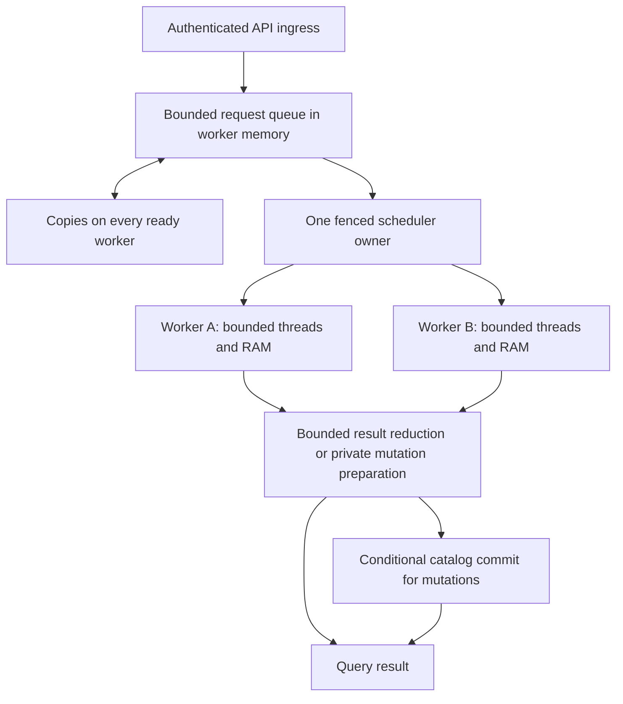

Nabedra Database should share worker CPU and memory across concurrent requests while preserving accepted work through individual failures and publishing each mutation atomically.

Status: approved requirements recorded on 2026-11-15, implemented by the resource-aware scheduling change. Execution evidence and its integration boundaries are recorded in [the acceptance ledger](../docs/testing/scheduler-evidence.md). The latest queue requirement supersedes a disk-durable queue: surviving worker memory preserves outstanding work; stopping every worker abandons it. Durable table data remains intact.

---

The API accepts requests; workers coordinate and execute partition jobs. A node handles many partitions and several requests over time. `serve` becomes a convenience composition of the same API and local worker used by a remote deployment. Admission, scheduling, memory limits, transactions, recovery, and results have the same semantics in both topologies.

These configuration objects are part of the versioned cluster configuration and worker bootstrap. Values are examples, not measured defaults; byte fields are positive integers.

```json
{
  "execution": {
    "max_workers_per_request": 4,
    "max_pending_requests": 1024,
    "max_queue_bytes_per_replica": 268435456,
    "max_retained_result_bytes_per_worker": 67108864,
    "result_retention_ms": 300000,
    "queue_replication": "all_ready_workers",
    "queue_lifetime": "live_cluster",
    "partition_size": "64 MiB"
  }
}
```

```json
{
  "resources": {
    "max_threads": 8,
    "memory_limit_bytes": 8589934592,
    "task_memory_limit_bytes": 536870912,
    "control_memory_reserve_bytes": 268435456
  }
}
```

`max_workers_per_request` caps simultaneously allocated compute nodes, including reduction. Queue replicas do not count as compute allocations. A fenced failed incarnation can be replaced. Each joining worker advertises its own validated thread/memory ceilings and available capacity; heterogeneous nodes need not match a cluster-wide capacity template. Configuration and local resource limits constrain advertised capacity. Reject contradictory or unsupported limits before readiness.

`max_threads` bounds concurrent partition, codec, and reducer execution across all compute pools on that worker. Do not multiply this budget by request count or create an unbounded blocking pool. Bound and report the separate network/control runtime overhead. Bound queue copies and retained results as part of the worker's total memory budget. A new worker copies outstanding queue records before it becomes ready; bootstrap uses separate authenticated capacity and does not need a query slot.

Keep the existing synchronous Python operation methods. Route them internally through the same queue. The asynchronous receipt interface observes queued work without keeping a connection open:

```text
POST /v1/requests
  body: existing {request_id, operation, payload} envelope
  202: {request_id, run_id, state: "queued"}
GET /v1/requests/{run_id}/{request_id}
  200: {request_id, run_id, state, result, error}
  state: queued | running | committing | reconciling | succeeded | failed | abandoned
  result: existing operation success data or null
  error: existing ProtocolError or null
```

Authenticate receipt access with the same database scope as submission. `POST /v1/operations` remains a synchronous wrapper and returns its existing terminal envelopes. A `202` means acceptance, never successful mutation. An unavailable/expired same-run receipt returns the existing `404 not_found` error envelope with an explicit receipt-unavailable message. An old-run lookup checks durable mutation decisions before reporting abandonment. Reads pin one catalog when execution first starts; retain that snapshot in replicated state for retries. Queue-only configuration does not raise existing table, body, batch, or result limits. Joins remain outside this change; future operators must use the same resource reservations.

---

Workflow: validate and bound ingress, replicate the request record, acknowledge acceptance, schedule eligible partition jobs on workers with CPU and memory capacity, refill freed capacity as each job settles, then reduce a query or publish one mutation. Retain the terminal receipt for the configured interval; a client disconnect releases its transport only.



Use an event-driven scheduler with per-request pending jobs. Replace fixed partition-to-thread assignment, per-request window barriers, and sequential remote partition loops. A free compute slot can execute the next eligible partition from any request. Partition file boundaries remain independent of worker count.

Scheduling policy: choose an eligible request with the lowest dominant resource share, `max(its_reserved_threads / cluster_threads, its_reserved_bytes / cluster_working_bytes)`, breaking ties by acceptance sequence. Pick a worker with available CPU and sufficient memory that minimizes projected dominant utilization, breaking ties by node ID. Re-evaluate after every completion, resource release, capacity update, join, or loss. Local reservation is authoritative; stale observations cannot oversubscribe a worker. Reserve CPU and memory together, or reserve neither.

The scheduler may bypass a temporarily unfit request so other work progresses. After 32 grant rounds of bypass, give the oldest request priority and earmark newly freed memory until one of its jobs fits; unrelated work can use unreserved resources. Reject a job that exceeds every eligible worker's total task budget. Running jobs are nonpreemptive; fairness applies at job boundaries. Do not hold compute permits while awaiting remote child jobs, queue replication, storage, or a commit lock. Preserve bounded progress capacity for reductions, settlement, heartbeats, and cancellation. Control progress cannot depend on an exhausted data queue.

A partition-size limit bounds encoded file bytes, not process RAM. Reserve and enforce space for input bytes, decoded rows/Arrow buffers, filters/sorts, mutation copies, encoding scratch, outputs, and coordinator reduction. Preflight metadata and use bounded buffers/fallible allocation; check budget growth before allocation. Replace unbounded intermediates with bounded operators or return a typed resource error. Account for simultaneous stages, queue replicas, and retained results. Measure RSS separately from logical charges; enforce the process ceiling with OS/container controls where available. Filling otherwise idle RAM is not itself a throughput objective.

---

Keep the queue and execution progress in RAM. Do not add S3 pending-request files, a persistent queue, or a per-partition write-ahead log. Initially replicate complete request bytes, identity/digest, acceptance order, and recoverable state to all ready workers before acknowledging acceptance or starting execution. Replicate a read's pinned snapshot before its first partition job. Reserve replica bytes before installation. All-ready replication provides retention through any sequence of failures that leaves a current replica alive; its network and memory cost must be measured. A timeout during replication is an uncertain submission; retry only the same identity/body while the same run survives. Duplicate identities attach to existing work; a different body for that identity is a conflict.

`max_pending_requests` covers queued and running nonterminal requests, including reconciliation. Queue byte limits apply independently on every replica. At capacity, wait only within a bounded ingress deadline or return explicit `429 overloaded` before acceptance; no finite system promises to accept unlimited arrivals. No accepted request may disappear on ordinary saturation, a transport timeout, or an API restart. Result retention expires explicitly; an unknown or expired receipt must never be fabricated as successful. Mutation decisions remain reconcilable from durable commit history.

Use the existing controller lease mechanism for one scheduler owner, extending its authority to worker-hosted scheduling. A scheduler takeover must fence the old owner before issuing attempts. Bind every queue record/job to `run_id`, scheduler term, membership revision, request digest, job ID, and attempt ID. Recover from a surviving replica; re-establish copies on all ready members before new admissions. Do not re-acknowledge every existing request during takeover. Transfer request copies before draining/removing the last holder. A one-worker deployment has one memory copy and cannot survive losing that worker.

A rolling API/worker restart keeps the run while a surviving worker retains its queue. A deliberate cold start after all queue holders have stopped creates a fresh `run_id`, abandons outstanding old-run work, and opens the committed catalog. Never reconstruct pending requests from object listings or decision history, and never automatically resubmit an abandoned request. A missed heartbeat or network partition alone does not prove every worker stopped; pause or perform an explicitly authorized cold-start transition after fencing old authority. Safety can require waiting for authoritative storage/ownership even when a queue copy survives.

---

For each mutation, prepare private candidate rows/files on workers; use those intermediate buffers only within their memory reservations. Validate every affected partition and the final table/result limits before publication. Upload only complete immutable Parquet objects to their final object keys, then conditionally publish one catalog reference set and its durable decision. Existing immutable commit decisions may remain durable; they are not a pending queue. No temporary S3 queue/undo files are needed. If files reach S3 but the catalog does not commit, they are invisible orphan objects and must never be discovered as live data by listing the bucket.

The catalog compare-and-swap is the visibility point: all affected partitions appear together, or the prior catalog remains current. Preserve concurrent mutation correctness by recomputing a CAS loser from a fresh catalog with the same logical request identity. Readers see a complete captured snapshot. A preparation failure cancels only dependent work in that mutation; unrelated requests continue. This contract covers one logical operation, including `insert_many`; multi-call or multi-table transactions require a separate API design.

Add `run_id` and scheduler term to a new catalog format and check them in the SAME conditional root update as table publication. A separate control-root check is insufficient fencing. Takeover/cold-start first conditionally updates that catalog fence; old attempts holding previous ETags cannot publish afterward. Version migration must retain existing table/decision history and require an explicit compatible writer transition. Existing old writers must not remain active during migration.

An already submitted catalog PUT can succeed even if every worker subsequently stops. Reconcile against the catalog: a mutation that committed remains committed, even without a delivered response. A PUT ordered before the new-run fence may win; one ordered after it must fail. Discard uncommitted memory and outstanding jobs after a full shutdown; do not promise rollback of a possibly committed PUT or label an ambiguous outcome `not_applied`.

---

Use strict wire types, checked arithmetic, validated constructors, `Result`/`Option`, and task-local buffers for normal failures. Keep scheduler locks short; perform neither I/O nor user computation while holding them. Settlement owns the original CPU, memory, and queue charges through cancellation and error delivery. Retryable attempts need bounded backoff and a finite retry policy; retries do not create new logical mutations.

Expected job errors and contained unwinding panics must leave unrelated jobs and the pool usable. Keep exceptional panic containment at the outer job boundary rather than using it as normal control flow. An abort, unsafe native-code failure, or OS OOM can terminate a shared process; checks cannot provide isolation from those events. If isolation through those failures is required within a node, use supervised executor processes/containers with aggregate thread/memory caps and benchmark their IPC cost. Do not claim that a thread pool alone provides this stronger guarantee.

Autoscaling may react to queue age and sustained resource demand only when a real Kubernetes/AWS provisioning adapter is configured and tested. Without one, remain a fixed/manual cluster and preserve queue behavior. Scaling down transfers queue copies and drains/fences owned work before termination. Adapter failure cannot discard accepted work.

---

Implementation tasks follow the approved configuration and receipt contracts. The reusable assertions and measurements live in [the scheduler test contract](../docs/testing/scheduler-contract.md). A checked implementation task does not replace the executed assertions and scope recorded in the acceptance ledger.

| Task | Concrete result | Depends on | Acceptance cases |
| --- | --- | --- | --- |
| [x] S1 | Versioned execution config, per-node resources, signed enrollment and capacity reports | None | C01-C03 |
| [x] S2 | CPU/byte reservations and bounded partition/reducer memory | S1 | C04-C07, M01-M03 |
| [x] S3 | Replicated RAM admission, receipts, deduplication and finite overflow | S1 | Q01-Q06 |
| [x] S4 | Run/term fencing and transactional publication/reconciliation | S3 | R01-R06, T01-T06 |
| [x] S5 | Work-conserving scheduling across concurrent requests | S2, S3 | C04-C07, F01-F03 |
| [x] S6 | Shared local/remote runtime and ORM queue integration | S4, S5 | U01-U03, Q04-Q06 |
| [x] S7 | Fault injection, process scenarios, reproducible utilization/load evidence | S4-S6 | All cases, B01-B02 |
| [x] S8 | Optional provisioning adapters with safe drain and queue handoff | S6, adapter authorization | A01-A02 |

S2 and S3 can proceed independently after S1; S4 and S5 can proceed independently after S3 and their listed prerequisites. Implementation tasks use the parallel worker workflow from the repository change skill.

---

Existing code to extend: [local dispatch](../server/src/engine/partition.rs), [remote coordination](../server/src/node/coordinator.rs), [worker runtime](../server/src/node/runtime.rs), [admission/settlement](../server/src/node/admission.rs), [payload ownership](../server/src/node/payload_owner.rs), [publication](../server/src/storage/publication.rs), [decision history](../server/src/storage/decision.rs), and [current process evidence](../server/notes/DN-runtime-integration.md). Managed-node slot equality currently appears in `cluster/state.rs`; enrollment, fingerprints, authorization and heartbeat schemas must evolve together.

Verified dependency behavior: [S3 conditional writes](https://docs.aws.amazon.com/AmazonS3/latest/userguide/conditional-writes.html) provide ETag preconditions for the root update; they do not transact several object keys. [Tokio semaphore fairness](https://docs.rs/tokio/1.54.1/tokio/sync/struct.Semaphore.html) can block smaller acquisitions behind `acquire_many`, so it does not replace the CPU/byte scheduler. [Rust Result](https://doc.rust-lang.org/book/ch09-02-recoverable-errors-with-result.html) handles expected failures; [panic containment](https://doc.rust-lang.org/std/panic/fn.catch_unwind.html) does not catch process aborts. No new dependency is selected by this plan.

## Retry, retention and admission limits (fx-sched, 2026-11-27)

Decisions taken in the review wave's fix phase. None changes a wire format, the HTTP API or a
configuration field.

- Retry policy. A failed attempt of an accepted record backs off exponentially from 100 ms to at most
  30 s, with jitter in the upper half of each interval. An unknown mutation outcome keeps retrying at
  that pace with the same identity and body; publication finds an earlier attempt's durable decision
  before it could apply twice, and a receipt can settle it from history meanwhile. A read whose
  attempts end `not_applied` three times still finishes with that error. Records in backoff do not
  take a dispatch slot, and dispatch follows acceptance order across databases.
- Terminal identity retention. Once a result's retention ends, every worker removes a terminal record
  from RAM when its identity stays answerable: a read, or a mutation whose terminal status (200, 400,
  404, 409, 413) was published as a durable decision. A same-identity read submitted after that runs
  again as a new read; a same-identity mutation is answered from its decision. A mutation that ended
  without a durable decision stays a tombstone, so a delayed retry of it cannot execute again. Without
  this, expired tombstones filled `max_queue_bytes_per_replica` after about 240,000 requests in one
  run and every proposal was then rejected.
- Uncertain submissions. A proposal that no member promoted is discarded when its submission fails,
  and a replica drops an unaccepted copy that no owner promoted within 120 s, or replaces it when the
  owner proposes the same identity again. A new scheduler term drops the fenced owner's unaccepted
  proposals. Their submitters saw `outcome_unknown` and may retry.
- Signed message rate. A receiver remembers at most 65,536 live replay nonces over the 30 s message
  window, about 2,180 signed queue and stream messages per second, and answers `overloaded` beyond
  that. The cache is bounded at about 5 MiB.
- The per-database pending cap is a quarter of `max_pending_requests`, rounded up (SCHED-14): one
  database cannot hold more than that many queued or running requests on a worker.
