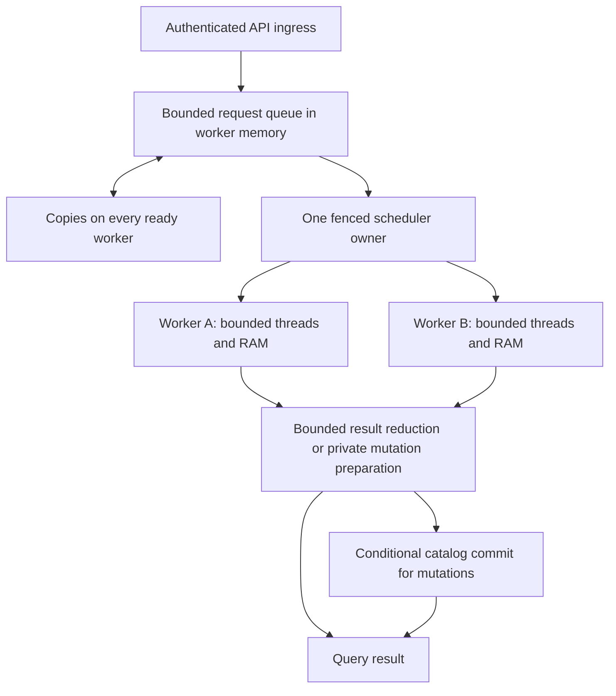

Nabedra Database should share worker CPU and memory across concurrent requests while preserving accepted work through individual failures and publishing each mutation atomically.

Status: approved requirements recorded on 2026-11-15, implemented by the resource-aware scheduling change. Execution evidence and its integration boundaries are recorded in [the acceptance ledger](../docs/testing/scheduler-evidence.md). The latest queue requirement supersedes a disk-durable queue: surviving worker memory preserves outstanding work; stopping every worker abandons it. Durable table data remains intact.

---

The API accepts requests; workers coordinate and execute partition jobs. A node handles many partitions and several requests over time. `serve` becomes a convenience composition of the same API and local worker used by a remote deployment. Admission, scheduling, memory limits, transactions, recovery, and results have the same semantics in both topologies.

These configuration objects are part of the versioned cluster configuration and worker bootstrap. Values are examples, not measured defaults; byte fields are positive integers.

```json
{
  "execution": {
    "max_workers_per_request": 4,
    "max_pending_requests": 1024,
    "max_queue_bytes_per_replica": 268435456,
    "max_retained_result_bytes_per_worker": 67108864,
    "result_retention_ms": 300000,
    "queue_replication": "all_ready_workers",
    "queue_lifetime": "live_cluster",
    "partition_size": "64 MiB"
  }
}
```

```json
{
  "resources": {
    "max_threads": 8,
    "memory_limit_bytes": 8589934592,
    "task_memory_limit_bytes": 536870912,
    "control_memory_reserve_bytes": 268435456
  }
}
```

`max_workers_per_request` caps simultaneously allocated compute nodes, including reduction. Queue replicas do not count as compute allocations. A fenced failed incarnation can be replaced. Each joining worker advertises its own validated thread/memory ceilings and available capacity; heterogeneous nodes need not match a cluster-wide capacity template. Configuration and local resource limits constrain advertised capacity. Reject contradictory or unsupported limits before readiness.

`max_threads` bounds concurrent partition, codec, and reducer execution across all compute pools on that worker. Do not multiply this budget by request count or create an unbounded blocking pool. Bound and report the separate network/control runtime overhead. Bound queue copies and retained results as part of the worker's total memory budget. A new worker copies outstanding queue records before it becomes ready; bootstrap uses separate authenticated capacity and does not need a query slot.

Keep the existing synchronous Python operation methods. Route them internally through the same queue. The asynchronous receipt interface observes queued work without keeping a connection open:

```text
POST /v1/requests
  body: existing {request_id, operation, payload} envelope
  202: {request_id, run_id, state: "queued"}
GET /v1/requests/{run_id}/{request_id}
  200: {request_id, run_id, state, result, error}
  state: queued | running | committing | reconciling | succeeded | failed | abandoned
  result: existing operation success data or null
  error: existing ProtocolError or null
```

Authenticate receipt access with the same database scope as submission. `POST /v1/operations` remains a synchronous wrapper and returns its existing terminal envelopes. A `202` means acceptance, never successful mutation. An unavailable/expired same-run receipt returns the existing `404 not_found` error envelope with an explicit receipt-unavailable message. An old-run lookup checks durable mutation decisions before reporting abandonment. A same-run mutation receipt answers from the durable decision whenever one exists, so a lookup never reports a nonterminal state after a terminal one. Reads pin one catalog when execution first starts; retain that snapshot in replicated state for retries. Queue-only configuration does not raise existing table, body, batch, or result limits. Joins remain outside this change; future operators must use the same resource reservations.

---

Workflow: validate and bound ingress, replicate the request record, acknowledge acceptance, schedule eligible partition jobs on workers with CPU and memory capacity, refill freed capacity as each job settles, then reduce a query or publish one mutation. Retain the terminal receipt for the configured interval; a client disconnect releases its transport only.



Use an event-driven scheduler with per-request pending jobs. Replace fixed partition-to-thread assignment, per-request window barriers, and sequential remote partition loops. A free compute slot can execute the next eligible partition from any request. Partition file boundaries remain independent of worker count.

Scheduling policy: choose an eligible request with the lowest dominant resource share, `max(its_reserved_threads / cluster_threads, its_reserved_bytes / cluster_working_bytes)`, breaking ties by acceptance sequence. Pick a worker with available CPU and sufficient memory that minimizes projected dominant utilization, breaking ties by node ID. Re-evaluate after every completion, resource release, capacity update, join, or loss. Local reservation is authoritative; stale observations cannot oversubscribe a worker. Reserve CPU and memory together, or reserve neither.

The scheduler may bypass a temporarily unfit request so other work progresses. After 32 grant rounds of bypass, give the oldest request priority and earmark newly freed memory until one of its jobs fits; unrelated work can use unreserved resources. Reject a job that exceeds every eligible worker's total task budget. Running jobs are nonpreemptive; fairness applies at job boundaries. Do not hold compute permits while awaiting remote child jobs, queue replication, storage, or a commit lock. Preserve bounded progress capacity for reductions, settlement, heartbeats, and cancellation. Control progress cannot depend on an exhausted data queue.

A partition-size limit bounds encoded file bytes, not process RAM. Reserve and enforce space for input bytes, decoded rows/Arrow buffers, filters/sorts, mutation copies, encoding scratch, outputs, and coordinator reduction. Preflight metadata and use bounded buffers/fallible allocation; check budget growth before allocation. Replace unbounded intermediates with bounded operators or return a typed resource error. Account for simultaneous stages, queue replicas, and retained results. Measure RSS separately from logical charges; enforce the process ceiling with OS/container controls where available. Filling otherwise idle RAM is not itself a throughput objective.

---

Keep the queue and execution progress in RAM. Do not add S3 pending-request files, a persistent queue, or a per-partition write-ahead log. Initially replicate complete request bytes, identity/digest, acceptance order, and recoverable state to all ready workers before acknowledging acceptance or starting execution. Replicate a read's pinned snapshot before its first partition job. Reserve replica bytes before installation. All-ready replication provides retention through any sequence of failures that leaves a current replica alive; its network and memory cost must be measured. A timeout during replication is an uncertain submission; retry only the same identity/body while the same run survives. Duplicate identities attach to existing work; a different body for that identity is a conflict.

`max_pending_requests` covers queued and running nonterminal requests, including reconciliation. Queue byte limits apply independently on every replica. At capacity, wait only within a bounded ingress deadline or return explicit `429 overloaded` before acceptance; no finite system promises to accept unlimited arrivals. No accepted request may disappear on ordinary saturation, a transport timeout, or an API restart. Result retention expires explicitly; an unknown or expired receipt must never be fabricated as successful. Mutation decisions remain reconcilable from durable commit history.

Use the existing controller lease mechanism for one scheduler owner, extending its authority to worker-hosted scheduling. A scheduler takeover must fence the old owner before issuing attempts. Bind every queue record/job to `run_id`, scheduler term, membership revision, request digest, job ID, and attempt ID. Recover from a surviving replica; re-establish copies on all ready members before new admissions. An interrupted join never blocks recovery: a removal or owner fence supersedes a join that Control has not published, and the owner's join seal ends with that view change. Do not re-acknowledge every existing request during takeover. Transfer request copies before draining/removing the last holder. A one-worker deployment has one memory copy and cannot survive losing that worker.

A rolling API/worker restart keeps the run while a surviving worker retains its queue. A deliberate cold start after all queue holders have stopped creates a fresh `run_id`, abandons outstanding old-run work, and opens the committed catalog. Never reconstruct pending requests from object listings or decision history, and never automatically resubmit an abandoned request. A missed heartbeat or network partition alone does not prove every worker stopped; pause or perform an explicitly authorized cold-start transition after fencing old authority. Safety can require waiting for authoritative storage/ownership even when a queue copy survives.

---

For each mutation, prepare private candidate rows/files on workers; use those intermediate buffers only within their memory reservations. Validate every affected partition and the final table/result limits before publication. Upload only complete immutable Parquet objects to their final object keys, then conditionally publish one catalog reference set and its durable decision. Existing immutable commit decisions may remain durable; they are not a pending queue. No temporary S3 queue/undo files are needed. If files reach S3 but the catalog does not commit, they are invisible orphan objects and must never be discovered as live data by listing the bucket.

The catalog compare-and-swap is the visibility point: all affected partitions appear together, or the prior catalog remains current. Preserve concurrent mutation correctness by recomputing a CAS loser from a fresh catalog with the same logical request identity. Readers see a complete captured snapshot. A preparation failure cancels only dependent work in that mutation; unrelated requests continue. This contract covers one logical operation, including `insert_many`; multi-call or multi-table transactions require a separate API design.

Add `run_id` and scheduler term to a new catalog format and check them in the SAME conditional root update as table publication. A separate control-root check is insufficient fencing. Takeover/cold-start first conditionally updates that catalog fence; old attempts holding previous ETags cannot publish afterward. Version migration must retain existing table/decision history and require an explicit compatible writer transition. Existing old writers must not remain active during migration.

An already submitted catalog PUT can succeed even if every worker subsequently stops. Reconcile against the catalog: a mutation that committed remains committed, even without a delivered response. A PUT ordered before the new-run fence may win; one ordered after it must fail. Discard uncommitted memory and outstanding jobs after a full shutdown; do not promise rollback of a possibly committed PUT or label an ambiguous outcome `not_applied`.

---

Use strict wire types, checked arithmetic, validated constructors, `Result`/`Option`, and task-local buffers for normal failures. Keep scheduler locks short; perform neither I/O nor user computation while holding them. Settlement owns the original CPU, memory, and queue charges through cancellation and error delivery. Retryable attempts need bounded backoff and a finite retry policy; retries do not create new logical mutations.

Expected job errors and contained unwinding panics must leave unrelated jobs and the pool usable. Keep exceptional panic containment at the outer job boundary rather than using it as normal control flow. An abort, unsafe native-code failure, or OS OOM can terminate a shared process; checks cannot provide isolation from those events. If isolation through those failures is required within a node, use supervised executor processes/containers with aggregate thread/memory caps and benchmark their IPC cost. Do not claim that a thread pool alone provides this stronger guarantee.

Autoscaling may react to queue age and sustained resource demand only when a real Kubernetes/AWS provisioning adapter is configured and tested. Without one, remain a fixed/manual cluster and preserve queue behavior. Scaling down transfers queue copies and drains/fences owned work before termination. Adapter failure cannot discard accepted work.

---

Implementation tasks follow the approved configuration and receipt contracts. The reusable assertions and measurements live in [the scheduler test contract](../docs/testing/scheduler-contract.md). A checked implementation task does not replace the executed assertions and scope recorded in the acceptance ledger.

| Task | Concrete result | Depends on | Acceptance cases |
| --- | --- | --- | --- |
| [x] S1 | Versioned execution config, per-node resources, signed enrollment and capacity reports | None | C01-C03 |
| [x] S2 | CPU/byte reservations and bounded partition/reducer memory | S1 | C04-C07, M01-M03 |
| [x] S3 | Replicated RAM admission, receipts, deduplication and finite overflow | S1 | Q01-Q06 |
| [x] S4 | Run/term fencing and transactional publication/reconciliation | S3 | R01-R06, T01-T06 |
| [x] S5 | Work-conserving scheduling across concurrent requests | S2, S3 | C04-C07, F01-F03 |
| [x] S6 | Shared local/remote runtime and ORM queue integration | S4, S5 | U01-U03, Q04-Q06 |
| [x] S7 | Fault injection, process scenarios, reproducible utilization/load evidence | S4-S6 | All cases, B01-B02 |
| [x] S8 | Optional provisioning adapters with safe drain and queue handoff | S6, adapter authorization | A01-A02 |

S2 and S3 can proceed independently after S1; S4 and S5 can proceed independently after S3 and their listed prerequisites. Implementation tasks use the parallel worker workflow from the repository change skill.

---

Existing code to extend: [local dispatch](../server/src/engine/partition.rs), [remote coordination](../server/src/node/coordinator.rs), [worker runtime](../server/src/node/runtime.rs), [admission/settlement](../server/src/node/admission.rs), [payload ownership](../server/src/node/payload_owner.rs), [publication](../server/src/storage/publication.rs), [decision history](../server/src/storage/decision.rs), and [current process evidence](../server/notes/DN-runtime-integration.md). Managed-node slot equality currently appears in `cluster/state.rs`; enrollment, fingerprints, authorization and heartbeat schemas must evolve together.

Verified dependency behavior: [S3 conditional writes](https://docs.aws.amazon.com/AmazonS3/latest/userguide/conditional-writes.html) provide ETag preconditions for the root update; they do not transact several object keys. [Tokio semaphore fairness](https://docs.rs/tokio/1.54.1/tokio/sync/struct.Semaphore.html) can block smaller acquisitions behind `acquire_many`, so it does not replace the CPU/byte scheduler. [Rust Result](https://doc.rust-lang.org/book/ch09-02-recoverable-errors-with-result.html) handles expected failures; [panic containment](https://doc.rust-lang.org/std/panic/fn.catch_unwind.html) does not catch process aborts. No new dependency is selected by this plan.

## Design review

Reviewed 2026-11-26 against `main` `e6b4040b` (wave rv, task rv-oltp-direct). The spec models the OLTP registered queue
on the queued path with the all-ready policy. It does not cover the OLAP cluster queue (`server/src/node/**`,
`server/src/cluster/**`, olap feature only), the scoped RF3 queue (O30, O31), queries and their pinned read grants, or
scheduling fairness.

### Guarantees

| Guarantee | Properties | Not modelled |
| --- | --- | --- |
| OLTP-G07 | `G07_ReadyHoldAccepted`, `G07_NoStaleRecord`, `G07_NoAbandonWhileHeld`, `Q03_ExecuteOnlyAccepted`, `QueueRetention`, `O14_RetryAttaches`, `L_AcceptedTerminates`, `L_CommittedFinishes`, deadlock freedom | Queue byte and count limits (Q02): resource accounting, SCHED-G01 |
| OLTP-G08 | `G07_ReadyHoldAccepted` and `G07_NoStaleRecord` across `RemoveMember`, `Rejoin`, `JoinCopy`, `PublishJoin` and `AbortJoin`; deadlock freedom with a pending join | Voter changes: OltpRanges and OltpControl |
| OLTP-G03 (queued path) | `G03_OnceExecution`, `R04_NoOldRunExecution` | The direct path: OltpDirect |
| OLTP-G04 (queued path) | `G04_AbandonedNeverCommits`, `G04_NotAppliedHasProof`, `Receipt_Monotone` | The direct path: OltpDirect |
| OLTP-G09 | `G09_SettleOnce`, `L_ReservationsSettle` | Byte budgets: SCHED-G01 |
| SCHED-G04 | `R04_NoOldRunExecution`, `G04_AbandonedNeverCommits`, `G07_NoAbandonWhileHeld` | None |
| SCHED-G01, G02, G03 | none | Capacity, fairness and aging are resource arithmetic and timing, checked by the C and M cases |

### Topology

```text
client --HTTP--> API --> queue owner (fenced by Control) --copies--> every ready worker (RAM)
                              |            \--attempts--> Status (identity, decision), Data
                              \--ready view, join, removal, fence--> Control (Raft)
```

Faults modelled: worker crash, losing RAM (`MaxCrash`); partition of a live worker from Control and peers
(`MaxPartition`), with heal; a full stop of every worker (`MaxStop`); a transient local lane refusal (`MaxLane`); a
transient receipt lookup failure (`MaxReceiptFault`); a copy installed whose acknowledgement is lost (`MaxLostAck`). A
total budget `MaxFaults` = 2 lets any two of them overlap. Message loss of a copy is the copy step not being taken. A
lost client reply is `ReplyClient` not being taken. Out of scope: Byzantine workers, Control and Status unavailability
(both are linearizable single steps, abstraction A1), clock drift (no lease is modelled; owner fencing is by view), and
disk faults (the queue has no disk).

### Spec

`specs/oltp/queue/OltpQueue.tla`, `MCOltpQueue.tla`. The baseline is `OltpQueue.cfg`: 4 workers, 2 requests, every fault
kind once, `MaxFaults` = 2, symmetry on workers and requests, safety and deadlock. The liveness baseline is
`OltpQueue.live.cfg`: 3 workers, 1 request, no symmetry, `LiveSpec`, with the full stop and receipt faults off. That is
below the L3 node bound, and the reason and approval are recorded under "Open gaps". The mutants are in
`specs/oltp/queue/mutants/`, at 3 workers and 1 request, each with its control. There are no constraints and no limits.
Fairness (each assumption names its mechanism): the owner's admission future and recovery loop (`InstallCopy`,
`AcceptStaged`, `Start`, `ResolveCommitted`); the attempt task and Status progress (`SubmitDecision`,
`CommitDecision`); the settlement guard (`Settle`, `CancelAttempt`); the membership actor's 250 ms poll (`ApplyView`,
`JoinCopy`, `PublishJoin`); Control's heartbeat timeout (`RemoveMember`, `AbortJoin`); the cold-start procedure
(`FenceGroups`); and the fault-stop assumption (`Heal`). The T check is `oltp-queue-spec`.

Abstractions A1 to A6 are listed in the spec header. A3 folds the Running copy into the accepted version: every start
and takeover consults the Status decision first, so a holder's Running copy changes no outcome.

### Results

| Run | Where | Distinct states | Depth | Verdict |
| --- | --- | --- | --- | --- |
| `OltpQueue.cfg` at 3 workers, 1 request (probe) | local, unattested | 38,221 | 30 | pass |
| `OltpQueue.live.cfg` | local, unattested | 138,744 | 30 | pass, liveness checked |
| `OltpQueue.cfg` (4 workers, 2 requests) | Actions run 45805091930 on `fbb0b2e7` | 13,478,194 | 58 | pass, exhaustive, 1,767 s |
| `OltpQueue.live.cfg` | Actions run 45805091930 on `fbb0b2e7` | 138,744 | 30 | pass, liveness checked |

Coverage: 29 actions, each with a nonzero count (minimum 97, local). Mutant counterexample lengths are local, at 3 workers
and 1 request; the controls of the liveness mutants are `OltpQueue.live.cfg` with the lane fault off. On run
https://github.com/zPy52/nabedra-database/actions/runs/45805091930 (`fbb0b2e7`) every baseline passed, coverage was
complete (minimum 810) and 19 of 20 mutants were caught on their property. `no_settle_superseded` was caught by a
deadlock first (21 states) with several TLC workers, so its cfg now checks only `L_ReservationsSettle` with deadlock
checking off. The check verdict on that run is `fail` for that reason only. The rerun on the next head is pending.

### Mutants

| Mutant | Property | Counterexample (states, local) |
| --- | --- | --- |
| `ack_on_quorum` | `G07_ReadyHoldAccepted` | 6 |
| `join_no_seal` | `G07_ReadyHoldAccepted` | 11 |
| `ready_before_copy` | `G07_ReadyHoldAccepted` | 10 |
| `rejoin_keeps_stale` | `G07_NoStaleRecord` | 8 |
| `cold_on_missed_heartbeat` | `G07_NoAbandonWhileHeld` | 7 |
| `dispatch_before_copies` | `Q03_ExecuteOnlyAccepted` | 8 |
| `no_identity_dedup`, `retire_without_tombstone` | `G03_OnceExecution` | 15, 17 |
| `no_durable_reservation` | `R04_NoOldRunExecution` | 11 |
| `no_cold_fence`, `lookup_before_fence` | `G04_AbandonedNeverCommits` | 15, 14 |
| `acc3_receipt_early` | `G04_NotAppliedHasProof` | 12 |
| `gc1_double_guard`, `cancel_releases_put` | `G09_SettleOnce` | 8, 13 |
| `o07_lane_fails` | `QueueRetention` | 9 |
| `prefix_o14_ready_view` | `O14_RetryAttaches` | 8 |
| `prefix_f1_receipt_regress` | `Receipt_Monotone` | 12 |
| `prefix_join_never_aborted` | Deadlock | 7 |
| `no_reconcile` | `L_CommittedFinishes` | 16 (lasso) |
| `no_remove_crashed` | `L_AcceptedTerminates` | 12 (lasso) |
| `no_settle_superseded` | `L_ReservationsSettle` | 16 (lasso) |

### Counterexamples

- **Interrupted join (OQ-2, record `2026-11-26-design-queue-join-never-aborted`).** Shipped Control refuses every
  removal and owner fence while a join is pending, and only publication or a cold fence ends one. Trace
  (`prefix_join_never_aborted`, 7 states): 1 submit r1; 2 partition w1; 3 remove w1; 4 heal; 5 w1 begins its rejoin;
  6 the owner crashes; 7 no step is enabled. The plan now says an interrupted join never blocks recovery (plan fixed,
  code pending). The spec's `AbortJoin`, and `RemoveMember` superseding a pending join, model the fix. The coverage
  gap was that the draft spec let a crashed joiner release the join, which the code does not do.
- **Receipt regression (OQ-1, record `2026-11-26-design-queue-receipt-regress`).** Trace (`prefix_f1_receipt_regress`,
  12 states, no fault): r1 is accepted, copied, started and decided; a same-ID POST answers the durable terminal; a GET
  then answers running. The plan now says a same-run mutation receipt answers from the durable decision (plan fixed,
  code pending). The gap was that the client view had no monotonicity property.

### Cost

Per queued mutation in a cluster of N ready workers. The plan sets no numeric target; it requires the network and
memory cost of all-ready replication to be measured.

| Item | Spec actions | Code | Count |
| --- | --- | --- | --- |
| Status Raft writes besides the transaction | `SubmitRequest`, `AcceptStaged`, `Retire` | `reserve_identity`, `bind_staged`, `retire_terminal` (plus a Timestamp `release` at retirement) | 3 (+1) |
| Decision | `CommitDecision` | the transaction's Status decision | 1 |
| Queue copy RPCs | `InstallCopy` for the staged, accepted and terminal versions | the same, plus the Running version (A3), each a full `RecordFrame` with the body | 4(N-1) |
| Sequential copy rounds | | batches of `MAX_PARALLEL_QUEUE_COPIES` = 4 | 4 ceil((N-1)/4), 2 of them before the 202 |
| RAM copies of the body | | every ready worker, until `result_retention_ms` | N |
| fsyncs | | the Raft writes above, on each Status or Timestamp voter; the queue itself has no disk | 4 Raft quorums plus the transaction |

Finding OQ-5 proposes sending the body once and later phases as headers. Measure with `scripts/testing/ab.py`.

### Independent read

`wave-dr/reads/queue.md` (2026-11-24). The plan changed since then only by the removal of AGENTS.md references, so the
read still applies. Its AGENTS.md rules are no longer a source.

| Scenario | Encoding |
| --- | --- |
| R-queue-01 join during an install | `InstallCopy` only to current members; `JoinCopy` seals; `PublishJoin` resets the barrier; `join_no_seal`, `ready_before_copy` |
| R-queue-02 stale joiner copy, then re-execution | `Rejoin` wipes the queue; `Start` checks the Status decision; `rejoin_keeps_stale`, `G03_OnceExecution` |
| R-queue-03 joiner is the last survivor with a partial bootstrap | A joiner is not a holder: `AllReadyDown`, and a cold start needs every worker stopped (`G07_NoAbandonWhileHeld`). The interrupted-join wedge is OQ-2 |
| R-queue-04 submitter crash after a partial install | `Crash` of the owner, then `RemoveMember` merges, and the new owner adopts with `AcceptStaged`; `Q03_ExecuteOnlyAccepted` |
| R-queue-05 unaccepted copy leaks bytes or a slot | Adopted by the recovery loop (`AcceptStaged` under fairness). Byte accounting is not modelled. A staged record refused for good is an open candidate |
| R-queue-06 stale replica rejoins after a partition | `Partition`, `RemoveMember`, `Heal`, `Rejoin`; `G07_NoStaleRecord` |
| R-queue-07 stale replica after a cold start | `ColdStart`, `Bootstrap`, `Rejoin`; `R04_NoOldRunExecution`, `no_cold_fence` |
| R-queue-08 cold start with a live holder | the `ColdStart` guard; `cold_on_missed_heartbeat` |
| R-queue-09 same ID through two APIs | one owner under the UUID gate (A1); `G03_OnceExecution`, `no_identity_dedup` |
| R-queue-10 two bodies for one ID | Not modelled: Status rejects a different digest at reservation (`admission.rs`, `DigestConflict`); each modelled identity has one body |
| R-queue-11 deadline mid-install, then 429 | A failure with a local copy is uncertain, never `not_applied` (`worker_runtime.rs` `submit_original`); `G04_NotAppliedHasProof` |
| R-queue-12 takeover with an old attempt running | `RemoveMember` supersedes attempts; `CancelAttempt`; `G09_SettleOnce` |
| R-queue-13 duplicated settlement | `Settle` once per attempt; `gc1_double_guard` |
| R-queue-14 wrongly suspected loss, then a late settlement | `Partition`, `RemoveMember`, `Settle`; `cancel_releases_put` |
| R-queue-15 paused old owner writes a stale terminal | `OwnerOK` requires the current view; terms are abstract (A5); `G07_NoStaleRecord` |
| R-queue-16 PUT across a full stop and a fence | `StopAll` keeps submitted decisions; `CommitDecision` checks `fenceRun`; `no_cold_fence`, `lookup_before_fence` |
| R-queue-17 catalog and decision written apart | Not applicable to OLTP: the decision is one Status entry |
| R-queue-18 multi-group fence and a decided transaction | Out of scope here: transaction finalization is OltpRanges. `FenceGroups` is one step (A1) |
| R-queue-19 raw resubmit after a cold start | the abandoned branch of `SubmitRequest`; `no_durable_reservation` |
| R-queue-20 delayed duplicate after retirement | the terminal branch of `SubmitRequest`; `retire_without_tombstone` |
| R-queue-21 receipt of an unaccepted copy | `ReplyClient` answers accepted versions only |
| R-queue-22 receipt from a lagging replica | Receipts come from the owner (`ReplyClient` needs `OwnerOK`); `Receipt_Monotone` (OQ-1) |
| R-queue-23 query pin not replicated | Out of scope: queries (A6) |
| R-queue-24 no bytes to re-establish copies | Not modelled: byte limits (SCHED-G01). Open gap |
| R-queue-25 scale-down removes the last holder mid-transition | `RemoveMember` merges every survivor's copy. A drain of a live worker is not modelled. Open gap |
| R-queue-26, R-queue-27 direct-to-queued forward races | the direct path: OltpDirect |
| R-queue-28 cancellation races completion | `CancelAttempt` against `CommitDecision` and `Settle`; `cancel_releases_put` |

### Open gaps

- The liveness baseline runs at 3 workers and 1 request without symmetry, below the L3 node bound, because liveness
  cannot use symmetry and the 4-worker, 2-request space does not fit the budget without it. It needs approval from a
  reviewer who did not write it.
- Byte and count limits, drains of live workers, queries and the scoped queue are not modelled.
- The compute-charge owner behind `held` is unverified in the code (the old dr-queue note).
