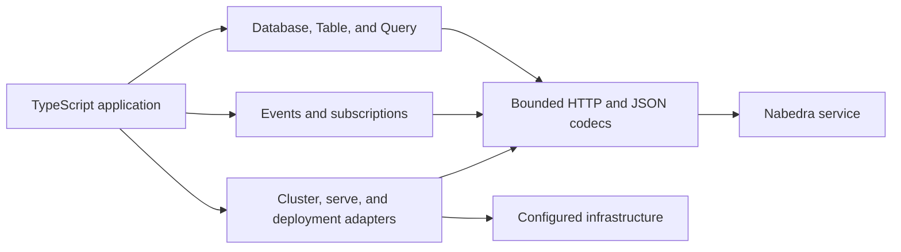

Add a TypeScript ORM whose public API and behavior match the Python package at `1418bad`.

## Parity contract

The Python sources in [`orm/python/src/nabedra`](../orm/python/src/nabedra) define the classes, aliases, constructors, methods, properties, defaults, parameter names, and behavior. Use the package exports and the documented submodules in the [reference](../orm/python/docs/reference.md), [streaming guide](../orm/python/docs/streaming.md), and [events guide](../orm/python/docs/events.md). The `deployment` exports and the independently documented deployment adapters also belong to the package. Test public members on returned objects, including classes reached through properties. Python private helpers, standard-library ancestor methods, and automatically generated language methods are implementation details.

| Python | TypeScript |
| --- | --- |
| Class, alias, function | Same PascalCase or camelCase name. `DB === Database`. |
| `snake_case` argument, method, property | camelCase. Retain every argument and its default. Preserve database identifiers, generic JSON records, error codes, and protocol keys verbatim. |
| Fixed positional args, keyword-only args | Keep fixed args positional and map the keyword-only args to named fields on the last options argument. Use a single options object when callers can supply Python arguments entirely by name. |
| `*columns`, `**filters` | Rest arguments and a typed filter object. |
| `Expr` comparisons and boolean operators | `eq`, `ne`, `gt`, `ge`, `lt`, `le`, `and`, `or`, `not`. |
| Blocking network or subprocess work | `Promise`. Pure construction, validation, and query building remain synchronous. |
| Network-backed generators and context managers | Async iteration, explicit `close()`, and `await using` where Python provides context-managed cleanup. |
| `str`, `int`, `float`, `bool` schema markers | `String`, `BigInt`, `Number`, `Boolean`. Use `bigint` for exact signed int64 and event offsets. |
| Python `None` result | `null` for nullable results and `void` for procedures. |
| UUIDs, bytes, secret-facing representations | Strings, `Uint8Array`, and redacted Node inspection. |

Support Node.js ≥22.13 with ESM and strict NodeNext declarations. Expose the package root plus corresponding public module paths under `nabedra`. Use native Node HTTP(S), TLS, process, and filesystem APIs. The Apache Arrow dependency provides native batch types and loads at runtime on Arrow requests. Optional cloud libraries load on their integration paths. Use an exact decimal representation for fractional Events numbers where the Python client returns `Decimal`. Include no Python runtime dependency. [TypeScript NodeNext](https://www.typescriptlang.org/docs/handbook/modules/reference.html), [Node HTTP](https://nodejs.org/docs/latest-v22.x/api/http.html), [Node HTTPS](https://nodejs.org/docs/latest-v22.x/api/https.html), [Apache Arrow JS](https://arrow.apache.org/docs/js/), [AWS credentials](https://docs.aws.amazon.com/sdk-for-javascript/v3/developer-guide/setting-credentials-node.html).

## ORM shape

```ts
type Scalar = string | bigint | number | boolean
type Key = string | bigint
type Schema = Record<string, StringConstructor | BigIntConstructor | NumberConstructor | BooleanConstructor>
type Row = Record<string, Scalar>
type RowOf<S extends Schema> = { [K in keyof S]: ReturnType<S[K]> }

interface DatabaseOptions {
  url?: string | null
  token?: string | null
  mode?: "oltp" | "olap"
  timeout?: number
  caFile?: string | null
  database?: string | null
  apiUrl?: string | null
}

// The constructor also accepts positional url and token, with the remaining
// keyword fields in a final options object.
const db = new Database({ url: "http://127.0.0.1:8000", mode: "oltp" })
const users = await db.createTable("users", { id: String, age: BigInt }, "id")
await users.insertMany([{ id: "alice", age: 24n }, { id: "bob", age: 17n }])
const adults = await users.where(col("age").ge(18n)).select("id", "age").collect()
```

Keep primary key values, updates, projections, filter objects, and row stream batches tied to the inferred schema. Unknown schemas from `table` and `tables` use generic rows. `where(expr?, filters?)` also accepts the filter object as the first argument. Options are optional only when all constituent Python arguments have defaults. Keep timeouts in seconds.

Builders validate inputs and snapshot schema synchronously. An operation then writes the existing snake_case envelope to the configured server and decodes its validated result. No write retry follows a lost reply. Explicit submission returns the accepted identity. Polling uses the same run and request IDs without submitting a new operation. Preserve bounds, exact JSON numbers, strict response validation, redirect refusal, TLS CA and timeout behavior, and uncertainty classification.

Implement the following internal module contracts for concurrent work. These are internal imports.

```ts
// transport.ts
type JsonObject = Record<string, unknown>
interface HttpResponse {
  status: number
  headers: import("node:http").IncomingHttpHeaders
  body: Buffer
}
function parseJson(raw: Uint8Array | string): unknown
function encodeJson(value: unknown): Buffer
class Transport {
  constructor(url: string | null | undefined, token: string | null | undefined,
    options?: { timeout?: number; caFile?: string | null; database?: string | null })
  readonly timeout: number
  request<T>(operation: string, payload: JsonObject, decode: (data: unknown) => T): Promise<T>
  exchange(method: string, route: string, options?: {
    body?: Uint8Array; headers?: Record<string, string>; timeout?: number; maxBytes?: number
  }): Promise<HttpResponse>
}

// stream.ts
function batchStream<R>(transport: Transport, tableId: string, query: JsonObject,
  schema: Schema, options: StreamOptions & { limit: number | null }): BatchStream<R[] | RecordBatch>
function streamSnapshot(transport: Transport, tableId: string, query: JsonObject, shards: number): StreamSnapshot

// table.ts
function tableFromDescriptor<S extends Schema = Schema, K extends keyof S & string = keyof S & string>(
  transport: Transport, descriptor: unknown): Table<S, K>
```

JSON integer tokens outside the safe number range decode to `bigint`. Schema validation converts safe wire int64 values to `bigint`, and integer-looking float64 values remain `number`. Emit exact numeric tokens without changing field names or precision.



## Work and assertions

| ID | Implementation | Acceptance |
| --- | --- | --- |
| TS1 | Package, HTTP transport, errors, `Database`, receipts | TLS, duplicate JSON fields, response bounds and identities. Verify same-run lookup and no unknown-write resubmit (client parts of Q04–Q06, T04, U02). |
| TS2 | Validation, `Expr`, `Table`, `Query` | Compare Python and TypeScript wire requests for all 13 operations, immutable chaining, typed projection, signed int64 boundaries, stale handles and batch limits (T06, U02). |
| TS3 | `BatchStream`, snapshots, Arrow | Rows and Arrow, limits, laziness, prefetch/cleanup, retryable truncated replies, and shard identity. |
| TS4 | `Cluster`, `serve`, CLI, provider callbacks, Kubernetes, deployment adapters | Control envelopes, status and wait, real child lifecycle for local serve, provider adapter contract and authorization. Preserve server semantics in U01, A01–A02 and R04. |
| TS5 | `Gateway`, context, AWS and S3 types and resolution | Middleware order, request validation, private metadata, bounded forwarding, response identity, close and errors. |
| TS6 | `events` client and sink | Publish, pagination, lease acquire/heartbeat/read/ack/release, duplicate identity, offset limits and sink writer protocol. |
| TS7 | API contract, transport fixtures and live integration | Compare exports, methods, properties and parameter layouts. Compile usage against packed declarations. Run TS and Python suites and exercise the same Rust server with both clients. |

Implement TS1–TS3 in parallel. TS4–TS6 can proceed with the shared HTTP contract. Use the existing Python tests as executable examples. Keep new test inputs deterministic with a local HTTP peer or the repository's Rust process fixture and use disposable local data. Write at batch sizes 1, 100 and 1,000 and record observed request timings at the tested sizes. Record the scheduler IDs and exact assertions exercised in the test report. Record full cluster fault scenarios in the [scheduler test contract](../docs/testing/scheduler-contract.md). Client assertions cover the protocol behavior they execute.
