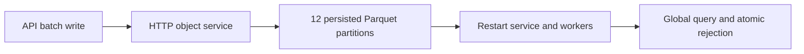

# Test value audit

This audit applies `.agents/skills/code-review/SKILL.md` to the Rust server,
Python ORM and local acceptance guards. Verification ran on 2026-11-15. The user
authorized up to four CPU cores and 4 GB RAM for test processes. Cargo uses two
build jobs and at most two test threads. Live samples use the existing small
acceptance datasets.

## Review rubric

| Check | Required evidence |
| --- | --- |
| Fundamentals | Rust formatting, compilation and warnings; Python imports and test discovery |
| Test value | Remove duplicate executions and assertions already exercised by meaningful behavior checks |
| Durable behavior | Real object-service restart, persisted Parquet partitions, global query results and atomic batch rejection |
| Failure boundaries | Lost allocation acknowledgement, strict JSON, TLS rejection and forced child cleanup |
| Regression and scale | Retained suites, process-level distributed acceptance and bounded live S3 samples |

## Removed or consolidated

- `test_serve_exit.py` imported `ServeProcessTests` directly. Unittest collected
  that imported class as well as its original module, running all ten process
  tests twice. Importing the module preserves the shared helper without duplicate
  discovery. Each of the 101 remaining ORM test IDs is unique.
- Removed `test_final_public_signature_and_export`, which froze annotation text
  and class member order, and `test_exception_diagnostics_and_exports`, which
  repeated error construction and exports. Public calls and real transport error
  mapping still exercise these types and diagnostics.
- Replaced `test_private_ssl_context_adds_ca_without_network` and duplicate
  mocked CA-loading assertions with real HTTPS calls. Removed import-presence,
  attribute-presence and standard-library JSON round-trip assertions from tests
  that already use those imports, attributes and wire values.
- Folded the partition-size hard-cap examples into the existing unit table.
  Both accepted strings and the default cap remain covered.
- Removed `independent_capacity_bounds`. The public admission construction test
  already exercises the same valid limits and invalid bounds.
- Removed `atomic_allocation_and_capacity`. Existing exact-field preservation,
  retained-capacity and persisted competing-allocation tests cover its claims.
- Removed unrelated arithmetic from the worker-pool test. Routing, queue bounds,
  thread identity, panic recovery and shutdown assertions remain.
- The config integration test imports the actual public library module instead
  of recompiling the source privately and referencing a constructor only to
  suppress dead-code warnings.
- Removed the incremental encoder's comparison with a collecting wrapper that
  calls the same implementation. The snapshot integration suite independently
  verifies decoded rows, typed ordering and partition ranges.

Security, ownership, replay, resource limits, cancellation, CAS conflicts and
uncertain-write tests remain where they cover distinct failures. Unit-test size
alone was not a reason to remove a test.

## Added or strengthened



- The API/HttpStore test writes twelve singleton Parquet partitions through the
  actual local SQLite-backed object service, stops the service and worker pool,
  then reopens storage with a fresh engine. Independent expected results check
  global filtering, descending sort ties, limit and projection. A late duplicate
  in a batch must leave the complete catalog unchanged and the earlier candidate
  key absent. Update, delete and final count exercise the reopened partitions.
- The incremental encoder rejects malformed rows, duplicate keys and keys
  outside their partition before emitting any file. Callback error propagation
  and empty input remain covered.
- An applied allocation whose PUT reply and reconciliation read are lost remains
  charged after an independent storage reload. It blocks excess provisioning and
  identity reuse. This uses the existing fault-injecting storage backend; it is
  a durable-observer regression, not a process restart claim.
- Data-transport TLS uses a real local HTTPS peer. One client's private CA trust
  must not change another client's trust, and rejected handshakes must deliver no
  HTTP operation. The trusted client remains usable afterward.
- Strict JSON responses now carry the correct request ID. Duplicate keys,
  nonfinite constants, overflowing floats and invalid UTF-8 must cause the
  appropriate read/write error without retries. Previously, a null ID could
  reject the response before reaching the intended malformed-data check. The
  administration duplicate-key case now also uses a correlated ID.
- A real child process ignores SIGTERM. The acceptance process helper must kill
  and reap it, report the forced shutdown as failure and finish within a bounded
  deadline.

## Verification

Cargo commands ran sequentially with these build settings, reusing the main
checkout's target cache:

```sh
export CARGO_BUILD_JOBS=2 CARGO_PROFILE_DEV_DEBUG=0 CARGO_PROFILE_TEST_DEBUG=0 CARGO_INCREMENTAL=0
export CARGO_TARGET_DIR=../meshdb/server/target
```

Python 3.11.10, one full run before and after the audit:

| Suite | Before | After |
| --- | ---: | ---: |
| ORM | 112 executions, 71.130 s | 101 executions, 61.854 s |
| Script guards | 8 tests, 4.103 s | 9 tests, 5.208 s |

All tests passed. These are single observations with concurrent development
activity, not a controlled performance comparison. The removal of ten duplicate
process executions is deterministic. The final administration-envelope edit also
passed its focused test in 0.601 s.

Six Python negative controls failed through assertions, without test errors:
accepting duplicate keys in either transport, accepting nonfinite constants,
accepting overflowing floats, disabling TLS verification and treating a forced
child kill as success. All temporary faults were discarded.

Three Rust negative controls also failed through the intended assertions:

| Temporary fault | Regression that caught it |
| --- | --- |
| Ignore managed nodes without a resource ID | Reloaded uncertain allocation must still consume capacity |
| Skip per-row partition range validation | Invalid range must fail before any callback emission |
| Remove global query truncation | Reopened multi-partition query must return exactly three expected rows |

All three affected production files were restored. Sanitized local logs are in
`artifacts/mutation-*.txt` and `artifacts/rust-mutation-results.json`. No mutation
is part of the final diff.

The focused Rust run passed 481 tests, including all 460 library tests and the
config, HttpStore, snapshot and worker-pool suites. Its total 145.81 s includes
92 s of compilation. The HttpStore suite took 2.69 s. `/usr/bin/time -l` reported
1,409,085,440 bytes maximum resident set size across measured child usage; this
is not an aggregate process-tree memory bound.

`cargo fmt --manifest-path server/Cargo.toml --all -- --check` passes after fixing
two pre-existing formatting issues: a module declaration order and a wrapped
function signature. These edits do not change production behavior.

After the cleanup fix, default-feature Clippy passed with warnings treated as
errors in 30.71 s. The full default-feature Rust suite passed all 638 tests across
34 nonempty test binaries in 189.63 s, including compilation. Reported maximum
resident set size was 899,039,232 bytes. Commands used the Cargo settings above
and `TOKIO_WORKER_THREADS=2`:

```sh
cargo clippy --manifest-path server/Cargo.toml --locked --offline --all-targets -- -D warnings
cargo test --manifest-path server/Cargo.toml --locked --offline -- --test-threads=2
```

Final logs are `artifacts/final-format.txt`, `artifacts/final-clippy.txt` and
`artifacts/final-rust.txt`. Earlier focused/negative-control runs are retained
separately. Python production code did not change after its passing suite runs.

Live S3 acceptance passed all three existing latency datasets in `meshdb-testing`,
`us-east-1`. The supplied main-checkout `.env` was loaded privately by the
unchanged runner. No fixtures were deleted. The exact underlying command, run
from the main checkout, was:

```sh
PYTHONDONTWRITEBYTECODE=1 PYTHONPATH=orm/src:scripts python3.11 -B scripts/acceptance_latency.py --binary server/target/debug/meshdb-server --report ../meshdb-test-value-audit/artifacts/live-s3-latency.json
```

Retained prefixes:

- `test-7-latency-1-38e7b1d811b4/`
- `test-8-latency-100-a8389c201cee/`
- `test-9-latency-1000-2fc0049c7541/`

The sanitized report is `artifacts/live-s3-latency.json`. A wrapper sampled the
runner's process group every 0.5 s: 62,861,312 bytes peak aggregate RSS and 56.1%
peak summed process CPU readings, with 14.444 s total elapsed. CPU readings are
process averages, not an instantaneous CPU ceiling. These are one-sample
end-to-end latency observations, not a throughput or scaling guarantee.

| Initial rows | Insert, ms | Batch of 10, ms | Collect, ms |
| ---: | ---: | ---: | ---: |
| 1 | 487.203 | 522.651 | 238.211 |
| 100 | 455.494 | 469.786 | 237.083 |
| 1,000 | 643.585 | 586.666 | 289.725 |

All 36 live checks passed. Collect reads the initial row count plus eleven.
These samples ran before the cleanup correction; that correction changes only
the distributed worker's account release, outside this legacy S3 serve path.

The initial real distributed process run passed its data, competing-write,
lost-response replay and API restart assertions, then failed the worker's clean
SIGTERM exit assertion. Diagnostics reported payload drain and scratch cleanup
failure. `artifacts/distributed-resources.log` retains the failure. Its sampled
peak process-group RSS was 104,214,528 bytes, so this was not a resource-budget
failure. The existing assertion remains unchanged.

## Worker cleanup regression found by the process test

The failure is timing-dependent. One diagnostic run passed, and the next failed
at the same process assertion with `account-release reason=Conflict`. Its log is
`artifacts/distributed-diagnostic-repeat-resources.log`. All temporary diagnostic
statements were removed afterward.

A self-directed job and its original operation share dependency metadata but
have separate payload accounts. Shutdown closes dependencies and cancels their
owners together. If the job's account finishes first, `release_account` used to
reject it merely because the original operation was still retained. That refusal
permanently failed the payload registry and could leave the process spool
directory behind.

The new
`self_dependency_account_reaps_while_original_operation_response_is_retained`
regression preserves the original operation response and scratch account while
closing and reaping a self job. Before the fix, exactly one test ran and failed
at `self dependency account release: Ok(false)` in 0.01 s. Its explicit quarantine
teardown still settled threads and removed its temporary directory.
`artifacts/self-dependency-red.txt` retains the failure.

The fix removes only the requirement that the original operation already be
gone before releasing the separate job payload account. The account must still
exist, be closing and have no job uses. `reap_dependency` continues to retain
metadata until the original operation finishes. The regression checks that the
operation, response hold, scratch account and admission charges remain retained,
then verifies complete drain, thread join and empty scratch cleanup.

The focused regression passed after the fix, one test in 0.02 s. The before/after
logs are `artifacts/self-dependency-red.txt` and
`artifacts/self-dependency-green.txt`. Independent static review found no blocking
issue in the correction or its retained-resource assertions.

The rebuilt binary passed the original process scenario twice consecutively
after the correction. Both runs exercised competing mutations, exact lost-reply
replay across API restart, peer/self TCP jobs and exit-code-zero worker shutdown
with incomplete request headers. The command, from the audit worktree, was:

```sh
PYTHONDONTWRITEBYTECODE=1 PYTHONPATH=orm/src:scripts python3.11 -B scripts/acceptance_nodes.py --binary ../meshdb/server/target/debug/meshdb-server
```

| Run | Elapsed, s | Sampled process-group peak RSS, bytes | Outcome |
| --- | ---: | ---: | --- |
| First after fix | 27.242 | 104,583,168 | Passed |
| Repeated after fix | 32.879 | 105,091,072 | Passed |

Logs and resource samples are `artifacts/distributed-fixed-resources.*` and
`artifacts/distributed-fixed-repeat-resources.*`. Final formatting, Clippy, all
638 Rust tests and both process scenarios pass. The Python results above remain
valid because its implementation and tests did not change during this fix.
