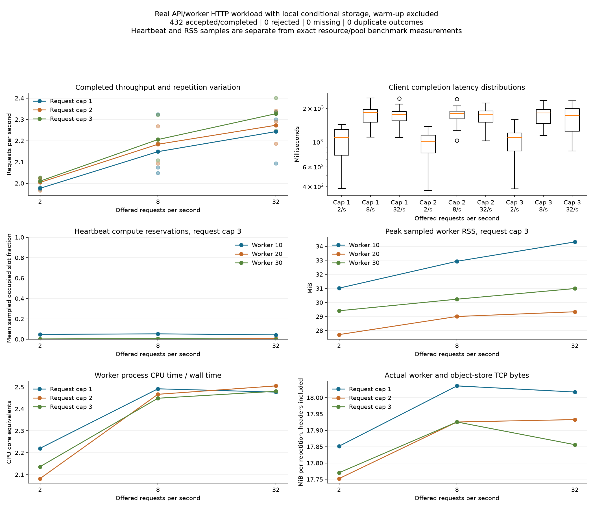

# Nabedra Database v0

Nabedra Database stores tables as immutable Parquet snapshots in S3. The Rust server
exposes HTTP or native HTTPS, and a synchronous Python ORM builds and sends
operations. Run the API and a local worker together with `serve`, or use
supervised API and worker processes for a cluster. The ORM requires Python 3.11+
and only the Python standard library at runtime. It needs the server URL and bearer token, not AWS credentials.
Standalone and supervised deployments support S3 with conditional writes. An
HTTP object backend supports local fixtures. Fixed mode binds data to one
database; serverless mode accepts authorized data-storage context from an
application server gateway. Run only one standalone `serve` process per
bucket/prefix; use the cluster deployment for multiple APIs/workers.

## Start here

- [Hands-on v0 tutorial](../TUTORIAL.md): start the server, build a task tracker,
  query data and reopen it after a restart.
- [Python ORM guide](../../orm/python/docs/reference.md): installation, connection, verified TLS,
  table operations, queries and errors.
- [Repository CLI and server gateway](cli-and-serverless.md): install once,
  supervise local workers, and attach authorized storage in a framework-independent
  application endpoint.
- [Server guide](reference.md): build and serve, environment configuration,
  HTTP requests, native TLS, health and shutdown.
- [Execution and recovery contract](../../plans/resource-aware-scheduling.md): worker
  resources, replicated requests, mutation publication and recovery.
- [Scheduler test contract](../../docs/testing/scheduler-contract.md) and
  [executed evidence](../../docs/testing/scheduler-evidence.md): acceptance cases,
  recorded results and verification boundaries.

## Run the server

Run commands from the repository root. Installation requires Rust 1.94.1 or newer
and Cargo. Python clients require Python 3.11+. You also need an existing S3
bucket and an AWS identity allowed to read and conditionally write objects
under your database prefix. The server does not create buckets.

Install the CLI and native server into an isolated environment:

```sh
python3.11 scripts/install_nabedra.py --prefix .nabedra
.nabedra/bin/nabedra --version --json
.nabedra/bin/nabedra database serve --mode fixed --storage s3://your-bucket/nabedra/ \
  --region eu-west-1
```

The installer builds the locked release binary once. Starting an installed
server invokes no Cargo. See the [CLI guide](cli-and-serverless.md) for
configuration, protected token files, shared compute and gateway middleware.

For direct native deployment, install the S3-enabled server from crates.io:

```sh
cargo install nabedra-database --version 0.1.1 --locked
nabedra-db --version
```

This installs the native server. Use the repository installer above for the
Python CLI and ORM as well. To build the native server from this checkout:

```sh
CARGO_BUILD_JOBS=2 cargo build --locked --release --manifest-path server/Cargo.toml
```

Configure the server environment. Replace the profile, region and bucket with
your own values, and supply a shared bearer token privately in `NABEDRA_TOKEN`:

```sh
export AWS_PROFILE='<configured-profile>'
export AWS_REGION='<bucket-region>'
export NABEDRA_S3_BUCKET='<existing-bucket>'
export NABEDRA_S3_PREFIX='nabedra-v0/'
: "${NABEDRA_TOKEN:?Set NABEDRA_TOKEN to your shared bearer token}"
server/target/release/nabedra-db serve --host 127.0.0.1 --port 8000 \
  --workers 4 --queue-size 64 --partition-size '64 MiB'
```

The AWS SDK also supports environment credentials and roles; omit `AWS_PROFILE`
when using those. AWS credentials belong on the server. Clients need only its
URL and bearer token. The server does not load `.env` or translate `BUCKET_NAME`
to `NABEDRA_S3_BUCKET`.

The command starts one API and one local worker with four shared compute
threads. `--workers` controls compute threads, not partition count or OS process
count. `--queue-size` supplies a legacy pending-request default; execution and
resource JSON files provide explicit count, byte, retention, CPU and memory
limits. See [server configuration](reference.md#configuration).

In a second terminal, check readiness and send a direct HTTP request. Supply the
same `NABEDRA_TOKEN` there:

```sh
curl --fail --silent --show-error http://127.0.0.1:8000/health/ready
request_id="$(python3.11 -c 'import uuid; print(uuid.uuid4())')"
curl --fail-with-body --silent --show-error \
  -H "Authorization: Bearer ${NABEDRA_TOKEN}" \
  -H 'Content-Type: application/json' \
  --data "{\"request_id\":\"${request_id}\",\"operation\":\"table.list\",\"payload\":{}}" \
  http://127.0.0.1:8000/v1/operations
```

An empty database returns `{"request_id":"<your UUID>","data":[]}`. The
unauthenticated `/health/live` route checks process responsiveness;
`/health/ready` checks a fresh catalog read. Readiness does not prove write access.

For native HTTPS, add `--tls-cert /path/to/server-cert.pem` and
`--tls-key /path/to/server-key.pem`. Bind a nonloopback address explicitly with
`--host` when serving other machines. Clients must trust the certificate's CA
and verify its hostname.

Stop with Ctrl-C or SIGTERM to stop admission and drain admitted work. After
that local worker exits, restart the same bucket/prefix with `--cold-start` to
fence the old run and open committed data with a new empty request queue.
Outstanding old requests are abandoned unless a durable mutation decision
proves they committed. Catalog format 6 is the only format; a catalog of an
older format is refused, not migrated.

For separate API and worker processes, use `nabedra-db api --config PATH`
and `nabedra-db worker --bootstrap PATH`. The API requires a supervisor
startup exchange and explicit object-storage configuration. Follow the
[cluster process guide](reference.md#cluster-process-acceptance) and
[provider configuration](../../docs/testing/provisioning-adapters.md) for enrollment,
heterogeneous workers, drain and optional autoscaling.

## Use the Python ORM

Install the client from PyPI with Python 3.11+:

```sh
python3.11 -m venv orm/python/.venv
orm/python/.venv/bin/python -m pip install "nabedra[database]"
```

With the server at `http://127.0.0.1:8000`, supply its bearer token privately in
`NABEDRA_TOKEN` and run this example with `orm/python/.venv/bin/python`. It uses a fresh
table name on each run and retains the table:

```python
import uuid
from nabedra import Database, col

db = Database(url="http://127.0.0.1:8000", mode="oltp")
users = db.create_table(
    "guide_users_" + uuid.uuid4().hex,
    {"id": str, "age": int, "active": bool},
    key="id",
)
users.insert_many([
    {"id": "alice", "age": 24, "active": True},
    {"id": "bob", "age": 17, "active": False},
])
rows = users.where(col("age") >= 18).select("id", "age").collect()
assert rows == [{"id": "alice", "age": 24}]
```

The Python distribution is `nabedra`; import it as `nabedra`. The `database`
extra selects the dependency-free ORM. For development, install the checkout
with `orm/python/.venv/bin/python -m pip install -e ./orm/python`.
`Database(url=..., mode="oltp")` also accepts `mode="olap"`. The mode is a
validated client workload preference; both modes currently use the same engine.
Pass `token=...` explicitly or let the client read `NABEDRA_TOKEN`. Construction
requires no network access; an operation without a token raises
`AuthenticationError` locally.

For HTTPS, the client verifies certificates and hostnames; use `ca_file` for a
private CA as described in the [ORM connection guide](../../orm/python/docs/reference.md#install-and-connect).

### Submit work and observe receipts

Table and query methods wait for their terminal response. To release the
connection while work runs, submit an operation and retain its receipt:

```python
receipt = db.submit("query.count", {
    "table_id": users.id,
    "query": {"select": None, "filter": None, "order_by": None, "limit": None},
})
print(receipt.run_id, receipt.request_id)
terminal = receipt.wait(timeout=30)
assert terminal.state == "succeeded", terminal.error
print(terminal.result)

# Recover the receipt later using the recorded identity.
reconnected = db.receipt(receipt.run_id, receipt.request_id)
```

The HTTP equivalents are `POST /v1/requests` with the same operation envelope
and `GET /v1/requests/{run_id}/{request_id}`. HTTP 202 confirms queue replication,
not mutation commit. Waiting or disconnecting does not cancel accepted work.
Query results expire after configured retention; durable mutation decisions
remain reconcilable. See [ORM receipts](../../orm/python/docs/reference.md#queue-receipts).

## Supported behavior and limits

Schemas have 1 to 128 nonnullable columns with exact Python types `str`, `int`,
`float` and `bool`. Integers are signed int64; floats must be finite. There is
no implicit coercion. Primary keys are unique `str` or `int` columns. Full rows
must contain all schema columns and no extras. Updates cannot change the key.

The ORM supports table creation, discovery and drop; row insertion, atomic
batch insertion, lookup, partial update, full-row upsert and deletion. Immutable
query builders support scalar comparisons, Boolean composition, projection,
one-column ordering, limit, collect, count and metadata-only explain. Reads
observe a fresh committed snapshot per call. Ordering defaults to ascending
primary key and uses that order to break explicit sort ties. Count includes an
explicit limit. Dropping and recreating a name creates a new identity; old
handles remain stale. See the [ORM guide](../../orm/python/docs/reference.md) for full API behavior.

Tables use immutable Parquet partitions ordered by primary-key range. Keyed
operations route to one partition; changed mutations rewrite only affected
files. Queries scan partitions on workers and combine results with global
ordering, primary-key tie-breaking, limit, projection and count semantics.
Requests share bounded compute and memory reservations. A replicated queue
retains accepted work while a worker keeps its copy. Mutations prepare private
replacement files and publish one conditional catalog update with a durable
request decision. A conflicting publication recomputes against the newer catalog.
Atomic batches remain single operations. See the
[execution and recovery contract](../../plans/resource-aware-scheduling.md) and
[verification evidence](../../docs/testing/scheduler-evidence.md).

For example, after configuring the server environment:

```sh
server/target/release/nabedra-db serve --workers 4 --partition_size '64 KB'
```

`--partition-size` is equivalent. `--workers N` supplies N persistent local
compute threads unless a resources file overrides it. Concurrent requests share
that ceiling, independently of storage partition count. Size inputs require
a positive integer and a case-insensitive `B`, `KB`, `MB`, `KiB` or `MiB` unit,
with optional whitespace. SI units use 1000; IEC units use 1024. `64kb`,
`'64 Kb'` and `64KiB` are valid. The default target and hard maximum are 64 MiB,
or 67,108,864 closed-file bytes including metadata; `64MiB` and `67108864B` are accepted.
A singleton may exceed a smaller target but never the hard cap. An impossible
file fails the whole mutation. Empty tables have `files: []`. A new size applies
to new or rewritten ranges; unchanged files are not automatically repacked.

Current publications use fenced catalog format 4. Legacy table layouts remain
readable after the explicit catalog migration described above. Reads and no-ops
do not rewrite legacy table data; an actual data change migrates that table to
partitions. See [storage and worker details](reference.md#storage-behavior-and-limits).
There is no SQL, joins, indexes, general transactions across calls, garbage
collection or remote execution. Dropping a table retains historical files and
orphan objects.

Requests and responses are limited to 8 MiB each, including their JSON envelope.
Batches and collected results are limited to 10,000 rows; tables are limited to
100,000 rows and 64 MiB of decoded row payload. Byte limits may be reached first, and
one partition must decode within a task's memory budget, which limits wide tables to fewer
rows (see [storage behavior and limits](reference.md#storage-behavior-and-limits)).
Partitions do not multiply these limits. Oversized results fail rather than
truncate. There is no pagination or streaming.

The ORM never retries automatically. An uncertain write may have committed even
if the caller saw a timeout or `UnknownOutcomeError`. Preserve its request UUID
and exact operation body. Repeating that identity attaches to the same logical
request; a different body conflicts. Reconcile through its receipt or durable
mutation decision before issuing a new logical write. An immediate old read
does not prove rollback. See
[uncertain-write handling](../../orm/python/docs/reference.md#errors-and-uncertain-writes).

Accepted requests live in replicated worker RAM. Individual API/worker failures
can recover while another complete request copy survives. A one-worker `serve`
deployment has only one copy. Stopping every worker abandons outstanding work;
committed rows and mutation decisions remain durable. The queue is never replayed
from object storage after a complete shutdown.

## Benchmarks and performance expectations

Use the recorded results below as a baseline for reproducing the supplied
workloads. There is no published release-build or AWS S3 throughput/latency
SLA, and adding workers has no promised linear speedup. Partition count, payload
size, storage latency, queue replication and concurrent requests affect results.
Batching rows into `insert_many` performs one atomic operation rather than one
publication per row, within the batch and byte limits above.

The [recorded B01/B02 measurements](../../docs/testing/evidence/resource-aware-scheduling/benchmarks.json)
were taken at commit `59ffcc7` on macOS x86-64 with eight logical CPUs and
16 GiB RAM, using unoptimized development builds. Each configuration had one
warm-up and three measured repetitions. The HTTP fixture used real API/worker
TCP and a local conditional SQLite object store, 64 seeded rows, 16 requests per
repetition and a 2 ms partition-read delay. Workers advertised 1/2/4 compute
threads and logical RAM ceilings of 8/12/20 GiB on the shared host. No OS CPU or
memory quota was installed; those logical ceilings do not certify physical RAM.

| Workload | Recorded result |
| --- | --- |
| B01 CPU pool, request node caps 1/2/3 | 498–586 jobs/s; 6.26–6.57 CPU core equivalents; mean worker slot occupancy 89.6–92.7%. |
| B02 mixed CPU/memory/socket pool, caps 1/2/3 and arrival intervals 0/250/1,000 microseconds | 783–875 jobs/s across measured configurations. |
| B02 HTTP, offered 2 requests/s, caps 1/2/3 | 1.98–2.01 completed requests/s; mean per-run p95 completion 1.23–1.42 s. |
| B02 HTTP, offered 8 requests/s, caps 1/2/3 | 2.15–2.21 completed requests/s; mean per-run p95 completion 2.00–2.06 s. |
| B02 HTTP, offered 32 requests/s, caps 1/2/3 | 2.24–2.33 completed requests/s; mean per-run p95 completion 2.00–2.11 s. |

These ranges span configurations and are not confidence intervals. HTTP
throughput includes authentication, the local proxy, polling and storage.
All 432 measured HTTP requests completed with zero client rejections, missing
or duplicate outcomes in the recorded run. Internal retries are reported
separately in the evidence. The small sample sizes limit tail-latency estimates.



The [evidence ledger](../../docs/testing/scheduler-evidence.md) includes CPU utilization
plots, p50/p95/p99 distributions, queue-wait bounds, sampled RSS versus charged
memory, network bytes and retry counts. The [test contract](../../docs/testing/scheduler-contract.md)
defines B01/B02 and the Q01/Q02 saturation assertions. Expected behavior is to
retain every accepted identity, respect CPU/memory caps, dispatch eligible work
when capacity frees and reject excess work explicitly before acceptance.

To reproduce the local benchmarks without AWS credentials, build the native
fixture targets and run the measurements sequentially with other load stopped:

```sh
export CARGO_BUILD_JOBS=2 CARGO_PROFILE_DEV_DEBUG=0 CARGO_PROFILE_TEST_DEBUG=0 CARGO_INCREMENTAL=0
cargo build --locked --manifest-path server/Cargo.toml --no-default-features \
  --bin nabedra-db --example resource_scheduler_benchmark
mkdir -p artifacts
server/target/debug/examples/resource_scheduler_benchmark --output artifacts/scheduler-pool-benchmark.json
python3.11 scripts/acceptance_scheduler_load.py --binary server/target/debug/nabedra-db \
  --suite benchmark --output artifacts/scheduler-http-benchmark.json
python3.11 scripts/summarize_scheduler_benchmarks.py \
  --pool artifacts/scheduler-pool-benchmark.json --http artifacts/scheduler-http-benchmark.json \
  --output artifacts/scheduler-benchmark-evidence.json
```

Use fresh output paths on subsequent runs. These commands measure the local
fixtures; the S3 latency runner below samples the configured cloud backend
separately. The figures above are historical evidence, not a new benchmark run
for this README change.

## Local verification

The [project rename evidence](../../docs/testing/rename-evidence.md) records checks for
the `nabedra` Python package, CLI and native server.

After the editable install, these commands run the ORM tests and local script
guards without using the supplied `.env` or AWS. The guard suite includes local
subprocess/loopback and TLS fixture cleanup checks. OpenSSL is required
for TLS fixtures; AWS CLI is required for live object inspection. Neither tool
is a dependency of normal ORM use.

```sh
PYTHONDONTWRITEBYTECODE=1 orm/python/.venv/bin/python -m unittest discover -s orm/python/tests -v
PYTHONDONTWRITEBYTECODE=1 orm/python/.venv/bin/python -m unittest discover -s scripts -p 'test_*.py' -v
```

After installing into `.nabedra`, exercise the installed CLI and client with a
local conditional SQLite object service:

```sh
python3.11 scripts/acceptance_nabedra.py \
  --binary .nabedra/bin/nabedra-db \
  --cli .nabedra/bin/nabedra --python .nabedra/bin/python
```

The runner checks 10, 100 and 1,000 rows, both client modes, token behavior,
graceful child cleanup and committed rows after a cold restart. It records its
assertions in `artifacts/rename/integration.json`. This is a local smoke subset
of C01/U01/F03/R04; it performs no AWS requests or full scheduler acceptance.

Run Cargo checks sequentially from the repository root, using `server/target`
and the checkout's disk-saving settings. These checks do not run live S3
acceptance; dependency installation may need network access on a new machine.

```sh
export CARGO_BUILD_JOBS=2
export CARGO_PROFILE_DEV_DEBUG=0
export CARGO_PROFILE_TEST_DEBUG=0
cargo fmt --manifest-path server/Cargo.toml --all -- --check
cargo clippy --locked --manifest-path server/Cargo.toml --all-targets -- -D warnings
cargo test --locked --manifest-path server/Cargo.toml
```

## Live acceptance and evidence

Live acceptance needs the installed ORM, a built server binary, AWS CLI and
OpenSSL. To build the debug binary, use the Cargo settings above:

```sh
cargo build --locked --manifest-path server/Cargo.toml
```

The sole allowed acceptance bucket is `meshdb-testing` in `us-east-1`. This is
an existing AWS resource name, retained across the project rename. The
prepared runners load the supplied repository `.env` through
[private configuration helpers](../../scripts/acceptance_support.py). They require
`BUCKET_NAME`, `AWS_REGION`, `AWS_ACCESS_KEY_ID` and `AWS_SECRET_ACCESS_KEY`,
plus `AWS_SESSION_TOKEN` for temporary credentials. Helpers map `BUCKET_NAME`
to `NABEDRA_S3_BUCKET` in private child environments and supply a bearer token.
Do not source, print or commit the dotenv file or credentials.

This strict acceptance configuration ignores ambient AWS profiles. The generic
server uses the standard AWS SDK credential and region chains, including
profiles and roles; it neither loads dotenv nor translates `BUCKET_NAME` itself.

Run these prepared runners sequentially. HTTP covers types, CRUD, queries
and atomic failures; lifecycle covers actual-process restart and verified native
HTTPS; concurrency covers independent clients, stale handles and retained
objects; latency samples single writes, batches and scans at modest table sizes.
The partition runner checks actual file sizes, routed mutations, global query
results and a restart from two to three workers in one retained namespace.

```sh
PYTHONDONTWRITEBYTECODE=1 orm/python/.venv/bin/python scripts/acceptance_http.py --scenario all --binary server/target/debug/nabedra-db
PYTHONDONTWRITEBYTECODE=1 orm/python/.venv/bin/python scripts/acceptance_lifecycle.py --scenario all --binary server/target/debug/nabedra-db
PYTHONDONTWRITEBYTECODE=1 orm/python/.venv/bin/python scripts/acceptance_concurrency.py --binary server/target/debug/nabedra-db
PYTHONDONTWRITEBYTECODE=1 orm/python/.venv/bin/python scripts/acceptance_latency.py --binary server/target/debug/nabedra-db
PYTHONDONTWRITEBYTECODE=1 orm/python/.venv/bin/python scripts/acceptance_partitions.py --binary server/target/debug/nabedra-db
```

Each run allocates fresh S3 folders named `test-<number>-<name>-<run-id>/` and
retains fixtures and snapshots. The partition runner allocates
`test-10-partition-workers-<run-id>/`. A restart reuses only its scenario's allocated
prefix. Never replay a recorded prefix, delete fixtures or create another bucket.
Each runner creates a fresh sanitized JSON report beneath the Git-ignored
`artifacts/` directory; `--report` accepts an unused alternative path. Keep
reports ignored and record the command, report location, outcome and exact
allocated prefixes in a tracked note under [scripts/notes/](../../scripts/notes).
Retain failure reports as well as successful reports, without private logs or
credentials. Latency samples provide no throughput or scaling guarantee.

Recorded live evidence is available for [HTTP/S3 acceptance](../../scripts/notes/E02.md)
and [restart/native HTTPS acceptance](../../scripts/notes/E03.md). Consult the
[scheduler evidence ledger](../../docs/testing/scheduler-evidence.md) for current
execution and recovery evidence. The [partition acceptance run](../../scripts/notes/PW-E02.md)
passed all 53 checks, including actual file sizes and restart with a different
worker count.
