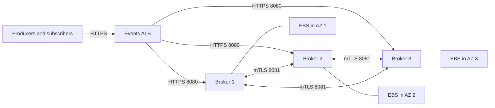

# Run Events on AWS

The Terraform configuration in this folder creates an HTTPS Application Load
Balancer (ALB) and, for each broker ID, one private EC2 instance with its own
encrypted EBS volume. Terraform manages the volume separately from the
instance, so you can replace a host and keep its disk. Each broker's private
DNS name also stays the same when its host is replaced.

Start with three metadata voters in different Availability Zones, and create
production topics with replication factor 3. The OLAP cluster and the sink run
on their own hosts, with their own storage and credentials.



## Provision the brokers

1. Bring an existing VPC with at least three private subnets for brokers, an
   ALB subnet in each broker zone, a private Route 53 zone associated with the
   VPC, and a client hostname with a matching regional ACM certificate. The
   private hosts need network access to their regional S3 artifacts, Secrets
   Manager and SSM. Operators connect through SSM sessions. The instance
   security group allows only the ALB to reach TCP 8080, and only other brokers
   to reach TCP 8081.
2. Choose an EC2 Nitro AMI that can run the broker binary. The packaged image
   is built on Debian 12. To install on the host instead, use a Linux AMI with
   cloud-init, systemd, AWS CLI v2, the SSM Agent, Bash, jq, util-linux and the
   XFS tools. The broker has no C++ dependencies. Upload the binary to a private S3 key that you
   never overwrite, and record its SHA-256.
3. Create one Secrets Manager secret per broker. Every secret in the cluster
   has the same cluster UUID, grant and session signing rings, peer CA and peer
   token, but each broker gets its own peer credential. A broker's server
   certificate must list `broker-<id>.<peer-zone>` as a DNS SAN. Issue its
   outgoing client certificate from a trusted peer CA, with client-auth usage.
   The [secret shape](#secret-shape) section lists the fields.
4. Copy [the example inputs](terraform.tfvars.example) to a local tfvars file
   and replace the sample values. Set `format_blank_volume=true` only for disks
   you mean to format. For the first deployment, set the genesis flag in the
   secret of the broker with the lowest ID among the metadata voters, and leave
   it false everywhere else.
5. Run `terraform init`, review `terraform plan`, and apply the plan you
   reviewed. Check that all three targets are healthy, then read the committed
   metadata voter list from `/v1/admin/groups/metadata`. Once bootstrap is
   done, clear the genesis flag and the formatting flags. When the genesis
   broker's two peers are healthy, restart it with the updated secret.

Cloud-init installs the service and records which EBS volume ID the host
should have. On every start, the host checks the disk serial, mounts the
filesystem at the broker's data directory, verifies the binary's checksum and
fetches the current secret. It formats a blank disk only when you asked for
it, and clears the local format flag after mounting. The broker runs as a
non-root user and opens its `nabedra-kv` store only after its own data
directory is mounted.

If the store hits a storage fault, the broker stops accepting writes and exits
with code 75. The systemd unit has `Restart=on-failure`, so the broker restarts
after 10 seconds and recovers the store when it reopens it. Alert on repeated
restarts, since they point at a failing disk.

When Terraform moves a volume, it stops the old host before detaching the
disk. It also refuses to destroy the registered data disks while this
configuration manages them.
[Stable EBS device identification](https://docs.aws.amazon.com/ebs/latest/userguide/identify-nvme-ebs-device.html) · [Terraform volume attachment options](https://registry.terraform.io/providers/hashicorp/aws/latest/docs/resources/volume_attachment)

Clients see the ACM certificate on the ALB, and the ALB also uses HTTPS to
reach each broker. Brokers accept client traffic only from the ALB's security
group. Brokers talk to each other over mutual TLS with the private CA, and on
top of that check the cluster credential on every HTTP request. When you
replace a host in place, keep its peer DNS name and the cluster UUID.
[ALB HTTPS target connections](https://docs.aws.amazon.com/elasticloadbalancing/latest/application/load-balancer-target-groups.html)

### Secret shape

Each secret is a JSON object with these fields. PEM strings keep their line
breaks.

| Field | Contents |
| --- | --- |
| `peer_token` | Random cluster token shared by every broker, 32 to 256 printable ASCII characters |
| `keyring` | `cluster_id` and separate `grant` and `session` signing rings |
| `initialize_new_cluster` | Boolean, true only for the broker that starts a brand-new cluster |
| `public_cert`, `public_key` | PEM server chain and key for the listener the ALB connects to |
| `peer_ca` | PEM root chain that verifies private client and server connections |
| `peer_cert`, `peer_key` | PEM server chain and key for this broker's peer listener |
| `peer_identity` | PEM client chain and private key this broker uses to connect to peers |

Each signing ring looks like
`{"active":"v1","keys":[{"id":"v1","secret_hex":"…","accept_until_ms":…}]}`.
Use a random secret of 64 hexadecimal characters and an expiry in the future,
in epoch milliseconds.

Keep secret values out of Terraform inputs. Each broker's role can read only
its own secret and the binary. A separate backup policy is exported as
`backup_operator_policy_arn`, for you to attach to an authorized operator role.

## Scale and replace brokers

**Adding a broker.** Give it a new ID, its own EBS volume and certificate, and
a bootstrap config that points at the existing cluster. Keep its genesis flag
false. If the live catalog doesn't know that ID yet, register it with
`add_broker`. Then spread data onto it with `rebalance`, or place partitions
yourself with `move_partition`, and check the published voters and applied
indexes. Metadata voters move separately, with `move_metadata`. Partitions keep
their IDs throughout.

**Retiring a broker.** Wait for `drain` to finish, and check that every group's
new membership has committed. Then set `provision_instance=false` for that ID
and apply. Keep its entry in the map so that its data volume stays.

**A failed host whose EBS volume is fine.** First make sure the old host is
stopped and fenced. Then replace that broker's EC2 instance in the same
Availability Zone and reattach its recorded volume. The broker reopens its
metadata and topic data from that disk. Check its ready response and its Raft
applied indexes before the next maintenance step. Never force-detach a disk
that is still attached to a live host.

**A lost disk or zone.** Keep the surviving quorum running, and add a broker
with a new ID and a fresh volume in the recovered or replacement zone. While
the quorum is still available, move the affected metadata and partition
replicas to the new broker. Wait for it to catch up, and confirm that the
committed membership spans three zones again. Only then take the unavailable
broker out of traffic.

If a group has lost quorum, first try to recover its original disks from their
hosts or volumes. If that fails, restore a verified backup into a fresh
cluster. Restarting an empty group can't bring back its committed history.

## Back up and restore

Take backups while metadata membership is stable and every group has quorum.
Run the export on a broker or another authorized private host, using the
broker binary and a config that has private peer credentials. The host needs
scratch space for the snapshots it receives from brokers and for the bundle
itself. The CLI compares the layout before and after the export, and records a
committed cut for each group. Each group's cut is taken at that group's own
applied index, so together the cuts don't describe a single moment in time.

```sh
bundle=/srv/events-backup/orders-2026-11-17T2000
config=/etc/nabedra-events/current/broker.json
nabedra-events backup --config "$config" --output "$bundle"
destination="s3://$backup_bucket/$backup_prefix/${bundle##*/}"
aws s3 cp --recursive "$bundle/" "$destination/" --exclude manifest.json \
  --sse aws:kms --sse-kms-key-id "$backup_kms_key_arn"
aws s3 cp "$bundle/manifest.json" "$destination/manifest.json" \
  --sse aws:kms --sse-kms-key-id "$backup_kms_key_arn"
```

Give every run its own prefix, and upload the manifest last, after the images.
Store backups in a versioned, encrypted bucket with a retention policy that is
separate from event retention. Monitor how old the latest backup is, and record
each run's partition cuts and export time. When you rehearse a restore, time
the download and checksum verification, provisioning and mounting, leader
election, and the point at which the expected events and checkpoints are
readable.

To recover, download the whole bundle and prepare an offline target cluster.
It needs empty mounted disks, a new cluster UUID and new keys, and the same
broker IDs, placements and zones that the manifest records. The original
broker IDs, zones and metadata voters must match the manifest, but private DNS
can point at the new hosts. Set `start_broker=false` for each new EC2 instance,
so that cloud-init mounts and configures the disk without starting the broker.
Use a separate client hostname until you have verified the recovery. Leave the
genesis flag false on the target, and run restore on every target broker:

```sh
nabedra-events restore --config "$config" --backup "$downloaded_bundle"
```

Run restore as the same user that owns the broker's disk. Then enable and
start `nabedra-events.service` on every restored broker, check that every group
is healthy, and replay representative checkpoint ranges against the expected
cuts. Only then point client DNS at the new cluster, and issue new credentials
for it. Record the actual RPO from the cuts, and the RTO from the start of
recovery until clients can use the cluster again.

## Rotate credentials and upgrade

**Signing keys.** Rotating a grant or session signing key takes two rolling
restarts. In the first, add the new key to every broker's accepted keys while
the old key stays active, one broker at a time. In the second, switch the
active ID to the new key. Keep the old key accepted until every grant and
delivery it signed has expired, plus an allowance for clock skew. Reissue
scoped grants before they expire.

**Peer certificates.** Roll these out in the same order. First trust both the
old and the new CA, then roll out the new server and client certificates, and
finally remove the old CA.

**Peer token.** The shared peer token holds only one value, so changing it
means restarting every broker together. Schedule that restart when your
backups are current, and stop producers from publishing until the brokers have
quorum again.

**Binary upgrades.** First test the new version alongside the old one on a
separate cluster, including the wire protocol, the disk format, snapshot
transfer and reopening a kept volume. Take a backup before you start. Then,
one broker at a time, update the artifact key and checksum and either replace
that EC2 instance explicitly or put the verified binary on the host through an
operator session. Changing the user data alone doesn't touch hosts that are
already running. Keep each broker's volume and ID, and wait for its target
health, leader elections and applied indexes to settle before you move on to
the next broker. If the new version writes a disk format the old one can't
read, roll back by restoring the old binary and a compatible backup to a fresh
cluster.

## Monitor the service and size disks

Probe `/readyz`, and sample the operator status of individual groups and
partitions as well. The ALB can keep serving healthy routes while one
partition has lost quorum, so a healthy load balancer doesn't mean every
partition is up.

Collect these metrics:

- publish and subscribe latency, overload responses and unknown outcomes
- request load, CPU and memory per broker
- leader and follower applied indexes
- lag, meaning a partition's tail minus a subscription's checkpoint
- failed backups and free space on each volume
- clock offset between brokers

Read them alongside the ALB's latency and target health and the EC2 and EBS
I/O, network and disk metrics. Track traffic between zones when you size RF3.
Measure performance and recovery targets for each workload, under the
retention, replica count and failure scenarios you actually plan to run.

Brokers refuse publishes with HTTP 507 when free space on the data volume drops
below `min_free_disk_bytes` (128 MiB by default) plus the room the store keeps
for two journal segments and one compaction. At default settings that adds up
to 576 MiB. Checkpoints and replication keep working below that line.

To size a disk, estimate the encoded bytes each partition retains from the
payload sizes, event rate and retention time, then multiply by the number of
replicas assigned to the broker. On top of that, measure the extra space and
I/O used by storage compaction, journal segments, snapshot staging and replicas
catching up. Leave enough headroom for a replacement broker to catch up while
producers keep publishing. When a single partition leader saturates, add
partitions for keys that can be ordered independently.
