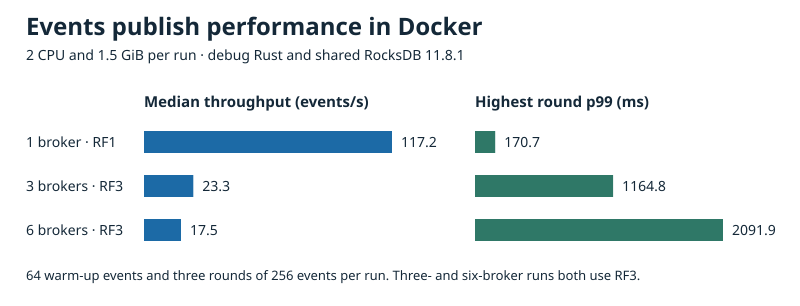

# Events broker acceptance

The recovery matrix used Docker image
`sha256:524b09a5e5aeade937ea25d9fd6772e2baafc16e13b4a933050ac25838040645`,
a debug Rust build linked against vendored RocksDB 11.8.1. The runner
checked available VM memory before each case and ran one fixture at a
time. Each fixture had an aggregate cap of 2 CPUs and 1.5 GiB across its
brokers and any temporary relay or restore container. [Build provenance](build.md)

| Plan ID | Executed observations |
| --- | --- |
| EV01–EV03 | Exact HTTP size limits, typed scope and body rejections, atomic batches, concurrent deduplication, unread publish replies, lease expiry and fencing, and retention reset. RF1 recovered 18 events and a checkpoint after a process restart. Under low disk, publishing returned 507 while a checkpoint advanced. Five requests passed the HTTP 100-continue barrier and held the publish slots, after which another publish received 429 with Retry-After and a checkpoint still advanced. [RF1 evidence](rf1.json) |
| EV07 | Wrong-ingress publish reached a quorum. A later-term leader preserved an unread committed receipt and the consumer checkpoint. An isolated RF3 leader returned 503 while an independent RF1 partition advanced on the same process. After all three processes stopped, their original mounts recovered the committed log and checkpoint. [Quorum evidence](quorum.json) |
| EV08 | RF1 promoted to RF3 after snapshot transfer. A learner restarted after storing a partial image, and a new controller finished a pending move. The retired voter rejoined at snapshot index 1049, after the historical RF1 snapshot at 1023. Six brokers rebalanced, appended partitions, drained the former voter, and replayed all 1,030 committed events with their original identities. [Growth evidence](growth.json) · [Initial failed run](growth-initial-failure.json) |
| EV10 | Verified checksums for the metadata cut and two partition cuts. A corrupted bundle was rejected. A fresh cluster identity and three new mounts restored the existing checkpoints, unacknowledged suffixes and deduplication positions. Local mTLS and key rotation preserved an existing grant, lease and delivery token across six rolling restarts. [Backup and restore](backup.json) · [TLS and rotation](tls.json) |

## EV09 local load

These measurements used the earlier shared-library debug image
`sha256:630389e108220d346d14344f4e3a8bac02c303895e50f8d88b084ba7df76c944`
with RocksDB 11.8.1 and a 2 CPU and 1.5 GiB cap per topology.

Each topology used 64 warm-up events and three measured rounds of 256 events
with identical 512-byte padding and eight concurrent publishers. Fast
subscribers made checkpoint progress during publishing, and slow subscribers
replayed independently afterward. Throughput includes the overlap barrier
and producer retries. Poll timing includes poll retries. JSON records retry
responses, per-partition lag, process RSS, cgroup memory, disk file sizes,
and local network activity. The 3- and 6-broker runs both used RF3.

[1-broker measurements](load-1.json) · [3-broker measurements](load-3.json) · [6-broker measurements](load-6.json)

EV06 and the cloud portions of EV10 remain unverified. The load measurements
exclude real cross-zone traffic, long-duration load, and mixed-version upgrades.
